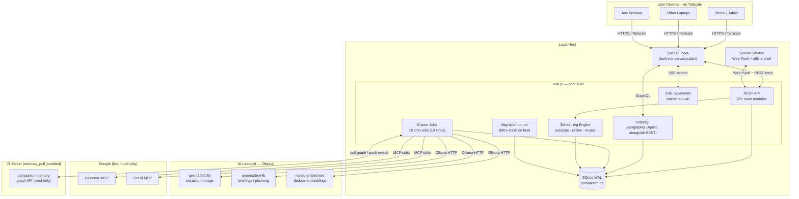
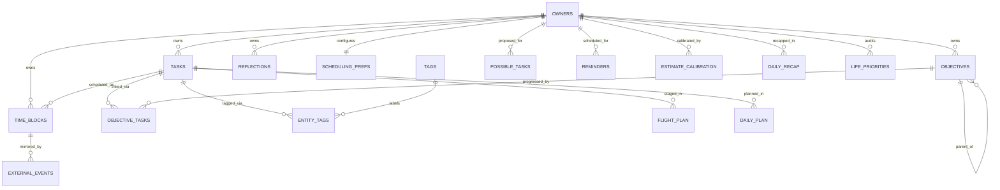
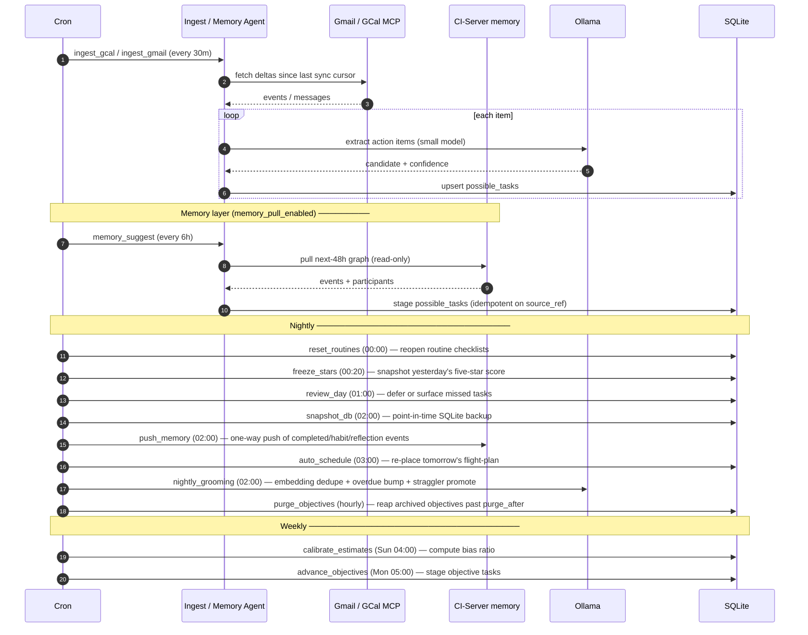
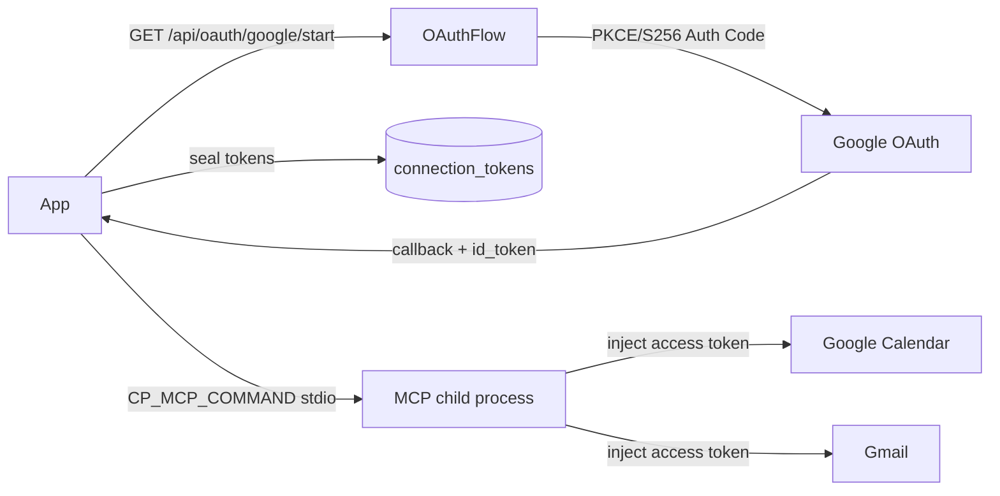
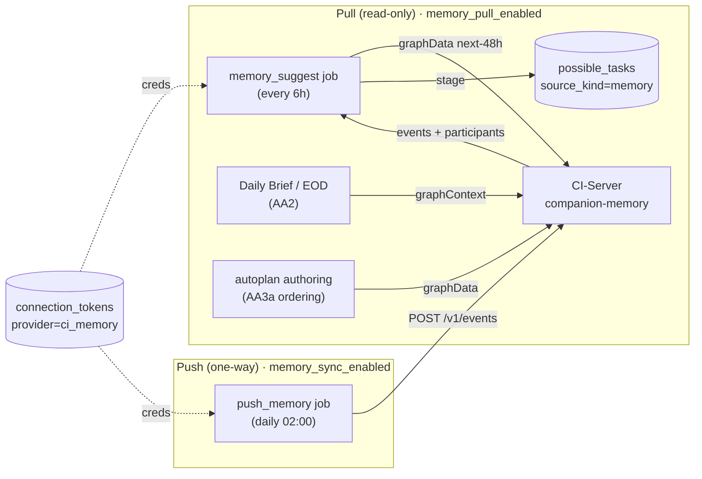
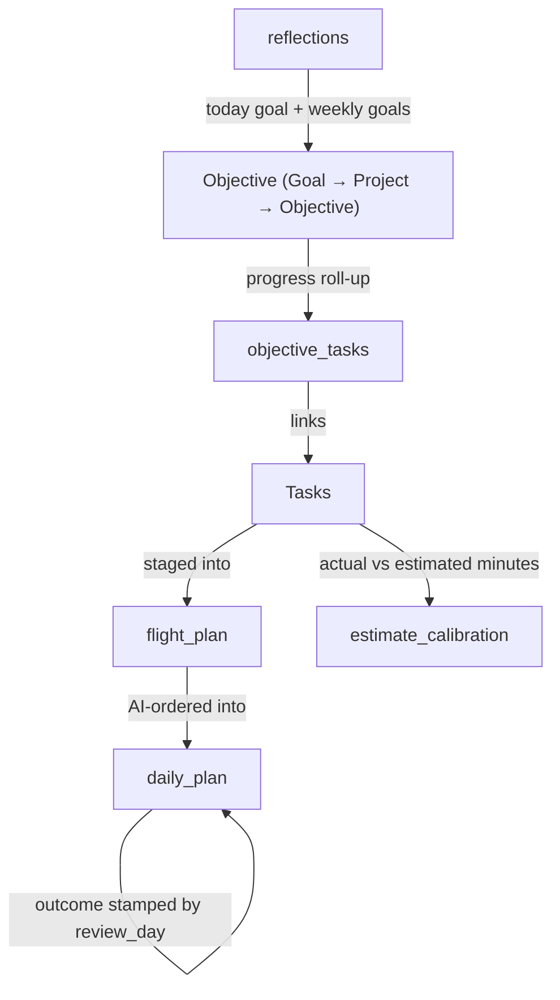
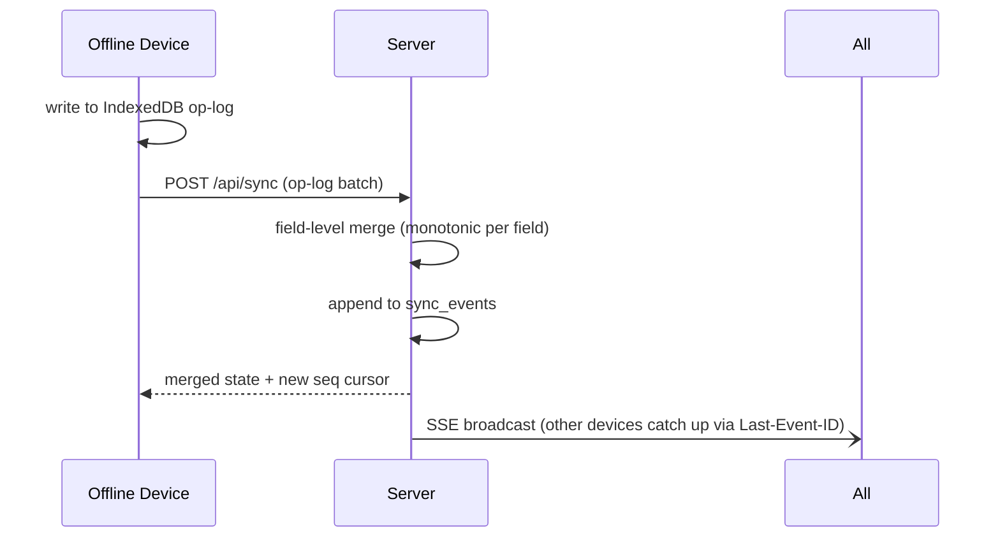

# Companion Planning — Architecture Reference

**Status:** Living document · last updated 2026-07-16 · migration head `0130`

> This document describes the **as-built** system — what is actually running, not what was planned. For future phases, see [docs/ROADMAP.md](docs/ROADMAP.md).

---

## 1. Project overview

Companion Planning is a **local-first, AI-assisted personal planning system**. It runs as a private server on a laptop or desktop, reachable from any device over Tailscale, stores everything in local SQLite, and uses a local LLM (Ollama) for briefings, task extraction, grooming, and auto-scheduling. No cloud required; no account.

**Shipped phases (A → AG, plus the post-AG work in §1.1; migration head 0130):** Tasks + scheduler · Rich semantics + time tracking · Recurrence · Calendar grid · Time-blocks + patterns + cockpit · Notifications + Web Push · Backups + export/import + audit · Identity + auth + connector infrastructure · Two-way calendar sync (Google) · Google OAuth 2.1 + MCP · AI scheduler + reactive reflow · Multi-device sync + offline writes · Life-planning layer (objectives, reflections, weekly review, calibration) · **Phase O — the gamified five-star day** (FOCUS card with linked/freeform focus + Today's Brief pop-up, a day note, `computeStars()` + nightly-frozen `daily_recap` stars, calendar heatmap; the standalone Morning Briefing section is retired) · **Phase P — planner hygiene** (a shared `clear-range` engine behind the CLI, `POST /api/planner/clear`, and a `recurrence_horizon_days` setting that bounds + auto-prunes both recurrence engines) · **Phase Q — schema hygiene** (FK enforcement guaranteed on every connection via a shared `openDb()`, FK-path index coverage, and owner-identity integrity rebuilds of `flight_plan` and `daily_summaries` — pre-multi-tenant) · **Phase S — schema consolidation** (dropped the dead `plan_outcomes` table + its cron; merged `daily_summaries` + `day_stars` into `daily_recap`; `pattern_prefs` + `category_prefs` into `tag_prefs`) · **Phase T — multi-tenant owner-scoping** (every table + route + service scoped to `owner_id`; owner-less rows retired) · **Phase U — CI-Portal OIDC + local auth** (session-cookie login: OAuth 2.1 + PKCE relying-party, or `DISABLE_OIDC` local username/password) · **Phase V — password reset** (single-use tokens; `session_epoch` invalidation) · **Phase W — GraphQL CRUD layer alongside REST** (complete; see §6a) · **Phase X — MCP intent vocabulary** · **Phase Y — env-config** (every env var documented; `server/.env.example`). Also in this window: task placement lifecycle (open↔scheduled), task→objective auto-promotion with height-based leveling, block-template application, and objectives joining the multi-device sync layer (0085–0087).

**Phase Z Time-Sense** (a Focus Ritual + estimate-calibration loop — EOD alignment, daily-brief fold-in, "Keep working"/"Schedule again", focus-cue reminders + vibrate, per-cue prefs, suggest-only estimate chip, voice loop) has **landed behind the `time_sense_enabled` master flag** (flag-off = behavior-neutral; migs 0106–0109). The **calendar / UI feedback waves** have also landed (QuickAdd mounted in Today, Planner de-scroll, Flight-Plan tabs + saved-blocks + search, three-axis calendar tag filter, container-outlines + click-to-add, select-date → day-type picker, collapsed night hours).

**Phases AA–AE** (2026-07, migs 0113–0117) close out the current line:
- **AA — Memory-aware agentic layer** (CI-Server `companion-memory`, pull-first, behind the `memory_pull_enabled` flag): a read-only connector (`connectors/memory.ts`, fixture/live), the `memory_suggest` agent that stages next-48h events as Inbox suggestions, a memory-informed Daily Brief (AA2), memory-aware autoplan ordering + a history-based default estimate for memory-drafted tasks (AA3a/AA3b), and a one-way `push_memory` background sync (AA4). Flag-off = byte-identical.
- **AB — Natural scheduling** (`scheduled_for`/`task_time` are START intent that drives placement; `due_at` is a deadline only).
- **AC — Today + Tasks UI overhaul** (Today: single header row — Today's Brief · Focus bullseye · Note as popovers; FAB restored; DUE collapsible. Tasks: task-chip redesign with a merged direction-icon/done toggle, Routine grouping by routine, end-of-day archive, and a midnight `reset_routines` job that reopens routine checklists).
- **AD — Calendar reliability** (`task_time` honored across quick-add + flight-plan; container→task direction inheritance; Alt-drag free placement).
- **AE — Reflow correctness** (snapshot-based reactive reflow: the clear set equals the re-place set, so a task edit can no longer wipe other auto-placed blocks; placement status parity; not-before-now clamp; locked-block guards). See §6.

**Phases AF–AG + ship-readiness** (2026-07, migs 0118–0126) — note 0119 is an intentional gap (see `migrations/index.ts`); the line continues past AG in §1.1:
- **AF — Task management** (migs 0120/0121): Objectives surface as a **tab inside `/tasks`** (URL-synced `?focus`), tree API returns tasks-per-leaf, quick-add subtask, assign-to-objective on the task card. **The Inbox surface is retired** — ingested `possible_tasks` are deduplicated inline and **auto-promoted** into Tasks (no manual triage), surfacing in a date-derived **New Today** section until owner-local midnight; `/inbox`, `/objectives`, `/patterns`, `/routines` are now redirects/tabs, not standalone views. Includes **AF-11 tag unification** (routine-tag cleanup 0120, task-intention level move 0121).
- **AG — Multi-tenant RBAC** (mig 0125): `owners.role` drives scopes at one choke point (`lib/auth/scopes.ts` `roleToScopes`, unknown role → read-only), replacing the hardcoded `[READ, WRITE, ADMIN]` triple. Three roles — `operator` (R+W+A) · `member` (R+W) · `viewer` (R); existing owners backfill to `operator`, OIDC auto-provision defaults to `member` (closes the auto-admin hole). Operator-gated `routes/accounts.ts` (`GET/POST/PATCH/DELETE /api/accounts` + `/:id/invite`) creates/manages accounts via password-less invite + reset-token link.
- **Ship-readiness + hardening** (migs 0122–0124, 0126): seeded developer identity scrubbed (0122); dead `auto_mode` column dropped, top-bar Suggest/Schedule toggle repointed to `trust_mode` (0123); in-app Google connection setup + auto-provisioned Web Push VAPID keys via the `app_config` table (0124); base **category** tags (Personal / Professional / Social) seeded (0126). License corrected to **CI-Commercial-1.0** (not MIT).

## 1.1 Post-AG work (2026-07-14 → 07-16, migs 0127–0130)

Two tracks landed after the AG close-out. Neither has a phase letter; both are current head.

**Life priorities + the Priorities Wizard** (migs 0127/0128, #356). A `life_priorities` row per `(owner, category)` captures a self-audit — `satisfaction` (1–10), `importance` (1–10), `target_hours_per_week`. It backs two routed views: **`/priorities`** (the wizard) and **`/balance`** (the dashboard). `scheduling_prefs.sleep_hours_per_week` (0128, default 63 = 9h × 7) reserves sleep as unschedulable, so the wizard's weekly pool is `168 − sleep_hours_per_week`. Self-contained: no `task.category`, and no scheduling boosts yet.

**Objectives archive + 48h purge** (migs 0129/0130, #366 and follow-ups #367–#372). **`DELETE /api/objectives/:id` no longer hard-deletes — it archives.** This is the single most load-bearing behavioral change in this window, and the invariant it rests on is easy to break:

- **Soft delete.** `archived_at` is stamped; the row is kept indefinitely. `status` is untouched — the archive is **orthogonal to status**, which is what makes restore lossless (and why a cadence job must check `archived_at`, not just `status='active'`).
- **The cascade.** Archiving fans out over the **live** subtree in one transaction, stamping each descendant's `archive_root_id` so the subtree restores as a unit (`cascadeArchiveToDescendants`). Atomicity is required, not nice-to-have: **`buildTree` roots any node whose parent is filtered out**, so a live child left under an archived parent silently resurfaces as a top-level goal.
- **THE INVARIANT: no live objective may have an archived parent.** Every read path filters `archived_at IS NULL`; every write path refuses an archived parent (`liveParentExists` → `parent_not_found`); the sync path clamps to it (§12).
- **Purge is separate and explicit.** `PURGE_WINDOW_HOURS = 48`. `POST /:id/purge` stamps an absolute `purge_after` deadline across the subtree; `DELETE /:id/purge` cancels it. The hourly `purge_objectives` job (0130) reaps rows past the deadline — the only path to permanent removal.
- **Routes:** `GET /api/objectives?archived=1` (flat archive list — an archived subtree is not a renderable tree), `POST /:id/restore` (root-only; a cascaded member must restore from its root), `POST /:id/purge`, `DELETE /:id/purge`.
- **Exception — auto-generated scaffolding is still hard-deleted.** `unpromoteIfEmpty` / `dropSourceObjective` (`services/task-promotion.ts`) `DELETE` a *pristine* auto-promoted objective rather than archiving it, so the archive doesn't fill with rows the owner never chose to create. Guarded by `isPristine` (top-level, no sub-objectives).

---

## 2. Tech stack

| Layer | Choice | Notes |
|---|---|---|
| Frontend | **SolidJS** + Vite | Fine-grained reactivity, small bundle |
| Styling | Tailwind + shadcn-solid / Kobalte | CI-Hub design tokens; dark-first |
| Backend | **Koa.js** (Node ≥22) | Minimal async middleware |
| DB | **SQLite** via `better-sqlite3` | WAL mode, embedded, zero-ops |
| Migrations | Plain TypeScript functions | Sequential, idempotent; `_migrations` table |
| ORM | **Drizzle ORM** + raw `better-sqlite3` | Typed schema; raw SQL for hot paths |
| GraphQL | **Apollo Server 5** + `@as-integrations/koa` | Schema-first SDL at `POST /api/graphql`, alongside REST; custom complexity limiter; `graphql@16` (Phase W, complete) |
| LLM runtime | **Ollama** (local) | Graceful degradation when offline |
| MCP | `@modelcontextprotocol/sdk` | Gmail + Google Calendar over OAuth |
| Cron | `croner` + `scheduled_jobs` table | Persistent job registry |
| PWA | `vite-plugin-pwa` | Offline shell + service worker; Web Push (VAPID) |
| Auth | Session-cookie login (OIDC/PKCE RP + local argon2id) + hashed API-key | Mints a signed, httpOnly cp_session on sso login; hashed x-api-key for standalone; no per-request Bearer |
| Crypto | AES-256-GCM (`CP_KEK_B64`) | OAuth tokens sealed in `connection_tokens` |

---

## 3. High-level system diagram



---

## 4. Repository layout

```
Companion-Planning/
├── client/                   SolidJS PWA
│   └── src/
│       ├── components/       Shared UI components
│       ├── views/            One file per route (Today, Focus, Calendar, Priorities, Balance, …)
│       ├── stores/           Solid signals/resources shared across views
│       ├── sw/               Service-worker source (Web Push + offline shell)
│       └── lib/              api.ts · dates.ts · objective-promote.ts
├── server/
│   └── src/
│       ├── db/
│       │   ├── migrations/   0001_baseline → 0130_purge_objectives_job (0119 is an
│       │   │                 intentional gap — see index.ts; do not "fix" it)
│       │   └── index.ts      BetterSqlite3 open + uuid7 UDF + runMigrations
│       ├── engine/           autoplan · review · reflow (auto-defense) · flight-plan
│       ├── routes/           REST controllers (one file per resource)
│       ├── graphql/          Apollo schema-first SDL + resolvers (Phase W, alongside routes/)
│       ├── sync/             apply.ts — the field-LWW merge engine (§12)
│       ├── jobs/             Croner job definitions (19 kinds; 18 cron-scheduled)
│       ├── services/         ~27 modules — the shared owner-scoped layer REST + GraphQL
│       │                     both call (tasks · blocks · objectives · task-promotion ·
│       │                     priorities · stars · timer · vapid-config · …)
│       ├── connectors/       Google OAuth 2.1 + Calendar/Gmail MCP bridge · CI-Server companion-memory (memory.ts)
│       ├── mcp/              MCP client/session for the Google tool surface (Phase X)
│       ├── agents/           ingest · groom · sync reconciler · memory-suggest · plan (authoring)
│       ├── cli/              operator scripts (clear-range, …)
│       └── lib/              config · crypto · dates · tz · logger · ids · auth/scopes
├── docs/                     ROADMAP · GLOSSARY · phase specs · diagrams
└── ops/                      litestream.yml · launchd plist
```

---

## 5. Data model

### 5.1 Entity-relationship overview



> `OBJECTIVES ||--o{ OBJECTIVES : parent_of` is the **live** tree only. An archived node
> (`archived_at` set) keeps its `parent_id` and its `objective_tasks` links — nothing is
> severed — but every read path filters it out. See §1.1.

### 5.2 Key tables

| Table | Purpose | Added |
|---|---|---|
| `owners` | User identity — auth columns `external_subject`/`username`/`password_hash` (0101), reset columns `backup_email`/`session_epoch` (0103) | 0001, 0101, 0103 |
| `tasks` | Core work atom — UUIDv7 PK, status, priority, subtype, recurrence | 0001 |
| `task_dependencies` | Blocked-by edges between tasks | 0005 |
| `time_entries` | Actual work logged per task; running timer = `ended_at IS NULL` | 0007 |
| `time_blocks` | Named time spans — task · meeting · focus · break · buffer; `owner_id` NOT NULL (0099) | 0015, 0099 |
| `block_templates` | Reusable Time-Block templates with saved task lists | 0022 |
| `flight_plan` | Two-step Auto staging tray — task list ordered before scheduling; `owner_id` `TEXT NOT NULL` (0093) | 0016, 0093 |
| `daily_plan` | AI-authored task order for a day (`outcome` stamp for plan tracking) | 0062, 0084 |
| `replan_suggestions` | Pending "re-plan with AI?" nudges on big-disruption reflows | 0067 |
| `possible_tasks` | Inbox — AI-proposed items pending promote / dismiss; owner-scoped `(proposed_owner_id, source_kind, source_ref)` uniqueness (0114) + `proposed_estimated_minutes` (0114) + `proposed_scheduled_for`/`proposed_task_time` START intent (0115) | 0001, 0114, 0115 |
| `tags` | Cross-cutting labels; `kind`: `direction` or `intention` or `category`; `owner_id` (0100) | 0001, 0100 |
| `tag_directions` | Many-to-many: intention tags grouped under direction tags | 0043/0105 |
| `entity_tags` | Polymorphic tag store for tasks, blocks, routines (CON-3); `created_at` NOT NULL DEFAULT CURRENT_TIMESTAMP (0110, table rebuilt) | 0033, 0110 |
| `patterns` | Routines — typed, reusable task collections (Habit ◯ / Routine ▢) | 0013 |
| `pattern_types` | Routine taxonomy — **load-bearing, do not rename** | 0019 |
| `pattern_tasks` | Routine ↔ task many-to-many | 0013 |
| `pattern_blocks` | Direction-scoped scheduling windows (workday/weekend) | 0037 |
| `tag_prefs` | Per-owner × per-tag config by `kind` (direction/category): shared color_token/default_minutes + direction-only auto_fill/reminder_offsets/icon_shape; merged `pattern_prefs` + `category_prefs` | 0039, 0069, 0097 |
| `scheduling_prefs` | Work hours, focus/break bounds, model overrides, feature flags, `recurrence_horizon_days` (default 7), `time_sense_enabled` (0106) + per-cue focus prefs `focus_ritual_enabled`/`haptic_cues_enabled`/`ambient_color_enabled`/`calibration_loop_enabled`/`z_experiment_arm` (0108), `view_prefs` cross-device calendar view-state (0111), `memory_pull_enabled` master flag for the CI-Server memory layer (default 0, 0113), `sleep_hours_per_week` (0128, default 63 = 9h × 7 — reserved as unschedulable; the Priorities Wizard's pool is `168 −` this) | 0001, 0091, 0106, 0108, 0111, 0113, 0128 |
| `scheduled_jobs` | Croner job registry (name, cron, enabled) | 0001 |
| `job_runs` | Execution log per run (status, items created/updated, log text) | 0001 |
| `reminders` | Scheduled reminders — fired exactly once by the 1-min dispatcher | 0044 |
| `push_subscriptions` | Web Push endpoints per owner (VAPID) | 0044 |
| `audit_log` | Append-only mutation log written by every mutating route | 0046 |
| `api_keys` | Hashed `x-api-key` credentials for `AUTH_MODE=standalone` | 0049 |
| `connection_tokens` | Encrypted OAuth tokens (AES-256-GCM, `CP_KEK_B64`); `provider` ∈ Google + `ci_memory` (per-owner CI-Server memory creds, AA0/AA0b) | 0050 |
| `external_events` | Sync identity map — provider events ↔ local time_blocks | 0051 |
| `outbound_queue` | Local blocks pending push to provider (when `CP_SYNC_WRITEBACK=true`) | 0057 |
| `oauth_states` | Single-use OAuth 2.1 PKCE/state rows, consumed at callback | 0058 |
| `sync_state` | Incremental-sync cursors per `(owner, provider, account, resource)` | 0060 |
| `sync_events` | Append-only SSE event log for `Last-Event-ID` catch-up replay; owner FK (0098) | 0077, 0098 |
| `auth_states` | Pre-login OIDC PKCE state (issued at `/login`, consumed at the callback) | 0102 |
| `password_reset_tokens` | Single-use local-owner password-reset tokens (Phase V) | 0104 |
| `copy_history` | Time-Sense voice-loop anti-repetition log (NOT in owner export) | 0109 |
| `app_config` | Server-owned singleton config rows set from inside the app rather than env — in-app Google connection setup + the auto-provisioned Web Push VAPID keypair (generated + persisted on first boot; env pins win) | 0124 |
| `life_priorities` | Self-audit per `(owner, category)` — `satisfaction` 1–10, `importance` 1–10, `target_hours_per_week`. Backs `/priorities` (wizard) + `/balance` (dashboard); `UNIQUE(owner_id, category)` | 0127 |
| `reflections` | FOCUS card slots — today focus + up to 3 weekly goals per ISO week; optional source link to a Task/Objective (`source_kind`/`source_ref`); also the one-per-day `kind='day_note'` row | 0080, 0088 |
| `objectives` | Hierarchical life goals — Goal › Project › Objective by height; `source_task_id` marks auto-promoted nodes; `version`/`field_ts` for sync. **Archive (0129):** `archived_at` (non-null ⇒ soft-deleted, absent from the live tree, `status` untouched), `archive_root_id` (the node whose archiving cascaded to this row; NULL on the root), `purge_after` (absolute reap deadline; server-owned — never client-authored) + `ix_objectives_purge_after`. See §1.1 | 0081, 0085, 0086, 0087, 0129 |
| `objective_tasks` | Objective ↔ Task linkage for progress roll-up | 0081 |
| `estimate_calibration` | Per-owner bias stats (p25/p50/p75 of actual/estimated ratio); scope columns (0107) | 0083, 0107 |
| `daily_recap` | One row per `(owner, date)`: the day-briefing cache (`prose`/`stats`/`focus`/`inputs_hash`) + the frozen five-star score (`star_*`/`total`/`frozen_at`); today lives, past days permanent once frozen. Merged `daily_summaries` + `day_stars` | 0089, 0094, 0096 |

---

## 6. Scheduling engine

Two clocks drive the day:

| Clock | What it does | When it runs |
|---|---|---|
| **Slow (LLM)** | Orders tasks into a frozen `daily_plan` with a "why now" rationale per block | Once per day on demand (`POST /api/plan/reauthor`) or the nightly job |
| **Fast (deterministic)** | Re-packs movable auto-blocks from a snapshot of the day whenever the obstacle set shifts | Debounced reactive trigger on a *scheduling-relevant* task edit / calendar sync / missed block |

**Snapshot-based reflow (Phase AE — `engine/auto-defense.ts`).** The reactive reflow's re-place set is **exactly the movable auto blocks it snapshotted** — the clear set equals the re-place set by construction, so re-placing after a task edit can never delete a block it isn't about to rebuild. (This fixed the AE bug where editing one placed task's start time wiped every *other* flight-plan-placed task: the old code cleared all agent blocks but re-placed only a subset.) `daily_plan` is an *ordering* hint only; it no longer gates membership. Related AE invariants: **status parity** (every placement path flips a task `open → scheduled` and reverts it when its last active block is cleared/swept; engine placements mirror `scheduled_for` but never `task_time`, which stays user-stated intent), a **not-before-now clamp** (on the owner-local current day engine-chosen slots never start before now — a late reflow packs the remaining day), and **locked-block guards** (no engine path — reflow clear, reschedule, nightly review, missed sweep — may delete/relabel/relocate an `is_locked=1` pin). The replan trigger is gated to fire only on a scheduling-relevant column change (`updateTouchesSchedule`), so a title/notes/tag edit never churns the day.

**Anti-thrash rules:** never move an in-progress block, never move user-locked or recently-moved blocks (`last_moved_at`), debounce bursts into one pass. On a big disruption the fast clock surfaces a single "Re-plan with AI?" nudge — never auto-calls the LLM.

**Review job** (`review_day`, nightly 01:00): scans for planned task-blocks whose end time passed un-started (locked pins excluded — a deliberate pin is not "missed work"). Low-priority tasks (`priority ≥ 3`) are auto-deferred with a +1/3/7-day backoff; high-priority tasks (`priority ≤ 2`) are surfaced as `status='missed'`. Before the stale block is hard-deleted, `daily_plan.outcome` is stamped `'deferred'` or `'missed'` so plan-outcome history isn't lost (the N4 lossy-slip fix).

---

## 6a. GraphQL layer (Phase W — complete)

Companion Planning exposes an **Apollo Server 5** GraphQL surface at `POST /api/graphql`, mounted via `@as-integrations/koa` **alongside** the REST API — REST remains authoritative and untouched. The schema is **schema-first** (hand-authored SDL) and follows CI-Server-compatible conventions: `Node` / Relay-style `Connection`/`Edge`/`PageInfo` pagination, and `DateTime` / `JSON` custom scalars. Introspection is on; a **custom complexity-limiter plugin** (not `graphql-query-complexity`) guards query cost, and `graphql` is pinned to 16.x. The whole surface sits under `requireAuth`, and the resolver context reads `currentOwnerId()` from the same `AsyncLocalStorage` the REST routes use. **Decision 3:** every resolver calls the existing `services/*.ts` functions — it never re-derives owner-scoping. A shared service layer (`services/tasks.ts`, `blocks.ts`, `flight-plan.ts`, `patterns.ts`, `objectives.ts`, `notifications.ts`, `prefs.ts`, `jobs.ts`, `engine-ops.ts`, alongside the pre-existing `services/tags.ts`) gives REST and GraphQL one owner-scoped implementation per resource area.

The full CRUD surface is now live (W1–W13 + W-sandbox + W-close):
- **TagType** (direction / intention / category hierarchy connections + `entities` reverse edge)
- **TaskType**, **TimeBlockType**, **EntityTagType** (forward `Taggable.tags` on Task + TimeBlock)
- **FlightPlanEntryType**; **Pattern / PatternKind / PatternBlock / PatternPref**; **DayType / TagPref**
- **Objective / Reflection / DayStars / DailyRecap** (unblocks `TaskType.objective`); **PossibleTask / BlockTemplate**
- **Reminder / PushSubscription**; **SchedulingPrefs**; **ScheduledJob / JobRun** (admin-scope gated, system-global)
- mutation-only **engine ops** (autoplan / find-slot / instruct / clear-planner)

A self-hosted, flag-gated GraphiQL sandbox (`GET /api/graphql/sandbox`, `GRAPHQL_SANDBOX`, prod-off) ships too. Perf indexes for the tag keyset connections landed in migration 0112. See [docs/W-graphql-crud.md](docs/W-graphql-crud.md).

---

## 7. Automation pipeline



### 7.1 Scheduled jobs (current)

| Kind | Cron | Purpose |
|---|---|---|
| `fire_reminders` | every 1m | Fire due reminders exactly once (SSE + Web Push) |
| `sync_calendar` | every 15m | Two-way Google Calendar sync — meeting mirror + placement (Phase J) |
| `ingest_gmail` | every 30m | Extract possible-task candidates from Gmail messages |
| `ingest_gcal` | every 30m | Extract possible-task candidates from Calendar events |
| `memory_suggest` | every 6h | Pull the next-48h CI-Server memory graph, stage events as Inbox suggestions (AA1; no-op unless `memory_pull_enabled` + connector creds) |
| `tag_tasks` | hourly | Auto-tag every untagged open task for the owner |
| `purge_objectives` | hourly | Reap archived objectives past their `purge_after` deadline — the ONLY path to permanent removal (0130). **Global, not per-owner** — deliberately absent from `OWNER_SCOPED_KINDS`, since a purge deadline is an absolute wall-clock instant, not an owner-local one |
| `reset_routines` | daily 00:00 | Reopen completed Routine checklist tasks for the new day (AC) |
| `freeze_stars` | daily 00:20 | Snapshot yesterday's five-star score into `daily_recap` (owner-tz day; idempotent, first-freeze-wins on `frozen_at`) |
| `review_day` | daily 01:00 | Defer / surface missed planned tasks |
| `promote_possibles` | — (manual only) | Unconditionally promote any pending inbox stragglers into Tasks, then hands-off auto-block — cron row retired by 0118 (AF-3: producers auto-promote at ingestion; `nightly_grooming` subsumes the sweep) |
| `nightly_grooming` | daily 02:00 | Per owner: embedding-dedupe pending possibles · bump overdue open-task priority · unconditionally promote pending stragglers · hands-off auto-block the newly promoted |
| `snapshot_db` | daily 02:00 | Write a point-in-time SQLite backup |
| `push_memory` | daily 02:00 | One-way push of completed tasks / habit occurrences / reflections to CI-Server as `POST /v1/events` (AA4; gated by `memory_sync_enabled` + per-entity scope toggles; watermarked by `memory_last_synced_at`) |
| `generate_recurrences` | daily 02:45 | Materialize recurring Task/Habit instances; flag missed habits |
| `auto_schedule` | daily 03:00 | Re-place flight-plan items for the next day |
| `prune_sync_events` | daily 03:00 | Trim old `sync_events` rows beyond retention window |
| `calibrate_estimates` | Sun 04:00 | Compute personal estimate bias ratio |
| `advance_objectives` | Mon 05:00 | Stage tasks for active objectives into flight-plan |

---

## 8. Frontend views

| View | Route | Key components |
|---|---|---|
| **Today** | `/` | Single header row (Today's Brief · Focus bullseye · Note, each a popover) + FAB · collapsible DUE card · day-stars tally · PLANNER (8h/expand, drag-reorder; Alt-drag = free placement) · Flight-plan staging · ElementWizard drawer (AC/AD) |
| **Calendar** | `/calendar` | Day / week / month grid · five-star heatmap + note dots · Weekly Review panel (week toggle) |
| **Tasks** | `/tasks` | Filterable backlog with priorities, tags, notes, subtasks, dependencies; task-chip merged direction-icon/done toggle; Routine tasks grouped by routine with end-of-day archive (AC). Hosts the **Objectives** tree (Goal › Project › Objective) and **Routines** as URL-synced **tabs** (`?focus`, AF), plus a date-derived **New Today** section for auto-promoted suggestions |
| **Tags** | `/tags` | direction / intention / category taxonomy; weighted cloud; mute / delete |
| **Jobs** | `/jobs` | Scheduled job registry; run any job on demand; execution log |
| **Settings** | `/settings` | Work hours · model picker · Web Push opt-in · MCP connections · Google/CI-memory connections · Profile · Accounts (operator-only, AG) · export/import · recurrence duration · Clear Date Range |

The nine routed views are `/`, `/focus`, `/calendar`, `/tasks`, `/tags`, `/priorities`, `/balance`, `/settings`, `/jobs` (`client/src/App.tsx`), plus the unauthenticated `/login` and `/reset-password`. Legacy paths `/inbox`, `/objectives`, `/patterns` **redirect** into their host tab — the Inbox surface was retired in Phase AF (ingested `possible_tasks` auto-promote, no manual triage), and Objectives/Routines became Tasks-view tabs. (`/routines` is **not** a route and never redirected — it 404s.) `/priorities` (wizard) and `/balance` (dashboard) are the life-priorities layer, §1.1.

SSE drives live updates across all views — task / block / job / reminder events are broadcast owner-scoped.

---

## 9. Authentication & security

**Auth modes** (set via `AUTH_MODE`):

| Mode | Use case | Mechanism |
|---|---|---|
| `test` | Dev / CI (forbidden in production) | System owner injected; no token required |
| `standalone` | Docker / self-hosted | Hashed `x-api-key` in `api_keys` table (SHA-256, `crypto.timingSafeEqual`) |
| `sso` | CI Hub appliance | Login mints a signed, httpOnly `cp_session` cookie (Koa `app.keys` from `SESSION_SECRET`); every request is authenticated by that cookie, never a Bearer token. Two login sub-modes: CI-Portal OIDC (OAuth 2.1 + PKCE RP; id_token JWKS-verified once at the callback, endpoints discovered via `CIPORTAL_ISSUER`) or, with `DISABLE_OIDC=true`, local username/password (argon2id). |

Sessions are stateless signed cookies stamped with `owners.session_epoch`; bumping that epoch (logout-all / Phase V password reset) instantly invalidates every outstanding cookie for that owner. The older generic `AUTH_JWKS_URL` / `AUTH_ISSUER` / `AUTH_AUDIENCE` / `AUTH_CONTRACT_VERSION` vars predate the CI-Portal OIDC flow: they are still parsed into `config.auth`, but those fields are consumed by no code path.

**Authorization — roles → scopes (Phase AG, mig 0125).** *Authentication* answers who you are; `owners.role` answers what you may do. One choke point converts role → scopes: `roleToScopes` (`lib/auth/scopes.ts`), replacing a hardcoded `[READ, WRITE, ADMIN]` triple that made every authenticated owner an admin.

| Role | Scopes | Notes |
|---|---|---|
| `operator` | read · write · admin | Existing owners backfilled to this |
| `member` | read · write | **OIDC auto-provision defaults here** — closes the auto-admin hole |
| `viewer` | read | Read-only |

**An unknown/unrecognized role degrades to read-only, never to admin** — the failure mode is a locked door, not an open one. Account management (`routes/accounts.ts`: `GET/POST/PATCH/DELETE /api/accounts` + `/:id/invite`) is operator-gated; onboarding is a password-less invite plus a reset-token link.

**Token crypto:** OAuth access/refresh tokens are sealed with AES-256-GCM in `connection_tokens`. The 32-byte key-encryption key is supplied as `CP_KEK_B64` — never committed; never in a log. Each row stores a `key_version` so keys can be rotated without re-authenticating.

**Log redaction:** `server/src/lib/logger.ts` recursively masks any key matching the secret pattern (tokens, `client_secret`, `authorization`, `code`, `kek`, `iv`, `ciphertext`, …) at any depth before serialization. URL query params carrying `token` / `code` / `client_secret` are scrubbed from string values. Cycle-safe, depth-guarded.

---

## 10. Google connector



The `McpGoogleSession` owns the MCP child process and injects the per-account access token (fetched from `connection_tokens`, refreshed if needed) into each MCP call — the child never persists credentials of its own. With `GOOGLE_MODE` unset (the default) the Google integration starts **off**, but an admin can activate it **in-app**: Settings → Connections → Google OAuth client stores the client id (plain) + client secret (KEK-sealed) in the server-global `app_config` table and hot-applies live mode at runtime (`services/google-config.ts`; requires `CP_KEK_B64`). An explicit `GOOGLE_MODE` env pins the mode and makes the in-app setup read-only. `GOOGLE_MODE=fixture` is an explicit dev/demo opt-in that uses committed sample data with no network calls (refused under `NODE_ENV=production` unless `CP_ALLOW_FIXTURE=true`). In live mode each user connects their own account in Settings → Connections, and the ingest jobs run only for owners with an active connection. The Calendar MCP child defaults to the bundled server (`src/scripts/mcp-google-server.ts`), overridable via `CP_MCP_COMMAND`.

**Circuit breaker:** 5 consecutive MCP failures open the breaker for 30s; retries get 3 attempts with a `CP_MCP_TIMEOUT_MS` deadline.

---

## 10a. CI-Server memory connector (Phase AA)

A **pull-first** integration with the CI-Server `companion-memory` graph. Two independent flags, both default off (⇒ byte-identical): **`memory_pull_enabled`** gates the read-only pull (suggestions, brief, ordering, estimate), and **`memory_sync_enabled`** separately gates the one-way `push_memory` sync — push can run with pull off, and vice-versa. Creds are per-owner in `connection_tokens` (`provider='ci_memory'`, KEK-sealed) — either a manually pasted key/bearer, or a **CI-Portal OAuth** grant (AA0b: OAuth 2.1 + PKCE with `offline_access`; the connector self-refreshes the bearer). With `MEMORY_MODE` unset (the default) the transport is **off** and every consumer sees "not connected"; `MEMORY_MODE=fixture` is a dev/demo opt-in that reads a committed sample graph with no network; `MEMORY_MODE=live` calls the real graph API. Every transport/4xx/5xx failure surfaces as `MemoryUnavailable`, so all consumers degrade deterministically.



**Consumers of the pull:** AA1 stages next-48h events as Inbox suggestions (idempotent on `source_ref`, capped, dismissed-is-terminal); AA2 folds a `graphContext` excerpt into the Daily Brief / EOD alignment; AA3a biases autoplan ordering toward memory-related tasks; AA3b seeds a better default estimate for memory-drafted tasks from the owner's own history. **Push (AA4)** is separate and one-way — completed tasks / habit occurrences / reflections as capture envelopes, gated by `memory_sync_enabled` + per-entity scope toggles, watermarked by `memory_last_synced_at`.

---

## 11. Life-planning layer (Phase N)

Phase N turns Companion Planning from a workday planner into a life planner.



**Key decisions:**
- Objective level is server-derived from tree **height** (leaf-with-tasks = objective, node-of-objectives = project, node-of-projects = goal) — re-stamped on the node + ancestors on every (re)parent; never accepted in PUT/POST body. Tasks link only to leaf objectives.
- Progress is `NULL` when there are no tasks or children (not 0 — a `NULL` is a rot signal).
- `daily_plan.outcome` is write-once (`WHERE outcome IS NULL` guard) — `review.ts` stamps `'deferred'` / `'missed'` before hard-deleting the stale block.
- Estimate bias uses the **median** (p50), not mean — robust against outlier interrupted sessions.
- Quartile computation is in JavaScript (sorted array) — SQLite has no `PERCENTILE_CONT`.

---

## 12. Multi-device sync (Phase L)

**Two-clock merge strategy:** every mutating route increments a monotonic `version` counter and records a `field_ts` (per-field timestamp) alongside the updated row. A `sync_events` append-only log backs `Last-Event-ID` SSE catch-up. Synced entities: **tasks, time blocks, objectives, and objective↔task links** (objectives joined the allowlist in 0087; links merge via an `unlink` tombstone so a removal round-trips under field-LWW).



**Monotonic completions:** a concurrent edit on another device can never un-complete a task — the `done_at` field is monotonically forward-only in the merge. The same guard pins task **placement**: a stale offline op carrying `status:'open'` can't revert a server-side `scheduled` (mirrors the `done` pin), so placement isn't lost across devices.

**Conflict surface:** a genuine conflict (two devices edited the same field in the same version window) shows a persistent banner — not a toast — so the user can review.

**Clamp, never reject.** The merge has no channel to tell a client "your op was refused", so a rejected op would leave the two sides permanently divergent. Instead `applyOp` **accepts the op and clamps the value** — it still wins its LWW comparison, and the client is told what actually landed via `applied`. The `done`/`scheduled` pins above are one instance; the objective tree-shape guard is the other:

- **`clampToLiveParent`** (`sync/apply.ts`) forces an incoming `objective.parent_id` to a parent that exists in the owner's **live** tree, else `NULL`. Three cases collapse to "not a live parent of yours": **archived** (it exists, so the FK passes — this is the corrupt edge the API refuses via `liveParentExists`), **missing** (the FK would otherwise throw `FOREIGN KEY` out of `applyOp` and roll back *every other op in the batch*), and **another owner's**. NULL is the honest landing spot: it is where `buildTree` puts the node anyway, but now the DB says so, so `level` can be restamped. It is a separate step from `applyMonotonic`, whose `(field, row, value)` signature cannot reach the DB.
- **`applySyncedObjectiveUpkeep`** (`routes/sync.ts` → `services/objectives.ts`) re-runs the service-level upkeep `applyOp` bypasses — chiefly, a synced `archived_at` must **cascade over the live subtree** exactly as `archiveObjective` does, or archiving offline orphans every child (and `buildTree` then re-roots them to top level). This is the same seam, and the same reason, as the task→block done-state mirror alongside it: *`applyOp` writes columns directly and never goes through the services.* An un-archive deliberately does **not** cascade — restore is root-only.

`archived_at`/`archive_root_id` are ordinary mergeable fields (so archiving works offline) and are deliberately **not** pinned in `applyMonotonic` — a pin would make archiving irreversible through sync and defeat the 48h window. `purge_after` and `level`/`progress_cache` are server-owned and absent from the allowlist entirely.

Because LWW guarantees no arrival order, both orders converge on a well-formed tree: *re-parent then archive* → the cascade catches the child; *archive then re-parent* → the clamp catches the op. The end states differ (LWW is order-sensitive by nature); the invariant holds either way.

---

## 13. Deployment options

### Tailscale + launchd (recommended for personal use)

```bash
pnpm build && pnpm --filter server start
# Runs on port 3848; access from any Tailscale device
```

Install as a launch agent: `ops/companion-planning.plist` (macOS). Set `DB_PATH` explicitly on Linux or Windows (default is `~/Library/Application Support/CompanionPlanning/companion.db` on macOS).

### Docker

```bash
docker run -d --name ci-planning \
  -p 3848:3848 \
  -v ci-planning-data:/data \
  ghcr.io/companionintelligence/ci-planning:latest
```

On CI Hub, install from the marketplace — the Hub mounts `${APP_DATA_DIR}/data` at `/data` and wires `OLLAMA_URL` automatically.

### Key environment variables

| Var | Default | Purpose |
|---|---|---|
| `PORT` | `3848` | HTTP port |
| `DB_PATH` | `~/Library/…/companion.db` | SQLite path |
| `AUTH_MODE` | `test` | `test` / `standalone` / `sso` |
| `OLLAMA_URL` | `http://127.0.0.1:11434` | Ollama endpoint |
| `GOOGLE_MODE` | (unset ⇒ off) | `live` (real OAuth) or `fixture` (offline sample data — dev/demo opt-in) |
| `MEMORY_MODE` | (unset ⇒ off) | CI-Server memory transport: `live` or `fixture` (offline sample graph — dev/demo opt-in) |
| `CI_SERVER_URL` | (unset) | CI-Server memory API base — the single-tenant fallback base, and required by the CI-Portal memory connect flow even under SSO |
| `CI_SERVER_API_KEY` | (unset) | Shared fallback API key — **ignored under multi-tenant SSO** (per-owner creds come from `connection_tokens`) |
| `CP_KEK_B64` | (unset) | 32-byte AES key for token sealing |
| `CP_SYNC_WRITEBACK` | `false` | Push local blocks to Google Calendar |
| `VAPID_PUBLIC_KEY` / `VAPID_PRIVATE_KEY` | (unset) | Web Push keys |

Full variable reference: [README.md](README.md#environment-variables)

---

## 14. Backup & recovery

Everything lives in the single SQLite file at `DB_PATH`.

| Method | How | Cadence |
|---|---|---|
| **Built-in snapshots** | `pnpm --filter server snapshot` or the `snapshot_db` job | Daily at 02:00; keeps `SNAPSHOT_RETAIN` (default 7) copies |
| **Litestream** | `litestream replicate -config ops/litestream.yml` | Continuous WAL replication to object storage |
| **Export/import** | `GET /api/export` → `POST /api/import` | On-demand; owner-scoped JSON |

⚠ **Do not sync the live `.db` file with Syncthing/rsync** — SQLite WAL spans three files (`.db`, `.db-wal`, `.db-shm`) and file-sync tools copy them at different moments, producing a corrupt or inconsistent database. Use `pnpm snapshot` or Litestream.

---

## 15. Competitive position

Companion Planning occupies the gap between open-source tools (no auto-scheduling) and commercial AI schedulers (cloud-only, no data ownership):

| Dimension | Companion Planning | OSS alternatives | Commercial AI (Motion, Reclaim) |
|---|---|---|---|
| Local-first | ✅ SQLite source of truth | ✅ (Super Productivity, Taskwarrior) | ❌ cloud |
| AI auto-schedule | ✅ local LLM | ❌ | ✅ cloud LLM |
| Two-way calendar sync | ✅ | ❌ or limited | ✅ |
| Life-planning layer | ✅ objectives + reflections | ❌ | partial |
| Data ownership | ✅ fully local | ✅ | ❌ |
| Licensing | Commercial (CI-Commercial-1.0), source-available | ✅ open source | ❌ closed SaaS |

The differentiator: **local-first + AI-assisted day planning + life-planning layer**, all on your own hardware — commercially licensed (CI-Commercial-1.0) with the source available to licensees.
