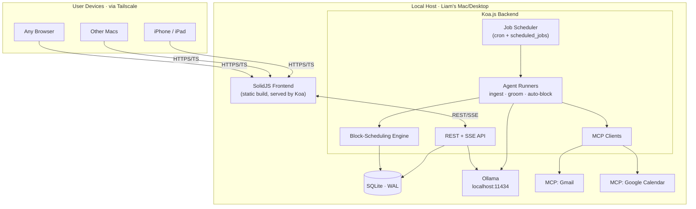
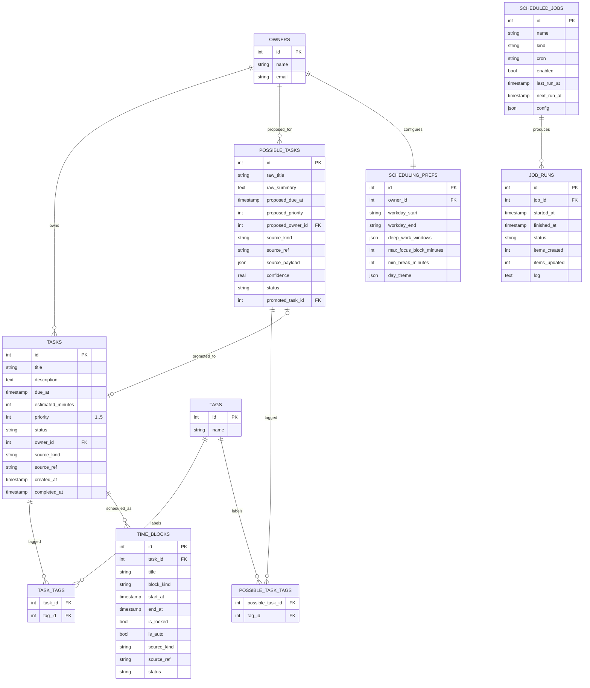
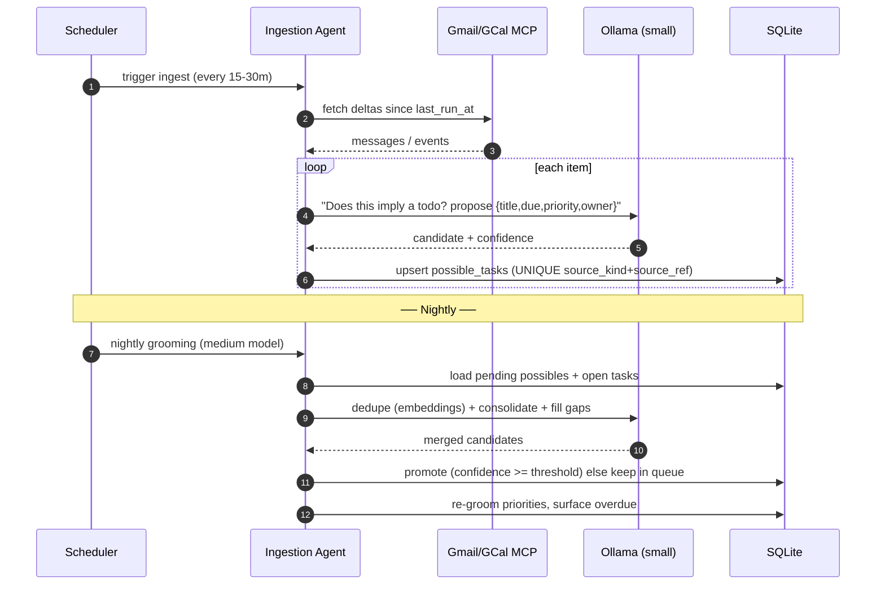
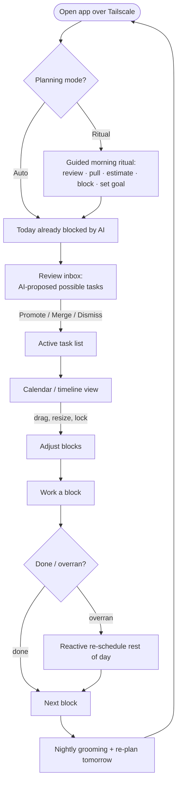
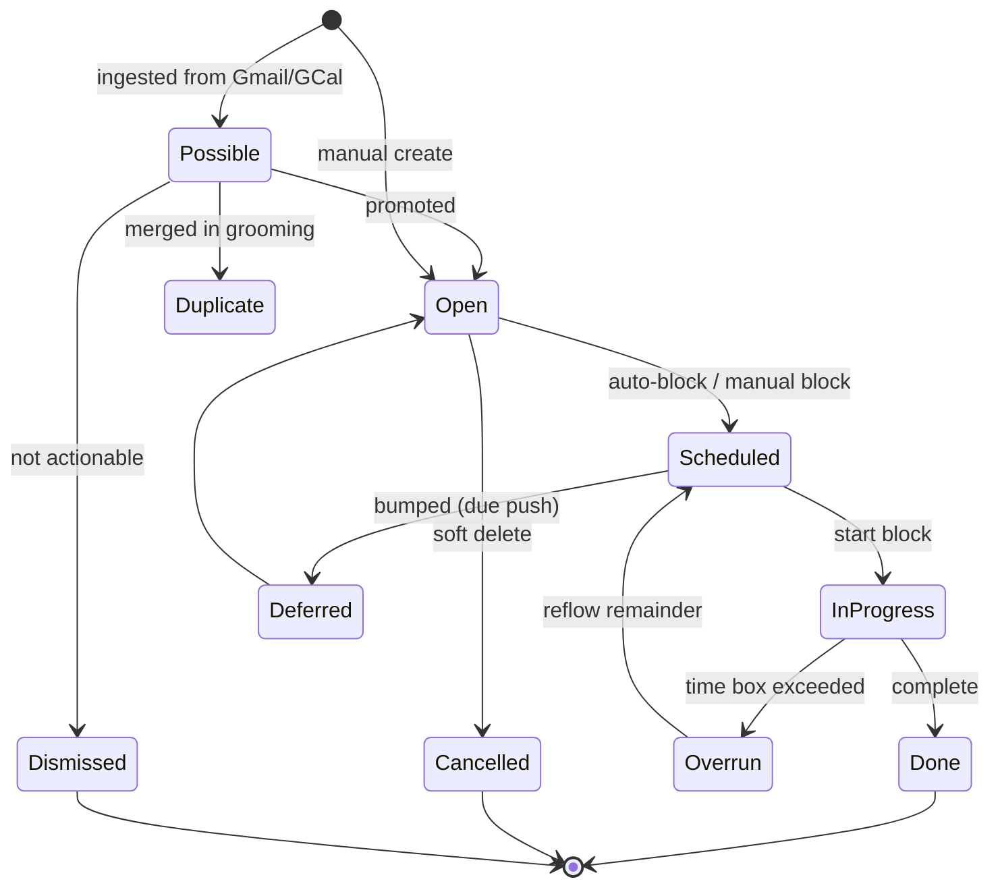
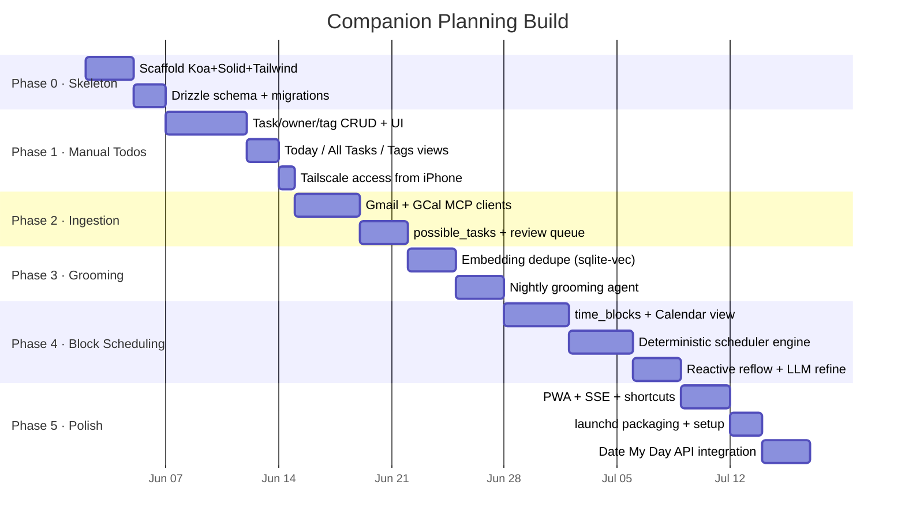

# Companion Planning — Architecture Plan
**Status:** Draft v0.2
**Owner:** Liam
**Goal:** Rebuild Companion Planning from scratch on a clean codebase with a sleek modern UI — the best private, local-first life-planning + calendar-management tool, with first-class AI block scheduling.
> **Changes since v0.1:** Added competitive landscape + positioning, a block-scheduling strategy and engine, `time_blocks` / `scheduling_prefs` schema, the auto-scheduler in the automation pipeline, a Calendar/Timeline frontend view, and seven mermaid diagrams (ER, system, user flow, ingestion sequence, lifecycle, scheduler, roadmap).
---
## 1. Project Overview
Companion Planning is a **local-first, AI-assisted personal planning system**. It runs as a private server on a laptop/desktop, is reachable from any device over Tailscale, stores everything in local SQLite, and uses local LLMs (Ollama) to continuously **ingest, groom, prioritize, and time-block** todos sourced from manual entry, Gmail, and Google Calendar.
It is a Companion Intelligence (CI) product, sibling to *Date My Day*. *Date My Day* owns the geometric day surface and reflection; Companion Planning owns the **task queue, calendar management, and auto-scheduling engine**. They can share data (see §17).
---
## 2. Competitive Landscape
The market splits cleanly into three camps. None occupies the corner Companion Planning targets: **open-source + local-first + AI auto-scheduling**.
### 2.1 Comparison Table
| Tool | Type | Local-first | Calendar sync | Time blocking | AI auto-schedule | Best at |
|---|---|---|---|---|---|---|
| **Super Productivity** | OSS (MIT) | ✅ IndexedDB / desktop store | ⚠️ read-only side panel | ✅ manual timeboxing | ❌ | Solo devs; time tracking + Jira/GitHub/GitLab sync in one app |
| **Vikunja** | OSS (GPL-3, Go) | ❌ server source of truth | ⚠️ CalDAV | ⚠️ basic | ❌ | Self-hosted shared lists & project views |
| **Taskwarrior** | OSS (MIT, C++) | ✅ files | ❌ | ❌ | ❌ | Terminal-native power users |
| **Nextcloud Tasks** | OSS | ❌ needs full Nextcloud | ✅ CalDAV | ❌ | ❌ | People already running Nextcloud |
| **Planify** | OSS (GTK4) | ✅ offline | ⚠️ CalDAV/Todoist | ⚠️ | ❌ | Beautiful Linux/GNOME desktop |
| **Tracks** | OSS (GPL-2, Ruby) | ❌ web app | ❌ | ❌ | ❌ | Pure GTD methodology |
| **Wekan / Kanboard / Planka** | OSS | ❌ | ❌ | ❌ | ❌ | Kanban boards |
| **Logseq / Obsidian (+plugins)** | OSS / freemium | ✅ files | ⚠️ via plugins | ⚠️ via plugins | ❌ | Notes-first task hybrids |
| **Motion** | Commercial cloud | ❌ | ✅ two-way | ✅ | ✅ full auto-rebuild | Hands-off AI that re-plans your day automatically |
| **Reclaim.ai** | Commercial cloud | ❌ | ✅ two-way (Google/M365) | ✅ | ✅ habit/focus defense | Protecting focus time & habits alongside an existing task app |
| **Sunsama** | Commercial cloud | ❌ | ✅ | ✅ manual ritual | ❌ (deliberately) | Calm, mindful morning planning ritual |
| **Akiflow** | Commercial cloud | ❌ | ✅ | ✅ | ⚠️ assisted | Command-bar speed; consolidating many task sources |
| **TickTick / Todoist** | Commercial | ❌ | ✅ | ⚠️ | ❌ | Polished cross-platform mainstream task apps |
| **➡️ Companion Planning** | **OSS, self-host** | **✅ SQLite source of truth** | **✅ two-way (planned)** | **✅ first-class** | **✅ local-LLM auto-block** | **Private AI day-planning you fully own** |
### 2.2 What each camp gets right (and the gap)
- **Open-source / self-hosted** (Super Productivity, Vikunja, Taskwarrior, Nextcloud Tasks): strong on privacy and ownership. Super Productivity is the standout — local-first with built-in timeboxing and time tracking and deep issue-tracker integration. But all of them stop at *manual* scheduling; none auto-plans your day.
- **Commercial AI schedulers** (Motion, Reclaim): genuinely automate the calendar. Motion replaces your calendar and rebuilds the day when a meeting runs long; Reclaim defends habits and focus blocks with two-way sync. The cost is total cloud dependence and no data ownership.
- **Mindful manual planners** (Sunsama, Akiflow): Sunsama's morning ritual — review yesterday, pull tasks, estimate time, block the calendar, set a realistic goal — is the gold standard for *intentional* planning, and it refuses auto-scheduling on principle. Cloud-only.
**The gap:** there is no mature tool that is simultaneously (a) open-source, (b) local-first with the device as source of truth, and (c) capable of AI auto-scheduling tasks into calendar blocks. Companion Planning is built precisely for that corner — and uniquely can offer **both** Motion-style auto-blocking *and* a Sunsama-style ritual, switchable per user.
### 2.3 Design lessons we steal
1. **From Super Productivity:** local-first storage + integrated time tracking, no mandatory account.
2. **From Motion:** auto-reschedule the day when reality shifts (meeting overran → afternoon re-blocks).
3. **From Reclaim:** habit/focus-block defense and respecting fixed events.
4. **From Sunsama:** an optional, opinionated morning ritual; "slow is a feature" mode.
5. **From Akiflow:** a fast command bar and one place that ingests every source.
### 2.4 Sources
- Super Productivity — open-source comparison & local-first roundup: https://super-productivity.com/compare/best-open-source-task-managers/ , https://super-productivity.com/blog/best-local-first-todo-apps-2026/
- awesome-selfhosted task management: https://awesome-selfhosted.net/tags/task-management--to-do-lists.html
- Time-blocking app roundups: https://arahi.ai/blog/best-time-blocking-apps-and-planners-2026 , https://blog.saner.ai/best-time-blocking-planner-apps/
- Motion vs Reclaim vs Sunsama: https://efficient.app/compare/motion-vs-reclaim , https://calmevo.com/sunsama-vs-motion/
---
## 3. Design Principles
1. **Local-first.** SQLite on the device is the source of truth. Tailscale is the only network surface; no cloud sync by default.
2. **Private by construction.** All LLM inference runs on Ollama at `localhost`. MCP servers run on the same host.
3. **Agentic but bounded.** Agents propose; they write only through a small allowed-tool surface and never silently mutate user-locked data.
4. **Manual-or-Auto, flight-plan planning (v2 / Phase G).** *Supersedes the old Auto/Ritual mode toggle.* You schedule by **dragging** tasks, or by **Auto** — which acts **only on a flight-plan** staging area: empty → it proposes candidates into the flight-plan; selected → it places them per a **Time-Block** (tag filter) or **Pattern** (typed task collection) rules. The deterministic scheduler is the engine Auto runs over the flight-plan; **overlaps are allowed-but-flagged**. "Ritual" is now a **Pattern type** (Routine ▢ / Habit ◯ / Ritual △), not a mode. Canonical UX: [docs/design-today-cockpit.md](docs/design-today-cockpit.md); plan: [docs/G-rituals-reflection.md](docs/G-rituals-reflection.md). Data model additions (`patterns`, `pattern_types`, `pattern_tasks`, Time-Block containers, `block_templates`) are specced there. *(A–F as below are shipped; the cockpit is the next build.)*
5. **Structured data + light unstructured layer.** SQL is canonical; tags are a free-form many-to-many overlay.
6. **MVC, legible, forkable.** Modern look, conservative architecture.
7. **Static-deployable frontend.** The SolidJS app builds to static assets; the backend hosts it and powers the agentic pipeline.
---
## 4. Block Scheduling Strategy
Time blocking assigns every working hour a purpose instead of working from an open-ended list. Companion Planning treats **calendar blocks, not list items, as the unit of execution.**
### 4.1 Methodologies supported
| Strategy | What it is | How CP implements it |
|---|---|---|
| **Time blocking** | Each task gets a fixed calendar block. | Scheduler converts `tasks` → `time_blocks` against free calendar gaps. |
| **Time boxing** | Fixed-duration cap per task; stop when the box ends. | `estimated_minutes` drives block length; overrun → `status='overrun'` flag. |
| **Task batching** | Group similar work (email, calls) into one block. | Batch by shared tag; scheduler clusters same-tag tasks adjacently. |
| **Day theming** | Assign whole days a theme (deep work, meetings, admin). | `scheduling_prefs.day_theme` biases which tags get scheduled which day. |
| **Focus/deep-work defense** | Protect long uninterrupted blocks. | `max_focus_block_minutes` + reserved deep-work windows the scheduler won't fill with shallow work. |
| **Buffers** | Breathing room between blocks. | `min_break_minutes` inserts `break`/`buffer` blocks automatically. |
### 4.2 Scheduling rules (v1 heuristic, pre-LLM)
The scheduler runs a deterministic pass first; the LLM only resolves ambiguity and ordering. Order of operations:
1. **Honor fixed events.** Meetings from Google Calendar and any `is_locked` blocks are immovable.
2. **Respect working hours & day theme** from `scheduling_prefs`.
3. **Rank the backlog** by `priority` (1 highest), then `due_at` proximity, then age.
4. **Fit blocks** into free gaps using `estimated_minutes`, splitting long tasks across deep-work windows where allowed.
5. **Insert buffers/breaks** per prefs; never schedule past `workday_end`.
6. **Overflow** → leave unscheduled, surface in the review queue, optionally suggest a due-date push.
7. **LLM pass (optional):** re-order/justify edge cases, batch same-tag work, write a one-line rationale per block.
### 4.3 Reactivity (the Motion lesson)
When a synced calendar event appears/moves, or a user marks a block done/overrun, the scheduler re-runs an **incremental** pass that only moves non-locked, non-completed `time_blocks` for the remainder of the day. Nightly grooming does a full re-plan for tomorrow.
---
## 5. High-Level System Architecture

**Why a backend (not a pure static PWA):** scheduled jobs, persistent MCP sessions, and Ollama calls all require a long-lived process. The frontend stays static-buildable; the backend hosts it and runs the pipeline.
---
## 6. Tech Stack
| Layer | Choice | Notes |
|---|---|---|
| Frontend | **SolidJS** + Vite | Fine-grained reactivity, small bundle. |
| Styling | Tailwind + Kobalte / shadcn-solid | Matches CI's minimal, dark-first design. |
| Calendar UI | custom grid or `@fullcalendar` (Solid wrapper) | Day/week timeline for blocks. |
| Backend | **Koa.js** (Node 20+) | Minimal async middleware. |
| DB | **SQLite** via `better-sqlite3` | WAL mode, embedded, zero-ops. |
| ORM/Migrations | **Drizzle ORM** | Typed schema, SQLite-native. |
| Vector search | `sqlite-vec` extension | Dedupe embeddings in the same DB. |
| LLM runtime | **Ollama** (local) | Small model for ingest, medium for grooming/scheduling. |
| MCP | MCP TypeScript SDK | Gmail + Google Calendar over OAuth. |
| Scheduler | `croner` | Backed by `scheduled_jobs` table. |
| PWA | `vite-plugin-pwa` | Offline shell + read-only cache. |
| Packaging | Node service + `launchd` plist | No Electron, no Docker required. |
---
## 7. Data Model
ISO 8601 UTC timestamps throughout. New in v0.2: `time_blocks`, `scheduling_prefs`.
### 7.1 ER Diagram

### 7.2 New table DDL
```sql
CREATE TABLE time_blocks (
  id INTEGER PRIMARY KEY,
  task_id INTEGER REFERENCES tasks(id) ON DELETE CASCADE,   -- null for meetings/habits
  title TEXT,                          -- denormalized for calendar render
  block_kind TEXT,                     -- task | meeting | habit | focus | break | buffer
  start_at TIMESTAMP NOT NULL,
  end_at TIMESTAMP NOT NULL,
  is_locked INTEGER DEFAULT 0,         -- user-pinned; scheduler won't move
  is_auto INTEGER DEFAULT 1,           -- placed by scheduler vs manual
  source_kind TEXT,                    -- manual | agent | gcal
  source_ref TEXT,                     -- gcal event id if mirrored
  status TEXT DEFAULT 'planned',       -- planned | completed | skipped | overrun
  created_at TIMESTAMP DEFAULT CURRENT_TIMESTAMP
);
CREATE TABLE scheduling_prefs (
  id INTEGER PRIMARY KEY,
  owner_id INTEGER REFERENCES owners(id),
  workday_start TEXT DEFAULT '09:00',
  workday_end   TEXT DEFAULT '18:00',
  deep_work_windows JSON,              -- [{"start":"09:00","end":"11:00"}]
  max_focus_block_minutes INTEGER DEFAULT 90,
  min_break_minutes INTEGER DEFAULT 10,
  day_theme JSON                       -- {"mon":"deep-work","tue":"meetings"}
);
```
(`owners`, `tasks`, `possible_tasks`, `tags`, join tables, `scheduled_jobs`, `job_runs` carry over from v0.1 — see §7.1 for fields.)
---
## 8. Backend (Koa) — Modules & API
```
/server
  /db        → drizzle schema, migrations, queries
  /routes    → REST controllers
  /jobs      → scheduler + job definitions
  /agents    → LLM runners (ingest, groom, schedule)
  /engine    → deterministic block-scheduling engine
  /mcp       → MCP clients (gmail, gcal) + ollama wrapper
  /lib       → logging, config, tag + time utilities
  index.ts   → Koa app, static serve, API mount
```
| Method | Path | Purpose |
|---|---|---|
| GET | `/api/tasks` | List with filters (status, owner, tag, due). |
| POST | `/api/tasks` | Create manual task. |
| PATCH | `/api/tasks/:id` | Update fields/tags/status. |
| DELETE | `/api/tasks/:id` | Soft-delete (status=cancelled). |
| GET | `/api/possible-tasks` | Review queue (the inbox). |
| POST | `/api/possible-tasks/:id/promote` | Promote (optionally merge). |
| POST | `/api/possible-tasks/:id/dismiss` | Mark not actionable. |
| GET | `/api/blocks?from=&to=` | Calendar blocks for a range. |
| POST | `/api/blocks` | Manual block. |
| PATCH | `/api/blocks/:id` | Move/resize/lock/complete. |
| POST | `/api/schedule/run` | Trigger (re)scheduling for a day. |
| GET | `/api/prefs` / PATCH | Scheduling preferences. |
| GET | `/api/tags` / POST | Tags + counts (word cloud). |
| GET | `/api/jobs` · POST `/api/jobs/:id/run` | Jobs + ad-hoc trigger. |
| GET | `/api/summary?date=` | Prose day briefing (LLM). |
| GET | `/api/llm/status` | Ollama health + installed model list. |
| GET | `/api/events` (SSE) | Live job/schedule/possible updates. |
---
## 9. Automation Pipeline
### 9.1 Ingestion → Promotion sequence

### 9.2 Block-scheduling engine flow

### 9.3 Scheduled jobs
| Job kind | Cadence | Model | Writes |
|---|---|---|---|
| `ingest_gmail` / `ingest_gcal` | every 15–30m awake | small (Hermes/Qwen ~3–7B) | `possible_tasks` |
| `promote_possibles` | nightly | medium (~8–14B) | `tasks` |
| `nightly_grooming` | nightly 02:00 | medium | priorities, dedupe |
| `auto_schedule` | nightly + reactive | deterministic + optional LLM | `time_blocks` |
All agent writes go through the same API endpoints a human uses, with `source_kind='agent'` and an entry in `job_runs.log`.
---
## 10. User Flow

---
## 11. Task & Block Lifecycle

---
## 12. MCP Integration
| Server | Use | Auth |
|---|---|---|
| Gmail MCP | List recent messages, fetch bodies, extract action items. | Standalone OAuth (token in the encrypted `connection_tokens` store). |
| Google Calendar MCP | Read events (rolling window); **optional** write-back of task blocks (behind `CP_SYNC_WRITEBACK`, v2-flag posture). | Standalone OAuth (same store). |
| Ollama (HTTP) | Local generation + embeddings. | none (localhost). |

### 12.1 Authentication — standalone OAuth, not the Keychain
Companion Planning runs its **own** Google OAuth 2.1 flow in-process (Authorization Code
+ **PKCE/S256**); there is no dependency on macOS Keychain, libsecret, or an external
agent bridge. Access + refresh tokens are encrypted with **AES-256-GCM** and stored in
the `connection_tokens` table — never in a committed `.env`. The key-encryption key (KEK)
is a 32-byte value supplied as base64 via `CP_KEK_B64` (`server/src/lib/crypto`); each
sealed row records the `key_version` it was sealed under so keys can be rotated without
re-authenticating (see §16). Lock Ollama to `127.0.0.1` and firewall port 11434.

> **OAuth routes** (`/api/oauth/google/start`, `/callback`, `/accounts`,
> `DELETE /accounts/:account`) are an **assumed, in-flight contract** (a separate work
> package) and are not asserted as merged here. Token sealing/opening, refresh
> single-flight, and the `connection_tokens` store *are* in place
> (`server/src/connectors/base.ts`).

### 12.2 CP as an MCP client
CP is an **MCP client** (`@modelcontextprotocol/sdk`) to a Gmail MCP server and a Google
Calendar MCP server. A single `McpGoogleSession` owns the MCP child process and **injects
the per-account access token** (fetched/refreshed from the `connection_tokens` store) into
each MCP call, so the child never persists credentials of its own. *(This session +
live MCP wiring is the in-flight architecture; the as-built connector currently throws a
`TODO(phase-2)` until the MCP layer lands — see `server/src/connectors/google.ts`.)*

### 12.3 The GoogleClient ↔ CalendarConnector bridge
Two thin views sit over the same `McpGoogleSession`:
- **`GoogleClient`** — the *ingest* view (Gmail + Calendar read for task extraction).
- **`CalendarConnector`** — the *sync* view (`server/src/connectors/base.ts`): typed
  `listEvents` / `createEvent` / `updateEvent` / `deleteEvent`, all carrying **etag** so
  optimistic concurrency flows end-to-end. `EtagConflictError` surfaces a stale-etag write
  so the reconciler can let **remote win** and retry.

### 12.4 One canonical inbound path
Calendar meeting blocks are mirrored by a **single** inbound reconciler
(`applyInbound` in `server/src/agents/sync.ts`), keyed on the
`(provider, account, external_id)` identity in `external_events` plus **etag** for
change detection; events that vanish from a cycle are tombstoned (local block deleted).
`ingest_gcal` **no longer mirrors meeting blocks** — it does task extraction only — so
there is exactly one writer of calendar mirrors and no double-mirroring.

### 12.5 Staged enablement flags
| Flag | Default | Effect |
|---|---|---|
| `GOOGLE_MODE` | `fixture` | `fixture` = offline sample data; `live` = real OAuth + MCP. |
| `CP_SYNC_WRITEBACK` | off | Off ⇒ inbound read-only (the v2-flag, read-only-first posture from §17 Q2). On ⇒ local block changes push back to Google. |
| `CP_SYNC_DISABLED` | off | Master kill switch for the sync agent. |

The runbook **[docs/google-cloud-setup.md](docs/google-cloud-setup.md)** is the operator
guide for provisioning the Google client and walking these flags up in order.
---
## 13. Frontend (SolidJS) — Views
1. **Today (the cockpit, Phase G)** — Day Overview (date + today's tag set) · Summary (overdue/blocked/open + the `+ New Task` button) · the **PLANNER** (hour-by-hour, 8h/expand-24, "next up" pinned to row 2, drag-reorder, overlap-flagged) · the **Flight-plan** staging area (with `Auto Schedule` on top) · a never-closing lower **drawer** `[+ Block] [+ Pattern] [+ Open Task]`. *(Today the view is a simpler briefing + next-up + open-tasks; the cockpit is the G build — see [docs/design-today-cockpit.md](docs/design-today-cockpit.md).)*
2. **Calendar → PLANNER** — day/week grid of `time_blocks`; drag/resize/lock; under G it gains 8h-scroll, next-up pinning, **Time-Block outlines**, **Pattern textures**, and overlap-flagging (the calendar grid becomes the TODAY PLANNER; `F′` revision).
3. **Inbox / Review** — `possible_tasks` cards; keyboard `P` promote, `D` dismiss, `M` merge.
4. **All Tasks** — filterable table (status, owner, tag, due).
5. **Tags** — weighted tag cloud; click to filter.
6. **Patterns** — typed task collections (Routine ▢ / Habit ◯ / Ritual △ + user-defined), searchable; add existing or create new; tap to stage in the flight-plan. *(Replaces the old "Ritual" sequence — ritual is now a Pattern type.)*
7. **Jobs** — schedule status, run logs, manual triggers.
8. **Settings** — scheduling prefs, **Ollama model picker (Fast/Quality/Embedding)**, **Companion Memory sync**, **pattern types + per-type reminders**, MCP connections, light/dark theme.
Design language: the **CI-Hub shared design system** (semantic tokens + primitives, Montserrat, dark-first with a light mode) — global styles first. SSE drives live updates.
---
## 14. Tagging System
Many-to-many over `tasks`/`possible_tasks`. Names normalized on insert (lowercase, hyphenated, ≤32 chars). Tags survive promotion (`possible_task_tags` → `entity_tags`). Agents may *suggest* tags but only surface them in the queue above a confidence threshold. Batching and day-theming key off tags.
---
## 15. Deployment
- Single Node process under `launchd`, bound to the Tailscale interface on a chosen port (e.g. 3848).
- Reached at `http://liam-mbp.<tsnet>.ts.net:3848`.
- Optional bearer token over Tailscale TLS for the API.
- DB at `~/Library/Application Support/CompanionPlanning/`; Time Machine + optional encrypted nightly export.
- `pnpm start` runs everything; a `companion-planning.plist` installs the launch agent. No Docker required.
---
## 16. Security / Privacy Posture
- **Network:** Tailscale ACLs only; no public ingress.
- **Auth:** single user; bearer token over TLS.
- **Data:** local SQLite; all inference local; outbound limited to Google OAuth refresh + MCP-mediated reads.
- **Audit:** every row records `source_kind` / `source_ref` / timestamps; agent edits append to `job_runs.log`; locked blocks are immutable to the scheduler.
- **Token storage:** OAuth access/refresh tokens are sealed with AES-256-GCM in the
  `connection_tokens` table under a base64 `CP_KEK_B64` key — never plaintext, never in a
  committed `.env`, never the macOS Keychain (see §12.1).
- **Centralized log redaction:** `server/src/lib/logger.ts` runs a **recursive** redactor
  over every log payload before serialization — object keys matching the secret pattern
  (access/refresh/id tokens, `client_secret`, `authorization`, `code`, `code_verifier`,
  `kek`, `iv`, `auth_tag`, `ciphertext`, …) are masked at any depth, and **URL query
  params** carrying `token` / `access_token` / `code` / `client_secret` are scrubbed even
  inside string values. The walk is cycle-safe and depth-guarded so a hostile/looping
  structure can't hang the logger.
- **KEK rotation:** keys are versioned. Each `connection_tokens` row stores the
  `key_version` it was sealed under; `rotateKek(newVersion)` opens every row with its
  historical key (`CP_KEK_B64_V{n}`, falling back to `CP_KEK_B64` for the current version)
  and re-seals it under the new key with a fresh IV, atomically (one transaction,
  idempotent, refuses downgrades). Operators rotate without re-authenticating any account.
---
## 17. Open Questions
1. **Date My Day integration.** Shared SQLite file, a read API CP exposes, or fully independent? *Recommendation:* CP exposes a read API; Date My Day consumes blocks/tasks and owns reflection. **(Needs your call before scaffolding.)**
2. **Calendar write-back.** Mirror auto-blocks into Google Calendar, or keep CP-internal? Read-only v1; write-back behind a v2 flag.
3. **Scheduler intelligence split.** How much to deterministic engine vs LLM? Start ~80/20 deterministic; measure.
4. **Embeddings model** for dedupe — which Ollama embedding model, and similarity threshold for "duplicate"?
5. **Multi-owner.** Schema supports it; v1 stays single-user (Liam).
---
## 18. Phased Roadmap

### Phase notes
- **Phase 0–1:** usable manual planner reachable from all devices.
- **Phase 2–3:** inbox/calendar ingestion + nightly grooming (the v0.1 core).
- **Phase 4:** the differentiator — local-LLM block scheduling with reactive reflow.
- **Phase 5:** ship-quality polish + CI ecosystem integration.
---
## 19. Naming / Repo
- Working name: **Companion Planning** (replaces the previous codebase).
- New clean repo under the `companion-intelligence` org; archive or repurpose `ai-todo-static` as the static dashboard front.
- Tagline candidates: *"Your inbox becomes your plan, privately."* / *"Own your day. Literally."*
