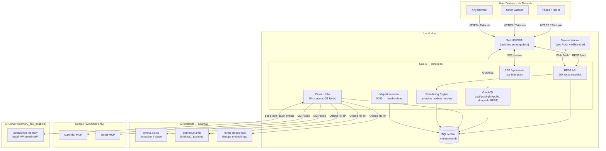
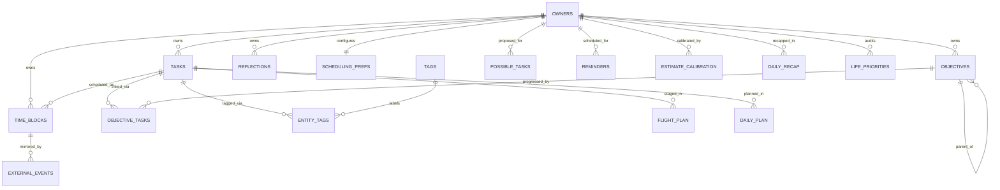
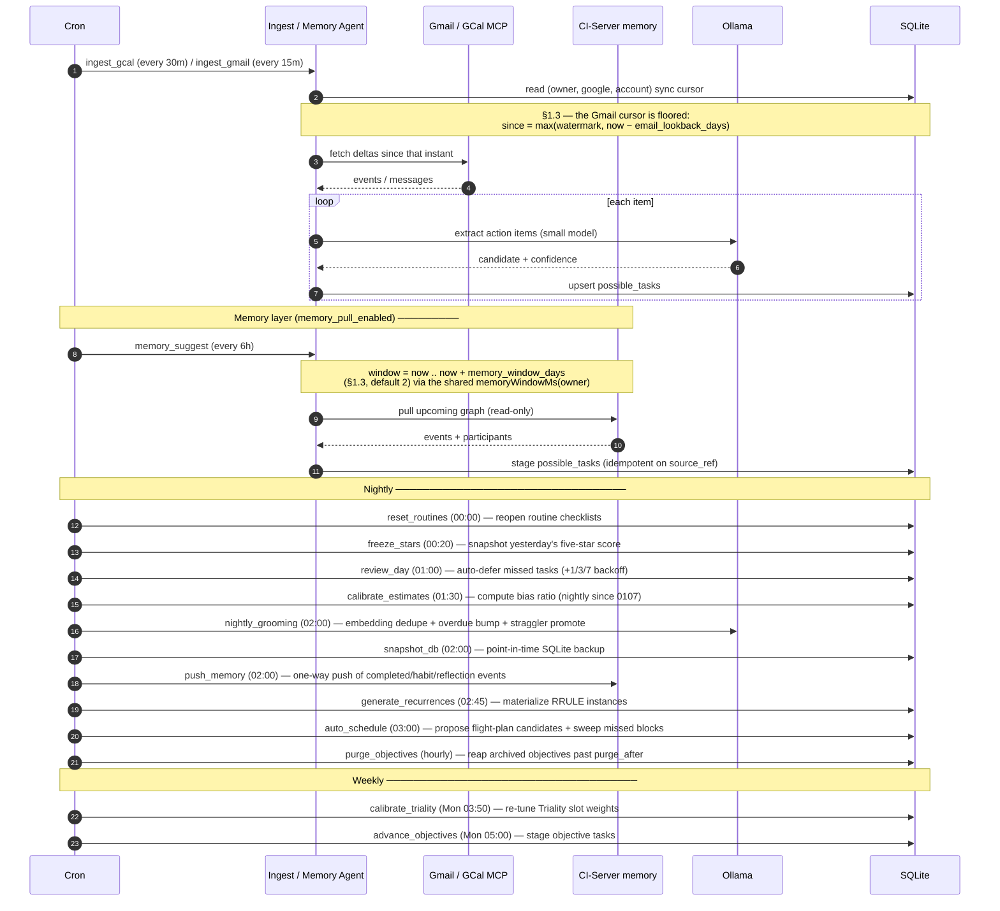
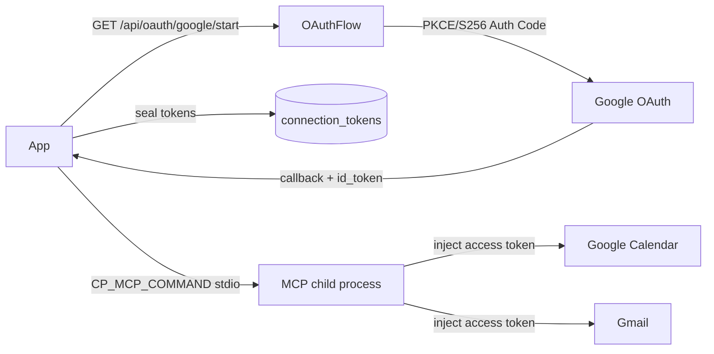
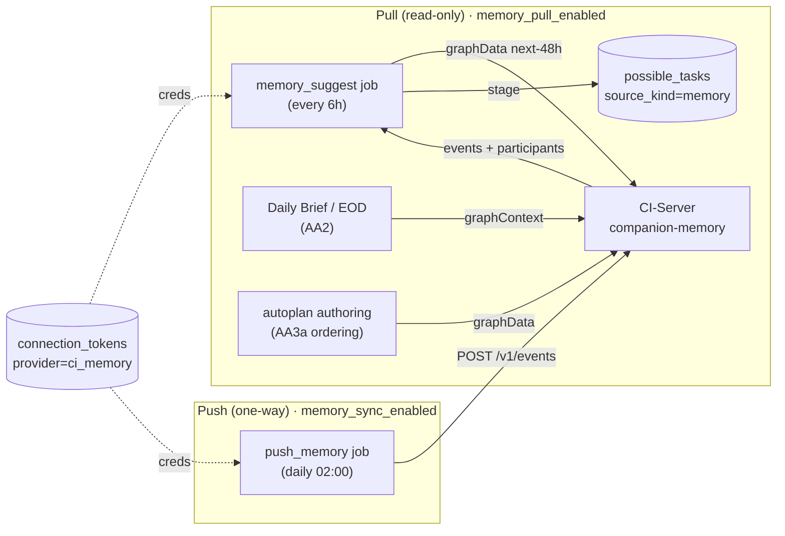
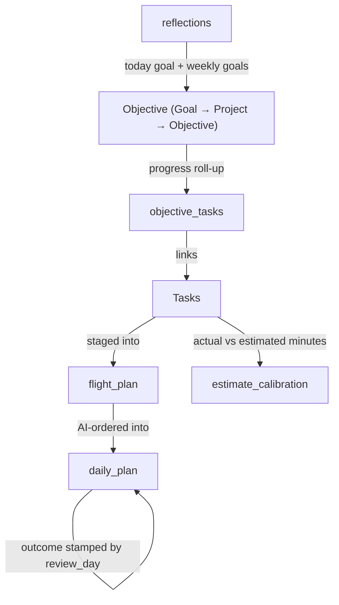
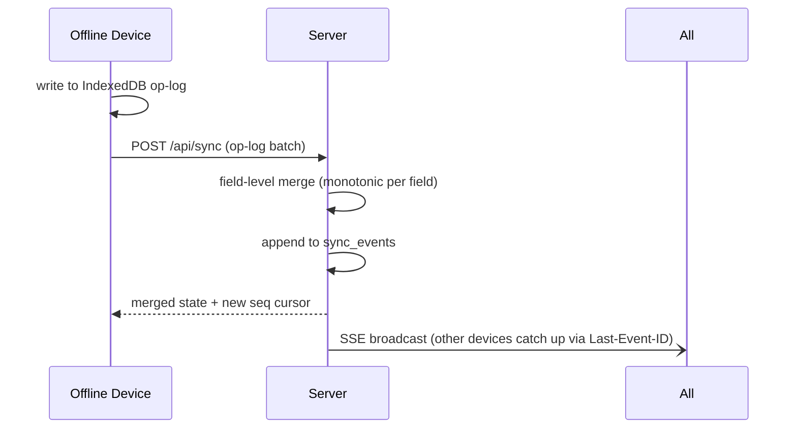

# Companion Planning — Architecture Reference

**Status:** Living document · last updated 2026-08-13 · migration head `0147` in `main` (authoritative list: `server/src/db/migrations/index.ts`)

> This document describes the **as-built** system — what is actually running, not what was planned. For future phases, see [docs/ROADMAP.md](docs/ROADMAP.md).
>
> Anything finished but **not yet merged to `main`** gets its own numbered section, cross-referenced from every section it changes, so "as-built" keeps meaning `main`. There is currently no such section — §1.3 describes 0147, which has merged.

---

## 1. Project overview

Companion Planning is a **local-first, AI-assisted personal planning system**. It runs as a private server on a laptop or desktop, reachable from any device over Tailscale, stores everything in local SQLite, and uses a local LLM (Ollama) for briefings, task extraction, grooming, and auto-scheduling. No cloud required; no account.

**Shipped phases (A → AG, plus the post-AG work in §1.1 and the Categories⇄Balance
feature in §1.2; migration head 0135):** Tasks + scheduler · Rich semantics + time tracking · Recurrence · Calendar grid · Time-blocks + patterns + cockpit · Notifications + Web Push · Backups + export/import + audit · Identity + auth + connector infrastructure · Two-way calendar sync (Google) · Google OAuth 2.1 + MCP · AI scheduler + reactive reflow · Multi-device sync + offline writes · Life-planning layer (objectives, reflections, weekly review, calibration) · **Phase O — the gamified five-star day** (FOCUS card with linked/freeform focus + Today's Brief pop-up, a day note, `computeStars()` + nightly-frozen `daily_recap` stars, calendar heatmap; the standalone Morning Briefing section is retired) · **Phase P — planner hygiene** (a shared `clear-range` engine behind the CLI, `POST /api/planner/clear`, and a `recurrence_horizon_days` setting that bounds + auto-prunes both recurrence engines) · **Phase Q — schema hygiene** (FK enforcement guaranteed on every connection via a shared `openDb()`, FK-path index coverage, and owner-identity integrity rebuilds of `flight_plan` and `daily_summaries` — pre-multi-tenant) · **Phase S — schema consolidation** (dropped the dead `plan_outcomes` table + its cron; merged `daily_summaries` + `day_stars` into `daily_recap`; `pattern_prefs` + `category_prefs` into `tag_prefs`) · **Phase T — multi-tenant owner-scoping** (every table + route + service scoped to `owner_id`; owner-less rows retired) · **Phase U — CI-Portal OIDC + local auth** (session-cookie login: OAuth 2.1 + PKCE relying-party, or `DISABLE_OIDC` local username/password) · **Phase V — password reset** (single-use tokens; `session_epoch` invalidation) · **Phase W — GraphQL CRUD layer alongside REST** (complete; see §6a) · **Phase X — MCP intent vocabulary** · **Phase Y — env-config** (every env var documented; `server/.env.example`). Also in this window: task placement lifecycle (open↔scheduled), task→objective auto-promotion with height-based leveling, block-template application, and objectives joining the multi-device sync layer (0085–0087).

**Phase Z Time-Sense** (a Focus Ritual + estimate-calibration loop — EOD alignment, daily-brief fold-in, "Keep working"/"Schedule again", focus-cue reminders + vibrate, per-cue prefs, suggest-only estimate chip, voice loop) has **landed behind the `time_sense_enabled` master flag** (flag-off = behavior-neutral; migs 0106–0109). The **calendar / UI feedback waves** have also landed (QuickAdd mounted in Today, Planner de-scroll, Flight-Plan tabs + saved-blocks + search, three-axis calendar tag filter, container-outlines + click-to-add, select-date → day-type picker, collapsed night hours).

**Phases AA–AE** (2026-07, migs 0113–0117) close out the current line:
- **AA — Memory-aware agentic layer** (CI-Server `companion-memory`, pull-first, behind the `memory_pull_enabled` flag): a read-only connector (`connectors/memory.ts`, fixture/live), the `memory_suggest` agent that stages next-48h events as Inbox suggestions, a memory-informed Daily Brief (AA2), memory-aware autoplan ordering + a history-based default estimate for memory-drafted tasks (AA3a/AA3b), and a one-way `push_memory` background sync (AA4). Flag-off = byte-identical.
- **AB — Natural scheduling** (`scheduled_for`/`task_time` are START intent that drives placement; `due_at` is a deadline only).
- **AC — Today + Tasks UI overhaul** (Today: single header row — Today's Brief · Focus bullseye · Note as popovers; FAB restored; DUE collapsible. Tasks: task-chip redesign with a merged direction-icon/done toggle, Routine grouping by routine, end-of-day archive, and a midnight `reset_routines` job that reopens routine checklists).
- **AD — Calendar reliability** (`task_time` honored across quick-add + flight-plan; container→task direction inheritance; Alt-drag free placement).
- **AE — Reflow correctness** (snapshot-based reactive reflow: the clear set equals the re-place set, so a task edit can no longer wipe other auto-placed blocks; placement status parity; not-before-now clamp; locked-block guards). See §6.

**Phases AF–AG + ship-readiness** (2026-07, migs 0118–0126) — note 0119 is an intentional gap (see `migrations/index.ts`); the line continues past AG in §1.1:
- **AF — Task management** (migs 0120/0121): Objectives surface as a **tab inside `/tasks`** (URL-synced `?focus`), tree API returns tasks-per-leaf, quick-add subtask, assign-to-objective on the task card. **The Inbox surface is retired** — ingested `possible_tasks` are deduplicated inline and **auto-promoted** into Tasks (no manual triage), surfacing in a date-derived **New Today** section until owner-local midnight; `/inbox`, `/objectives`, `/patterns`, `/routines` are now redirects/tabs, not standalone views. Includes **AF-11 tag unification** (routine-tag cleanup 0120, task-intention level move 0121).
- **AG — Multi-tenant RBAC** (mig 0125): `owners.role` drives scopes at one choke point (`lib/auth/scopes.ts` `roleToScopes`, unknown role → read-only), replacing the hardcoded `[READ, WRITE, ADMIN]` triple. Three roles — `operator` (R+W+A) · `member` (R+W) · `viewer` (R); existing owners backfill to `operator`, OIDC auto-provision defaults to `member` (closes the auto-admin hole). Operator-gated `routes/accounts.ts` (`GET/POST/PATCH/DELETE /api/accounts` + `/:id/invite`) creates/manages accounts via password-less invite + reset-token link.
- **Ship-readiness + hardening** (migs 0122–0124, 0126): seeded developer identity scrubbed (0122); dead `auto_mode` column dropped, top-bar Suggest/Schedule toggle repointed to `trust_mode` (0123); in-app Google connection setup + auto-provisioned Web Push VAPID keys via the `app_config` table (0124); base **category** tags (Personal / Professional / Social) seeded (0126) — **superseded by the six Balance-dimension categories, migration 0134, §1.2**. License corrected to **CI-Commercial-1.0** (not MIT).

## 1.1 Post-AG work (2026-07-14 → 07-16, migs 0127–0130)

Two tracks landed after the AG close-out. Neither has a phase letter; §1.2 (Categories⇄Balance, migs 0134–0135) continues the line, and the head has since moved past it (see the status line at top).

Also in this window, all flag-gated or additive: memory enrichment (`POST /api/tasks/:id/enrich` + the nightly `enrich_tasks` job, 0136), the close ritual + durable calibration history behind the Balance → Metrics tab (0137/0138), and **Triality** — three candidate next actions (Habitual · Contextual · Novel) ranked by local arithmetic over a balanced-ternary situation vector, a task `motivation` axis (me/us/them), an append-only outcome log, and a weekly weight-calibration job (each weight clamped to ½×–2× of its default, then renormalized so the slot's weights still sum to the default total), all behind `scheduling_prefs.triality_enabled` (default 0; migs 0139–0143; design record `docs/triality-design.md`). **No generative model chooses or re-orders a pick**; the one piece of I/O in the scoring path is a local *embedding* call that supplies half the novelty term when Ollama answers (bounded by a 40-candidate cap and a 4s stage budget, with a pure-arithmetic fallback when it does not) — so stopping Ollama can change the picks against identical SQLite state, and "deterministic" holds only for a fixed embedding availability. Flag-off = no routes, no UI, no suggestion computation; the `calibrate_triality` cron row is seeded unconditionally by 0143 and no-ops on an empty log, so it is not byte-identical: every owner still gets the weekly `job_runs` row, its `job:run` SSE broadcast, and the extra row in `/jobs`. Its surfaces are the Focus suggestion banner and the Balance → Metrics measurement tiles — **no new routed view**.

**Life priorities + the Priorities Wizard** (migs 0127/0128, #356). A `life_priorities` row per `(owner, category)` captures a self-audit — `satisfaction` (1–10), `importance` (1–10), `target_hours_per_week`. It backs two routed views: **`/priorities`** (the wizard) and **`/balance`** (the dashboard). `scheduling_prefs.sleep_hours_per_week` (0128, default 63 = 9h × 7) reserves sleep as unschedulable, so the wizard's weekly pool is `168 − sleep_hours_per_week`. `/balance` reads the self-audit back — a **Balance Index** (how far `satisfaction` tracks `importance`) plus the allocated weekly targets. Self-contained, and narrower than it may sound: **it reports stated intent, not measured time.** There is still no actual-vs-target tracking (`Balance.tsx` reads no `time_entries`/`actual_minutes`) or scheduling boosts — but the `no task.category` gap named here is now **closed by the Categories⇄Balance feature (§1.2)**.

**Objectives archive + 48h purge** (migs 0129/0130, #366 and follow-ups #367–#372). **`DELETE /api/objectives/:id` no longer hard-deletes — it archives.** This is the single most load-bearing behavioral change in this window, and the invariant it rests on is easy to break:

- **Soft delete.** `archived_at` is stamped; the row is kept indefinitely. `status` is untouched — the archive is **orthogonal to status**, which is what makes restore lossless (and why a cadence job must check `archived_at`, not just `status='active'`).
- **The cascade.** Archiving fans out over the **live** subtree in one transaction, stamping each descendant's `archive_root_id` so the subtree restores as a unit (`cascadeArchiveToDescendants`). Atomicity is required, not nice-to-have: **`buildTree` roots any node whose parent is filtered out**, so a live child left under an archived parent silently resurfaces as a top-level goal.
- **THE INVARIANT: no live objective may have an archived parent.** Every read path filters `archived_at IS NULL`; every write path refuses an archived parent (`liveParentExists` → `parent_not_found`); the sync path clamps to it (§12).
- **Purge is separate and explicit.** `PURGE_WINDOW_HOURS = 48`. `POST /:id/purge` stamps an absolute `purge_after` deadline across the subtree; `DELETE /:id/purge` cancels it. The hourly `purge_objectives` job (0130) reaps rows past the deadline — the only path to permanent removal.
- **Routes:** `GET /api/objectives?archived=1` (flat archive list — an archived subtree is not a renderable tree), `POST /:id/restore` (root-only; a cascaded member must restore from its root), `POST /:id/purge`, `DELETE /:id/purge`.
- **Exception — auto-generated scaffolding is still hard-deleted.** `unpromoteIfEmpty` / `dropSourceObjective` (`services/task-promotion.ts`) `DELETE` a *pristine* auto-promoted objective rather than archiving it, so the archive doesn't fill with rows the owner never chose to create. Guarded by `isPristine` (top-level, no sub-objectives).

## 1.2 Categories⇄Balance + per-element striped textures (2026-07-20 → 07-21, migs 0134–0135)

Unifies the old block-only "Time Block Category" axis with `/balance`'s six Core Dimensions,
so a **Category** is a tracked Balance dimension by name, on **both tasks and blocks**, and
drives an optional per-element striped background. Full session record + owner decisions:
`docs/HANDOFF-2026-07-20-categories-and-ui.md` (closed out).

- **Model (0134).** The `kind='category'` tag axis is purged and re-seeded to exactly the six
  `life_priorities` keys — `health / career / relationships / growth / leisure / finance` —
  each `is_base=1`, hue-matched to a `--tag-N` token via `tag_prefs`. Add/remove of categories
  is behind `client/src/lib/flags.ts` `CATEGORIES_EDITABLE` (**false** this delivery — the six
  are fixed; rename/recolour stays allowed). New table **`entity_categories`**
  `(entity_kind, entity_id, category_tag_id, position)`, PK on all three, `position` (0–2)
  ordering a **1–3 multi-select** per task/block — the single legacy `time_blocks.category_id`
  column couldn't express that. `services/tags.ts`: `setEntityCategories` /
  `entityCategoryNames` / `categoryIdsForOwner` (+ batched `entityCategoryNamesByIds`, the
  `taskTagNamesByIds` idiom — no N+1 on list reads).
- **Capture (0135 + wiring).** `0135_categories_capture` backfills any surviving
  `time_blocks.category_id` into `entity_categories` at position 0, then adds
  `texture_enabled` (`DEFAULT 1`) + `texture_color_token` to **both** `tasks` and
  `time_blocks` — the per-element texture on/off + colour override. `category_id` stays a
  column (back-compat reads) but is **retired from the write path**: `createBlock`/
  `updateBlock` bridge a legacy `category_id` input into `entity_categories` and null the
  column on touch; `entity_categories` is authoritative. The 1–3 picker lives on both
  ElementWizard tabs; `quickVocab`/`enrichQuick` (`agents/quickadd.ts`) classify 1–3
  best-guess categories on a **separate axis from intentions**, so a category name can never
  leak into `secondary_tags`.
- **Derive rule (the key relationship).** A block's *effective* categories are **its own
  `entity_categories` rows if any, else its linked task's** — resolved server-side
  (`blockCategoryNames`, `services/blocks.ts`) and reused client-side (the same rule backs
  the Planner chip's texture and the Calendar overlay's category filter). Consequence: an
  auto-placed task block needs **no category write of its own** — recategorizing the task
  re-stripes every block it holds, free.
- **Renderer.** `client/src/lib/textures.ts` `elementTextureStyle(el, tags, prefs,
  motifFallback?)` is the one resolution rule: `texture_enabled=0` → none →
  `texture_color_token` (user override, single hue) → `categories` (**even stripes**, a
  `repeating-linear-gradient` interleaving each category's colour token line-by-line in
  `position` order, 1px line / 2px gap) → the legacy routine/pattern motif tile (kept, for
  Habit/Ritual members) → none. `TEXTURE_OPACITY` halved `0.06 → 0.03` (stripes render at 2×
  to compensate — a 1px line carries roughly a third the ink of the old motif tile). Un-gated
  from routine-only to **every** task card and planner chip.
- **Surfaces.** TaskCard's secondary-axis chips are now the task's **categories** (colour-dot
  + name), not intention `secondary_tags` — intentions stay in `entity_tags` (still drive
  `tag_categories`/`tag_directions` grouping and auto-tag) but are off the card. `/balance`
  Core-Dimension cards get an "N open" button → a client-joined modal of that dimension's
  open tasks (no new query — tasks already carry `categories`). The Calendar overlay's
  Category row is now **functional** (`lib/overlay.ts` `namesPass` reads the block's
  effective categories — previously it matched category names against task tags, where
  they never appear, so the row was inert) plus a brand-monochrome ↔ colourful-per-tag
  palette toggle. Tags view: a per-chip Category `<select>` on both tabs (writes
  `tag_categories`), alongside the existing drag-to-refile.

## 1.3 Ingestion windows, New Today precedence, New Today fill order (mig 0147)

> **In `main`.** Sections §5.2, §6, §7, §7.1 and §8 carry a pointer back here for the
> full narrative.

Three related changes to *how work arrives and gets ordered*, plus one real bug found on
the way. The through-line is arrival time: two settings bound how much of each source a
pull reads, one precedence change fixes what "arrived today" means in the UI, and one fill
order lets arrival drive placement.

**Ingestion windows (0147).** Two per-owner columns on `scheduling_prefs`, both surfaced in
**Settings → Connections**:

| Column | Range | Default | Direction | Bounds |
|---|---|---|---|---|
| `memory_window_days` | 1–30 | 2 | **ahead** | how far forward the Companion Memory pull reads |
| `email_lookback_days` | 1–90 | 7 | **back** | how far back a Gmail ingest may reach |

The two directions are deliberate and **not symmetric**: memory suggestions mirror
*upcoming* events into tasks, so a backward memory window would stage work for things that
already happened; an inbox is only ever read backwards.

- The memory half is a **no-op upgrade** — default 2 is exactly the 48h that
  `agents/memory-suggest.ts` (`MEMORY_WINDOW_HOURS`, now deleted) and
  `agents/summarize.ts` (`memoryBriefExcerpt`) each hardcoded separately.
  `memoryWindowMs(owner)` in `services/memory.ts` is the single authority both read,
  so one setting moves the suggestion agent and the daily brief together. A non-positive
  stored value is treated as unset, so a bad row can never collapse the window to zero and
  silently stop all suggestions.
- The email half is **not** a no-op. The `gmail_since` cursor had **no floor at all**, so a
  first ingest — or the first run after a long outage — read as far back as the MCP Gmail
  tool would return. `ingestEmails` now takes `since = max(watermark, now − N days)` via
  `gmailLookbackFloor()`. On the healthy 15-minute cadence the watermark is always newer,
  so the steady state is byte-identical. An explicit `opts.since` is a manual replay and
  bypasses the floor deliberately — the caller has named the window.
- **Validation lives in `services/prefs.ts`** (`MEMORY_WINDOW_DAYS_RANGE`,
  `EMAIL_LOOKBACK_DAYS_RANGE`, `inRange`) so REST and GraphQL cannot drift, and it
  **rejects** (422 / `BAD_USER_INPUT`) rather than clamping — the same rule as
  `recurrence_horizon_days`, and for the same reason: a clamped value leaves the Settings
  input showing a number the server never stored. Values are also `Number()`-normalized
  there, because `fromApi` is a blind key rename and a string `"5"` would otherwise reach
  Drizzle and land in an INTEGER column.
- **Known trade-off:** the email floor applies always, not only on first run. A reconnect
  after a long outage pulls the configured window and the watermark jumps past the older
  backlog. That is the plain meaning of "look back N days", but it is a deliberate skip in
  a pipeline otherwise engineered never to skip.

**Tasks-tab precedence.** Membership order is **Routine › Scheduled › New Today ›
Open** (was Routine › New Today › Scheduled › Open) in `client/src/lib/task-sections.ts`
`partitionTaskSections`. Scheduling a task the same day it was created now moves its card
to Scheduled *immediately*; previously it sat in New Today until local midnight, so the
placement produced no visible movement and the section read as "created today" rather than
"not yet dealt with". New Today now means **arrived today and still needs a decision**.
The unscheduled New Today → Open rollover at local midnight is unchanged and still pure
derivation — no column, no job. `headerOpenCount`'s `isScheduled` parameter is **dropped**:
it existed only to strip scheduled tasks back out of New Today under the old order, and the
partition now drains them first — the header NUMBER is unchanged by the swap.

**New Today fill order.** `fill_order` carries a third value, `new_today`, alongside Priority
and Due Date in the flight-plan toggle. Today's arrivals take the earliest slots and each
half stays deadline-first, so it **layers on** `overdue` rather than replacing it. Keyed on
the owner's **real today**, not the date being placed — otherwise planning ahead would make
the mode a silent no-op, since nothing is ever created on a future date. Membership matches
the client's New Today partition (`created_at` converted to the owner's local day, never a
raw UTC compare); a NULL `created_at` sorts with the older half, so an undated row never
displaces a task the owner can see is new.

Wired into **both** ordering paths, which is necessary rather than thorough:
`placeFlightPlan` skips its own `fill_order` branch whenever a `daily_plan` exists for the
day (`engine/autoplan.ts` `orderByNewToday`), so a value only the engine understood would
be inert on exactly the days the owner planned deliberately; `deterministicIndices`
(`agents/plan.ts`) carries a matching band — after theme/memory, before deadline/priority —
which is the same parity the existing two values already have.

**Bug: `CURRENT_TIMESTAMP` parsed as local time.** `tasks.created_at` is defaulted by
SQLite's `CURRENT_TIMESTAMP`, which stores `'YYYY-MM-DD HH:MM:SS'` — a UTC instant with
**no zone designator** that `new Date()` parses as LOCAL. Behind UTC that shifted every
timestamp by the server offset, so a task created after ~17:00 local never appeared in New
Today on the day it actually arrived; it showed up the next day. **Every task row in a real
database uses this spelling.** Fixed at both ends with the identical rule so the Tasks tab
and the new fill order cannot disagree about the set: `sqliteUtcToISO()` (`lib/tz.ts`)
folded into `localDateInTZ`, and the same normalization in `isCreatedOnDay` client-side. A
no-op for the proper ISO strings every other caller passes.

---

## 2. Tech stack

| Layer | Choice | Notes |
|---|---|---|
| Frontend | **SolidJS** + Vite | Fine-grained reactivity, small bundle |
| Styling | Tailwind + shadcn-solid / Kobalte | CI-Hub design tokens; dark-first |
| Backend | **Koa.js** (Node ≥22) | Minimal async middleware |
| DB | **SQLite** via `better-sqlite3` | WAL mode, embedded, zero-ops |
| Migrations | Plain TypeScript functions | Sequential, idempotent; `_migrations` table |
| ORM | **Drizzle ORM** + raw `better-sqlite3` | Typed schema; raw SQL for hot paths |
| GraphQL | **Apollo Server 5** + `@as-integrations/koa` | Schema-first SDL at `POST /api/graphql`, alongside REST; custom complexity limiter; `graphql@16` (Phase W, complete) |
| LLM runtime | **Ollama** (local) | Graceful degradation when offline |
| MCP | `@modelcontextprotocol/sdk` | Gmail + Google Calendar over OAuth |
| Cron | `croner` + `scheduled_jobs` table | Persistent job registry |
| PWA | `vite-plugin-pwa` | Offline shell + service worker; Web Push (VAPID) |
| Auth | Session-cookie login (OIDC/PKCE RP + local argon2id) + hashed API-key | Mints a signed, httpOnly cp_session on sso login; hashed x-api-key for standalone; no per-request Bearer |
| Crypto | AES-256-GCM (`CP_KEK_B64`) | OAuth tokens sealed in `connection_tokens` |

---

## 3. High-level system diagram



---

## 4. Repository layout

```
Companion-Planning/
├── client/                   SolidJS PWA
│   └── src/
│       ├── components/       Shared UI components
│       ├── views/            One file per route (Today, Focus, Calendar, Priorities, Balance, …)
│       ├── stores/           Solid signals/resources shared across views
│       ├── sw/               Service-worker source (Web Push + offline shell)
│       └── lib/              api.ts · dates.ts · objective-promote.ts
├── server/
│   └── src/
│       ├── db/
│       │   ├── migrations/   0001_baseline → head, ordered in index.ts (0119 is an
│       │   │                 intentional gap — do not "fix" it)
│       │   └── index.ts      BetterSqlite3 open + uuid7 UDF + runMigrations
│       ├── engine/           autoplan · review · reflow (auto-defense) · flight-plan
│       ├── routes/           REST controllers (one file per resource)
│       ├── graphql/          Apollo schema-first SDL + resolvers (Phase W, alongside routes/)
│       ├── sync/             apply.ts — the field-LWW merge engine (§12)
│       ├── jobs/             Croner job definitions (21 kinds; 20 cron-scheduled)
│       ├── services/         ~27 modules — the shared owner-scoped layer REST + GraphQL
│       │                     both call (tasks · blocks · objectives · task-promotion ·
│       │                     priorities · stars · timer · vapid-config · …)
│       ├── connectors/       Google OAuth 2.1 + Calendar/Gmail MCP bridge · CI-Server companion-memory (memory.ts)
│       ├── mcp/              MCP client/session for the Google tool surface (Phase X)
│       ├── agents/           ingest · groom · sync reconciler · memory-suggest · plan (authoring)
│       ├── cli/              operator scripts (clear-range, …)
│       └── lib/              config · crypto · dates · tz · logger · ids · auth/scopes
├── docs/                     ROADMAP · GLOSSARY · phase specs · diagrams
└── ops/                      litestream.yml · launchd plist
```

---

## 5. Data model

### 5.1 Entity-relationship overview



> `OBJECTIVES ||--o{ OBJECTIVES : parent_of` is the **live** tree only. An archived node
> (`archived_at` set) keeps its `parent_id` and its `objective_tasks` links — nothing is
> severed — but every read path filters it out. See §1.1.

### 5.2 Key tables

ORM = modeled in `server/src/db/schema.ts` (the Drizzle mirror, guarded by
`schema-parity.test.ts`). Raw = raw-SQL only — invisible to Drizzle queries and to that
parity test. 56 live tables total, grouped below by concern; superseded by the full UML
class diagram in §5.3.

#### Identity, auth & config

| Table | Purpose | ORM | Added |
|---|---|---|---|
| `owners` | User identity — auth columns `external_subject`/`username`/`password_hash` (0101), reset columns `backup_email`/`session_epoch` (0103) | ✓ | 0001, 0101, 0103 |
| `api_keys` | Hashed `x-api-key` credentials for `AUTH_MODE=standalone` | ✓ | 0049 |
| `auth_states` | Pre-login OIDC PKCE state (issued at `/login`, consumed at the callback) | ✓ | 0102 |
| `oauth_states` | Single-use OAuth 2.1 PKCE/state rows, consumed at callback | ✓ | 0058 |
| `connection_tokens` | Encrypted OAuth tokens (AES-256-GCM, `CP_KEK_B64`); `provider` ∈ Google + `ci_memory` (per-owner CI-Server memory creds, AA0/AA0b) | ✓ | 0050 |
| `password_reset_tokens` | Single-use local-owner password-reset tokens (Phase V) | ✓ | 0104 |
| `app_config` | Server-owned singleton config rows set from inside the app rather than env — in-app Google connection setup + the auto-provisioned Web Push VAPID keypair (generated + persisted on first boot; env pins win) | raw | 0124 |

#### Core work

| Table | Purpose | ORM | Added |
|---|---|---|---|
| `tasks` | Core work atom — UUIDv7 PK, status, priority, subtype, recurrence. `texture_enabled`/`texture_color_token` (0135) — per-element striped-texture override (§1.2); `completion_mood`/`completion_note`/`reaction_at` close-ritual columns, all nullable (0137); `motivation` (`me`\|`us`\|`them`, NULL = unlabeled — and NULL is never read as `us`) + `motivation_source` (`user`\|`llm`; a user label is never re-tagged) (0141) | ✓ | 0001, 0135, 0137, 0141 |
| `task_dependencies` | Blocked-by edges between tasks | ✓ | 0005 |
| `time_entries` | Actual work logged per task; running timer = `ended_at IS NULL` | ✓ | 0007 |
| `possible_tasks` | Inbox — AI-proposed items pending promote / dismiss; owner-scoped `(proposed_owner_id, source_kind, source_ref)` uniqueness (0114) + `proposed_estimated_minutes` (0114) + `proposed_scheduled_for`/`proposed_task_time` START intent (0115) | ✓ | 0001, 0114, 0115 |
| `possible_task_tags` | Tags staged on an inbox item, carried over on promote | ✓ | 0001 |
| `flight_plan` | Two-step Auto staging tray — task list ordered before scheduling; `owner_id` `TEXT NOT NULL` (0093) | ✓ | 0016, 0093 |

#### Time blocks

| Table | Purpose | ORM | Added |
|---|---|---|---|
| `time_blocks` | Named time spans — task · meeting · focus · break · buffer; `owner_id` NOT NULL (0099). `category_id`/`color_token` (0069) are legacy reads only — writes go through `entity_categories` (0134/§1.2); `texture_enabled`/`texture_color_token` (0135) per-element override | ✓ | 0015, 0099, 0135 |
| `block_templates` | Reusable Time-Block templates with saved task lists | ✓ | 0022 |

#### Tags & taxonomy

| Table | Purpose | ORM | Added |
|---|---|---|---|
| `tags` | Cross-cutting labels; `kind`: `direction` or `intention` or `category`. `category` is re-seeded to the six Balance dimensions, `is_base=1` (§1.2); `owner_id` (0100) | ✓ | 0001, 0100, 0134 |
| `tag_directions` | Many-to-many: intention tags grouped under direction tags | ✓ | 0043/0105 |
| `tag_categories` | Many-to-many: intention tags grouped under category tags — verbatim mirror of `tag_directions` on the second (Balance) axis | ✓ | 0069 |
| `category_direction_optouts` | Per-category direction SCOPE, opt-out polarity — a row means a direction is turned OFF for that category; empty = all directions on | ✓ | 0069 |
| `entity_tags` | Polymorphic tag store for tasks, blocks, routines (CON-3); `created_at` NOT NULL DEFAULT CURRENT_TIMESTAMP (0110, table rebuilt); **no FK on `entity_id`** — integrity is app-enforced (`services/tags.ts`) | ✓ | 0033, 0110 |
| `entity_categories` | Polymorphic **category** store for tasks/time_blocks (`entity_kind, entity_id, category_tag_id, position`), 1–3 per entity, `position` (0–2) = stripe order. A block's *effective* categories are its own rows, else its linked task's (§1.2); **no FK on `entity_id`**, same as `entity_tags` | ✓ | 0134 |
| `tag_prefs` | Per-owner × per-tag config by `kind` (direction/category): shared color_token/default_minutes + direction-only auto_fill/reminder_offsets/icon_shape; merged `pattern_prefs` + `category_prefs`. `category` rows are the six Balance-dimension hues (0134) | ✓ | 0039, 0069, 0097, 0134 |

#### Routines (patterns)

| Table | Purpose | ORM | Added |
|---|---|---|---|
| `patterns` | Routines — typed, reusable task collections (Habit ◯ / Routine ▢) | ✓ | 0013 |
| `pattern_types` | Routine taxonomy — **load-bearing, do not rename** | ✓ | 0019 |
| `pattern_tasks` | Routine ↔ task many-to-many | ✓ | 0013 |
| `pattern_blocks` | Direction-scoped scheduling windows (workday/weekend) | ✓ | 0037 |
| `pattern_day_optouts` | "Skip this routine on this date" — one row per (owner, pattern, date) | raw | 0074 |

#### Day shape & preferences

| Table | Purpose | ORM | Added |
|---|---|---|---|
| `scheduling_prefs` | Work hours, focus/break bounds, model overrides, feature flags, `recurrence_horizon_days` (default 7), `time_sense_enabled` (0106) + per-cue focus prefs `focus_ritual_enabled`/`haptic_cues_enabled`/`ambient_color_enabled`/`calibration_loop_enabled`/`z_experiment_arm` (0108), `view_prefs` cross-device calendar view-state (0111), `memory_pull_enabled` master flag for the CI-Server memory layer (default 0, 0113), `sleep_hours_per_week` (0128, default 63 = 9h × 7 — reserved as unschedulable; the Priorities Wizard's pool is `168 −` this), `triality_enabled` master flag (default 0, 0139), and (§1.3, 0147) the ingestion windows `memory_window_days` (1–30, default 2 — how far AHEAD the memory pull reads) and `email_lookback_days` (1–90, default 7 — how far BACK a Gmail ingest may reach) | ✓ | 0001, 0091, 0106, 0108, 0111, 0113, 0128, 0139, *0147* |
| `day_types` | Custom day types + per-date assignment (T-SCHED-3); `workday`/`weekend` builtins, rename-only | ✓ | 0068 |
| `day_of_week_map` | Recurring weekly default: dow (0=Sun…6=Sat, UTC noon) → day-type key | ✓ | 0068 |
| `day_assignments` | Per-date override: a specific `YYYY-MM-DD` → day-type key (beats the weekly map) | ✓ | 0068 |
| `connection_prefs` | Per-calendar display prefs — `color_token`/`texture` by `(owner, provider, account)`, deliberately NOT FK'd to `connection_tokens.id` | raw | 0145 |

#### Planning & AI loop

| Table | Purpose | ORM | Added |
|---|---|---|---|
| `daily_plan` | AI-authored task order for a day (`outcome` stamp for plan tracking) | raw | 0062, 0084 |
| `plan_hints` | NL scheduling hints fed to the planner, one row per (owner, date, kind, tag) | raw | 0071 |
| `replan_suggestions` | Pending "re-plan with AI?" nudges on big-disruption reflows — one row per owner | raw | 0067 |
| `planning_sessions` | The planning-session log — one row per "Plan my week" session; the whole conversation is the `transcript` JSON array, no per-turn events table | ✓ | 0131 |
| `daily_recap` | One row per `(owner, date)`: the day-briefing cache (`prose`/`stats`/`focus`/`inputs_hash`) + the frozen five-star score (`star_*`/`total`/`frozen_at`); today lives, past days permanent once frozen. Merged `daily_summaries` + `day_stars` | raw | 0089, 0094, 0096 |

#### Life layer

| Table | Purpose | ORM | Added |
|---|---|---|---|
| `objectives` | Hierarchical life goals — Goal › Project › Objective by height; `source_task_id` marks auto-promoted nodes; `version`/`field_ts` for sync. **Archive (0129):** `archived_at` (non-null ⇒ soft-deleted, absent from the live tree, `status` untouched), `archive_root_id` (the node whose archiving cascaded to this row; NULL on the root), `purge_after` (absolute reap deadline; server-owned — never client-authored) + `ix_objectives_purge_after`. See §1.1 | raw | 0081, 0085, 0086, 0087, 0129 |
| `objective_tasks` | Objective ↔ Task linkage for progress roll-up | raw | 0081 |
| `reflections` | FOCUS card slots — today focus + up to 3 weekly goals per ISO week; optional source link to a Task/Objective (`source_kind`/`source_ref`); also the one-per-day `kind='day_note'` row | raw | 0080, 0088 |
| `life_priorities` | Self-audit per `(owner, category)` — `satisfaction` 1–10, `importance` 1–10, `target_hours_per_week`. Backs `/priorities` (wizard) + `/balance` (dashboard); `UNIQUE(owner_id, category)`. `category` is a plain TEXT key (no FK) — shares its NAME vocabulary with `tags.kind='category'` (0134) but the two are linked only by string equality, per owner | ✓ | 0127 |

#### Learning loops

| Table | Purpose | ORM | Added |
|---|---|---|---|
| `estimate_calibration` | Per-owner bias stats (p25/p50/p75 of actual/estimated ratio); scope columns (0107). Regenerable rollup — replaced wholesale each run | raw | 0083, 0107 |
| `calibration_history` | Append-only calibration trend — one row per (owner, scope, day) from the same job; never recomputed or pruned | raw | 0138 |
| `calibration_combo_pins` | Pinned scope combos for the calibration UI, one row per (owner, scope_ref) | raw | 0107 |
| `triality_log` | Append-only Triality outcome log — one row per suggestion shown (`slot`, `action_kind`/`action_ref`, the full `scores` JSON breakdown), stamped once more on `opened`/`staged`/`dismissed`. The learning corpus, not a cache: two requests log two sets of rows. Enums in code; raw SQL only (not in `schema.ts`); indexed on `(owner_id, local_date)` | raw | 0140 |
| `triality_weights` | Learned Triality weights per `(owner_id, slot)` PK — `weights` JSON, `sample_count`, `computed_date`. Regenerable rollup replaced wholesale by `calibrate_triality`; **absence means "the default weights"**, so deleting an owner's rows is the reset switch. Raw SQL only | raw | 0142 |

#### Sync & external calendars

| Table | Purpose | ORM | Added |
|---|---|---|---|
| `external_events` | Sync identity map — provider events ↔ local time_blocks | ✓ | 0051 |
| `outbound_queue` | Local blocks pending push to provider (when `CP_SYNC_WRITEBACK=true`) | ✓ | 0057 |
| `sync_state` | Incremental-sync cursors per `(owner, provider, account, resource)` | ✓ | 0060 |
| `sync_events` | Append-only SSE event log for `Last-Event-ID` catch-up replay; owner FK (0098) | ✓ | 0077, 0098 |

#### Ops, notifications & audit

| Table | Purpose | ORM | Added |
|---|---|---|---|
| `scheduled_jobs` | Croner job registry (name, cron, enabled) | ✓ | 0001 |
| `job_runs` | Execution log per run (status, items created/updated, log text) | ✓ | 0001 |
| `reminders` | Scheduled reminders — fired exactly once by the 1-min dispatcher | ✓ | 0044 |
| `push_subscriptions` | Web Push endpoints per owner (VAPID) | ✓ | 0044 |
| `audit_log` | Append-only mutation log written by every mutating route | ✓ | 0046 |
| `copy_history` | Time-Sense voice-loop anti-repetition log (NOT in owner export) | raw | 0109 |

Dropped along the way (superseded, not in the live shape above): `task_tags` (0041),
`plan_outcomes` (0095), `pattern_prefs`/`category_prefs` (0097), `daily_summaries`/`day_stars` (0096).

### 5.3 UML class diagram

Full column-level shape of every live table, grouped by concern. `«PK»` marks the primary
key (composite where multiple columns are listed); `⊗`/`⊘` on a relationship below mean
`ON DELETE CASCADE` / `ON DELETE SET NULL`.

```mermaid
classDiagram
direction LR

class owners {
  +TEXT id «PK uuidv7»
  name, email, role
  external_subject, username, password_hash
  backup_email, session_epoch
}
class scheduling_prefs {
  +TEXT id «PK»
  owner_id «FK 1:1»
  workday_start/_end, timezone
  trust_mode, fill_order, planning_mode
  planning/recurrence_horizon_days
  feature flags, model overrides, view_prefs
}
class tasks {
  +TEXT id «PK»
  owner_id, parent_id «FK»
  title, status, priority, subtype
  due_at, scheduled_for, defer_until
  estimated_minutes, actual_minutes
  recurrence_rule/_parent_id/_exdates
  motivation, completion_mood, reaction_at
  version, field_ts
}
class time_blocks {
  +TEXT id «PK»
  owner_id «NOT NULL», task_id, parent_block_id, category_id «FK»
  title, start_at, end_at, all_day
  block_kind, block_type, status
  is_locked, is_auto, color_token
  recurrence_rule/_parent_id, auto_run_id
  version, field_ts
}
class time_entries {
  +TEXT id «PK»
  task_id, owner_id, block_id «FK»
  started_at, ended_at «NULL = running»
}
class task_dependencies {
  +«PK» task_id, depends_on_id «FK»
}
class possible_tasks {
  +TEXT id «PK»
  proposed_owner_id, promoted_task_id «FK»
  raw_title, confidence, status
  proposed_* intent columns
}
class flight_plan {
  +«PK» owner_id, task_id «FK»
  selected, position
}
class tags {
  +TEXT id «PK»
  owner_id «FK»
  name «uq per owner»
  kind: direction|intention|category
  muted, is_base
}
class entity_tags {
  +«PK» entity_kind, entity_id, tag_id
  level, created_at
  «entity_id: NO FK — app-enforced»
}
class entity_categories {
  +«PK» entity_kind, entity_id, category_tag_id
  position 0..2 «stripe order»
  «entity_id: NO FK — app-enforced»
}
class tag_prefs {
  +TEXT id «PK» — uq(owner, tag)
  kind, color_token, default_minutes
  auto_fill, reminder_offsets, icon_shape
}
class tag_directions { +«PK» intention_tag_id, direction_tag_id }
class tag_categories { +«PK» intention_tag_id, category_tag_id }
class category_direction_optouts { +«PK» category_tag_id, direction_tag_id }
class patterns {
  +TEXT id «PK»
  owner_id, type_id «FK»
  name, tag, recurrence_rule, color_token
}
class pattern_types {
  +TEXT id «PK»
  name, icon_shape, is_builtin, catch_all
}
class pattern_tasks { +«PK» pattern_id, task_id : position }
class pattern_blocks {
  +TEXT id «PK»
  owner_id, direction_tag_id «FK»
  day_type, start_time, end_time
}
class pattern_day_optouts { +«PK» owner_id, pattern_id, date }
class day_types { +TEXT id «PK» : key «uq per owner», name, is_builtin }
class day_of_week_map { +«PK» owner_id, dow : day_type_key }
class day_assignments { +«PK» owner_id, date : day_type_key }
class block_templates { +TEXT id «PK» : name, tag, default_minutes, tasks JSON }
class objectives {
  +TEXT id «PK»
  owner_id, parent_id, category_id, source_task_id
  level, horizon, status, cadence
  progress_cache, archived_at, purge_after
}
class objective_tasks { +«PK» objective_id, task_id : linked, version }
class reflections {
  +«PK» owner_id, kind, period_key, position
  body, done_at, source_kind/_ref, category_id
}
class life_priorities {
  +TEXT id «PK» — uq(owner, category)
  satisfaction, importance, target_hours_per_week
}
class daily_plan { +«PK» owner_id, date, task_id : position, source, outcome, block_id }
class daily_recap { +«PK» owner_id, date : prose, stats, star_*, total, frozen_at }
class plan_hints { +TEXT id «PK» : date, kind, tag, time }
class replan_suggestions { +owner_id «PK» : date, reason, at_risk }
class planning_sessions { +TEXT id «PK» : entry_branch, status, llm_used, transcript }
class estimate_calibration { +«PK» owner_id, scope_kind, scope_ref : bias_ratio, p25/p50/p75 }
class calibration_history { +«PK» owner_id, scope_kind, scope_ref, computed_date }
class calibration_combo_pins { +«PK» owner_id, scope_ref }
class triality_log { +TEXT id «PK» : slot, action_kind/_ref, scores, outcome }
class triality_weights { +«PK» owner_id, slot : weights, sample_count }
class connection_tokens { +TEXT id «PK» : provider, account, ciphertext, status }
class connection_prefs { +TEXT id «PK» : provider, account, color_token, texture }
class external_events { +TEXT id «PK» : provider, account, external_id, etag, direction }
class outbound_queue { +TEXT id «PK» : provider, account }
class sync_state { +TEXT id «PK» : provider, account, resource, cursor }
class sync_events { +INTEGER seq «PK AI» : entity, entity_id, version, event, payload }
class reminders { +TEXT id «PK» : fire_at, status, source «task XOR block» }
class push_subscriptions { +TEXT id «PK» : endpoint «uq», p256dh, auth }
class audit_log { +TEXT id «PK» : actor, action, entity, at }
class copy_history { +TEXT id «PK» : surface, signature }
class scheduled_jobs { +TEXT id «PK» : name «uq», kind, cron, enabled }
class job_runs { +TEXT id «PK» : status, items_created/_updated, log }
class api_keys { +TEXT id «PK» : prefix, key_hash, scopes, revoked_at }
class auth_states { +TEXT id «PK» : state «uq», code_verifier, nonce }
class oauth_states { +TEXT id «PK» : state «uq», code_verifier }
class password_reset_tokens { +TEXT id «PK» : token_hash, expires_at, used_at }
class possible_task_tags { +possible_task_id, tag_id «FK» }
class app_config { +key «PK» : value, updated_at }

owners "1" -- "1" scheduling_prefs : configures
owners "1" --o "0..*" tasks : owns
owners "1" --o "0..*" time_blocks : owns
owners "1" --o "0..*" tags : owns
owners "1" --o "0..*" patterns : owns
owners "1" --o "0..*" pattern_types
owners "1" --o "0..*" pattern_blocks
owners "1" --o "0..*" objectives : owns
owners "1" --o "0..*" reflections
owners "1" --o "0..*" life_priorities : audits
owners "1" --o "0..*" possible_tasks : proposed_for
owners "1" --o "0..*" reminders
owners "1" --o "0..*" push_subscriptions
owners "1" --o "0..*" api_keys
owners "1" --o "0..*" password_reset_tokens
owners "1" --o "0..*" connection_tokens
owners "1" --o "0..*" connection_prefs
owners "1" --o "0..*" oauth_states
owners "1" --o "0..*" sync_state
owners "1" --o "0..*" sync_events
owners "1" --o "0..*" audit_log
owners "1" --o "0..*" copy_history
owners "1" --o "0..*" day_types
owners "1" --o "0..*" day_of_week_map
owners "1" --o "0..*" day_assignments
owners "1" --o "0..*" block_templates
owners "1" --o "0..*" planning_sessions
owners "1" --o "0..*" plan_hints
owners "1" --o "0..1" replan_suggestions
owners "1" --o "0..*" daily_plan
owners "1" --o "0..*" daily_recap
owners "1" --o "0..*" estimate_calibration
owners "1" --o "0..*" calibration_history
owners "1" --o "0..*" calibration_combo_pins
owners "1" --o "0..*" triality_log
owners "1" --o "0..*" triality_weights
owners "1" --o "0..*" flight_plan
owners "1" --o "0..*" tag_prefs
owners "1" --o "0..*" pattern_day_optouts
owners "1" --o "0..*" outbound_queue
owners "1" --o "0..*" external_events

tasks "1" --o "0..*" tasks : subtask of
tasks "1" --o "0..*" time_blocks : scheduled as
tasks "1" --o "0..*" time_entries : worked in
tasks "1" --o "0..*" task_dependencies : blocked by
tasks "1" --o "0..*" daily_plan : ordered in
tasks "1" --o "0..*" flight_plan : staged in
tasks "1" --o "0..*" pattern_tasks
tasks "1" --o "0..*" objective_tasks
possible_tasks "0..1" ..> "1" tasks : promoted to
possible_tasks "1" --o "0..*" possible_task_tags

time_blocks "1" --o "0..*" time_blocks : Plan container
time_blocks "1" --o "0..*" time_entries
time_blocks "1" --o "0..*" external_events : mirrored by
time_blocks "1" --o "0..*" outbound_queue : pending push
time_blocks "1" --o "0..*" reminders
time_blocks "0..*" --> "0..1" tags : category_id «frozen color»

tags "1" --o "0..*" entity_tags : labels
tags "1" --o "0..*" entity_categories : categorizes
tags "1" --o "0..*" tag_prefs
tags "1" --o "0..*" tag_directions
tags "1" --o "0..*" tag_categories
tags "1" --o "0..*" category_direction_optouts
tags "1" --o "0..*" pattern_blocks : direction window
tags "0..1" <-- "0..*" objectives : category_id
tags "0..1" <-- "0..*" reflections : category_id
tags "1" --o "0..*" possible_task_tags

entity_tags ..> tasks : entity_kind='task' «no FK»
entity_tags ..> time_blocks : entity_kind='time_block' «no FK»
entity_tags ..> patterns : entity_kind='routine' «no FK»
entity_categories ..> tasks : «no FK»
entity_categories ..> time_blocks : «no FK»

pattern_types "1" --o "0..*" patterns : typed by
patterns "1" --o "0..*" pattern_tasks
patterns "1" --o "0..*" pattern_day_optouts
day_types ..> day_of_week_map : key
day_types ..> day_assignments : key
day_types ..> pattern_blocks : day_type

objectives "1" --o "0..*" objectives : parent of «live tree»
objectives "1" --o "0..*" objective_tasks : progressed by
tasks "0..1" <.. "0..*" objectives : source_task_id
daily_plan "0..*" --> "0..1" time_blocks : block_id

scheduled_jobs "1" --o "0..*" job_runs : logged as
```



Three things worth flagging in the model:

- **`entity_tags` / `entity_categories` are polymorphic with no FK on `entity_id`** — the
  dotted edges above are app-enforced by `services/tags.ts`, not the DB. `time_blocks.tag`
  and `patterns.tag` remain denormalized top-level mirrors.
- **`owners` is the tenant root** — nearly every table hangs off it, but cascade behavior
  is inconsistent (some `ON DELETE CASCADE`, some plain FK), so owner deletion isn't yet a
  single safe operation.
- **16 tables live only in raw SQL**, outside `schema.ts` (marked "raw" in §5.2) — the
  whole life layer (`objectives`, `reflections`), the AI-loop tables, and the
  calibration/triality rollups. They're invisible to Drizzle queries *and* to the
  `schema-parity` test that guards drift.

---

## 6. Scheduling engine

Two clocks drive the day:

| Clock | What it does | When it runs |
|---|---|---|
| **Slow (LLM)** | Orders tasks into a frozen `daily_plan` with a "why now" rationale per block | Once per day on demand (`POST /api/plan/reauthor`) or the nightly job |
| **Fast (deterministic)** | Re-packs movable auto-blocks from a snapshot of the day whenever the obstacle set shifts | Debounced reactive trigger on a *scheduling-relevant* task edit / calendar sync / missed block |

**Snapshot-based reflow (Phase AE — `engine/auto-defense.ts`).** The reactive reflow's re-place set is **exactly the movable auto blocks it snapshotted** — the clear set equals the re-place set by construction, so re-placing after a task edit can never delete a block it isn't about to rebuild. (This fixed the AE bug where editing one placed task's start time wiped every *other* flight-plan-placed task: the old code cleared all agent blocks but re-placed only a subset.) `daily_plan` is an *ordering* hint only; it no longer gates membership. Related AE invariants: **status parity** (every placement path flips a task `open → scheduled` and reverts it when its last active block is cleared/swept; engine placements mirror `scheduled_for` but never `task_time`, which stays user-stated intent), a **not-before-now clamp** (on the owner-local current day engine-chosen slots never start before now — a late reflow packs the remaining day), and **locked-block guards** (no engine path — reflow clear, reschedule, nightly review, missed sweep — may delete/relabel/relocate an `is_locked=1` pin). The replan trigger is gated to fire only on a scheduling-relevant column change (`updateTouchesSchedule`), so a title/notes/tag edit never churns the day.

**Anti-thrash rules:** never move an in-progress block, never move user-locked or recently-moved blocks (`last_moved_at`), debounce bursts into one pass. On a big disruption the fast clock surfaces a single "Re-plan with AI?" nudge — never auto-calls the LLM.

**Leftover fill order** (`scheduling_prefs.fill_order`). Applies to Pass 2b — the workday fallback fill — and **only when the day has no authored `daily_plan`**, since an authored day already encodes its sequence. `'priority'` places P1 first then by deadline; `'overdue'` (the authoring default) places soonest-due first then by priority. A third value `'new_today'` (§1.3) gives the Tasks tab's New Today set the earliest slots with each half still deadline-first, wired into both `engine/autoplan.ts` (`orderByNewToday`) and `agents/plan.ts` (`deterministicIndices`) so it is not inert on deliberately-planned days.

**Review job** (`review_day`, nightly 01:00): scans for planned task-blocks whose end time passed un-started (locked pins excluded — a deliberate pin is not "missed work"). **Every priority now auto-defers** with a +1/3/7-day backoff by prior `defer_count` — `scheduled_for` moves out, `status` returns to `open`, and the stale block is consumed. The old hybrid that parked `priority ≤ 2` tasks as `status='missed'` for manual review was **retired by owner ruling on 2026-07-20** (the Missed review surface only arrived in #409, so years of P1/P2 tasks silently starved Fill/Auto in a black hole); the same run also sweeps any still-stuck `status='missed'` one-offs back to `open`. The **`daily_plan.outcome` stamp keeps the priority split** (`'missed'` for P≤2, `'deferred'` for P≥3) before the stale block is dropped, so the nightly aggregates can still distinguish an important miss from a routine slip (the N4 lossy-slip fix). Owners on `trust_mode='hands_off'` get each deferred/revived task booked into its new day via `placeStartAnchoredTask` (best-effort — a placement failure never fails the sweep); Suggest-mode owners get it back as `open` with a dated `scheduled_for` and nothing placed. Same engine behind the top-bar sweep button (`POST /api/review/sweep`).

---

## 6a. GraphQL layer (Phase W — complete)

Companion Planning exposes an **Apollo Server 5** GraphQL surface at `POST /api/graphql`, mounted via `@as-integrations/koa` **alongside** the REST API — REST remains authoritative and untouched. The schema is **schema-first** (hand-authored SDL) and follows CI-Server-compatible conventions: `Node` / Relay-style `Connection`/`Edge`/`PageInfo` pagination, and `DateTime` / `JSON` custom scalars. Introspection is on; a **custom complexity-limiter plugin** (not `graphql-query-complexity`) guards query cost, and `graphql` is pinned to 16.x. The whole surface sits under `requireAuth`, and the resolver context reads `currentOwnerId()` from the same `AsyncLocalStorage` the REST routes use. **Decision 3:** every resolver calls the existing `services/*.ts` functions — it never re-derives owner-scoping. A shared service layer (`services/tasks.ts`, `blocks.ts`, `flight-plan.ts`, `patterns.ts`, `objectives.ts`, `notifications.ts`, `prefs.ts`, `jobs.ts`, `engine-ops.ts`, alongside the pre-existing `services/tags.ts`) gives REST and GraphQL one owner-scoped implementation per resource area.

The full CRUD surface is now live (W1–W13 + W-sandbox + W-close):
- **TagType** (direction / intention / category hierarchy connections + `entities` reverse edge)
- **TaskType**, **TimeBlockType**, **EntityTagType** (forward `Taggable.tags` on Task + TimeBlock)
- **FlightPlanEntryType**; **Pattern / PatternKind / PatternBlock / PatternPref**; **DayType / TagPref**
- **Objective / Reflection / DayStars / DailyRecap** (unblocks `TaskType.objective`); **PossibleTask / BlockTemplate**
- **Reminder / PushSubscription**; **SchedulingPrefs**; **ScheduledJob / JobRun** (admin-scope gated, system-global)
- mutation-only **engine ops** (autoplan / find-slot / instruct / clear-planner)

A self-hosted, flag-gated GraphiQL sandbox (`GET /api/graphql/sandbox`, `GRAPHQL_SANDBOX`, prod-off) ships too. Perf indexes for the tag keyset connections landed in migration 0112. See [docs/W-graphql-crud.md](docs/W-graphql-crud.md).

---

## 7. Automation pipeline



**Call parameters live in one table.** Every agent above reaches Ollama through
`generate` / `generateJson` / `embed` in `server/src/mcp/ollama.ts`, and none of them
states a tier, temperature, or timeout of its own: each names a *purpose* from
`CALL_POLICY` in that same file (`classify`, `classify_wide`, `brainstorm`, `extract`,
`plan_generate`, `plan_judge`, `plan_narrate`, `plan_instruct`, `suggest`, `narrate`,
`voice`), and the table supplies the three numbers with a comment saying why they are
what they are. Raising every classifier's timeout is therefore one edit, not a grep.
An explicitly passed `tier` / `temperature` / `timeoutMs` still overrides the purpose,
which is how the two genuinely computed sites work — `agents/render-copy.ts` picks a
per-surface tier and a longer ceiling for quality surfaces, and
`services/triality-rationale.ts` passes the caller's remaining stage budget. The four
`plan_*` purposes stay separate entries even where values coincide: the §A0 loop's
"the generator is never the evaluator" guarantee is expressed as a tier split, with the
generator on `fast` and `plan_judge` on `quality`. These are code constants, not
configuration — they were measured against a live model, so they change under a measured
retune, never through an env var.

**Failure handling lives in one helper, and availability in one predicate.** "Ollama
might be down, degrade gracefully" is the most-repeated rule in the codebase, and it used
to have six implementations — four of them a bare `catch {}`. It now has one:
`llmOrNull(op, fn)` in `server/src/mcp/ollama.ts` returns `null` for the two failures a
caller can do nothing about — `OllamaUnavailable` (unreachable, timed out, model not
pulled) and `LlmParseError` (the reply is not JSON) — logs exactly one `warn` naming the
op, and **re-throws everything else**. That last clause is the point: a `TypeError` in our
own callback is a bug, and the old `catch {}` blocks turned it into an empty result
indistinguishable from a model that had nothing to say. Each caller still owns its own
fallback — `suggestTags` returns `[]`, `enrichTaskFromMemory` returns
`{ enriched: false, reason }`, `renderCopy` drops to its rotation pool, ingest stages a
raw `fallbackTask` — only the plumbing converges.

Two paths are deliberately outside it. The `runLoop` stage callbacks (`generate` /
`judge` / `revise` in `agents/plan.ts`) must keep THROWING: the §A0 loop's error contract
(`agents/loop.ts`) is that a transport failure propagates out to the authoring caller,
which falls back to the deterministic baseline. A `null` returned *into* the loop would
flow through `check()`/`judge()` as a candidate and silently break the stall→baseline
escape hatch and the call-budget accounting — the loop and its caller ARE the handler
there. And in `agents/render-copy.ts` the two exits stay distinct: transport failure
breaks straight to the pool, while a gate rejection regenerates once with the reason fed
back.

"Can we call a model?" is answered only by `isReady()` — `status().ready`, meaning
reachable **and** the effective fast/quality models are actually pulled. The predicate it
replaced, `isAvailable()` (`status().available`, "Ollama answered `/api/tags`"), is a
green light with nothing behind it, and gating on it ran the full generate→judge→revise
loop against installs that could not serve a single call. `status().available` survives
only on the status object, for the Settings card that legitimately shows reachable and
usable as distinct states.

**The probe under that predicate is cached; the model resolution above it is not.** Making
`isReady()` the one predicate put a live `/api/tags` fetch on the day-authoring and
NL-instruct hot paths as well as the Settings poll, so `status()` now caches the probe
(reachability + installed set) for `PROBE_TTL_MS` = 30s — a code constant, not
configuration. Everything else `status()` returns is recomputed on every call, and that
split is load-bearing: a model chosen in Settings is a DB write that must take effect on
the very **next** request, so caching the resolved names would make a saved choice look
like it never applied (`ollama.test.ts` pins this with an override written *between* two
cached calls). Two bypasses: `NODE_ENV === 'test'` disables the cache outright, for the
same reason the auto-select guard beside it does — no suite may depend on which test
probed first — and `status(owner, { fresh: true })` forces a live read, reached by
`GET /api/llm/status?fresh=1`. That endpoint is otherwise diagnostic-only (the UI reads
the richer `GET /api/integrations`, which takes the cached read); its one live caller is
Settings → "Re-check", the escape hatch for an Ollama that came up after the app, which a
TTL alone cannot cover. Settings renders Ollama health in exactly one place — the Models
card, beside the selects — with the same three states (unavailable / reachable-but-unusable
/ ready) it always had.

**What a model is allowed to write is decided in two shared modules, not per agent.** A
classifier's answer reaches the user's own taxonomy, so the rule that filters it is the one
place a bug would be least visible and most damaging — a suggester that can mint new
directions, categories or tags is not a suggester, it is a second author of the user's data.

- **`agents/constrain.ts`** owns the never-invent rule: `constrainToVocabulary(raw, vocabulary,
  max)` and `constrainOne(raw, vocabulary)` keep only names the owner actually has, in the
  vocabulary's casing (never the model's), deduped case-insensitively and capped. Quick-add's
  overlay, the Auto-tag sweep and the memory enrichment pass each used to carry their own copy,
  and the copies had already drifted — one deduped on the canonical name, the other on its
  lowercase, equivalent only while canonical names stay unique case-insensitively. Matching is
  case-**insensitive** on purpose: a model answering `"finance"` for a `"Finance"` tag is right,
  and dropping it silently was the older behaviour (`tags-suggest.test.ts` pins this, including
  the downstream invariant that a canonical name survives `mergeTags`' case-sensitive filter).
  The vocabulary itself is never re-derived here — it comes from `suggestibleVocabulary`
  (`services/tags.ts`), which owns the muted rule for every suggester.
- **`agents/rubric.ts`** owns the prompt text every classifier shares — priority, duration,
  time-of-day, motivation, complexity, and the direction definitions. Each exists because a bare
  label under-specifies the axis for a small local model: `"priority 1-5"` is not a rubric, so
  the model guesses high and the axis degrades into noise. Kept in one module so quick-add, the
  Auto-tag sweep and the memory pass cannot drift into three definitions of the same word.

Two rules that layer carries are easy to undo by accident. **A shared definition must not name
the caller's field**: `COMPLEXITY_DEFINITION` is field-neutral, and each caller supplies its own
leading sentence — quick-add's `COMPLEXITY_RUBRIC` prepends `"Set isComplex true when …"`, while
`agents/subtasks.ts` prepends `"isBreakdownUseful is true when …"`, because that model ignores
instructions no schema field backs and a borrowed field name would disarm its refusal gate. And
**the deterministic gate must not import from the generator**: `agents/voice-gate.ts` owns
`BANNED_PHRASES` and derives the prompt text `render-copy.ts` interpolates, so the list the gate
enforces and the list the model is shown cannot diverge — they had, by two words, which cost a
regeneration every time a model used one of them.

Prompt text is behaviour. Every string in those modules is sent to a model, so an edit is a
behaviour change that needs re-measuring against a live model — and measuring means sampling,
not one before/after pair: `llama3.2` at `temperature: 0.1` is **not** deterministic, and
incidental fields drift between runs of a byte-identical prompt. Compare only the
rubric-governed verdict, over N≥5 runs, and assert the completion is non-empty first — a
`thinking`-capable model returns `""` under `format:"json"`, which reads exactly like
"unchanged". `docs/complexity-rubric-measurement-2026-08.md` is the worked example.

### 7.1 Scheduled jobs (current)

| Kind | Cron | Purpose |
|---|---|---|
| `fire_reminders` | every 1m | Fire due reminders exactly once (SSE + Web Push) |
| `sync_calendar` | every 15m | Two-way Google Calendar sync — meeting mirror + placement (Phase J) |
| `ingest_gmail` | every 15m | Extract possible-task candidates from Gmail messages (review-gated — they wait for approval, see services/review-gate.ts). The `since` watermark is floored at `now − email_lookback_days` (§1.3), so a first ingest or a post-outage run can't replay months of mail through the extraction LLM |
| `ingest_gcal` | every 30m | Extract possible-task candidates from Calendar events |
| `memory_suggest` | every 6h | Pull the upcoming CI-Server memory graph, stage events as suggestions (AA1; no-op unless `memory_pull_enabled` + connector creds). Window is `memory_window_days` (§1.3, default 2), shared with the daily brief via `memoryWindowMs(owner)` |
| `tag_tasks` | hourly | Auto-tag every untagged open task for the owner |
| `purge_objectives` | hourly | Reap archived objectives past their `purge_after` deadline — the ONLY path to permanent removal (0130). **Global, not per-owner** — deliberately absent from `OWNER_SCOPED_KINDS`, since a purge deadline is an absolute wall-clock instant, not an owner-local one |
| `reset_routines` | daily 00:00 | Reopen completed Routine checklist tasks for the new day (AC) |
| `freeze_stars` | daily 00:20 | Snapshot yesterday's five-star score into `daily_recap` (owner-tz day; idempotent, first-freeze-wins on `frozen_at`) |
| `review_day` | daily 01:00 | Auto-defer missed planned tasks with the +1/3/7-day backoff (every priority, since the 2026-07-20 ruling — see §6), revive stuck `status='missed'` rows, and stamp `daily_plan.outcome` before dropping the stale block |
| `calibrate_estimates` | daily 01:30 | Compute personal estimate bias ratio — **moved here from Sun 04:00 by 0107** (`UPDATE scheduled_jobs SET cron = '30 1 * * *'`, applied only to rows still on the old weekly cron so an operator-customized one is never clobbered) |
| `promote_possibles` | — (manual only) | Unconditionally promote any pending inbox stragglers into Tasks, then hands-off auto-block — cron row retired by 0118 (AF-3: producers auto-promote at ingestion; `nightly_grooming` subsumes the sweep) |
| `nightly_grooming` | daily 02:00 | Per owner: embedding-dedupe pending possibles · bump overdue open-task priority · unconditionally promote pending stragglers · hands-off auto-block the newly promoted |
| `snapshot_db` | daily 02:00 | Write a point-in-time SQLite backup |
| `push_memory` | daily 02:00 | One-way push of completed tasks / habit occurrences / reflections to CI-Server as `POST /v1/events` (AA4; gated by `memory_sync_enabled` + per-entity scope toggles; watermarked by `memory_last_synced_at`) |
| `generate_recurrences` | daily 02:45 | Materialize recurring Task/Habit instances; flag missed habits |
| `auto_schedule` | daily 03:00 | **Proposes** open-task candidates into the flight-plan (`fillFlightPlanCandidates`) and sweeps blocks whose planned time passed un-started (`sweepMissedBlocks` → mark `skipped`, revert the task to `open`, re-stage at the END of the plan), then `requestReplan('missed')`. It does **not** pack the backlog — Auto stopped doing that in Phase G; placement is user-triggered via `POST /api/auto/run` |
| `prune_sync_events` | daily 03:00 | Trim old `sync_events` rows beyond retention window |
| `enrich_tasks` | daily 03:20 | Per owner: fill blank description / direction / categories on thin tasks from Companion Memory (fill-blanks-only; no-op when memory is off) (0136) |
| `calibrate_triality` | Mon 03:50 | Re-tune the per-slot Triality weights from 90 days of `triality_log` outcomes — batch, each weight clamped to ½×–2× of its default and then renormalized so the slot's weights still sum to the default total, and inert below 20 decided rows for a slot. **Owner-scoped** (in `OWNER_SCOPED_KINDS`): weights are per-owner by construction, and pooling one owner's feedback into another's ranking is ruled out absolutely (0143) |
| `advance_objectives` | Mon 05:00 | Stage tasks for active objectives into flight-plan |

---

## 8. Frontend views

| View | Route | Key components |
|---|---|---|
| **Today** | `/` | Single header row (Today's Brief · Focus bullseye · Note, each a popover) + FAB · collapsible DUE card · day-stars tally · PLANNER (8h/expand, drag-reorder; Alt-drag = free placement) · Flight-plan staging · ElementWizard drawer (AC/AD) |
| **Focus** | `/focus` | Today-only single-column list (upcoming / collapsed past); Time-Sense hero + Focus Ritual launcher; header mirrors Today's card (Brief · Focus goals · day note) + FAB; reminders card offers only today's tasks |
| **Calendar** | `/calendar` | Day / week / month grid · five-star heatmap + note dots · Weekly Review panel (week toggle) · overlay filter (Direction + **Category**, brand ↔ colourful palette toggle — §1.2) · "Schedule Day" (fill-then-place intake) |
| **Tasks** | `/tasks` | Filterable backlog with priorities, tags, notes, subtasks, dependencies; task-chip merged direction-icon/done toggle; Routine tasks grouped by routine with end-of-day archive (AC). Hosts the **Objectives** tree (Goal › Project › Objective) and **Routines** as URL-synced **tabs** (`?focus`, AF), plus a date-derived **New Today** section for auto-promoted suggestions. Section membership is pure derivation (`lib/task-sections.ts`), precedence Routine › Scheduled › New Today › Open (§1.3) — Scheduled sits ahead of New Today, so placing a task retires its New Today card on placement rather than at midnight |
| **Balance** | `/balance` | Core-Dimension satisfaction/importance bars + Balance Index; each dimension's "N open" button opens a client-joined modal of its related open tasks (§1.2) |
| **Tags** | `/tags` | direction / intention / category taxonomy; weighted cloud; mute / delete; per-chip **Category** select on both tabs (§1.2) |
| **Jobs** | `/jobs` | Scheduled job registry; run any job on demand, or **Run all**; execution log |
| **Settings** | `/settings` | Work hours · model picker · Web Push opt-in · MCP connections · Google/CI-memory connections · Profile · Accounts (operator-only, AG) · export/import · recurrence duration · Clear Date Range. Connections also carries the two ingestion windows (§1.3) — a **Look ahead** field under the memory-pull toggle, and an **Email suggestions** card with **Look back** (Google-visibility-gated like the rest of that surface) |

The nine routed views are `/`, `/focus`, `/calendar`, `/tasks`, `/tags`, `/priorities`, `/balance`, `/settings`, `/jobs` (`client/src/App.tsx`), plus the unauthenticated `/login` and `/reset-password`. Legacy paths `/inbox`, `/objectives`, `/patterns` **redirect** into their host tab — the Inbox surface was retired in Phase AF (ingested `possible_tasks` auto-promote, no manual triage), and Objectives/Routines became Tasks-view tabs. (`/routines` is **not** a route and never redirected — it 404s.) `/priorities` (wizard) and `/balance` (dashboard) are the life-priorities layer, §1.1.

SSE drives live updates across all views — task / block / job / reminder events are broadcast owner-scoped.

---

## 9. Authentication & security

**Auth modes** (set via `AUTH_MODE`):

| Mode | Use case | Mechanism |
|---|---|---|
| `test` | Dev / CI (forbidden in production) | System owner injected; no token required |
| `standalone` | Docker / self-hosted | Hashed `x-api-key` in `api_keys` table (SHA-256, `crypto.timingSafeEqual`) |
| `sso` | CI Hub appliance | Login mints a signed, httpOnly `cp_session` cookie (Koa `app.keys` from `SESSION_SECRET`); every request is authenticated by that cookie, never a Bearer token. Two login sub-modes: CI-Portal OIDC (OAuth 2.1 + PKCE RP; id_token JWKS-verified once at the callback, endpoints discovered via `CIPORTAL_ISSUER`) or, with `DISABLE_OIDC=true`, local username/password (argon2id). |

Sessions are stateless signed cookies stamped with `owners.session_epoch`; bumping that epoch (logout-all / Phase V password reset) instantly invalidates every outstanding cookie for that owner. The older generic `AUTH_JWKS_URL` / `AUTH_ISSUER` / `AUTH_AUDIENCE` / `AUTH_CONTRACT_VERSION` vars predated the CI-Portal OIDC flow and have been **retired** — they were parsed into `config.auth` but consumed by no code path, so setting them looked like hardening while enforcing nothing. Their live equivalents: the JWKS endpoint and expected `iss` come from `CIPORTAL_ISSUER` discovery (with every discovered endpoint origin-checked against the issuer), and the `aud` check uses `CIPORTAL_CLIENT_ID`.

**Authorization — roles → scopes (Phase AG, mig 0125).** *Authentication* answers who you are; `owners.role` answers what you may do. One choke point converts role → scopes: `roleToScopes` (`lib/auth/scopes.ts`), replacing a hardcoded `[READ, WRITE, ADMIN]` triple that made every authenticated owner an admin.

| Role | Scopes | Notes |
|---|---|---|
| `operator` | read · write · admin | Existing owners backfilled to this |
| `member` | read · write | **OIDC auto-provision defaults here** — closes the auto-admin hole |
| `viewer` | read | Read-only |

**An unknown/unrecognized role degrades to read-only, never to admin** — the failure mode is a locked door, not an open one. Account management (`routes/accounts.ts`: `GET/POST/PATCH/DELETE /api/accounts` + `/:id/invite`) is operator-gated; onboarding is a password-less invite plus a reset-token link.

**Token crypto:** OAuth access/refresh tokens are sealed with AES-256-GCM in `connection_tokens`. The 32-byte key-encryption key is supplied as `CP_KEK_B64` — never committed; never in a log. Each row stores a `key_version` so keys can be rotated without re-authenticating.

**Log redaction:** `server/src/lib/logger.ts` recursively masks any key matching the secret pattern (tokens, `client_secret`, `authorization`, `code`, `kek`, `iv`, `ciphertext`, …) at any depth before serialization. URL query params carrying `token` / `code` / `client_secret` are scrubbed from string values. Cycle-safe, depth-guarded.

---

## 10. Google connector



The `McpGoogleSession` owns the MCP child process and injects the per-account access token (fetched from `connection_tokens`, refreshed if needed) into each MCP call — the child never persists credentials of its own. With `GOOGLE_MODE` unset (the default) the Google integration starts **off**, but an admin can activate it **in-app**: Settings → Connections → Google OAuth client stores the client id (plain) + client secret (KEK-sealed) in the server-global `app_config` table and hot-applies live mode at runtime (`services/google-config.ts`; requires `CP_KEK_B64`). An explicit `GOOGLE_MODE` env pins the mode and makes the in-app setup read-only. `GOOGLE_MODE=fixture` is an explicit dev/demo opt-in that uses committed sample data with no network calls (refused under `NODE_ENV=production` unless `CP_ALLOW_FIXTURE=true`). In live mode each user connects their own account in Settings → Connections, and the ingest jobs run only for owners with an active connection. The Calendar MCP child defaults to the bundled server (`src/scripts/mcp-google-server.ts`), overridable via `CP_MCP_COMMAND`.

**Circuit breaker:** 5 consecutive MCP failures open the breaker for 30s; retries get 3 attempts with a `CP_MCP_TIMEOUT_MS` deadline.

---

## 10a. CI-Server memory connector (Phase AA)

A **pull-first** integration with the CI-Server `companion-memory` graph. Two independent flags, both default off (⇒ byte-identical): **`memory_pull_enabled`** gates the read-only pull (suggestions, brief, ordering, estimate), and **`memory_sync_enabled`** separately gates the one-way `push_memory` sync — push can run with pull off, and vice-versa. Creds are per-owner in `connection_tokens` (`provider='ci_memory'`, KEK-sealed) — either a manually pasted key/bearer, or a **CI-Portal OAuth** grant (AA0b: OAuth 2.1 + PKCE with `offline_access`; the connector self-refreshes the bearer). With `MEMORY_MODE` unset (the default) the transport is **off** and every consumer sees "not connected"; `MEMORY_MODE=fixture` is a dev/demo opt-in that reads a committed sample graph with no network; `MEMORY_MODE=live` calls the real graph API. Every transport/4xx/5xx failure surfaces as `MemoryUnavailable`, so all consumers degrade deterministically.



**Consumers of the pull:** AA1 stages next-48h events as Inbox suggestions (idempotent on `source_ref`, capped, dismissed-is-terminal); AA2 folds a `graphContext` excerpt into the Daily Brief / EOD alignment; AA3a biases autoplan ordering toward memory-related tasks; AA3b seeds a better default estimate for memory-drafted tasks from the owner's own history. **Push (AA4)** is separate and one-way — completed tasks / habit occurrences / reflections as capture envelopes, gated by `memory_sync_enabled` + per-entity scope toggles, watermarked by `memory_last_synced_at`.

---

## 10b. One connection surface

Every provider's credentials live in **one** table (`connection_tokens`: `google`, `ci_memory`, fixture), and they are read through **one shape** — `ConnectionRecord` in `lib/connections.ts` — served by both `GET /api/connections` (all providers) and `GET /api/integrations` → `google.connections`. It replaced a `ConnectionHealth` / `ConnectionSummary` pair that each called itself "the locked contract" over the same rows. `status` is always the mapped `connected | expired | inactive`; the raw `connection_tokens.status` column never leaves the server. **Every active row is opened, on every caller's behalf** — `connected` means the stored token was decrypted, not merely that a row exists. Decryption used to be opt-in (`listConnections(owner, { withExpiry })`) to save a KEK load plus an AES-GCM open per row, which meant the plain list reported `connected` for a token the app could no longer decrypt while the integrations card reported `inactive` for that same row — one connection, two answers, and a green badge for an operator whose KEK had rotated. Measured, the saving was ~9µs per row (~60µs on a one-connection list), so the option is gone and the two endpoints cannot diverge. `mappedEventCount` is Google-only and **absent, not 0**, elsewhere. The SELECT behind the plain list names only safe columns — never `iv` / `auth_tag` / `ciphertext` / `key_version` — which the no-leak guards in `connections-unified.test.ts` and `connections-route.test.ts` assert on the serialized response.

There is **one disconnect**: `DELETE /api/connections/:provider/:account` → `disconnectConnection()` (best-effort Google revoke, then hard-delete of the token row and its `outbound_queue` rows; for `ci_memory` it also clears the `scheduling_prefs.memory_account` label). The Google-specific duplicate route is gone, and `POST /api/memory/disconnect` delegates to the same function. Connecting stays provider-specific by nature — Google OAuth, CI-Portal SSO, and memory's pasted URL + key have nothing in common — so only **list / status / disconnect** unify. `GET /api/memory/status` remains for the pull/sync flags and creds source, which are not connection facts, but its connection block is sourced from `listConnections` so the two endpoints cannot disagree.

Connector failures share **one error contract** as well: `ConnectorUnavailable` (`lib/connector-error.ts`) is the base of `OllamaUnavailable`, `McpUnavailable` and `MemoryUnavailable`, which keep their exact names and `.name` values. One `catch (err instanceof ConnectorUnavailable)` covers "a connector is down"; each specific class still narrows for callers that care which.

---

## 11. Life-planning layer (Phase N)

Phase N turns Companion Planning from a workday planner into a life planner.



**Key decisions:**
- Objective level is server-derived from tree **height** (leaf-with-tasks = objective, node-of-objectives = project, node-of-projects = goal) — re-stamped on the node + ancestors on every (re)parent; never accepted in PUT/POST body. Tasks link only to leaf objectives.
- Progress is `NULL` when there are no tasks or children (not 0 — a `NULL` is a rot signal).
- `daily_plan.outcome` is write-once (`WHERE outcome IS NULL` guard) — `review.ts` stamps `'deferred'` / `'missed'` before hard-deleting the stale block.
- Estimate bias uses the **median** (p50), not mean — robust against outlier interrupted sessions.
- Quartile computation is in JavaScript (sorted array) — SQLite has no `PERCENTILE_CONT`.

---

## 12. Multi-device sync (Phase L)

**Two-clock merge strategy:** every mutating route increments a monotonic `version` counter and records a `field_ts` (per-field timestamp) alongside the updated row. A `sync_events` append-only log backs `Last-Event-ID` SSE catch-up. Synced entities: **tasks, time blocks, objectives, and objective↔task links** (objectives joined the allowlist in 0087; links merge via an `unlink` tombstone so a removal round-trips under field-LWW).



**Monotonic completions:** a concurrent edit on another device can never un-complete a task — the `done_at` field is monotonically forward-only in the merge. The same guard pins task **placement**: a stale offline op carrying `status:'open'` can't revert a server-side `scheduled` (mirrors the `done` pin), so placement isn't lost across devices.

**Conflict surface:** a genuine conflict (two devices edited the same field in the same version window) shows a persistent banner — not a toast — so the user can review.

**Clamp, never reject.** The merge has no channel to tell a client "your op was refused", so a rejected op would leave the two sides permanently divergent. Instead `applyOp` **accepts the op and clamps the value** — it still wins its LWW comparison, and the client is told what actually landed via `applied`. The `done`/`scheduled` pins above are one instance; the objective tree-shape guard is the other:

- **`clampToLiveParent`** (`sync/apply.ts`) forces an incoming `objective.parent_id` to a parent that exists in the owner's **live** tree, else `NULL`. Three cases collapse to "not a live parent of yours": **archived** (it exists, so the FK passes — this is the corrupt edge the API refuses via `liveParentExists`), **missing** (the FK would otherwise throw `FOREIGN KEY` out of `applyOp` and roll back *every other op in the batch*), and **another owner's**. NULL is the honest landing spot: it is where `buildTree` puts the node anyway, but now the DB says so, so `level` can be restamped. It is a separate step from `applyMonotonic`, whose `(field, row, value)` signature cannot reach the DB.
- **`applySyncedObjectiveUpkeep`** (`routes/sync.ts` → `services/objectives.ts`) re-runs the service-level upkeep `applyOp` bypasses — chiefly, a synced `archived_at` must **cascade over the live subtree** exactly as `archiveObjective` does, or archiving offline orphans every child (and `buildTree` then re-roots them to top level). This is the same seam, and the same reason, as the task→block done-state mirror alongside it: *`applyOp` writes columns directly and never goes through the services.* An un-archive deliberately does **not** cascade — restore is root-only.

`archived_at`/`archive_root_id` are ordinary mergeable fields (so archiving works offline) and are deliberately **not** pinned in `applyMonotonic` — a pin would make archiving irreversible through sync and defeat the 48h window. `purge_after` and `level`/`progress_cache` are server-owned and absent from the allowlist entirely.

Because LWW guarantees no arrival order, both orders converge on a well-formed tree: *re-parent then archive* → the cascade catches the child; *archive then re-parent* → the clamp catches the op. The end states differ (LWW is order-sensitive by nature); the invariant holds either way.

---

## 13. Deployment options

### Tailscale + launchd (recommended for personal use)

```bash
pnpm build && pnpm --filter server start
# Runs on port 3848; access from any Tailscale device
```

Install as a launch agent: `ops/companion-planning.plist` (macOS). Set `DB_PATH` explicitly on Linux or Windows (default is `~/Library/Application Support/CompanionPlanning/companion.db` on macOS).

### Docker

```bash
docker run -d --name ci-planning \
  -p 3848:3848 \
  -v ci-planning-data:/data \
  ghcr.io/companionintelligence/ci-planning:latest
```

On CI Hub, install from the marketplace — the Hub mounts `${APP_DATA_DIR}/data` at `/data` and wires `OLLAMA_URL` automatically.

### Key environment variables

| Var | Default | Purpose |
|---|---|---|
| `PORT` | `3848` | HTTP port |
| `DB_PATH` | `~/Library/…/companion.db` | SQLite path |
| `AUTH_MODE` | `test` | `test` / `standalone` / `sso` |
| `OLLAMA_URL` | `http://127.0.0.1:11434` | Ollama endpoint |
| `GOOGLE_MODE` | (unset ⇒ off) | `live` (real OAuth) or `fixture` (offline sample data — dev/demo opt-in) |
| `MEMORY_MODE` | (unset ⇒ off) | CI-Server memory transport: `live` or `fixture` (offline sample graph — dev/demo opt-in) |
| `CI_SERVER_URL` | (unset) | CI-Server memory API base — the single-tenant fallback base, and required by the CI-Portal memory connect flow even under SSO |
| `CI_SERVER_API_KEY` | (unset) | Shared fallback API key — **ignored under multi-tenant SSO** (per-owner creds come from `connection_tokens`) |
| `CP_KEK_B64` | (unset) | 32-byte AES key for token sealing |
| `CP_SYNC_WRITEBACK` | `false` | Push local blocks to Google Calendar |
| `VAPID_PUBLIC_KEY` / `VAPID_PRIVATE_KEY` | (unset) | Web Push keys |

Full variable reference: [README.md](README.md#environment-variables)

---

## 14. Backup & recovery

Everything lives in the single SQLite file at `DB_PATH`.

| Method | How | Cadence |
|---|---|---|
| **Built-in snapshots** | `pnpm --filter server snapshot` or the `snapshot_db` job | Daily at 02:00; keeps `SNAPSHOT_RETAIN` (default 7) copies |
| **Litestream** | `litestream replicate -config ops/litestream.yml` | Continuous WAL replication to object storage |
| **Export/import** | `GET /api/export` → `POST /api/import` | On-demand; owner-scoped JSON |

⚠ **Do not sync the live `.db` file with Syncthing/rsync** — SQLite WAL spans three files (`.db`, `.db-wal`, `.db-shm`) and file-sync tools copy them at different moments, producing a corrupt or inconsistent database. Use `pnpm snapshot` or Litestream.

---

## 15. Competitive position

Companion Planning occupies the gap between open-source tools (no auto-scheduling) and commercial AI schedulers (cloud-only, no data ownership):

| Dimension | Companion Planning | OSS alternatives | Commercial AI (Motion, Reclaim) |
|---|---|---|---|
| Local-first | ✅ SQLite source of truth | ✅ (Super Productivity, Taskwarrior) | ❌ cloud |
| AI auto-schedule | ✅ local LLM | ❌ | ✅ cloud LLM |
| Two-way calendar sync | ✅ | ❌ or limited | ✅ |
| Life-planning layer | ✅ objectives + reflections | ❌ | partial |
| Data ownership | ✅ fully local | ✅ | ❌ |
| Licensing | Commercial (CI-Commercial-1.0), source-available | ✅ open source | ❌ closed SaaS |

The differentiator: **local-first + AI-assisted day planning + life-planning layer**, all on your own hardware — commercially licensed (CI-Commercial-1.0) with the source available to licensees.

---

## 16. Glossary

Terms whose plain-English reading is ambiguous, or that mean different things in
different parts of the tree. Grep-facing: each entry names the code that owns it.

### "pin" — three unrelated nouns

The word is load-bearing in three separate domains. Nothing is shared between them, and
a grep for `pin` hits all three — so each site carries a comment saying which it is.

| Sense | What it is | Owned by |
|---|---|---|
| **Operator env pin** | An operator fixed a value by hand in the environment, so the app must not choose it for them: a model tier (`OLLAMA_FAST`/`OLLAMA_QUALITY`/`OLLAMA_EMBED`), the Google connector mode (`GOOGLE_MODE`), or the Web Push keypair (`VAPID_PUBLIC_KEY` + `VAPID_PRIVATE_KEY`). Every one of them lives in `config.pins`. Surfaces to Settings as `ModelSource = 'pin'`. | `server/src/lib/config.ts` (`PinConfig`), `server/src/lib/models.ts` |
| **Calibration combo pin** | The OWNER confirming "keep learning a separate estimate bias for this tag combination" — the §2.3 hybrid confirm workflow. Rows in `calibration_combo_pins`; an unpinned combo is only ever a suggestion. | `server/src/services/calibration.ts`, `client/src/components/CalibrationPins.tsx` |
| **Plan pin** | A task start time the owner locked in free text ("gym at 7"), parsed by `POST /api/plan/instruct` and placed as an immovable obstacle block. Contrast a *hint*, which only biases ordering. | `server/src/agents/plan.ts` (`PlanPin`) |

### Connector mode

`live` / `fixture` / `off` — the transport selector shared by the Google and CI-Server
memory connectors (`ConnectorMode` / `ModeConfig` in `server/src/lib/config.ts`).
`fixture` serves committed sample data and is always an explicit opt-in: it is refused
under `NODE_ENV=production` unless `CP_ALLOW_FIXTURE=true`.

The two connectors differ in ONE way, and the asymmetry is deliberate:

- **`config.google.mode` is boot-pinned.** `services/google-config.ts` hot-applies an
  operator's in-app setup by mutating the singleton; a lazy re-read from env would
  silently undo that.
- **`config.memory.mode` (and `config.memory.serverUrl`) are getters** that re-read
  `MEMORY_MODE` / `CI_SERVER_URL` on every access, because `connectors/memory.ts`
  resolves its transport per call and the suite toggles those vars mid-run.

Both are still resolved in `lib/config.ts` and nowhere else — `connectors/memory.ts`'s
`memoryMode()` is a thin delegate to `config.memory.mode`.
