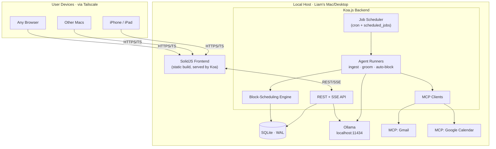
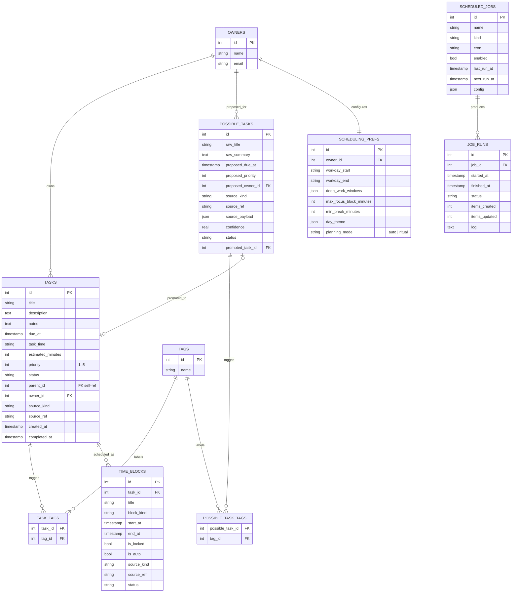
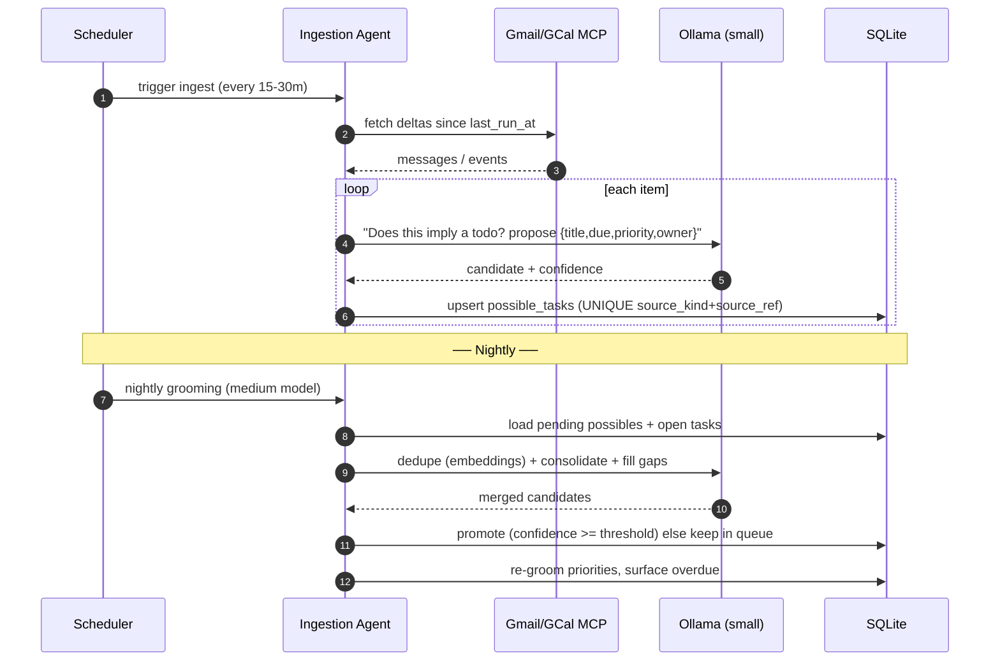
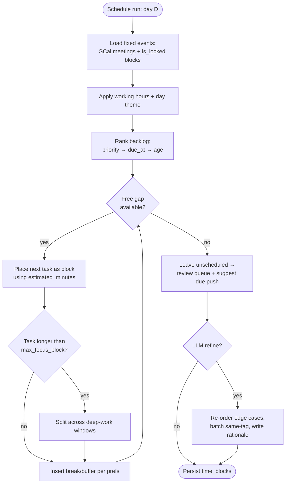
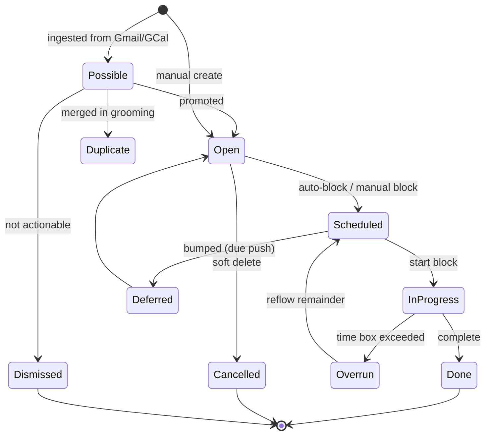
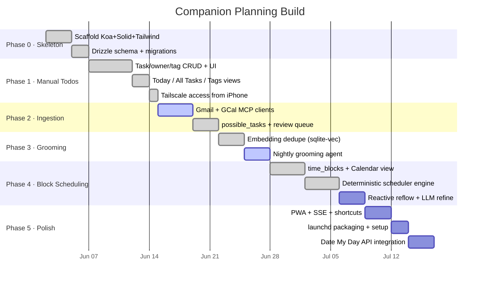

# Companion Planning — Architecture Plan
**Status:** v0.3 — updated 2026-06-10
**Owner:** Liam
**Goal:** Rebuild Companion Planning from scratch on a clean codebase with a sleek modern UI — the best private, local-first life-planning + calendar-management tool, with first-class AI block scheduling.
> **Changes since v0.2:** Updated to reflect implementation reality. Corrected tech stack (SolidJS fonts are Source Code Pro + Abel, not Inter + Geist Mono; styling is raw Tailwind CSS, not Kobalte/shadcn-solid). Updated ER diagram with new fields (`notes`, `task_time`, `parent_id` on tasks; `planning_mode` on scheduling_prefs). Documented actual frontend views and component inventory. Added Design System section (§20). Updated roadmap with completion status. Marked resolved open questions.
---
## 1. Project Overview
Companion Planning is a **local-first, AI-assisted personal planning system**. It runs as a private server on a laptop/desktop, is reachable from any device over Tailscale, stores everything in local SQLite, and uses local LLMs (Ollama) to continuously **ingest, groom, prioritize, and time-block** todos sourced from manual entry, Gmail, and Google Calendar.
It is a Companion Intelligence (CI) product, sibling to *Date My Day*. *Date My Day* owns the geometric day surface and reflection; Companion Planning owns the **task queue, calendar management, and auto-scheduling engine**. They can share data (see §17).
---
## 2. Competitive Landscape
The market splits cleanly into three camps. None occupies the corner Companion Planning targets: **open-source + local-first + AI auto-scheduling**.
### 2.1 Comparison Table
| Tool | Type | Local-first | Calendar sync | Time blocking | AI auto-schedule | Best at |
|---|---|---|---|---|---|---|
| **Super Productivity** | OSS (MIT) | ✅ IndexedDB / desktop store | ⚠️ read-only side panel | ✅ manual timeboxing | ❌ | Solo devs; time tracking + Jira/GitHub/GitLab sync in one app |
| **Vikunja** | OSS (GPL-3, Go) | ❌ server source of truth | ⚠️ CalDAV | ⚠️ basic | ❌ | Self-hosted shared lists & project views |
| **Taskwarrior** | OSS (MIT, C++) | ✅ files | ❌ | ❌ | ❌ | Terminal-native power users |
| **Nextcloud Tasks** | OSS | ❌ needs full Nextcloud | ✅ CalDAV | ❌ | ❌ | People already running Nextcloud |
| **Planify** | OSS (GTK4) | ✅ offline | ⚠️ CalDAV/Todoist | ⚠️ | ❌ | Beautiful Linux/GNOME desktop |
| **Tracks** | OSS (GPL-2, Ruby) | ❌ web app | ❌ | ❌ | ❌ | Pure GTD methodology |
| **Wekan / Kanboard / Planka** | OSS | ❌ | ❌ | ❌ | ❌ | Kanban boards |
| **Logseq / Obsidian (+plugins)** | OSS / freemium | ✅ files | ⚠️ via plugins | ⚠️ via plugins | ❌ | Notes-first task hybrids |
| **Motion** | Commercial cloud | ❌ | ✅ two-way | ✅ | ✅ full auto-rebuild | Hands-off AI that re-plans your day automatically |
| **Reclaim.ai** | Commercial cloud | ❌ | ✅ two-way (Google/M365) | ✅ | ✅ habit/focus defense | Protecting focus time & habits alongside an existing task app |
| **Sunsama** | Commercial cloud | ❌ | ✅ | ✅ manual ritual | ❌ (deliberately) | Calm, mindful morning planning ritual |
| **Akiflow** | Commercial cloud | ❌ | ✅ | ✅ | ⚠️ assisted | Command-bar speed; consolidating many task sources |
| **TickTick / Todoist** | Commercial | ❌ | ✅ | ⚠️ | ❌ | Polished cross-platform mainstream task apps |
| **➡️ Companion Planning** | **OSS, self-host** | **✅ SQLite source of truth** | **✅ two-way (planned)** | **✅ first-class** | **✅ local-LLM auto-block** | **Private AI day-planning you fully own** |
### 2.2 What each camp gets right (and the gap)
- **Open-source / self-hosted** (Super Productivity, Vikunja, Taskwarrior, Nextcloud Tasks): strong on privacy and ownership. Super Productivity is the standout — local-first with built-in timeboxing and time tracking and deep issue-tracker integration. But all of them stop at *manual* scheduling; none auto-plans your day.
- **Commercial AI schedulers** (Motion, Reclaim): genuinely automate the calendar. Motion replaces your calendar and rebuilds the day when a meeting runs long; Reclaim defends habits and focus blocks with two-way sync. The cost is total cloud dependence and no data ownership.
- **Mindful manual planners** (Sunsama, Akiflow): Sunsama's morning ritual — review yesterday, pull tasks, estimate time, block the calendar, set a realistic goal — is the gold standard for *intentional* planning, and it refuses auto-scheduling on principle. Cloud-only.
**The gap:** there is no mature tool that is simultaneously (a) open-source, (b) local-first with the device as source of truth, and (c) capable of AI auto-scheduling tasks into calendar blocks. Companion Planning is built precisely for that corner — and uniquely can offer **both** Motion-style auto-blocking *and* a Sunsama-style ritual, switchable per user.
### 2.3 Design lessons we steal
1. **From Super Productivity:** local-first storage + integrated time tracking, no mandatory account.
2. **From Motion:** auto-reschedule the day when reality shifts (meeting overran → afternoon re-blocks).
3. **From Reclaim:** habit/focus-block defense and respecting fixed events.
4. **From Sunsama:** an optional, opinionated morning ritual; "slow is a feature" mode.
5. **From Akiflow:** a fast command bar and one place that ingests every source.
### 2.4 Sources
- Super Productivity — open-source comparison & local-first roundup: https://super-productivity.com/compare/best-open-source-task-managers/ , https://super-productivity.com/blog/best-local-first-todo-apps-2026/
- awesome-selfhosted task management: https://awesome-selfhosted.net/tags/task-management--to-do-lists.html
- Time-blocking app roundups: https://arahi.ai/blog/best-time-blocking-apps-and-planners-2026 , https://blog.saner.ai/best-time-blocking-planner-apps/
- Motion vs Reclaim vs Sunsama: https://efficient.app/compare/motion-vs-reclaim , https://calmevo.com/sunsama-vs-motion/
---
## 3. Design Principles
1. **Local-first.** SQLite on the device is the source of truth. Tailscale is the only network surface; no cloud sync by default.
2. **Private by construction.** All LLM inference runs on Ollama at `localhost`. MCP servers run on the same host.
3. **Agentic but bounded.** Agents propose; they write only through a small allowed-tool surface and never silently mutate user-locked data.
4. **Two planning modes.** *Auto* (Motion-style: the day is pre-planned) and *Ritual* (Sunsama-style: guided manual blocking). User-selectable.
5. **Structured data + light unstructured layer.** SQL is canonical; tags are a free-form many-to-many overlay.
6. **MVC, legible, forkable.** Modern look, conservative architecture.
7. **Static-deployable frontend.** The SolidJS app builds to static assets; the backend hosts it and powers the agentic pipeline.
---
## 4. Block Scheduling Strategy
Time blocking assigns every working hour a purpose instead of working from an open-ended list. Companion Planning treats **calendar blocks, not list items, as the unit of execution.**
### 4.1 Methodologies supported
| Strategy | What it is | How CP implements it |
|---|---|---|
| **Time blocking** | Each task gets a fixed calendar block. | Scheduler converts `tasks` → `time_blocks` against free calendar gaps. |
| **Time boxing** | Fixed-duration cap per task; stop when the box ends. | `estimated_minutes` drives block length; overrun → `status='overrun'` flag. |
| **Task batching** | Group similar work (email, calls) into one block. | Batch by shared tag; scheduler clusters same-tag tasks adjacently. |
| **Day theming** | Assign whole days a theme (deep work, meetings, admin). | `scheduling_prefs.day_theme` biases which tags get scheduled which day. |
| **Focus/deep-work defense** | Protect long uninterrupted blocks. | `max_focus_block_minutes` + reserved deep-work windows the scheduler won't fill with shallow work. |
| **Buffers** | Breathing room between blocks. | `min_break_minutes` inserts `break`/`buffer` blocks automatically. |
### 4.2 Scheduling rules (v1 heuristic, pre-LLM)
The scheduler runs a deterministic pass first; the LLM only resolves ambiguity and ordering. Order of operations:
1. **Honor fixed events.** Meetings from Google Calendar and any `is_locked` blocks are immovable.
2. **Respect working hours & day theme** from `scheduling_prefs`.
3. **Rank the backlog** by `priority` (1 highest), then `due_at` proximity, then age.
4. **Fit blocks** into free gaps using `estimated_minutes`, splitting long tasks across deep-work windows where allowed.
5. **Insert buffers/breaks** per prefs; never schedule past `workday_end`.
6. **Overflow** → leave unscheduled, surface in the review queue, optionally suggest a due-date push.
7. **LLM pass (optional):** re-order/justify edge cases, batch same-tag work, write a one-line rationale per block.
### 4.3 Reactivity (the Motion lesson)
When a synced calendar event appears/moves, or a user marks a block done/overrun, the scheduler re-runs an **incremental** pass that only moves non-locked, non-completed `time_blocks` for the remainder of the day. Nightly grooming does a full re-plan for tomorrow.
---
## 5. High-Level System Architecture

**Why a backend (not a pure static PWA):** scheduled jobs, persistent MCP sessions, and Ollama calls all require a long-lived process. The frontend stays static-buildable; the backend hosts it and runs the pipeline.
---
## 6. Tech Stack
| Layer | Choice | Notes |
|---|---|---|
| Frontend | **SolidJS** + Vite | Fine-grained reactivity, small bundle. |
| Styling | Tailwind CSS 3 (raw utility classes + custom @layer components) | Dark-only CI brand theme; no component library. |
| Calendar UI | Custom week-strip + block list | Day timeline grid planned for v2. |
| Fonts | Source Code Pro + Abel (Google Fonts) | Monospace-first brand; Abel for display headings. |
| Backend | **Koa.js** (Node 20+) | Minimal async middleware. |
| DB | **SQLite** via `better-sqlite3` | WAL mode, embedded, zero-ops. |
| ORM/Migrations | **Drizzle ORM** | Typed schema, SQLite-native. |
| Vector search | `sqlite-vec` extension | Dedupe embeddings in the same DB. |
| LLM runtime | **Ollama** (local) | Small model for ingest, medium for grooming/scheduling. |
| MCP | MCP TypeScript SDK | Gmail + Google Calendar over OAuth. |
| Scheduler | `croner` | Backed by `scheduled_jobs` table. |
| PWA | `vite-plugin-pwa` | Offline shell + read-only cache. |
| Packaging | Node service + `launchd` plist | No Electron, no Docker required. |
---
## 7. Data Model
ISO 8601 UTC timestamps throughout. New in v0.2: `time_blocks`, `scheduling_prefs`.
### 7.1 ER Diagram

### 7.2 New table DDL
```sql
CREATE TABLE time_blocks (
  id INTEGER PRIMARY KEY,
  task_id INTEGER REFERENCES tasks(id) ON DELETE CASCADE,   -- null for meetings/habits
  title TEXT,                          -- denormalized for calendar render
  block_kind TEXT,                     -- task | meeting | habit | focus | break | buffer
  start_at TIMESTAMP NOT NULL,
  end_at TIMESTAMP NOT NULL,
  is_locked INTEGER DEFAULT 0,         -- user-pinned; scheduler won't move
  is_auto INTEGER DEFAULT 1,           -- placed by scheduler vs manual
  source_kind TEXT,                    -- manual | agent | gcal
  source_ref TEXT,                     -- gcal event id if mirrored
  status TEXT DEFAULT 'planned',       -- planned | completed | skipped | overrun
  created_at TIMESTAMP DEFAULT CURRENT_TIMESTAMP
);
CREATE TABLE scheduling_prefs (
  id INTEGER PRIMARY KEY,
  owner_id INTEGER REFERENCES owners(id),
  workday_start TEXT DEFAULT '09:00',
  workday_end   TEXT DEFAULT '18:00',
  deep_work_windows JSON,              -- [{"start":"09:00","end":"11:00"}]
  max_focus_block_minutes INTEGER DEFAULT 90,
  min_break_minutes INTEGER DEFAULT 10,
  day_theme JSON                       -- {"mon":"deep-work","tue":"meetings"}
);
```
(`owners`, `tasks`, `possible_tasks`, `tags`, join tables, `scheduled_jobs`, `job_runs` carry over from v0.1 — see §7.1 for fields.)
---
## 8. Backend (Koa) — Modules & API
```
/server
  /db        → drizzle schema, migrations, queries
  /routes    → REST controllers
  /jobs      → scheduler + job definitions
  /agents    → LLM runners (ingest, groom, schedule)
  /engine    → deterministic block-scheduling engine
  /mcp       → MCP clients (gmail, gcal) + ollama wrapper
  /lib       → logging, config, tag + time utilities
  index.ts   → Koa app, static serve, API mount
```
| Method | Path | Purpose |
|---|---|---|
| GET | `/api/tasks` | List with filters (status, owner, tag, due). |
| POST | `/api/tasks` | Create manual task. |
| PATCH | `/api/tasks/:id` | Update fields/tags/status. |
| DELETE | `/api/tasks/:id` | Soft-delete (status=cancelled). |
| GET | `/api/possible-tasks` | Review queue (the inbox). |
| POST | `/api/possible-tasks/:id/promote` | Promote (optionally merge). |
| POST | `/api/possible-tasks/:id/dismiss` | Mark not actionable. |
| GET | `/api/blocks?from=&to=` | Calendar blocks for a range. |
| POST | `/api/blocks` | Manual block. |
| PATCH | `/api/blocks/:id` | Move/resize/lock/complete. |
| POST | `/api/schedule/run` | Trigger (re)scheduling for a day. |
| GET | `/api/prefs` / PATCH | Scheduling preferences. |
| GET | `/api/tags` / POST | Tags + counts (word cloud). |
| GET | `/api/jobs` · POST `/api/jobs/:id/run` | Jobs + ad-hoc trigger. |
| GET | `/api/summary?date=` | Prose day briefing (LLM). |
| GET | `/api/llm/status` | Ollama health + installed model list. |
| GET | `/api/events` (SSE) | Live job/schedule/possible updates. |
---
## 9. Automation Pipeline
### 9.1 Ingestion → Promotion sequence

### 9.2 Block-scheduling engine flow

### 9.3 Scheduled jobs
| Job kind | Cadence | Model | Writes |
|---|---|---|---|
| `ingest_gmail` / `ingest_gcal` | every 15–30m awake | small (Hermes/Qwen ~3–7B) | `possible_tasks` |
| `promote_possibles` | nightly | medium (~8–14B) | `tasks` |
| `nightly_grooming` | nightly 02:00 | medium | priorities, dedupe |
| `auto_schedule` | nightly + reactive | deterministic + optional LLM | `time_blocks` |
All agent writes go through the same API endpoints a human uses, with `source_kind='agent'` and an entry in `job_runs.log`.
---
## 10. User Flow


### 10.1 Detailed User Flow Matrix

The application supports four primary user flows that correspond to execution, capturing, planning, and automation:

- **Flow A: Mindful Planning & Time Blocking (Sunsama style)**:
  1. The user logs in and starts in **Ritual Mode** (or opens `/calendar`).
  2. The left column lists the task backlog. The user filters tasks by priority or tag.
  3. The user drags tasks from the backlog sidebar onto the right calendar grid, scheduling them into hourly blocks (e.g. gym, deep work, project meetings).
  4. The user clicks scheduled blocks to adjust them.
- **Flow B: Autonomous AI Assisting & Conflict Reflow (Motion style)**:
  1. The user enables **Auto Mode**.
  2. AI agents ingest calendar meetings and emails. Gmail ingestion proposes new actions into the `/inbox` (Review Queue).
  3. The user opens `/inbox` and accepts (`P` promote) or dismisses (`D` dismiss) proposals.
  4. At night, the `auto_schedule` job runs the scheduling engine to place open tasks into remaining gaps automatically.
  5. The user opens `/` (Today) and sees their day pre-planned. If a meeting overruns or runs long, the user triggers "Schedule Day" (or the server does so reactively), shifting the remaining tasks down.
- **Flow C: Action & Execution with Time Tracking (Super Productivity style)**:
  1. The user opens `/` (Today) to see the active agenda.
  2. The user hovers over the active block or task card and clicks the **Play** button to start the Pomodoro time tracker.
  3. A sticky bar appears at the bottom. As the user works, the timer ticks.
  4. When done or paused, the user clicks **Stop** to log the actual elapsed minutes directly to `actual_minutes` in SQLite.
- **Flow D: Rapid Shorthand Capture (Akiflow style)**:
  1. The user presses `Cmd+K` anywhere in the app to open the global Command Bar modal.
  2. The user types a fast thought like: `submit Q3 financial report #work p1 est:60`.
  3. The shorthand parser decodes this into a task titled "submit Q3 financial report" with priority 1, tag "work", and estimated minutes 60.
  4. Pressing Enter calls the creation API, immediately inserting it into the backlog.

---
## 11. Task & Block Lifecycle

---
## 12. MCP Integration

### 12.1 Outbound Client Integrations
Companion Planning acts as an MCP client connecting to external MCP servers to ingest data:
| Server | Use | Auth |
|---|---|---|
| Gmail MCP | List recent messages, fetch bodies, label processed. | OAuth, token in Keychain. |
| Google Calendar MCP | Read events (rolling window); **optional** write-back of task blocks (v2 flag). | OAuth. |
| Ollama (HTTP) | Local generation + embeddings. | none (localhost). |
Credentials live in macOS Keychain (or libsecret), never in a committed `.env`. Lock Ollama to `127.0.0.1` and firewall port 11434.

### 12.2 Embedded MCP Server (Inbound Agent Access)
The application hosts an embedded MCP server, allowing major agentic harnesses (Claude Desktop, Cursor, Hermes, OpenClaw, etc.) to securely read and write tasks, propose tasks to the Review queue, and run auto-scheduling routines.
- **Transports Supported**: Stdio (CLI mode via `pnpm mcp`) and Server-Sent Events (SSE) (web/remote client mode via `/api/mcp`).
- **Exposed Tools**: `list_tasks`, `create_task`, `update_task`, `propose_task` (Review Queue helper), `get_day_summary`, `run_auto_schedule`.
---
## 13. Frontend (SolidJS) — Views & Components
### 13.1 Views (routes)
| Route | View | Purpose |
|---|---|---|
| `/` | **Today** | Single-screen focus; today's blocks + open tasks + AI briefing card. Time tracking triggers and ticking status bar. |
| `/calendar` | **Calendar (Planner)** | Split-view Workspace: Left sidebar task backlog search/filter; Right absolute hourly calendar grid (workday bounds). Drag & Drop scheduling from backlog to grid. |
| `/inbox` | **Inbox** | `possible_tasks` cards with promote/dismiss review queue. Badge count in nav. |
| `/tasks` | **All Tasks** | Filterable task table (status, tag, search). Inline subtask expansion and inline Markdown editor. |
| `/tags` | **Tags** | Weighted tag cloud + bar chart; click to filter tasks. |
| `/jobs` | **Jobs** | Scheduled job list with run status, manual trigger, latest log. |
| `/settings` | **Settings** | Planning mode (auto/ritual), work hours, block prefs, Ollama + Google MCP integration status. |

### 13.2 Components
| Component | Purpose |
|---|---|
| `Nav` | Sidebar navigation with CI logo, nav links, inbox badge count. |
| `TaskCard` | Task display with priority dot, subtask toggle, status actions, tag badges, Play/Stop timer button, actual vs estimated minutes display, and drag handler. |
| `BlockCard` | Time block card with kind indicator, time range, status controls. |
| `TaskForm` | Modal for creating/editing tasks (title, notes, due date, time, priority, tags, parent) prefilled with drop details. |
| `CommandBar` | Global modal Command Palette (`Cmd+K`) displaying search matching, arrow selection navigation, and syntax shorthand parser. |
| `Toast` | Toast notification container with success/error variants. |

### 13.3 State management
SolidJS `createSignal` + `createResource` in a central `stores/index.ts`. Resources auto-fetch tasks, blocks, possibles, prefs. SSE via `lib/sse.ts` triggers refetches on server events.

Design language: light & dark mode support, teal-navy surfaces, mint-gradient CTAs; Source Code Pro body + Abel headings; geometric priority dots with glow; CI brand tokens throughout. SSE drives live updates.

### 13.4 Interface Mockups

#### Desktop Split-View Planner
The desktop view combines the filterable backlog sidebar and the hourly Day Grid overlay in a responsive split layout:


#### Mobile Focus Layout
On mobile/tablet screens, the sidebar collapses into a slide-out drawer or toggles via nav. The view renders as a single-column scrollable Day Grid showing:
1. Pinned daily agenda blocks.
2. Floating Pomodoro Time Tracker pinned to the bottom.
3. Rapid shorthand capture bar (or a FAB) to quickly capture tasks on the move.
---
## 14. Tagging System
Many-to-many over `tasks`/`possible_tasks`. Names normalized on insert (lowercase, hyphenated, ≤32 chars). Tags survive promotion (`possible_task_tags` → `task_tags`). Agents may *suggest* tags but only surface them in the queue above a confidence threshold. Batching and day-theming key off tags.
---
## 15. Deployment
- Single Node process under `launchd`, bound to the Tailscale interface on a chosen port (e.g. 3848).
- Reached at `http://liam-mbp.<tsnet>.ts.net:3848`.
- Optional bearer token over Tailscale TLS for the API.
- DB at `~/Library/Application Support/CompanionPlanning/`; Time Machine + optional encrypted nightly export.
- `pnpm start` runs everything; a `companion-planning.plist` installs the launch agent. No Docker required.
---
## 16. Security / Privacy Posture
- **Network:** Tailscale ACLs only; no public ingress.
- **Auth:** single user; bearer token over TLS.
- **Data:** local SQLite; all inference local; outbound limited to Google OAuth refresh + MCP-mediated reads.
- **Audit:** every row records `source_kind` / `source_ref` / timestamps; agent edits append to `job_runs.log`; locked blocks are immutable to the scheduler.
---
## 17. Open Questions
1. **Date My Day integration.** Shared SQLite file, a read API CP exposes, or fully independent? *Recommendation:* CP exposes a read API; Date My Day consumes blocks/tasks and owns reflection. **(Needs your call before scaffolding.)**
2. **Calendar write-back.** Mirror auto-blocks into Google Calendar, or keep CP-internal? Read-only v1; write-back behind a v2 flag.
3. **Scheduler intelligence split.** **Resolved.** ~95% deterministic; LLM refine pass designed but not yet wired.
4. **Embeddings model** for dedupe — which Ollama embedding model, and similarity threshold for "duplicate"?
5. **Multi-owner.** Schema supports it; v1 stays single-user (Liam).
---
## 18. Phased Roadmap

### Phase notes
- **Phase 0–1:** usable manual planner reachable from all devices.
- **Phase 2–3:** inbox/calendar ingestion + nightly grooming (the v0.1 core).
- **Phase 4:** the differentiator — local-LLM block scheduling with reactive reflow.
- **Phase 5:** ship-quality polish + CI ecosystem integration.
---
## 19. Naming / Repo
- Working name: **Companion Planning** (replaces the previous codebase).
- New clean repo under the `companion-intelligence` org; archive or repurpose `ai-todo-static` as the static dashboard front.
- Tagline candidates: *"Your inbox becomes your plan, privately."* / *"Own your day. Literally."*

---
## 20. Design System — CI Brand
The frontend implements the CI (Companion Intelligence) brand language: a dark-only, teal-navy palette with neon-mint accents.

### 20.1 Color tokens (Tailwind)
| Token | Hex | Usage |
|---|---|---|
| `ci-3` | `#58ebbf` | **Primary CTA** — button gradients, checked states, FAB |
| `ci-4` | `#409b9b` | **Interactive accent** — borders, rings, badges, section labels |
| `ci-1` | `#ABD4D8` | **Text accent** — light teal for emphasis |
| `ci-9` | `#82ffe1` | **Neon glow** — hover highlights, active nav text-shadow |
| `ci-10` | `#244859` | **Dark navy-teal** — checkbox borders, muted UI |
| `surface-950` | `#070d11` | Page background |
| `surface-900` | `#0a1520` | Nav/top bar background |
| `surface-800` | `#0f1e2e` | Card/modal background |
| `surface-700` | `#152637` | Input background, hover states |
| `surface-600` | `#1a3040` | Input borders, scrollbar thumb |

### 20.2 Typography
- **Body / UI:** Source Code Pro 400–600 (monospace-first brand)
- **Headings:** Abel 400 with `tracking-wide` (geometric display)
- Both loaded via Google Fonts in `index.html`.

### 20.3 Component classes
Defined as `@layer components` in `index.css`:
`btn`, `btn-primary`, `btn-secondary`, `btn-ghost`, `btn-danger`, `btn-icon`, `card`, `input`, `input-lg`, `textarea`, `badge-*` (neutral, accent, green, yellow, red, blue), `priority-dot` (p1–p5), `toast`, `modal`, `fab`, `nav-item`, `section-label`, `checkbox`.

### 20.4 Signature effects
- **Mint gradient:** `linear-gradient(135deg, #58ebbf, #409b9b)` on primary buttons, FAB, checked checkbox.
- **CI glow:** `box-shadow: 0 0 20px -4px rgba(88,235,191,.35)` on hover cards, active elements.
- **Text glow:** `text-shadow: 0 0 12px rgba(88,235,191,.4)` on active nav items.
- **Press feedback:** `active:scale-95` on all interactive elements.
- **Glassmorphism:** `backdrop-filter: blur()` on modal backdrop and toasts.

---

## 21. Navigation Audit & User Flow Matrix

Every view in the navigation sidebar corresponds to a distinct phase of the user's planning, execution, and automation lifecycle:

| View Path | View Name | Primary Function | Supported User Flow | How it Informs User Flow |
|---|---|---|---|---|
| `/` | Today | Execution Dashboard | Flow C (Execution & Tracking) | Displays today's agenda; acts as the start/stop visual console for time tracking session logs. |
| `/calendar` | Calendar | Workspace Planner | Flow A (Mindful Scheduling) | Backlog sidebar next to day grid lets the user physically structure their day using drag-and-drop or slot clicks. |
| `/inbox` | Inbox | Triage Review | Flow B (Autonomous Triage) | Protects active todo backlog by forcing user confirmation on Gmail/GCal anomalies. |
| `/tasks` | Tasks | Backlog Grooming | Flow A (Mindful Planning) | Structured database list for notes cleanup, tag management, and nesting tasks before time-blocking. |
| `/tags` | Tags | Organization | Flow A & D (Categorization) | Taxonomical overview to gauge where time is spent and jump-filter tasks by label. |
| `/jobs` | Jobs | Control Room | Flow B (Automation) | Monitors background AI schedulers, mail sweeps, and ingestion health logs. |
| `/settings` | Settings | Core Config | Flow A & B (Preferences) | Restricts scheduler work windows, defaults, and planning mode (auto/ritual). |
