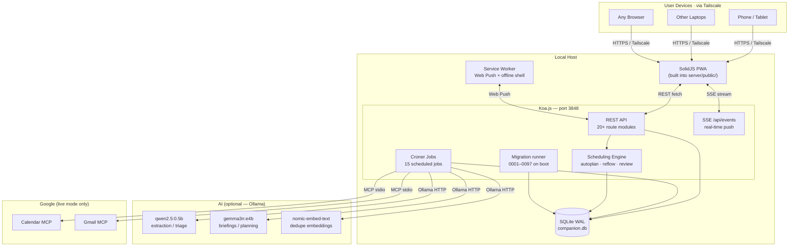
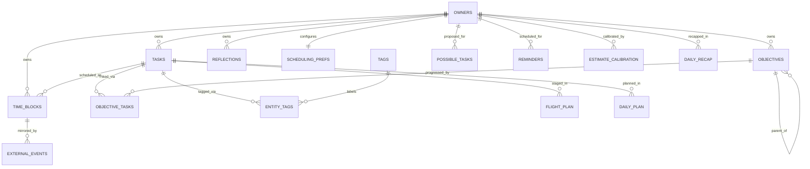
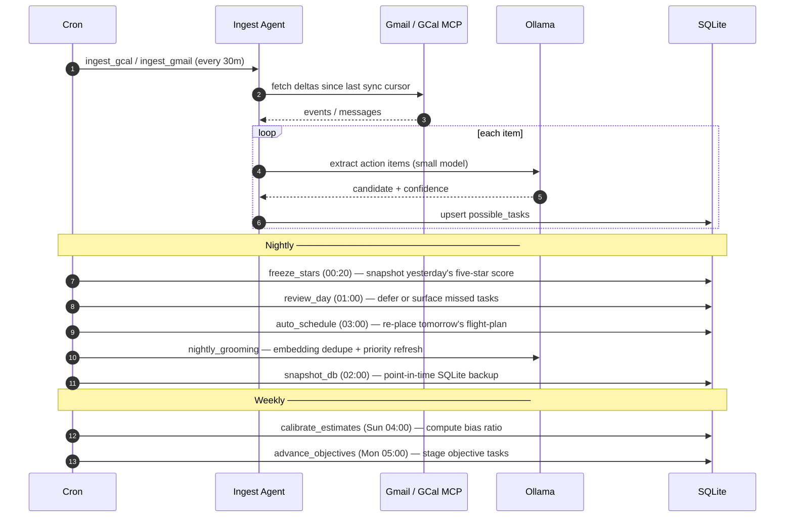
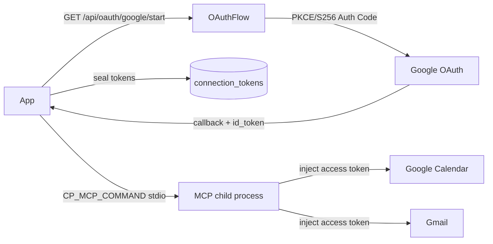
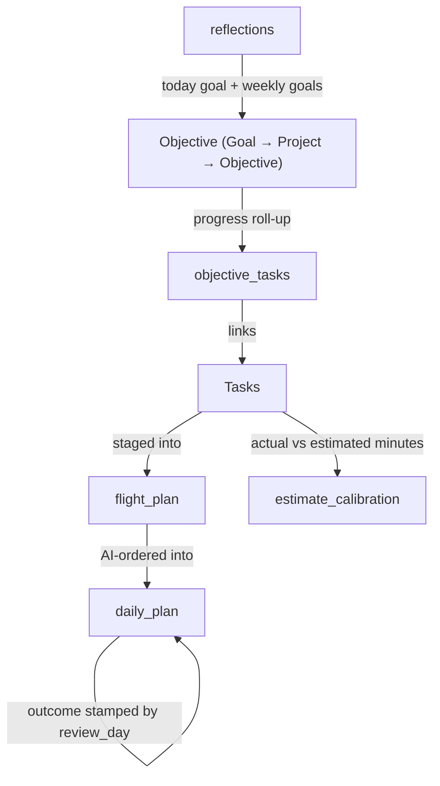
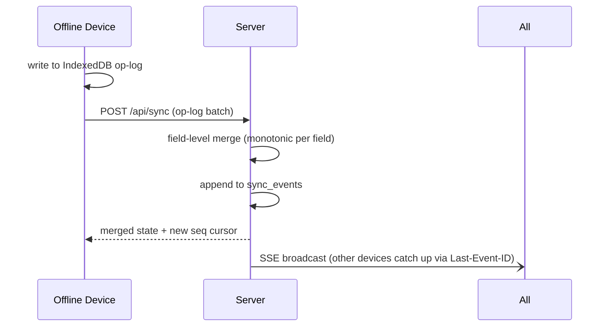

# Companion Planning — Architecture Reference

**Status:** Living document · last updated 2026-07-01 · migration head `0097`

> This document describes the **as-built** system — what is actually running, not what was planned. For future phases, see [docs/ROADMAP.md](docs/ROADMAP.md).

---

## 1. Project overview

Companion Planning is a **local-first, AI-assisted personal planning system**. It runs as a private server on a laptop or desktop, reachable from any device over Tailscale, stores everything in local SQLite, and uses a local LLM (Ollama) for briefings, task extraction, grooming, and auto-scheduling. No cloud required; no account.

**Shipped phases (A → S; migration head 0097):** Tasks + scheduler · Rich semantics + time tracking · Recurrence · Calendar grid · Time-blocks + patterns + cockpit · Notifications + Web Push · Backups + export/import + audit · Identity + auth + connector infrastructure · Two-way calendar sync (Google) · Google OAuth 2.1 + MCP · AI scheduler + reactive reflow · Multi-device sync + offline writes · Life-planning layer (objectives, reflections, weekly review, calibration) · **Phase O — the gamified five-star day** (FOCUS card with linked/freeform focus + Today's Brief pop-up, a day note, `computeStars()` + nightly-frozen `daily_recap` stars, calendar heatmap; the standalone Morning Briefing section is retired) · **Phase P — planner hygiene** (a shared `clear-range` engine behind the CLI, `POST /api/planner/clear`, and a `recurrence_horizon_days` setting that bounds + auto-prunes both recurrence engines) · **Phase Q — schema hygiene** (FK enforcement guaranteed on every connection via a shared `openDb()`, FK-path index coverage, and owner-identity integrity rebuilds of `flight_plan` and `daily_summaries` — pre-multi-tenant) · **Phase S — schema consolidation** (dropped the dead `plan_outcomes` table + its cron; merged `daily_summaries` + `day_stars` into `daily_recap`; `pattern_prefs` + `category_prefs` into `tag_prefs`). Also in this window: task placement lifecycle (open↔scheduled), task→objective auto-promotion with height-based leveling, block-template application, and objectives joining the multi-device sync layer (0085–0087).

---

## 2. Tech stack

| Layer | Choice | Notes |
|---|---|---|
| Frontend | **SolidJS** + Vite | Fine-grained reactivity, small bundle |
| Styling | Tailwind + shadcn-solid / Kobalte | CI-Hub design tokens; dark-first |
| Backend | **Koa.js** (Node ≥26) | Minimal async middleware |
| DB | **SQLite** via `better-sqlite3` | WAL mode, embedded, zero-ops |
| Migrations | Plain TypeScript functions | Sequential, idempotent; `_migrations` table |
| ORM | **Drizzle ORM** + raw `better-sqlite3` | Typed schema; raw SQL for hot paths |
| LLM runtime | **Ollama** (local) | Graceful degradation when offline |
| MCP | `@modelcontextprotocol/sdk` | Gmail + Google Calendar over OAuth |
| Cron | `croner` + `scheduled_jobs` table | Persistent job registry |
| PWA | `vite-plugin-pwa` | Offline shell + service worker; Web Push (VAPID) |
| Auth | Session-cookie login (OIDC/PKCE RP + local argon2id) + hashed API-key | Mints a signed, httpOnly cp_session on sso login; hashed x-api-key for standalone; no per-request Bearer |
| Crypto | AES-256-GCM (`CP_KEK_B64`) | OAuth tokens sealed in `connection_tokens` |

---

## 3. High-level system diagram



---

## 4. Repository layout

```
Companion-Planning/
├── client/                   SolidJS PWA
│   └── src/
│       ├── components/       Shared UI components
│       ├── views/            One file per route (Today, Calendar, …)
│       └── lib/              api.ts · dates.ts · stores
├── server/
│   └── src/
│       ├── db/
│       │   ├── migrations/   0001_baseline → 0097_tag_prefs
│       │   └── index.ts      BetterSqlite3 open + uuid7 UDF + runMigrations
│       ├── engine/           autoplan · review · reflow · flight-plan
│       ├── routes/           REST controllers (one file per resource)
│       ├── jobs/             Croner job definitions
│       ├── services/         weekly-review · tags · notifications
│       ├── connectors/       Google OAuth 2.1 + Calendar/Gmail MCP bridge
│       ├── agents/           ingest · groom · sync reconciler
│       └── lib/              config · crypto · dates · tz · logger · ids
├── docs/                     ROADMAP · GLOSSARY · phase specs · diagrams
└── ops/                      litestream.yml · launchd plist
```

---

## 5. Data model

### 5.1 Entity-relationship overview



### 5.2 Key tables

| Table | Purpose | Added |
|---|---|---|
| `owners` | User identity (single-owner in v0.3) | 0001 |
| `tasks` | Core work atom — UUIDv7 PK, status, priority, subtype, recurrence | 0001 |
| `task_dependencies` | Blocked-by edges between tasks | 0005 |
| `time_entries` | Actual work logged per task; running timer = `ended_at IS NULL` | 0007 |
| `time_blocks` | Named time spans — task · meeting · focus · break · buffer | 0015 |
| `block_templates` | Reusable Time-Block templates with saved task lists | 0022 |
| `flight_plan` | Two-step Auto staging tray — task list ordered before scheduling; `owner_id` `TEXT NOT NULL` (0093) | 0016, 0093 |
| `daily_plan` | AI-authored task order for a day (`outcome` stamp for plan tracking) | 0062, 0084 |
| `replan_suggestions` | Pending "re-plan with AI?" nudges on big-disruption reflows | 0067 |
| `possible_tasks` | Inbox — AI-proposed items pending promote / dismiss | 0001 |
| `tags` | Cross-cutting labels; `kind`: `direction` or `intention` or `category` | 0001 |
| `tag_directions` | Many-to-many: intention tags grouped under direction tags | 0043/0105 |
| `entity_tags` | Polymorphic tag store for tasks, blocks, routines (CON-3) | 0033 |
| `patterns` | Routines — typed, reusable task collections (Habit ◯ / Routine ▢) | 0013 |
| `pattern_types` | Routine taxonomy — **load-bearing, do not rename** | 0019 |
| `pattern_tasks` | Routine ↔ task many-to-many | 0013 |
| `pattern_blocks` | Direction-scoped scheduling windows (workday/weekend) | 0037 |
| `tag_prefs` | Per-owner × per-tag config by `kind` (pattern/category): shared color_token/default_minutes + pattern-only auto_fill/reminder_offsets/icon_shape; merged `pattern_prefs` + `category_prefs` | 0039, 0069, 0097 |
| `scheduling_prefs` | Work hours, focus/break bounds, model overrides, feature flags, `recurrence_horizon_days` (default 7) | 0001, 0091 |
| `scheduled_jobs` | Croner job registry (name, cron, enabled) | 0001 |
| `job_runs` | Execution log per run (status, items created/updated, log text) | 0001 |
| `reminders` | Scheduled reminders — fired exactly once by the 1-min dispatcher | 0044 |
| `push_subscriptions` | Web Push endpoints per owner (VAPID) | 0044 |
| `audit_log` | Append-only mutation log written by every mutating route | 0046 |
| `api_keys` | Hashed `x-api-key` credentials for `AUTH_MODE=standalone` | 0049 |
| `connection_tokens` | Encrypted OAuth tokens (AES-256-GCM, `CP_KEK_B64`) | 0050 |
| `external_events` | Sync identity map — provider events ↔ local time_blocks | 0051 |
| `outbound_queue` | Local blocks pending push to provider (when `CP_SYNC_WRITEBACK=true`) | 0057 |
| `oauth_states` | Single-use OAuth 2.1 PKCE/state rows, consumed at callback | 0058 |
| `sync_state` | Incremental-sync cursors per `(owner, provider, account, resource)` | 0060 |
| `sync_events` | Append-only SSE event log for `Last-Event-ID` catch-up replay | 0077 |
| `reflections` | FOCUS card slots — today focus + up to 3 weekly goals per ISO week; optional source link to a Task/Objective (`source_kind`/`source_ref`); also the one-per-day `kind='day_note'` row | 0080, 0088 |
| `objectives` | Hierarchical life goals — Goal › Project › Objective by height; `source_task_id` marks auto-promoted nodes; `version`/`field_ts` for sync | 0081, 0085, 0086, 0087 |
| `objective_tasks` | Objective ↔ Task linkage for progress roll-up | 0081 |
| `estimate_calibration` | Per-owner bias stats (p25/p50/p75 of actual/estimated ratio) | 0083 |
| `daily_recap` | One row per `(owner, date)`: the day-briefing cache (`prose`/`stats`/`focus`/`inputs_hash`) + the frozen five-star score (`star_*`/`total`/`frozen_at`); today lives, past days permanent once frozen. Merged `daily_summaries` + `day_stars` | 0089, 0094, 0096 |

---

## 6. Scheduling engine

Two clocks drive the day:

| Clock | What it does | When it runs |
|---|---|---|
| **Slow (LLM)** | Orders tasks into a frozen `daily_plan` with a "why now" rationale per block | Once per day on demand (`POST /api/plan/reauthor`) or the nightly job |
| **Fast (deterministic)** | Re-packs movable auto-blocks from the frozen order whenever the obstacle set shifts | Debounced reactive trigger on task edit / calendar sync / missed block |

**Anti-thrash rules:** never move an in-progress block, never move user-locked or recently-moved blocks (`last_moved_at`), cap displacement per run, debounce bursts into one pass. On a big disruption the fast clock surfaces a single "Re-plan with AI?" nudge — never auto-calls the LLM.

**Review job** (`review_day`, nightly 01:00): scans for planned task-blocks whose end time passed un-started. Low-priority tasks (`priority ≥ 3`) are auto-deferred with a +1/3/7-day backoff; high-priority tasks (`priority ≤ 2`) are surfaced as `status='missed'`. Before the stale block is hard-deleted, `daily_plan.outcome` is stamped `'deferred'` or `'missed'` so plan-outcome history isn't lost (the N4 lossy-slip fix).

---

## 7. Automation pipeline



### 7.1 Scheduled jobs (current)

| Kind | Cron | Purpose |
|---|---|---|
| `fire_reminders` | every 1m | Fire due reminders exactly once (SSE + Web Push) |
| `sync_calendar` | every 15m | Two-way Google Calendar sync — meeting mirror + placement (Phase J) |
| `ingest_gmail` | every 30m | Extract possible-task candidates from Gmail messages |
| `ingest_gcal` | every 30m | Extract possible-task candidates from Calendar events |
| `tag_tasks` | hourly | Auto-tag every untagged open task for the owner |
| `freeze_stars` | daily 00:20 | Snapshot yesterday's five-star score into `daily_recap` (owner-tz day; idempotent, first-freeze-wins on `frozen_at`) |
| `review_day` | daily 01:00 | Defer / surface missed planned tasks |
| `promote_possibles` | daily 02:00 | Auto-promote high-confidence inbox items into Tasks |
| `nightly_grooming` | daily 02:00 | Dedupe near-identical tasks with embeddings |
| `snapshot_db` | daily 02:00 | Write a point-in-time SQLite backup |
| `generate_recurrences` | daily 02:45 | Materialize recurring Task/Habit instances; flag missed habits |
| `auto_schedule` | daily 03:00 | Re-place flight-plan items for the next day |
| `prune_sync_events` | daily 03:00 | Trim old `sync_events` rows beyond retention window |
| `calibrate_estimates` | Sun 04:00 | Compute personal estimate bias ratio |
| `advance_objectives` | Mon 05:00 | Stage tasks for active objectives into flight-plan |

---

## 8. Frontend views

| View | Route | Key components |
|---|---|---|
| **Today** | `/` | Day header (single-select count buckets + paged task list, day note, day-stars tally) · FOCUS card (today/weekly focus, linked or freeform; Today's Brief pop-up) · PLANNER (8h/expand, drag-reorder) · Flight-plan staging · ElementWizard drawer |
| **Calendar** | `/calendar` | Day / week / month grid · five-star heatmap + note dots · Weekly Review panel (week toggle) |
| **Inbox** | `/inbox` | `possible_tasks` review queue — promote (`P`) / dismiss (`D`) / merge |
| **Tasks** | `/tasks` | Filterable backlog with priorities, tags, notes, subtasks, dependencies |
| **Routines** | `/routines` | Pattern CRUD (Routine ▢ / Habit ◯); per-pattern fill + reminder config |
| **Objectives** | `/objectives` | Tree of Goal › Project › Objective; create / edit / re-parent / link tasks |
| **Tags** | `/tags` | direction / intention taxonomy; weighted cloud; mute / delete |
| **Jobs** | `/jobs` | Scheduled job registry; run any job on demand; execution log |
| **Settings** | `/settings` | Work hours · model picker · Web Push opt-in · MCP connections · export/import · recurrence duration · Clear Date Range |

SSE drives live updates across all views — task / block / job / reminder events are broadcast owner-scoped.

---

## 9. Authentication & security

**Auth modes** (set via `AUTH_MODE`):

| Mode | Use case | Mechanism |
|---|---|---|
| `test` | Dev / CI (forbidden in production) | System owner injected; no token required |
| `standalone` | Docker / self-hosted | Hashed `x-api-key` in `api_keys` table (SHA-256, `crypto.timingSafeEqual`) |
| `sso` | CI Hub appliance | Login mints a signed, httpOnly `cp_session` cookie (Koa `app.keys` from `SESSION_SECRET`); every request is authenticated by that cookie, never a Bearer token. Two login sub-modes: CI-Portal OIDC (OAuth 2.1 + PKCE RP; id_token JWKS-verified once at the callback, endpoints discovered via `CIPORTAL_ISSUER`) or, with `DISABLE_OIDC=true`, local username/password (argon2id). |

Sessions are stateless signed cookies stamped with `owners.session_epoch`; bumping that epoch (logout-all / Phase V password reset) instantly invalidates every outstanding cookie for that owner. The older generic `AUTH_JWKS_URL` / `AUTH_ISSUER` / `AUTH_AUDIENCE` / `AUTH_CONTRACT_VERSION` vars predate the CI-Portal OIDC flow: they are still parsed into `config.auth`, but those fields are consumed by no code path.

**Token crypto:** OAuth access/refresh tokens are sealed with AES-256-GCM in `connection_tokens`. The 32-byte key-encryption key is supplied as `CP_KEK_B64` — never committed; never in a log. Each row stores a `key_version` so keys can be rotated without re-authenticating.

**Log redaction:** `server/src/lib/logger.ts` recursively masks any key matching the secret pattern (tokens, `client_secret`, `authorization`, `code`, `kek`, `iv`, `ciphertext`, …) at any depth before serialization. URL query params carrying `token` / `code` / `client_secret` are scrubbed from string values. Cycle-safe, depth-guarded.

---

## 10. Google connector



The `McpGoogleSession` owns the MCP child process and injects the per-account access token (fetched from `connection_tokens`, refreshed if needed) into each MCP call — the child never persists credentials of its own. `GOOGLE_MODE=fixture` (default) uses committed sample data with no network calls. Set `GOOGLE_MODE=live` to activate the real connector.

**Circuit breaker:** 5 consecutive MCP failures open the breaker for 30s; retries get 3 attempts with a `CP_MCP_TIMEOUT_MS` deadline.

---

## 11. Life-planning layer (Phase N)

Phase N turns Companion Planning from a workday planner into a life planner.



**Key decisions:**
- Objective level is server-derived from tree **height** (leaf-with-tasks = objective, node-of-objectives = project, node-of-projects = goal) — re-stamped on the node + ancestors on every (re)parent; never accepted in PUT/POST body. Tasks link only to leaf objectives.
- Progress is `NULL` when there are no tasks or children (not 0 — a `NULL` is a rot signal).
- `daily_plan.outcome` is write-once (`WHERE outcome IS NULL` guard) — `review.ts` stamps `'deferred'` / `'missed'` before hard-deleting the stale block.
- Estimate bias uses the **median** (p50), not mean — robust against outlier interrupted sessions.
- Quartile computation is in JavaScript (sorted array) — SQLite has no `PERCENTILE_CONT`.

---

## 12. Multi-device sync (Phase L)

**Two-clock merge strategy:** every mutating route increments a monotonic `version` counter and records a `field_ts` (per-field timestamp) alongside the updated row. A `sync_events` append-only log backs `Last-Event-ID` SSE catch-up. Synced entities: **tasks, time blocks, objectives, and objective↔task links** (objectives joined the allowlist in 0087; links merge via an `unlink` tombstone so a removal round-trips under field-LWW).



**Monotonic completions:** a concurrent edit on another device can never un-complete a task — the `done_at` field is monotonically forward-only in the merge. The same guard pins task **placement**: a stale offline op carrying `status:'open'` can't revert a server-side `scheduled` (mirrors the `done` pin), so placement isn't lost across devices.

**Conflict surface:** a genuine conflict (two devices edited the same field in the same version window) shows a persistent banner — not a toast — so the user can review.

---

## 13. Deployment options

### Tailscale + launchd (recommended for personal use)

```bash
pnpm build && pnpm --filter server start
# Runs on port 3848; access from any Tailscale device
```

Install as a launch agent: `ops/companion-planning.plist` (macOS). Set `DB_PATH` explicitly on Linux or Windows (default is `~/Library/Application Support/CompanionPlanning/companion.db` on macOS).

### Docker

```bash
docker run -d --name ci-planning \
  -p 3848:3848 \
  -v ci-planning-data:/data \
  ghcr.io/companionintelligence/ci-planning:latest
```

On CI Hub, install from the marketplace — the Hub mounts `${APP_DATA_DIR}/data` at `/data` and wires `OLLAMA_URL` automatically.

### Key environment variables

| Var | Default | Purpose |
|---|---|---|
| `PORT` | `3848` | HTTP port |
| `DB_PATH` | `~/Library/…/companion.db` | SQLite path |
| `AUTH_MODE` | `test` | `test` / `standalone` / `sso` |
| `OLLAMA_URL` | `http://127.0.0.1:11434` | Ollama endpoint |
| `GOOGLE_MODE` | `fixture` | `fixture` (offline) or `live` (real OAuth) |
| `CP_KEK_B64` | (unset) | 32-byte AES key for token sealing |
| `CP_SYNC_WRITEBACK` | `false` | Push local blocks to Google Calendar |
| `VAPID_PUBLIC_KEY` / `VAPID_PRIVATE_KEY` | (unset) | Web Push keys |

Full variable reference: [README.md](README.md#environment-variables)

---

## 14. Backup & recovery

Everything lives in the single SQLite file at `DB_PATH`.

| Method | How | Cadence |
|---|---|---|
| **Built-in snapshots** | `pnpm --filter server snapshot` or the `snapshot_db` job | Daily at 02:00; keeps `SNAPSHOT_RETAIN` (default 7) copies |
| **Litestream** | `litestream replicate -config ops/litestream.yml` | Continuous WAL replication to object storage |
| **Export/import** | `GET /api/export` → `POST /api/import` | On-demand; owner-scoped JSON |

⚠ **Do not sync the live `.db` file with Syncthing/rsync** — SQLite WAL spans three files (`.db`, `.db-wal`, `.db-shm`) and file-sync tools copy them at different moments, producing a corrupt or inconsistent database. Use `pnpm snapshot` or Litestream.

---

## 15. Competitive position

Companion Planning occupies the gap between open-source tools (no auto-scheduling) and commercial AI schedulers (cloud-only, no data ownership):

| Dimension | Companion Planning | OSS alternatives | Commercial AI (Motion, Reclaim) |
|---|---|---|---|
| Local-first | ✅ SQLite source of truth | ✅ (Super Productivity, Taskwarrior) | ❌ cloud |
| AI auto-schedule | ✅ local LLM | ❌ | ✅ cloud LLM |
| Two-way calendar sync | ✅ | ❌ or limited | ✅ |
| Life-planning layer | ✅ objectives + reflections | ❌ | partial |
| Data ownership | ✅ fully local | ✅ | ❌ |
| Open source | ✅ MIT | ✅ | ❌ |

The differentiator: **open-source + local-first + AI-assisted day planning + life-planning layer**, all on your own hardware.
