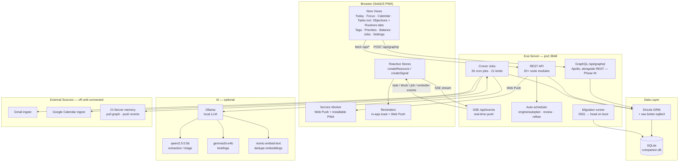
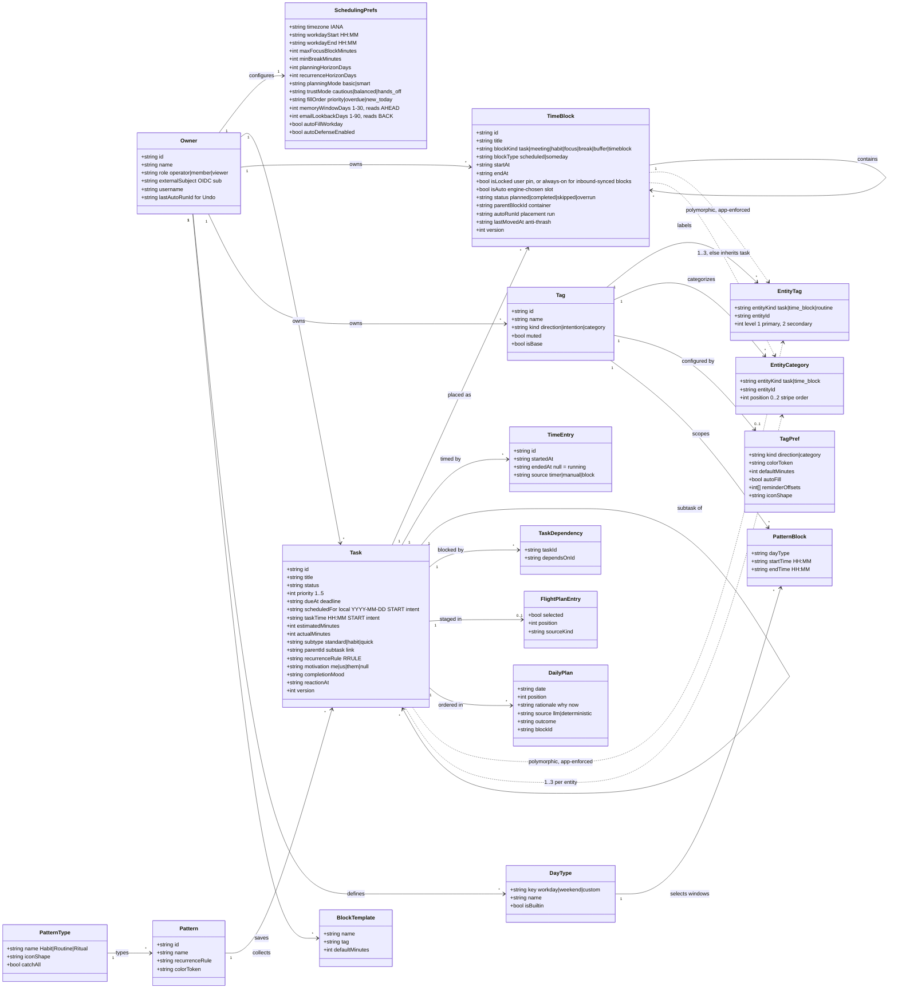
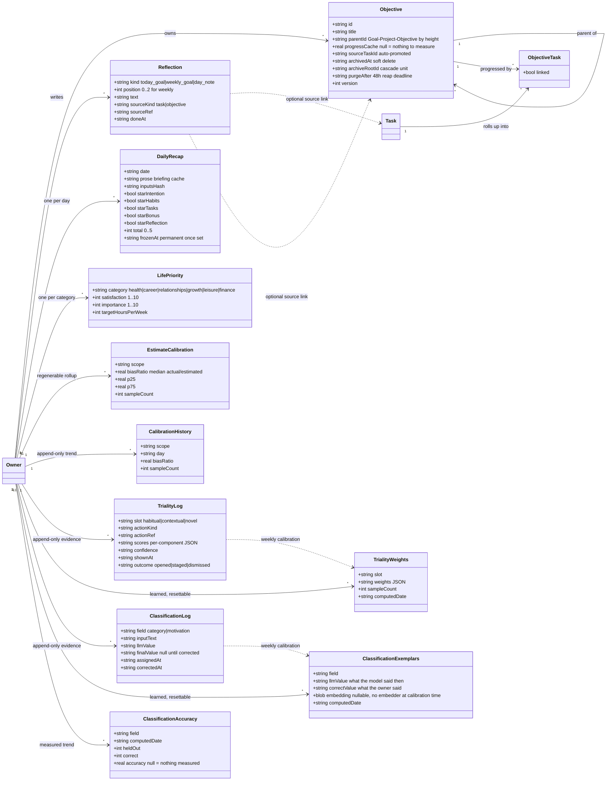
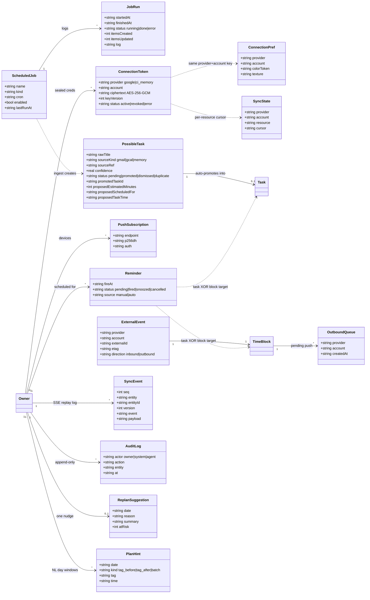
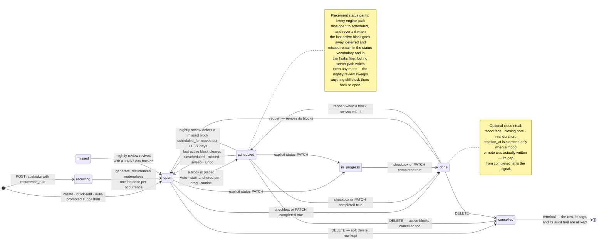
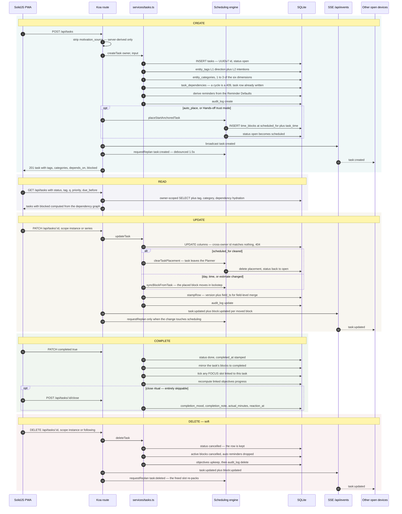
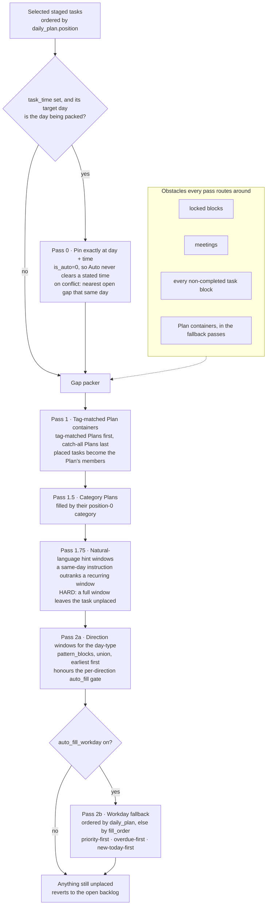

# Companion Planning

A **private, local-first** personal todo and planning app. Tasks, time blocks,
tags, and an automation pipeline live in a single SQLite file on your machine; an
optional local LLM (Ollama) adds AI briefings, task extraction, grooming, and
auto-scheduling. No cloud and no account — your planning data lives on your
hardware and stays there.

**On crash reporting, plainly:** released container images are built with a Sentry
DSN and report **crashes** by default — errors only, no tracing, no session replay,
no PII, and every payload scrubbed of credentials and home paths first. Your tasks,
calendar and reflections are never sent. Turn it off without a rebuild with
`CI_TELEMETRY=off` (what the app store's *Share crash reports* toggle sets) or
`CI_LOCAL_ONLY=true` (zero phone-home, beats everything). A **source checkout or
any build made without a DSN initialises no Sentry at all** and opens no outbound
connection. Full posture: [docs/operations/error-reporting.md](docs/operations/error-reporting.md).

Companion Planning is currently in **v0.3 active development**. The core app is
fully local and usable today. A **standalone Google OAuth 2.1 flow** (Authorization
Code + PKCE/S256, implemented in the app — not the macOS Keychain) and **two-way
Google Calendar sync** are built in. Enable them either **in-app** (an admin pastes a
Google OAuth client in Settings → Connections; needs only a 32-byte `CP_KEK_B64` key
that encrypts stored secrets/tokens) or via env (`GOOGLE_MODE=live` +
`CP_GOOGLE_CLIENT_ID` / `CP_GOOGLE_CLIENT_SECRET`, which pins the mode and makes the
in-app setup read-only). With neither configured, Google integration is **off** — no
ingest, no sync. `GOOGLE_MODE=fixture` is an explicit dev/demo opt-in that runs fully
offline on committed sample data (refused in production unless `CP_ALLOW_FIXTURE=true`).
Outbound calendar write-back stays behind a second flag, `CP_SYNC_WRITEBACK` (off by
default — inbound read-only is the safe posture).
See **[docs/google-cloud-setup.md](docs/google-cloud-setup.md)** to provision a Google
client.

- **Server** — Koa + TypeScript (`server/`), SQLite via better-sqlite3 + Drizzle, cron jobs via croner
- **Client** — SolidJS + Tailwind PWA (`client/`), built by Vite into `server/public/`
- **One process, one port** — the server serves both the API and the UI on **3848**

**Source of truth for docs:** this README describes the running app;
[docs/ROADMAP.md](docs/ROADMAP.md) is the authoritative plan for future phases.
SQLite is the single source of truth for data.

## Quick start

From a source checkout (Node ≥ 22 + pnpm):

```bash
corepack enable    # activates the pinned pnpm version
pnpm install
pnpm dev           # API server on :3848 + client dev server on :5173
```

Open **<http://localhost:5173>**. A dev run needs **no configuration and no login**
(`AUTH_MODE=test` is the default outside production), and the AI features simply stay
hidden until a local [Ollama](https://ollama.com) is reachable. In VS Code, the same
thing is one keypress: open the repo folder and press **F5** (*Full stack (pnpm dev)*).

The full guide — prerequisites, `server/.env`, the VS Code launch configurations, seed
data, Ollama, production-style runs — is in **[Local development](#local-development)**.
Prefer a container? See **[Run with Docker](#run-with-docker-ci-hub)**.

## Interface

A screen-by-screen tour of the SolidJS PWA, on the
[Companion Intelligence design system](https://github.com/companionintelligence/CI-Common/tree/main/style)
— teal primary (`#0f717a` light / `#abd4d8` dark), Montserrat, light + dark. Dark is
the default; the sidebar toggle switches to light. Every pair below is a real headless
render of the built client served by the Koa server against a seeded SQLite database
(`pnpm seed`), captured at 1440×900 in both themes — not a mockup.

The one sidebar toggle flips the whole app between the two canonical CI themes:


### Today

The day overview: a QuickAdd bar, the day header with live counts (overdue · due
today · scheduled · open), day-type + day-stars, the FOCUS card, the planner
instruct bar, and the PLANNER grid for placing blocks.

| Light | Dark |
|-------|------|
|  |  |

### Calendar

Day / week / month grid with the current week in view, plus Export, Review, and
Schedule Day controls and the overlays filter.

| Light | Dark |
|-------|------|
|  |  |

### Tasks

The full backlog — priority chips (P1–P3 · Later), tags, direction filter, and the
Tasks / Habits / Routines / Time Blocks tabs. Rendered against ~74 seeded tasks.
Every task created today — manual, quick-add, or auto-promoted suggestion — sits
in a **New Today** section at the top and flows into the normal sections at the
owner-local midnight rollover (the standalone Inbox view was retired in Phase AF:
suggestions now auto-promote, so there is nothing left to triage).

Section precedence is **Routine › Scheduled › New Today › Open**, so scheduling a task
the same day it arrived moves its card to **Scheduled** immediately rather than leaving
it in New Today until midnight. New Today therefore means *arrived today and still needs
a decision*.

| Light | Dark |
|-------|------|
|  |  |

### Objectives (a Tasks tab)

Hierarchical life goals — Goal → Project → Objective — with task linkage and
progress roll-up. Since Phase AF the tree lives as the **Objectives tab of the
Tasks view** (`/tasks?tab=objectives`); the standalone `/objectives` view is
retired. Shown at its empty state (the seed creates no objectives); the
**New Objective** / **Create your first objective** affordances open the editor.

| Light | Dark |
|-------|------|
|  |  |

> **Regenerating these:** build the client (`pnpm --filter client build`), seed a
> throwaway DB (`NODE_ENV=test DB_PATH=/tmp/shots.db pnpm --filter server seed -- --no-llm --target=70`),
> start the server against it (`DB_PATH=/tmp/shots.db PORT=8842 pnpm --filter server start`),
> then screenshot each route (`/`, `/calendar`, `/tasks`, `/tasks?tab=objectives`)
> in both themes into `docs/ui/planning-<screen>-<theme>.png`. The **Routines**,
> **Tags**, **Jobs**, and **Settings** screens live in the annotated
> [Screenshots](#screenshots) tour below.

## Architecture



### Domain model (UML)

The class diagrams below are the **domain model as the code actually declares it**
([`server/src/db/schema.ts`](server/src/db/schema.ts) plus the raw-SQL tables created by
[the migrations](server/src/db/migrations/index.ts)). Every entity is owner-scoped —
`owner_id` is the tenant boundary, and it is omitted from the field lists below only to
keep them readable. Identifiers are **UUIDv7 TEXT** (CON-1), timestamps are ISO-8601 TEXT
(UTC unless a field name says local), and booleans are SQLite integers.

**1. Core planning domain** — the entities you touch on Today, Calendar, and Tasks:



**2. Life planning, reflection, and learning** — the layer above the day:



**3. Automation, integrations, and sync** — everything that runs without you:



> Two relationships are **app-enforced, not FK-enforced**, because their `entity_id`
> spans several tables: `entity_tags` (task · time block · routine) and
> `entity_categories` (task · time block). `services/tags.ts` owns every entity-delete
> path, and the orphan-free tests are the gate.

### How the server finds and connects to the database

`server/src/lib/config.ts` resolves `DB_PATH` at startup:

1. If `DB_PATH` env var is set, use it as-is (Docker mounts `/data/companion.db`).
2. Otherwise fall back to `~/Library/Application Support/CompanionPlanning/companion.db`
   (macOS default). **On Linux or Windows, set `DB_PATH` explicitly.**
3. `mkdirSync(..., { recursive: true })` creates the containing directory before the
   file is opened — so a fresh install with no prior DB just works.

`server/src/db/index.ts` then opens and configures the connection:

```
BetterSqlite3(config.dbPath)        // synchronous open — SQLite single-writer, no pool
  .pragma('foreign_keys = ON')      // enforced at the connection level
  .function('uuid7', () => newId()) // UDF for raw-SQL inserts (CON-1 UUIDv7 identity)

runMigrations(sqlite)               // sequential, idempotent — applies any unapplied
                                    // migrations from the ordered MIGRATIONS list
drizzle(sqlite, { schema })         // exports `db` used by all route handlers
```

The migration runner (`server/src/db/migrate.ts`) keeps a `_migrations` table. On
every server start it compares the ordered `MIGRATIONS` array against that table and
runs any missing ones inside a transaction. Migrations are plain TypeScript functions —
no `.sql` files, no external tool.

### Schema overview

Migrations produce the tables below. The authoritative, ordered migration list — and
therefore the current head — is
[`server/src/db/migrations/index.ts`](server/src/db/migrations/index.ts); at the time
of writing (2026-08-15) `main` is at `0150_calibrate_classification_job`.

| Table | Purpose |
|---|---|
| `owners` | User identity — `role` drives scopes (0125): `operator` (R+W+A) · `member` (R+W) · `viewer` (R) |
| `tasks` | Core work atom — UUIDv7 PK, status, priority, recurrence fields, subtype; `texture_enabled`/`texture_color_token` (0135) per-element striped-texture override; close-ritual columns `completion_mood`/`completion_note`/`reaction_at` (0137, all nullable — the ritual is optional); `motivation` (`me`/`us`/`them`, NULL = unlabeled — never read as `us`) + `motivation_source` (`user` \| `llm`; a user label wins permanently) (0141) |
| `task_dependencies` | Blocked-by edges between tasks |
| `time_blocks` | Named time spans — `scheduled` / `someday` / `saved` states; recurrence support; same `texture_enabled`/`texture_color_token` override (0135); legacy `category_id`/`color_token` (0069) are read-only now — writes go through `entity_categories` |
| `block_templates` | Reusable Time-Block templates with saved task lists |
| `time_entries` | Actual work logged per task; running timer = `ended_at IS NULL` |
| `possible_tasks` | Staged AI-proposed items — auto-promoted into tasks at the end of each ingestion run (kept as the audit/dedup trail, Phase AF) |
| `tags` | Cross-cutting labels; `kind`: `direction` (Home / Work / Community), `intention`, or `category` (base: the six Balance dimensions — health/career/relationships/growth/leisure/finance — re-seeded in mig 0134, superseding the old Personal/Professional/Social set) |
| `tag_directions` | Many-to-many: intention tags grouped under direction tags (0043 briefly renamed this to `tag_patterns`; reverted in 0105) |
| `entity_tags` | Polymorphic tag store for tasks, blocks, and routines (CON-3); carries `created_at` (`NOT NULL DEFAULT CURRENT_TIMESTAMP`, table rebuilt in 0110) backing GraphQL `EntityTagType.taggedAt` |
| `entity_categories` | Polymorphic **category** store for tasks/time_blocks — 1–3 per entity (`entity_kind, entity_id, category_tag_id, position`); `position` orders the striped-texture stripes (0134) |
| `possible_task_tags` | Tags proposed alongside a staged suggestion |
| `patterns` | Routines — typed, reusable task collections with optional recurrence |
| `pattern_types` | Routine taxonomy: Habit ◯ · Routine ▢ · Ritual △ — **load-bearing, do not rename** |
| `pattern_tasks` | Routine membership (pattern ↔ task many-to-many) |
| `pattern_blocks` | Direction-scoped scheduling windows (`workday` / `weekend` time ranges) |
| `day_types` · `day_of_week_map` · `day_assignments` | Which day-type a date is (0068): a per-date assignment beats the weekly map, which beats the weekend heuristic. The resolved key selects the `pattern_blocks` windows Auto places into |
| `tag_prefs` | Per-owner × per-tag config, partitioned by `kind` (`direction` \| `category`): shared `color_token`/`default_minutes`, plus direction-only `auto_fill`/`reminder_offsets`/`icon_shape`; merged from `pattern_prefs` + `category_prefs` (0097). `category` rows are the six Balance-dimension hues (0134) |
| `flight_plan` | Staged task list for the two-step Auto (select → schedule); composite PK `(owner_id, task_id)` with `owner_id` `TEXT NOT NULL` (0093) |
| `scheduling_prefs` | Work hours, focus/break bounds, model overrides, feature flags, `recurrence_horizon_days` (materialization ceiling, default 7; 0091), `sleep_hours_per_week` (default 63 — reserved as unschedulable; 0128), and the **ingestion windows** `memory_window_days` / `email_lookback_days` (0147) |
| `app_config` | Server-owned singleton config set in-app rather than via env — Google connection setup + the auto-provisioned Web Push VAPID keypair (0124) |
| `life_priorities` | Life-priorities self-audit per (owner, category) — satisfaction · importance · target hours/week; backs `/priorities` + `/balance` (0127). `/balance` also joins tasks by their `entity_categories` to show each dimension's related open tasks (0134) |
| `scheduled_jobs` | Croner job registry (name, cron expression, enabled) |
| `job_runs` | Execution log per job run (status, items created/updated, log text) |
| `reminders` | Scheduled reminders (`fire_at`, task XOR block target, `source` manual/auto) fired by the 1-min dispatcher (Phase H, 0044/0045) |
| `push_subscriptions` | Web Push endpoints per owner (VAPID), for backgrounded delivery (Phase H, 0044) |
| `audit_log` | Append-only mutation log (owner, actor, action, entity) written by every mutating route (Phase R, 0046) |
| `api_keys` | Hashed `x-api-key` credentials for `AUTH_MODE=standalone` (0049) |
| `auth_states` | Single-use pre-login CI-Portal OIDC PKCE/state rows, consumed at the callback (Phase U, 0102) |
| `password_reset_tokens` | Single-use local-login password-reset tokens (Phase V, 0104) |
| `connection_tokens` | Encrypted OAuth tokens per `(owner, provider, account)` — AES-256-GCM sealed with `CP_KEK_B64`; `status` ∈ `active`/`revoked`/`error` (Phase J 0050; `status` 0058) |
| `external_events` | Sync identity map linking provider events ↔ local `time_blocks` by `(provider, account, external_id)` + etag/direction (Phase J 0051) |
| `outbound_queue` | Local blocks pending push to a provider — one row per `(block, provider, account)`, drained by the sync agent when `CP_SYNC_WRITEBACK` is on (Phase J 0057) |
| `oauth_states` | Single-use OAuth 2.1 PKCE/state rows, consumed at the callback (0058) |
| `sync_state` | Incremental-sync cursors per `(owner, provider, account, resource)` — calendar syncToken, Gmail watermark, dead-letter (0060) |
| `connection_prefs` | Per-`(owner, provider, account)` display config — the colour token and stripe texture the calendar paints that source's mirrored events with. Deliberately keyed on the natural key, **not** an FK to `connection_tokens`, so a disconnect/reconnect cycle restores your choice (0145) |
| `daily_plan` | AI-authored task order for a day — one row per `(owner, date, task)` with a "why now" rationale and `outcome` stamp (0062, 0084) |
| `plan_hints` | Transient per-tag day windows parsed out of the natural-language planner bar ("mornings for Deep Work") — placement reads them as a hard window, the LLM ordering folds them in as a soft constraint (0071) |
| `replan_suggestions` | Pending "re-plan with AI?" nudges surfaced on big-disruption reflows (0067) |
| `planning_sessions` | One row per "Plan my week" onboarding session — the whole conversation as a single JSON `transcript`, no per-turn child table; read by the Settings → Logs tab, exportable/deletable there (FTUE, 0131) |
| `daily_recap` | One row per `(owner, date)` — the day-briefing cache (`prose`/`stats`/`focus`, keyed by `inputs_hash`) **and** the frozen five-star score (`star_*`/`total`/`frozen_at`); merged from `daily_summaries` + `day_stars` (0096) |
| `sync_events` | Append-only SSE event log for `Last-Event-ID` catch-up replay (Phase L, 0077) |
| `reflections` | FOCUS card slots — today focus + up to 3 weekly goals per ISO week, with optional category, done-at stamp, and an optional source link to a Task/Objective (`source_kind`/`source_ref`, 0088); also holds the one-per-day `kind='day_note'` row — no migration, reuses the same table + the PK's existing uniqueness (Phase N, 0080; linked focus 0088) |
| `objectives` | Hierarchical life goals — Goal › Project › Objective (by tree height); progress derived from task completion; `source_task_id` marks auto-promoted nodes; `version`/`field_ts` for multi-device sync (Phase N, 0081; 0085–0086; sync versioning 0087). **Archive (0129):** `archived_at` soft-delete + `archive_root_id` (cascade unit) + `purge_after` (48h reap deadline) |
| `objective_tasks` | Links objectives to Tasks; enables progress roll-up (Phase N, 0081) |
| `estimate_calibration` | Per-owner bias stats (median actual/estimated ratio + quartiles) recomputed nightly (01:30) by the `calibrate_estimates` job (Phase N, 0083; scope columns + the move off a weekly cron, 0107) |
| `calibration_combo_pins` | Time-Sense (Phase Z) tag-combo confirmations — the system only ever *suggests* a divergent tag combo, computed on demand; a pinned row is the owner's explicit accept, and only pinned refs get a `tag_combo` row in `estimate_calibration` (0107) |
| `calibration_history` | Append-only calibration trend — one row per (owner, scope, day) written by the same job; the rollup above is regenerable, this table is never recomputed or pruned (0138) |
| `triality_log` | Append-only Triality outcome log — one row per suggestion **shown**, stamped at most once more when it is opened / staged / dismissed. Each row keeps that pick's full per-component score breakdown as JSON, which is what makes the weekly weight calibration evidence-based rather than guesswork; never recomputed, never pruned (0140). A `confidence` reading is stamped at *show* time (0144) — reported, never fed back into ranking; `NULL` means "shown before that column existed" permanently, and readers must exclude those rows rather than coerce them |
| `triality_weights` | Learned per-(owner, slot) Triality weights — regenerable, replaced wholesale by the weekly `calibrate_triality` job. A missing row means "score on the defaults", so deleting an owner's rows is the reset switch; the log above survives it (0142) |
| `classification_log` | Append-only evidence for the parse/classify LLM's `category`/`motivation` picks — what the model said, what the owner ultimately settled on (`NULL` until corrected), and the text judged; never recomputed, never pruned (Phase 8, 0149) |
| `classification_exemplars` | Regenerable few-shot retrieval index the classify prompt reads, rebuilt wholesale per owner by the weekly `calibrate_classification` job; deleting an owner's rows resets the adaptation without losing the log above (0149) |
| `classification_accuracy` | One held-out accuracy score per field per calibration run — `NULL` (not `0`) when a run measured nothing, so a trend chart draws a gap rather than a false dip (0149) |
| `copy_history` | Time-Sense voice-loop anti-repetition log — not included in owner export (0109) |

## See it in action

From an empty day to a planned one: capture a task, pick a priority, and let the
planner place it on your calendar — no cloud round-trip, all on-device.


## Walkthrough video

> 📹 A full video walkthrough is coming soon.

<!--
  Video placeholder. To embed a walkthrough, drag an .mp4/.mov into a GitHub issue
  or release to get a hosted URL, then replace this block with the rendered link,
  e.g.:

  https://github.com/companionintelligence/Companion-Planning/assets/<id>/walkthrough.mp4
-->

## Screenshots

| Today (with FOCUS + day stars) | Calendar (with the star heatmap + Weekly Review) |
|---|---|
| [](docs/screenshots/today.png) | [](docs/screenshots/calendar.png) |
| FOCUS card (today/weekly focus + Today's Brief pop-up) · day note · single-select count buckets · day-stars tally · PLANNER · Flight-plan | Day / week / month grid · five-star heatmap + note dots · Weekly Review panel (capacity · calibration · objectives) |

| Tasks |
|---|
| [](docs/screenshots/tasks.png) |
| The full backlog with priorities, tags, and notes — filter by status, tag, or text; today's arrivals (including auto-promoted suggestions) sit in the **New Today** section on top (Phase AF) |

| Routines | Objectives (Tasks tab) |
|---|---|
| *(screenshot pending)* | *(screenshot pending)* |
| Habit ◯ and Routine ▢ collections with per-pattern fill + reminder config | Hierarchical life goals — Goal → Project → Objective — with task linkage and progress; lives at `/tasks?tab=objectives` since Phase AF |

> 📸 Routines and Objectives screenshots coming soon.

| Tags | Jobs |
|---|---|
| [](docs/screenshots/tags.png) | [](docs/screenshots/jobs.png) |
| Direction + Intention taxonomy — group, mute, or delete | Background automations with their cron schedules — run any one on demand |

| Settings |
|---|
| [](docs/screenshots/settings.png) |
| Work hours, per-pattern fill + reminder offsets, pattern block shape/color, time-block labels, concept tags, model overrides, memory sync, recurrence duration, Clear Date Range |

## What you get

- **Nine routed views** — Today · **Focus** · Calendar · Tasks (hosts the Objectives + Routines tabs and a New Today section) · Tags · **Priorities** · **Balance** · Jobs · Settings, plus the unauthenticated `/login` and `/reset-password`. The Inbox surface was retired in Phase AF (`possible_tasks` auto-promote); `/inbox`, `/objectives`, `/patterns` redirect into their host. (`/routines` is **not** a route — it 404s.)
- **Full task CRUD** — priorities P1–P5, due date + time, estimates, notes, tags, and subtasks
- **Objectives you can undo** — hierarchical life goals (Goal → Project → Objective) with task
  linkage and progress roll-up. **Deleting an objective archives it rather than destroying it:**
  the row is kept indefinitely, its whole live subtree is archived with it as a unit, and one
  click restores the lot. Permanent deletion is a separate, explicit request with a **48-hour
  window** to change your mind — reaped hourly only once that deadline passes
- **Life priorities + balance** — a Priorities wizard rates each life category on satisfaction
  and importance and sets a target hours/week (sleep is reserved first, so the pool is real).
  The Balance dashboard reads that self-audit back on its **Balance** tab: a **Balance
  Index** of how far your satisfaction tracks what you said matters most, plus your
  allocated weekly targets per category, and an **"N open"** button per dimension → the
  tasks you've filed under it. That tab is **stated intent**; the **Metrics** tab beside
  it is **measured reality** — see below
- **Categories, unified with Balance** — tasks and time blocks can carry **1–3 categories**
  (the same six Balance dimensions — health/career/relationships/growth/leisure/finance —
  picked in the Add/Edit wizard, or best-guessed by the natural-language quick-add). A
  block with no categories of its own inherits its linked task's, so auto-scheduled blocks
  stay in sync automatically. Each element can show an optional **striped background** in
  its categories' colours (even stripes, one per category, in the order you picked them) —
  toggle it off or override the colour per element. Adding/removing which six categories
  exist is deliberately locked for now (a feature flag, off); renaming and recolouring stay
  open
- **Close ritual** — finish a task and an optional sheet asks how it went: a **mood face**
  (Good · Fine · Frustrated · Stressed — a face answers honestly and instantly where a
  1–5 self-score invites deliberation), a closing note, and how long it really took
  (pre-filled from the timer, so the common case is *confirm*, not *compute*). Entirely
  skippable — the checkbox already completed the task, and dismissing writes nothing. The
  reflection is stamped with its own `reaction_at`, deliberately **not** `completed_at`:
  the gap between them is signal, since a reflection written now reads the work more
  accurately than one reconstructed days later
- **Balance → Metrics** — the measured counterpart to the stated-intent Balance tab, over a
  7 / 30 / 90-day window and both axes you think in (direction: Work / Home / Community;
  category: the six life dimensions). Task counts and timed minutes come from real rows,
  the mood mix only from tasks closed with the ritual, and estimate bias is the median
  actual/estimated with a 3-sample floor. Where there's no data a tile says so instead of
  rendering a confident zero — an empty axis and a genuinely balanced one must never look
  alike
- **Calibration history** — the nightly bias rollup is regenerable (replaced wholesale each
  run, so a scope whose samples vanish stops serving stale numbers), which makes it useless
  for "am I getting better?". So each run also appends one immutable row per (scope, day)
  to a history table that is never recomputed and never pruned, keeping the trend intact
- **Triality — three candidate next actions** (off by default, `triality_enabled`). With the
  flag on, **Focus** carries a dismissable banner with exactly three picks, one per slot:
  **Habitual** (the usual continuation), **Contextual** (a familiar action fitted to right
  now), and **Novel** (a less typical one you could still actually do). They are **candidates,
  not certainties**, and the copy says so — the ranking is local arithmetic over your own
  SQLite rows: your current situation is encoded as a balanced-ternary vector (`−1` opposed ·
  `0` **unknown** · `+1` supportive — an absent signal stays 0 rather than being guessed) and
  dotted against each candidate, alongside habit strength, sequence fit, novelty, and a hard
  capacity filter. **No generative model ever chooses, writes, or re-orders a pick.** One
  honest asterisk, though: the *novelty* term is half categorical and half
  cosine distance from the centroid of your recent completions, so a local **embedding** model
  contributes to it whenever Ollama is reachable and you have at least 5 recent completions
  (novelty carries weight 0.30 in the Contextual and Novel slots, and none at all in
  Habitual). With Ollama down, novelty falls back to the categorical term alone, and the whole
  embedding stage is bounded — a 40-candidate cap and a 4-second budget — so a slow local
  model degrades the picks instead of stalling the banner. With too little history the banner
  refuses out loud instead of inventing three. Each pick carries one "why now" line — a
  deterministic template that a local model may replace, labeled either way, never blocking
- **Bounded learning you can undo** — every suggestion shown is logged with the score
  breakdown that produced it, and a weekly `calibrate_triality` job re-tunes the per-slot
  weights from four signals: what you **staged** (+1), what you **opened** (+0.5), what you
  **dismissed** (−1), and — the surprising one — what you **left alone for a day** (−0.25;
  a suggestion still untouched after 24h argued weakly against itself). The log records every
  time a suggestion was *shown*, not just what you did about it, so learning first collapses
  those to **one vote per suggestion per day**: re-opening Focus cannot teach the system
  anything. The bounds are the point: **batch only** (never mid-request, so a bad week can't
  bend a live ranking), each weight **clamped to ½×–2× of its default, then renormalized so
  the slot's weights still sum to the default total**, inert until a slot has **20 decided
  outcomes**, **visible** on Balance → **Metrics** (the learned numbers per slot with the
  sample count behind them, and an explicit "learning not started" while a slot is still on
  defaults), and **clearable in one click** — the button says *Recompute from scratch*, which
  is exactly what it does: it drops the derived weights, the outcome log survives untouched,
  and the next weekly pass re-derives from that same log. It is a recompute, not a permanent
  opt-out — turning the flag off is the way to stop learning. Tasks can also carry a
  **motivation** — *me* · *us* · *them* (who the work is for). Unlabeled stays unlabeled: a
  task nobody asked for is never recorded as shared
- **Classification learning** — the same local LLM that best-guesses a task's categories
  and motivation (above) improves from your own corrections: every judgment is logged with
  what the model said and what you settled on, and a weekly `calibrate_classification` job
  rebuilds a per-owner few-shot exemplar index from that history — the same batch-only,
  never-mid-request contract Triality's learning uses, and read/written through raw SQL
  only (`classification_log` / `classification_exemplars` / `classification_accuracy`).
  `GET /api/classification/accuracy` exposes the held-out accuracy trend so "the model got
  better" is a measured number rather than a claim, and `DELETE /api/classification/exemplars`
  resets the adaptation without touching the correction log underneath it. No feature flag —
  an owner who has never corrected anything simply sees an empty trend
- **Memory enrichment** — a per-task ✨ button (and a nightly `enrich_tasks` job) fills in a
  thin task from your Companion Memory: description, direction, categories. It only ever
  **fills blanks** — it never rewrites your own description or overrides a direction you
  chose — and when it can't help it says why ("memory is off", "nothing related") rather
  than silently no-opping
- **Reminders, scoped to today** — the Focus view's reminder picker only offers tasks
  actually on today's plate (scheduled for today, or already placed in a time block today)
- **Accounts + auth** — CI-Portal OIDC (OAuth 2.1 + PKCE) or local username/password, with
  role-based scopes: **operator** (read/write/admin) · **member** (read/write) · **viewer**
  (read-only). An unrecognized role degrades to read-only rather than escalating
- **Deterministic auto-scheduler** — packs open tasks into time blocks around your work
  hours, pattern-block windows, locked meetings, and break preferences. Placement is always
  deterministic and reproducible
- **Reactive reflow** — when the day shifts (a task edited, a meeting synced, a block missed),
  the schedule re-packs automatically around what's fixed: in-progress and recently-moved
  blocks are protected, churn is bounded, and a debounce collapses bursts into one pass. A
  low-noise toast reports what moved. Opt-out per owner (`auto_defense_enabled`)
- **AI planning (optional, Ollama)** — with "AI day ordering" on, a local LLM orders the day
  **once** (deadline / priority / momentum) into a durable plan; **placement stays
  deterministic**. Each AI-placed block carries a one-line "why now" rationale. A natural-language
  box turns "dentist 2–3pm" into pinned blocks the planner works around. On a big disruption the
  reflow never silently re-plans — it surfaces a single **"re-plan with AI?" nudge**, and the LLM
  re-author runs only if you accept
- **Pattern blocks** — named availability windows (Home / Work / Community) that shade
  the Planner and constrain auto-placement; per-pattern fill toggle and reminder offsets
- **Routines** — typed task collections (Routine ▢ / Habit ◯) placed via a flight-plan
  staging area; Ritual △ is feature-flagged
- **Flight-plan staging** — two-step Auto: build a staged list, then schedule; lets you
  curate before committing
- **Plan my week** — a guided onboarding assistant: a self-contained modal off a fixed
  3-branch menu (fill gaps · review past data · schedule tasks) that phrases its questions
  and answer options through the local LLM when available and falls back to fixed
  deterministic copy when it isn't — the fallback is authored first and the model only ever
  rephrases it, never invents a fourth option. Every session is logged (`planning_sessions`)
  and the Settings → Logs tab lets you read, export, or delete your own sessions
- **Auto-promoted suggestions** — ingestion jobs propose "possible tasks" from email and
  calendar; each carries its source and a confidence score. Suggestions are deduplicated
  inline (embedding-based when available) and **auto-promoted into real tasks** at the
  end of each run (Phase AF); they land in the **New Today** section at the top of the
  Tasks view, and the staging rows are kept as an audit/dedup trail
- **Ingestion windows** — two
  per-owner settings bounding how much of each source a pull reads: **Look ahead**
  (`memory_window_days`, 1–30, default 2) for the Companion Memory pull, and **Look back**
  (`email_lookback_days`, 1–90, default 7) for a Gmail ingest. They point in opposite
  directions on purpose — memory mirrors *upcoming* events into tasks, an inbox is only
  ever read backwards — and the email one is a real floor: before it, a first ingest read
  as far back as Gmail would return
- **Background jobs** — Gmail / Calendar ingest, nightly grooming (embedding-based
  dedupe), auto-schedule, memory enrichment, and the hourly `purge_objectives` reaper;
  all visible and manually runnable from the Jobs view. (Possible-task promotion no
  longer has a scheduled row — Phase AF made ingestion auto-promote; `nightly_grooming`
  subsumes the sweep. The kind stays runnable programmatically.)
- **AI day briefing** — Ollama-authored when available, deterministic template
  otherwise; the UI labels it honestly ("AI Briefing" vs. "Day Overview")
- **Reminders & Web Push** — per-pattern reminder offsets generate reminders that a
  1-minute dispatcher fires **exactly once**: in-app via SSE (always) and via **Web Push**
  to subscribed devices (service worker + VAPID; keys auto-provisioned on first boot). Opt in
  from Settings; snooze reschedules; completed / cancelled tasks never fire
- **Live updates** — Server-Sent Events push task / block / job changes to every open
  client, so the UI stays in sync without polling
- **Installable PWA** — manifest + standalone display; usable from a phone over your tailnet
- **Objectives hierarchy** — a life-planning tree of Goals → Projects → Objectives; each leaf Objective links to Tasks whose completion rolls up into progress; height-derived level (no manual selection); a task that gains a subtask auto-promotes into its own Objective; progress is `NULL` when there's nothing to measure — a rot signal, not a zero
- **FOCUS card** (formerly "Goals") — a single today focus and up to three weekly goals in the Today cockpit, toggled by a `Today | This week` switch. Each slot can **link** to a Task (today) or an Objective (weekly) via a typeahead, or hold freeform text; completing a linked task auto-checks its focus (two-way completion). A **Today's Brief** pop-up (replacing the old standalone Morning Briefing section) shows the AI prose, capacity, and top tasks (habits + routines excluded). Each slot optionally carries a category color stripe and a done stamp.
- **Day note** — one free-text note per day (enforced structurally, not by convention — reuses the FOCUS card's `reflections` table with a dedicated `kind`); a header affordance and a calendar dot open/indicate it
- **Five-star day** — a gamified daily score derived entirely from existing signal, never a manual toggle: a star each for the day's Intention, clearing all Habits, clearing all planned Tasks, an unplanned Bonus completion, and a Reflection (a done task + a saved day note). Shown as a small live tally in the Today header and as a heatmap on the Calendar (a perfect 5/5 day gets a single glowing star). Today computes live; once a day ends, a nightly job freezes its score — permanent, never recomputed
- **Weekly Review** — summary stats (scheduled vs focus minutes, capacity, block completion %) with calibration insights and objectives progress for the week; available inside the Calendar week view
- **Estimate calibration** — a nightly job computes your personal bias ratio (median actual/estimated), surfaced as an amber label in the Weekly Review when your pattern deviates more than 10%; helps you plan more accurately over time
- **Recurrence horizon** — a Settings control (7/15/30/60/90/180 days) bounding how far ahead recurring Routines/Habits/Time-Blocks materialize; lowering it prunes future auto-placed instances (snapshotted first, reversible by raising it back) without touching the underlying recurrence rule
- **Clear Date Range** — a Settings tool to preview-then-clear any date range from the Planner (bounded → skips just that window and stays reversible; open-ended → permanently caps the recurrence rule); every apply snapshots the DB first and is fully audited
- **Multi-device sync** — IndexedDB offline write log, field-level merge (not whole-record LWW) covering Tasks, Time Blocks, and Objectives (+ objective↔task links), monotonic guards so a stale offline op can't un-complete a task or revert a `scheduled` task to `open`, `Last-Event-ID` SSE catch-up replay for reconnecting devices (Phase L)
- **GraphQL layer** — a complete GraphQL CRUD surface at `POST /api/graphql` (Apollo Server 5) **alongside** the authoritative REST API; it reuses the same owner-scoped service layer, so REST is untouched (Phase W, done)

## How it works

Companion Planning is a small pipeline that turns raw inputs into a planned day,
with a full audit trail at every step — you steer by dismissing what you don't
want and by deciding when the plan runs.

1. **Ingest** — scheduled jobs read your sources (Gmail + Calendar; fixtures by
   default). Unstructured email/event text is mined by a local LLM for action items,
   with a deterministic fallback if Ollama is down. Calendar **meeting blocks** are
   mirrored by the dedicated calendar sync path (one canonical inbound reconciler keyed
   on event identity + etag), not by ingest — `ingest_gcal` now only extracts tasks.
2. **Review** — extracted items are staged as *possible tasks*, each tagged with
   its source and a confidence score, deduplicated inline, and **auto-promoted
   into real tasks** at the end of the run (Phase AF). Everything a run creates
   surfaces in the **New Today** section at the top of the Tasks view, so you
   see exactly what arrived today; the staging rows remain as an audit trail.
3. **Plan** — build a **flight-plan** staging list, then run **Auto** to pack open
   tasks into the open gaps of your workday, honoring work hours, pattern-block
   windows, locked meetings, focus-block limits, and minimum breaks. Deterministic —
   same inputs, same plan — and re-runnable any time. With **AI day ordering** on, a
   local LLM decides the *order* once (frozen into a durable day plan); the packing
   stays deterministic. Two clocks: the LLM is slow/async and only orders or re-triages;
   the deterministic placer is fast and defends the day.
4. **Defend** — as the day shifts (edits, synced meetings, missed blocks), the schedule
   **reflows** automatically and deterministically around what's fixed. It never calls
   the LLM in this hot path; on a big disruption it raises a single **"re-plan with AI?"**
   nudge instead, and re-authors only if you accept.
5. **Brief** — the **Today** view opens with an AI briefing that summarizes what's
   overdue, what's scheduled, and where to focus, generated on-device.
6. **Groom** — a nightly job dedupes near-identical tasks using text embeddings
   (`sqlite-vec` KNN when available, an exact cosine pass otherwise) and tidies the backlog.

Every step runs locally. The single SQLite file is the whole system of record.
**[Lifecycle of a to-do item](#lifecycle-of-a-to-do-item)** traces one task through that
pipeline end to end, and **[Scheduling system](#scheduling-system)** covers steps 3–4 in
detail. See **[Backup and restore](#backup-and-restore)** for safe copy and recovery options.

## Lifecycle of a to-do item

The Task is the app's core work atom, and every surface — quick-add, the wizard, an
auto-promoted email suggestion, an agent over GraphQL — funnels through the **same
owner-scoped service layer** (`server/src/services/tasks.ts`). The routes are transport;
the service is where the rules live, which is why REST and GraphQL cannot drift.

### Status lifecycle



### CRUD end to end

What actually happens on each verb — including the parts that are easy to miss (the
audit row, the sync version stamp, the SSE fan-out, and the debounced re-plan):



A few properties worth calling out, because they are what make the loop safe:

- **Nothing is hard-deleted.** `DELETE /api/tasks/:id` sets `status='cancelled'`; the row,
  its tags, its time entries, and its audit trail all survive. On a recurring instance,
  `?scope=following` additionally truncates the series from that occurrence onward.
- **The block is the source of truth for placement; the task carries the intent.**
  Editing a task's day/time/estimate moves its placed block, and dragging the block
  back-writes `scheduled_for`/`task_time` — but only the *earliest* session block owns
  the task's intent, so dragging a later session never re-anchors the task or its reminders.
- **Every mutation is versioned and audited.** `version` + `field_ts` back the field-level
  offline merge (a stale device's queued edit can't un-complete a task or revert a
  `scheduled` task to `open`), and `audit_log` gets an append-only row from every mutating
  route. `sync_events` gives reconnecting devices `Last-Event-ID` catch-up replay.
- **The re-plan is debounced and gated.** A burst of edits collapses into one reflow,
  a title or notes edit never churns the day (`updateTouchesSchedule` decides), and the
  whole reactive path is opt-out per owner via `auto_defense_enabled`.
- **Where the card lands is derived, never stored.** A task's Tasks-tab section is
  recomputed from `created_at`, its placement, and today's date — there is no section
  column and no job that moves anything. Placing a task moves it out of **New Today** on
  placement rather than at midnight, and `created_at` is normalized as UTC on both ends so
  an evening-created task lands in the right day.

## Scheduling system

Placement is **deterministic**: the same inputs produce the same plan, every time. Where a
local LLM is involved at all, it decides *order* — never *where a block lands*.

### Two clocks

| Clock | What it does | When it runs | Touches the LLM? |
|---|---|---|---|
| **Slow — authoring** | Orders the day's staged tasks into a durable `daily_plan`, one row per task with a "why now" rationale | Once per day, author-once: on the first Auto run, or forced by an accepted "re-plan with AI?" nudge | Yes, when `planning_mode='smart'` **and** Ollama is reachable — otherwise a deterministic deadline/priority sort, and the row records honestly which it was |
| **Fast — placement + defence** | Packs blocks into the day's real gaps, and re-packs when the day shifts | Explicitly on Auto, and reactively (debounced 1.5s) on a scheduling-relevant task edit, a calendar sync, or a missed block | **Never.** The hot path is pure arithmetic over SQLite rows |

The split is the whole design: a slow, fallible model can take 25 seconds to think about
sequence, while the thing that defends your calendar has to answer in milliseconds and be
reproducible.

### The three taps

Auto is deliberately staged — you build a list, then commit it — so nothing lands on your
calendar that you didn't look at first. `POST /api/auto/undo` reverses the last placement
run in one click (each run stamps its blocks with an `auto_run_id`).

| Tap | Endpoint | What it does |
|---|---|---|
| **1 · Fill** | `POST /api/auto/fill` | Proposes up to 20 candidates into the **flight plan** staging area — `open`, top-level, not a habit, not a recurrence instance, and either undated or already dated for the target day without a live block. They arrive selected (deselect to exclude). Schedules nothing. |
| **2 · Schedule** | `POST /api/auto/run` | Authors the day's order (once), then **places** the selected staged tasks through the pass ladder below. Placed tasks leave the staging area. |
| **3 · Priority top-up** | `POST /api/auto/priority` | Optional, never automatic: fills leftover workday capacity with the highest-priority still-unplaced tasks, flowing around everything already placed. |

In the **Hands-off** trust mode, tap 2 spans `planning_horizon_days` (default 7, clamped
1–60) instead of one day — leftovers fan onto the next day — and only day 0 may use the
LLM, so a week's plan never fires seven model calls. (A caller can pass `smart: true` to
re-author every day in the horizon; nothing does by default.)

### How a day gets packed

Each pass places into a window; every pass flows around the same live obstacle set, so
nothing ever stacks on existing work — manual or auto:



**Leftover fill order** is the `fill_order` pref, exposed as the toggle above the
flight plan. It only applies to Pass 2b, and only when the day has *no* authored
`daily_plan` (an authored day already encodes its sequence):

| Value | Toggle label | Order |
|---|---|---|
| `priority` | Priority | P1 first, then due date |
| `overdue` | Due Date | Soonest-due first, then priority |
| `new_today` | New Today | Today's arrivals take the earliest slots; each half stays deadline-first |

**The gap math** (`server/src/engine/scheduler.ts`) is small and shared by every path:

1. **Carve** the window into free gaps between fixed obstacles, inserting
   `min_break_minutes` after each one.
2. **Split** a task's estimate into focus-sized sessions capped at
   `max_focus_block_minutes` (default 90); the last session may be shorter. A task with no
   estimate is treated as 30 minutes.
3. **Pick** a gap **best-fit** — the one leaving the least leftover, which reduces
   fragmentation. If nothing fits, fall back to the largest remaining gap and truncate,
   but never carve a sliver under **15 minutes**. All gaps are scanned, so a small task
   backfills a hole a bigger one skipped.
4. **Clamp** — on the owner-local *current* day, no engine-chosen slot may start before
   now. A late-afternoon re-pack fills the remaining day instead of shoving work into
   past morning gaps that the missed sweep would immediately recycle.

Windows come from your own configuration: `workday_start`/`workday_end` are wall-clock in
your `timezone`, **pattern blocks** are direction-scoped availability windows
(Home / Work / Community) selected by the day's **day type**, and a day type is resolved
per-date first, then from the weekly map, then from a weekend heuristic. All day maths is
DST-aware — day bounds are computed in your zone, never as `start + 24h`.

### Reactive reflow, and why it doesn't thrash

When the day shifts, `reflow()` re-places only the day's *movable* auto blocks — and it is
**snapshot-based**: the set it clears is exactly the set it re-places, by construction. (That
invariant is load-bearing. The bug it fixes was real: editing one placed task used to wipe
every *other* auto-placed block, because the clear was broad and the re-place was narrow.)

Anti-thrash rules, in priority order:

1. An **in-progress** block is never moved.
2. A **user-locked** block holds its slot *and* its task — never moved, never duplicated
   beside the pin.
3. A **recently-moved** block (within a 5-minute stability window) is held.
4. Everything else is cleared and re-packed.

Protected blocks are passed through **in memory**, so a reflow never writes `is_locked` to
fence anything off — an interrupted reflow cannot leave a block stuck locked. A burst of
triggers collapses into one trailing pass (1.5s debounce), a re-entrancy guard stops a
reflow from re-triggering itself, and the whole path is skipped when
`auto_defense_enabled` is off. `daily_plan` is an **ordering hint only** — it never gates
membership, so a task staged after the day was authored still gets re-placed.

**Escalation, not silent re-planning.** If a reflow leaves a **P1/P2** task dropped or
unplaceable, that is a *big disruption*: the engine records **one** nudge per owner per day
(`replan_suggestions`, so it survives a restart) and surfaces it over SSE and Web Push. The
LLM re-authors only if you accept, via `POST /api/plan/reauthor`. A chronically-full day of
low-priority backlog never nags.

### Nightly review and backoff

The `review_day` job (01:00) looks at planned task blocks whose end time passed
un-started. Every priority now **auto-defers** on a **+1 / +3 / +7 day** backoff (by prior
`defer_count`): `scheduled_for` moves out, the stale block is consumed so it stops
lingering, and the task re-surfaces on its new day. The `daily_plan.outcome` stamp keeps
the priority split (`missed` for P≤2, `deferred` for P≥3) so the aggregates can still tell
an important miss from a routine slip. Hands-off owners get each deferred or revived task
booked straight into its new day; Suggest-mode owners get it back as `open` with a date and
nothing placed. The same engine backs the top-bar sweep button (`POST /api/review/sweep`).

Separately, the `auto_schedule` job (03:00) sweeps auto blocks whose planned time passed
without being started: it marks each one `skipped`, returns its task to the open backlog,
re-stages it at the *end* of the flight plan, and requests a reflow so the work lands in
whatever is left of the day.

### Recurrence, bounded

Recurring Tasks, Time Blocks, and Routines are **RRULE templates** that materialize lazily:
a template is never rendered directly, and `generate_recurrences` (02:45) creates one
instance per occurrence, idempotently. `recurrence_horizon_days` (Settings: 7 / 15 / 30 /
60 / 90 / 180, default 7) bounds how far ahead that runs — lowering it prunes future
auto-placed instances (snapshotted first, and reversible by raising it back) **without**
touching the underlying rule.

### Background jobs

**21 cron rows across 22 executable kinds.** Owner-scoped kinds fan out once per owner
(enumerated at run time, so a fresh account is picked up on the next tick); a kind still
running is never started again by the next tick. Every run writes a `job_runs` row, and
all of them are listed and manually runnable from the **Jobs** view.

| Job | Cron | What it does |
|---|---|---|
| `fire_reminders` | `* * * * *` | Claim-by-UPDATE dispatcher — fires each due reminder **exactly once**, in-app via SSE and via Web Push |
| `ingest_gmail` | `*/15 * * * *` | Mine email for action items into `possible_tasks`. Reads from the `(owner, google, account)` watermark, floored at `now − email_lookback_days` so a first run, or the first run after an outage, can't replay months of mail |
| `sync_calendar` | `*/15 * * * *` | Two-way calendar reconcile keyed on event identity + etag; requests a reflow when anything changed |
| `ingest_gcal` | `*/30 * * * *` | Extract **tasks** from calendar text (meeting blocks are mirrored by `sync_calendar`, not here) |
| `memory_suggest` | `0 */6 * * *` | Stage upcoming Companion Memory events as suggestions (needs `memory_pull_enabled`). Looks ahead by the configurable `memory_window_days` (default 2), which the daily brief reads too |
| `tag_tasks` | `0 * * * *` | Tag untagged top-level open tasks |
| `purge_objectives` | `0 * * * *` | Reap objectives whose 48-hour purge deadline has passed |
| `reset_routines` | `0 0 * * *` | Midnight routine rollover |
| `freeze_stars` | `20 0 * * *` | Freeze the closed day's five-star score — permanent, never recomputed |
| `review_day` | `0 1 * * *` | The missed-task review + backoff above |
| `calibrate_estimates` | `30 1 * * *` | Recompute the estimate-bias rollup and append an immutable row to `calibration_history` |
| `nightly_grooming` | `0 2 * * *` | Embedding-based dedupe (two gated passes), overdue bump, straggler promotion |
| `snapshot_db` | `0 2 * * *` | Point-in-time DB snapshot, keeping `SNAPSHOT_RETAIN` files |
| `push_memory` | `0 2 * * *` | One-way mirror of completions/habits/reflections back to memory (needs `memory_sync_enabled`) |
| `generate_recurrences` | `45 2 * * *` | Materialize RRULE instances up to the recurrence horizon |
| `auto_schedule` | `0 3 * * *` | Propose flight-plan candidates + sweep missed blocks (it does **not** pack the backlog) |
| `prune_sync_events` | `0 3 * * *` | Age out the SSE replay log |
| `enrich_tasks` | `20 3 * * *` | Fill blank description / direction / categories from Companion Memory |
| `calibrate_triality` | `50 3 * * 1` | Weekly re-tune of the per-slot Triality weights from the outcome log |
| `calibrate_classification` | `10 4 * * 1` | Weekly re-tune of the classify/parse LLM's few-shot exemplars from the owner's own corrections; runs after `calibrate_triality` so the two weekly learning passes don't compete for one GPU |
| `advance_objectives` | `0 5 * * 1` | Stage the next action for each active objective into the flight plan |
| `promote_possibles` | *(no cron row)* | Runnable on demand only — ingestion auto-promotes, and `nightly_grooming` sweeps stragglers |

Set **`TZ`** to your IANA zone: cron fires on the container clock, and it decides what
counts as "today" for every nightly job.

## Backup and restore

Everything lives in the single SQLite file at `DB_PATH`. Three safe options:

### Option 1 — scheduled snapshots (built-in)

A daily `snapshot_db` cron job (02:00) writes a point-in-time copy to
`<DB_DIR>/backups/companion-<timestamp>.db` and keeps the newest `SNAPSHOT_RETAIN`
files (default 7). Run one manually any time:

```bash
pnpm --filter server snapshot
```

To restore from a snapshot (server must be stopped first):

```bash
pnpm --filter server restore -- /data/backups/companion-2026-06-22T02-00-00-000Z.db
```

The restore script validates the source file, detects a running server, copies it to
`DB_PATH`, and runs any forward migrations if the snapshot is from an older version.

### Option 2 — Litestream (streaming replication)

[Litestream](https://litestream.io) replicates the SQLite WAL to object storage
continuously. Edit `ops/litestream.yml` with your replica URL, then run it alongside
the server:

```bash
litestream replicate -config ops/litestream.yml
```

Point-in-time restore:

```bash
litestream restore -config ops/litestream.yml \
  -timestamp 2026-06-22T14:00:00Z /data/companion.db
```

### ⚠ Syncthing / rsync warning

**Do not sync the live `.db` file with a generic file-sync tool.** SQLite's WAL mode
writes across multiple files (`.db`, `.db-wal`, `.db-shm`). A file-sync tool copies
them at different moments and can produce a corrupt or inconsistent database. Use
`pnpm snapshot` or Litestream — both open a proper SQLite connection and export a
consistent snapshot.

## Latest change set — migrations 0148–0150

Everything above describes the app **as it runs on `main`**, which is at migration head
`0150_calibrate_classification_job`. This section is the single narrative description of
that change set: closing a locking gap on synced calendar blocks, plus a new learning loop
that lets the parse/classify LLM improve from the owner's own corrections.

### Synced blocks are locked, always — not just going forward

`agents/sync.ts` has stamped `is_locked = 1` on every inbound-mirrored calendar block since
before the multi-tenant migration, so the ongoing sync path was already correct.
`0148_lock_synced_blocks` backfills the invariant onto the rows that predate or bypass that
path: blocks adopted by the pre-Wave-0 gcal-mirror migration (0059), rows restored from an
older backup, and anything a fixture or seed inserted unlocked. It is scoped to **inbound**
mappings only — an outbound row is a local block the owner still owns and pushes *to* a
calendar, so locking those would freeze the owner's own time — and it only ever *sets* the
flag, never clears it, so a lock applied for another reason survives. `is_locked` therefore
now means two things: a deliberate user pin, and "the source calendar owns this time" for
any block mirrored in from outside.

### Classification learning — the parse/classify LLM learns from corrections (Phase 8)

Three new tables (`classification_log` / `classification_exemplars` /
`classification_accuracy`, listed above), built in the same shape `triality_log` /
`triality_weights` already established, and — like those, and like `calibration_history` —
read and written through raw SQL only, never mirrored in `schema.ts`. The new weekly
`calibrate_classification` job (`10 4 * * 1`, Monday 04:10 — deliberately after
`calibrate_triality`'s 03:50, so the two weekly learning passes don't compete for one GPU) is
the only scheduled piece; classification itself stays request-time, never batch. Two
endpoints expose it: `GET /api/classification/accuracy` (the held-out accuracy trend, newest
run first — `accuracy: null` on a run that measured nothing, so a chart draws a gap rather
than a false dip) and `DELETE /api/classification/exemplars` ("reset learning" — the twin of
`DELETE /api/triality/weights`; the correction log survives, and the next weekly run
re-earns the adaptation from it rather than losing it). Unlike `routes/triality.ts`, there is
no feature flag here — an owner who has never corrected anything just has an empty trend and
an empty exemplar index, which is exactly what a fresh install reports anyway.

The original three-part narrative below (ingestion windows, the Tasks-view section-ordering
swap, and the `CURRENT_TIMESTAMP` local-time bug) shipped in migration 0147 and is kept as
history — everything it describes is still true of `main` today, just no longer the newest
change.

### Ingestion windows — two settings, pointing in opposite directions

How much of each upstream source a pull actually reads is per-owner configuration on
`scheduling_prefs`, surfaced in **Settings → Connections**:

| Setting | Range | Default | Direction | What it bounds |
|---|---|---|---|---|
| `memory_window_days` | 1–30 | **2** | **Ahead** | How far forward the Companion Memory pull looks for upcoming events |
| `email_lookback_days` | 1–90 | **7** | **Back** | How far back a Gmail ingest may reach |

The asymmetry is deliberate, not an oversight: memory suggestions mirror **upcoming**
events into tasks, so a backward memory window would stage work for things that already
happened — while an inbox is only ever read backwards.

- **The memory half is a no-op upgrade.** The default `2` is exactly the 48 hours that
  `agents/memory-suggest.ts` and `agents/summarize.ts` each hardcoded separately;
  `memoryWindowMs()` is the single authority both read, so one setting moves the
  suggestion agent and the daily brief together.
- **The email half is not.** The Gmail `since` cursor previously had **no floor at all**,
  so a first ingest — or the first run after a long outage — read as far back as the MCP
  Gmail tool would return. `since` is now `max(watermark, now − N days)`. On the healthy
  15-minute cadence the watermark is always newer, so the steady state is unchanged.
- **Range-checked once, in `services/prefs.ts`**, so REST and GraphQL cannot drift.
  Out-of-range **rejects** (422 / `BAD_USER_INPUT`) rather than clamping — a silently
  clamped value would leave the Settings input showing a number the server never stored.
  An explicit `opts.since` (a manual replay) bypasses the floor: the caller named the window.
- **Known trade-off, stated plainly:** the email floor applies always, not only on a first
  run. Reconnecting after a long outage pulls the configured window and the watermark
  jumps past the older backlog. That is what "look back N days" means, but it is a
  deliberate skip in a pipeline otherwise built never to skip.

### Tasks view — Scheduled now outranks New Today

Section membership precedence changed from **Routine › New Today › Scheduled › Open** to
**Routine › Scheduled › New Today › Open**. Scheduling a task the same day it was created
moves its card to **Scheduled** immediately; previously it sat in New Today until local
midnight, so placing it produced no visible movement and the section read as "created
today" rather than "not yet dealt with".

The **New Today → Open** rollover at local midnight is unchanged and still pure
derivation — no column, no job. The header's **"N open"** number is unchanged by the swap:
`headerOpenCount` loses its `isScheduled` parameter, which existed only to strip scheduled
tasks back out of New Today under the old order, and the partition now drains them first.

### Scheduling — a third fill order, "New Today"

`fill_order` gained `new_today` alongside Priority and Due Date in the flight-plan toggle:
today's arrivals take the earliest slots, and **each half stays deadline-first**, so it
layers on top of `overdue` rather than replacing it. It is keyed on the owner's **real
today**, not the date being placed — keying it to `date` would make the mode a silent
no-op on every day but today, since nothing is ever created on a future date.

It is wired into **both** ordering paths, which is necessary rather than thorough:
`placeFlightPlan` skips its own `fill_order` branch whenever a `daily_plan` exists for the
day, so a value only the placer understood would be inert on exactly the days the owner
planned deliberately. `deterministicIndices` carries a matching band (after theme/memory,
before deadline/priority) — the same parity the existing two values already have.

### Bug fix — `CURRENT_TIMESTAMP` was being parsed as local time

`tasks.created_at` is defaulted by SQLite's `CURRENT_TIMESTAMP`, which stores
`'YYYY-MM-DD HH:MM:SS'` — a UTC instant with **no zone designator**, which `new Date()`
parses as *local*. On a server behind UTC that shifted every timestamp by the offset, so a
task created after roughly 17:00 local never appeared in **New Today** on the day it
actually arrived; it turned up the next day. Every task row in a real database uses this
spelling.

Fixed at both ends with the identical rule, so the Tasks tab and the new fill order cannot
disagree about the set: `sqliteUtcToISO()` folded into `localDateInTZ` server-side, and
the same normalization in `isCreatedOnDay` client-side. A no-op for the proper ISO strings
every other caller passes.

## Project status (v0.3, 2026-07)

**Working today:**

- Koa + TypeScript backend serving both the API and the built client on port 3848
- SQLite schema (migrations 0001 → current head — the ordered list in
  `server/src/db/migrations/index.ts` is authoritative): tasks, subtasks, time
  blocks, tags, entity_tags, tag_directions, patterns, pattern_blocks, tag_prefs,
  flight_plan, daily_plan, daily_recap, possible_tasks, scheduling_prefs,
  time_entries, block_templates, scheduled_jobs, reminders, push_subscriptions,
  replan_suggestions, audit_log, sync_events, reflections, objectives,
  objective_tasks, estimate_calibration, calibration_history, connection_tokens,
  external_events, copy_history
- All nine routed SolidJS views, with full task CRUD (tags, notes, priorities, due
  date/time, subtasks)
- Deterministic auto-scheduler honoring work hours, pattern blocks, locked meetings,
  and break preferences; per-pattern auto-fill gating
- Reactive reflow (`POST /api/schedule/run`) — re-packs the day deterministically
  around protected (in-progress / recently-moved) blocks; debounced reactive triggers
  on task / calendar / missed-block changes, gated by `auto_defense_enabled`
- AI planning (optional, Ollama): "AI day ordering" authors a durable `daily_plan`
  order once with per-block "why now" rationale; placement stays deterministic.
  `POST /api/plan/instruct` parses NL into pinned blocks; a big-disruption reflow
  raises a "re-plan with AI?" nudge (`/api/plan/reauthor` · `/dismiss` · `/suggestion`)
  that re-authors only on accept
- Flight-plan staging area (two-step Auto)
- Pattern blocks — direction-scoped scheduling windows with per-pattern shape, color,
  fill toggle, and reminder offsets
- Notifications: a `reminders` store + 1-minute `fire_reminders` dispatcher (exactly-once),
  delivered in-app via SSE and via Web Push (VAPID) to subscribed devices; reminders are
  auto-derived from per-pattern reminder offsets, with a Settings opt-in toggle and snooze
- Croner jobs: 21 cron-scheduled rows out of 22 executable kinds — Gmail ingest (every
  15m since 0146), Calendar ingest, nightly grooming/dedupe, auto-schedule,
  `enrich_tasks`, the weekly `calibrate_triality` (Monday 03:50) and `calibrate_classification`
  (Monday 04:10), fire_reminders, purge_objectives, and the rest. Owner-scoped kinds fan out
  once per owner; a kind still running is never re-started by the next tick. Full table in
  [Scheduling system → Background jobs](#background-jobs). `promote_possibles` is the kind
  with no cron row (runnable on demand only); `place_patterns` was retired by 0026
- Ollama-backed extraction/summarization with deterministic fallbacks
- SSE events for real-time UI updates across open clients
- Tag taxonomy: direction / intention hierarchy with many-to-many grouping
- **Objectives** — life-planning hierarchy (Goal → Project → Objective) with task linkage, progress roll-up, and the `advance_objectives` job that auto-stages tasks for active objectives into the flight plan
- **Reflections / FOCUS card** — today focus + up to 3 weekly goals per ISO week, each optionally linked (`source_kind`/`source_ref`) to a Task or Objective, with category color stripes and done/undone toggling; a **Today's Brief** pop-up carries the AI/deterministic prose + capacity + top tasks that used to be the standalone Morning Briefing section
- **Day note + five-star day** (Phase O) — one note per day (`reflections.kind='day_note'`, PK-enforced uniqueness); `computeStars()` derives 5 booleans (intention/habits/tasks/bonus/reflection) with zero manual toggles, cached in `daily_recap` and frozen permanently by the nightly `freeze_stars` job; `GET /api/stars` serves the frozen row over a live recompute
- **Weekly Review** — scheduled/focus minutes, capacity bar, completion rate, and calibration bias insight
- **Estimate calibration** — the nightly (01:30) `calibrate_estimates` job computes personal bias ratio (p25/p50/p75) from actual vs estimated minutes; surfaced in the Weekly Review. The same run appends an immutable per-(scope, day) row to `calibration_history` (0138), so the regenerable rollup can keep being replaced without destroying the trend
- **Close ritual + Balance Metrics** (0137/0138) — an optional post-completion sheet (mood face · note · real duration, stamped with its own `reaction_at`) feeding a measured **Metrics** tab on `/balance`: counts, timed minutes, mood mix, and estimate bias per direction and per category over 7/30/90 days, served by `GET /api/metrics/tasks` + `/api/metrics/calibration`
- **Memory enrichment** (0136) — `POST /api/tasks/:id/enrich` (the task-card ✨ button) and the nightly `enrich_tasks` job fill blank description/direction/categories from Companion Memory; fill-blanks-only, and it reports an honest reason when it can't help
- **Recurrence horizon + Clear Date Range** (Phase P) — `recurrence_horizon_days` bounds materialization in both recurrence engines (patterns + blocks); lowering it auto-prunes via a shared `clearPlannerRange` engine, which also backs `POST /api/planner/clear` (dry-run preview, DB snapshot on apply) and the original `clear-planner-from.ts` CLI script
- **Multi-device sync** — field-level merge, `sync_events` append-only log, `Last-Event-ID` SSE catch-up; `POST /api/sync` applies offline op-log entries
- **GraphQL CRUD layer** (Phase W) — a complete Apollo Server 5 surface at `POST /api/graphql` alongside REST (REST authoritative/untouched); Relay-style connections, `Node`/`DateTime`/`JSON` conventions, shared owner-scoped service layer, flag-gated GraphiQL sandbox
- **Natural scheduling** (Phase AB) — `scheduled_for` + `task_time` are START intent that drives placement (a 2pm task lands at 2pm), with `due_at` a deadline only; a shared `placeStartAnchoredTask` honors stated day/time across create, quick-add, and promote
- **Calendar reliability** (Phase AD) — `task_time` honored uniformly (quick-add places on save; flight-plan pins timed tasks and packs flexible work around them); tasks inherit their container's direction tag; Alt-drag drops a block anywhere (overlap allowed)
- **Reflow correctness** (Phase AE) — the reactive reflow is snapshot-based (clear set == re-place set), so editing one placed task can never wipe the other auto-placed blocks; placement status parity (`open`↔`scheduled`), a not-before-now clamp, and locked-block guards across reschedule/review/sweep
- **Today + Tasks UI** (Phase AC) — Today's single header row (Brief · Focus · Note popovers + FAB, collapsible DUE); Tasks task-chip redesign, Routine grouping with end-of-day archive and a midnight `reset_routines` job
- **Memory integration** (Phase AA, opt-in) — a pull-first, read-only link to the CI-Server `companion-memory` graph behind `memory_pull_enabled`: the `memory_suggest` job stages upcoming events as task suggestions (auto-promoted since Phase AF), the Daily Brief folds in a memory excerpt, autoplan ordering favors memory-related tasks, and memory-drafted tasks get a history-based default estimate; a one-way `push_memory` job (behind `memory_sync_enabled`) mirrors completions/habits/reflections back

**Intentionally partial:**

- Google `live` mode (standalone OAuth + two-way calendar sync) is implemented but
  **opt-in**: it stays dormant until you set `GOOGLE_MODE=live`, `CP_GOOGLE_CLIENT_ID` /
  `CP_GOOGLE_CLIENT_SECRET`, and `CP_KEK_B64`. With `GOOGLE_MODE` unset (the default)
  Google integration is off entirely; `GOOGLE_MODE=fixture` is an explicit dev/demo
  opt-in that runs on committed sample data with no network calls. See
  [docs/google-cloud-setup.md](docs/google-cloud-setup.md).
- Calendar write-back (pushing local blocks to Google) is behind `CP_SYNC_WRITEBACK`,
  **off by default** — until you flip it on, sync is inbound read-only. `CP_SYNC_DISABLED`
  is a master kill switch for the whole sync agent.
- Web Push delivery uses a VAPID keypair that is **auto-generated on first boot** and
  persisted (see below); setting the env keys pins an explicit pair. In-app SSE reminders
  fire regardless
- CI-Server **memory integration** (Phase AA) is **off by default** (`memory_pull_enabled` /
  `memory_sync_enabled` both start `0`) and, in `live` mode, needs a reachable CI-Server plus
  per-owner creds; with `MEMORY_MODE` unset (the default) the transport is off entirely, and
  `MEMORY_MODE=fixture` is a dev/demo opt-in that runs against a committed sample graph
  with no network. Flag-off is byte-identical — the memory layer ships dark.
- **Time-Sense** (Phase Z — Focus Ritual + estimate-calibration loop) is behind the
  `time_sense_enabled` master flag (flag-off = behavior-neutral)
- **Triality** (three candidate next actions + its learning loop) is behind the
  `triality_enabled` master flag, **off by default** — with the flag off the Focus banner and
  the Balance → Metrics tiles never mount, and the three `/api/triality/*` routes plus
  `/api/metrics/triality` all 404. The `calibrate_triality` cron row exists either way and has
  nothing to do for an owner who never turned the flag on — no suggestions were shown, so there
  is no feedback to learn from
- Later phases in [docs/ROADMAP.md](docs/ROADMAP.md) — auth and multi-device sync have since **shipped** (see *Working today*)

## Run with Docker (CI Hub)

The published image is public and multi-arch (amd64 + arm64). The image bakes
`NODE_ENV=production`, and production **refuses the credential-free `test` auth mode at
boot** — so you must pick a real auth mode or the container exits immediately.

**Recommended: local username/password login.** One env-seeded account, sign in from any
browser:

```bash
docker run -d --name ci-planning \
  -p 3848:3848 \
  -v ci-planning-data:/data \
  -e TZ=America/Los_Angeles \
  -e AUTH_MODE=sso \
  -e DISABLE_OIDC=true \
  -e SESSION_SECRET="$(openssl rand -hex 32)" \
  -e AUTH_DEFAULT_USERNAME=you \
  -e AUTH_DEFAULT_PASSWORD='pick-a-strong-password' \
  ghcr.io/companionintelligence/ci-planning:latest
# open http://localhost:3848 → sign in with the username/password you set above
```

First-run notes:

- **Set `TZ` to your IANA timezone** (e.g. `Europe/Berlin`). The container defaults to
  UTC, which shifts what counts as "today" for the planner and the nightly jobs.
- The username/password pair seeds **one** local owner on first boot only; afterwards it
  is just your login (changing the env later doesn't rewrite the account — use the
  in-app password reset, which needs `SMTP_*` configured to actually email links).
- `SESSION_SECRET` signs the login cookie — keep it stable across container recreations
  or every device gets signed out.
- **Google Calendar (optional):** add `-e CP_KEK_B64="$(openssl rand -base64 32)"` to the
  run command (it encrypts stored OAuth tokens — keep it stable like `SESSION_SECRET`),
  then paste your Google OAuth client into **Settings → Connections → Google OAuth
  client** and hit *Save & enable* — no other env vars, no restart. Each user then
  connects their own Google account with the Connect button. See
  [docs/google-cloud-setup.md](docs/google-cloud-setup.md) for creating the client.
- **Web Push notifications work automatically** — the server generates a VAPID keypair on
  first boot and persists it (stable across restarts), so background push is live out of the
  box with no `npx web-push generate-vapid-keys` step. If `CP_KEK_B64` is set, the private
  key is sealed at rest; without it the key is stored unsealed (a low-stakes secret that only
  authorizes pushing to this app's own subscribers). Setting both `VAPID_PUBLIC_KEY` and
  `VAPID_PRIVATE_KEY` pins an explicit keypair instead.
- **Quick trial without auth** (single machine, no real data): add
  `-e NODE_ENV=development` instead of the five auth vars. This runs the dev
  `AUTH_MODE=test` identity — do not expose it beyond localhost.
- **API-only alternative** (`-e AUTH_MODE=standalone`): authenticates by hashed
  `x-api-key` header. Mint the first key with
  `docker exec ci-planning node_modules/.bin/tsx src/cli/issue-key.ts` (or
  `pnpm key:issue` from `server/` in a source checkout) — note the **browser UI does not
  attach API keys**, so this mode is for REST/GraphQL clients and agents, not the PWA.

On a CI Hub appliance, install **Companion Planning** from the marketplace — the Hub
mounts `${APP_DATA_DIR}/data` at `/data` and wires `OLLAMA_URL` automatically.

### Run with Docker Compose (standalone + bundled Ollama)

For a self-host stack that bundles Ollama so the AI features work out of the box, use the
[`docker-compose.yml`](docker-compose.yml) at the repo root. It runs the app + an `ollama`
service wired together over the compose network (`OLLAMA_URL=http://ollama:11434`), with
model data persisted in a named volume.

```bash
cp .env.example .env                                   # set SESSION_SECRET + login
docker compose up -d                                   # app + ollama
docker compose --profile pull run --rm ollama-pull     # pull default models once
# open http://localhost:3848 → sign in with the username/password from .env
```

The model pull sits behind the `pull` profile so a plain `docker compose up` never triggers
multi-GB downloads — run it once (or skip it and set `OLLAMA_FAST` / `OLLAMA_QUALITY` /
`OLLAMA_EMBED` to models you already have). Until a reachable Ollama has the models, the app
runs fine and simply hides the AI features. This file is for the self-host path only; the
**CI-Hub marketplace install ignores it** (the Hub provides its own Ollama).

### Environment variables

| Var | Default | Purpose |
|---|---|---|
| `PORT` | `3848` | HTTP port (API + UI) |
| `DB_PATH` | `/data/companion.db` in Docker; `~/Library/Application Support/CompanionPlanning/companion.db` on macOS; **set explicitly on Linux / Windows** | SQLite file path. The containing directory is created automatically. |
| `DATABASE_URL` / `STORE_BACKEND` | (unset) / `sqlite` | **Internal, in-progress Postgres cutover — not a supported deployment option yet.** Both backends coexist behind `db/store.ts` while ~386 raw-SQL call sites migrate file by file; flipping `STORE_BACKEND=postgres` is the cutover itself and is only correct once every call site uses the facade, so boot fails closed without a `DATABASE_URL` rather than silently serving from a store the data isn't in. SQLite remains the single source of truth described elsewhere in this README until that migration finishes. |
| `NODE_ENV` | (unset) | `production` enables fail-closed boot guards (e.g. forbids `AUTH_MODE=test`). |
| `TRUST_PROXY` | `false` | Set when behind a trusted TLS-terminating reverse proxy (e.g. CI-Hub's tunnel): honors `X-Forwarded-Proto` (⇒ Secure session cookies over HTTPS) and `X-Forwarded-For` (⇒ real client IP for login rate-limiting). |
| `OLLAMA_URL` | `http://127.0.0.1:11434` | Ollama endpoint. Unreachable ⇒ AI features degrade gracefully (template briefings, dedupe off). |
| `OLLAMA_FAST` | `qwen2.5:0.5b` | Fast model for extraction/triage. Must be pulled (`ollama pull`) or set to an installed model. Legacy alias: `OLLAMA_SMALL` (still accepted; `OLLAMA_FAST` wins when both are set). |
| `OLLAMA_QUALITY` | `gemma3n:e4b` | Quality model for briefings. Must be pulled (`ollama pull`) or set to an installed model. Legacy alias: `OLLAMA_MEDIUM` (still accepted; `OLLAMA_QUALITY` wins when both are set). |
| `OLLAMA_EMBED` | `nomic-embed-text` | Embedding model for dedupe |
| `TZ` | UTC | Container timezone — set it so "today" and cron schedules match your day. Safety net: if the stored scheduling timezone is still the un-chosen UTC default, the web app adopts the browser's timezone on first load (once per browser). |
| `AUTH_MODE` | `test` | Auth mode: `test` (dev/CI — system owner injected, **forbidden in production**), `standalone` (hashed `x-api-key` stored in the `api_keys` table), `sso` (CI-Portal OIDC login or local username/password — mints a signed session cookie). |
| `AUTH_AUTO_PROVISION` | `false` | When `true`, an unknown SSO `sub` automatically provisions a new owner row instead of returning 403. |
| `AUTH_RATE_WINDOW_MS` | `60000` | Rate-limit sliding window in milliseconds. |
| `AUTH_RATE_MAX` | `60` | Max requests per window per IP across all endpoints. |
| `AUTH_RATE_ISSUE_MAX` | `5` | Max token-issue operations (login / key exchange) per window per IP. |
| `SESSION_SECRET` | (unset) | Signs the httpOnly session cookie both `AUTH_MODE=sso` login paths issue. **Required whenever `AUTH_MODE=sso`** — fail-closed if unset. Generate with `openssl rand -hex 32`. Never commit it. |
| `DISABLE_OIDC` | `false` | When `true` (meaningful only with `AUTH_MODE=sso`), disables OIDC and serves local username/password login instead. `test`/`standalone` modes ignore it. |
| `AUTH_DEFAULT_USERNAME` | `admin` | Username of the first local owner seeded on boot when `DISABLE_OIDC=true` and no local owners exist yet. |
| `AUTH_DEFAULT_PASSWORD` | (unset) | Password for that seeded owner. **Required** to seed it (`DISABLE_OIDC=true` + zero local owners) — fail-closed if unset. Never commit it. |
| `AUTH_RESET_TOKEN_TTL_MS` | `3600000` | Password-reset link lifetime for local login (default 60 min, single-use). |
| `CIPORTAL_ISSUER` | `https://hub.companionintelligence.com/api/auth` | CI-Portal SSO discovery base (OAuth 2.1 + PKCE). Endpoints and the token `iss` are read from `<issuer>/.well-known/openid-configuration`. Meaningful when `AUTH_MODE=sso` and `DISABLE_OIDC` is not `true`. |
| `CIPORTAL_CLIENT_ID` | `ci-planning` | Our client registered with CI-Portal as a first-party public (PKCE) client. A fixed first-party identity, so it defaults rather than needing to be looked up; override only for a fixture portal or a differently-registered fork. |
| `CIPORTAL_CLIENT_SECRET` | (unset) | Only if registered as a confidential client; leave unset for public/PKCE. Never commit it. |
| `CIPORTAL_REDIRECT_URI` | `${PUBLIC_BASE_URL}/api/auth/ciportal/callback` | Must match the URI registered with CI-Portal. |
| `CIPORTAL_SCOPES` | `openid profile email` | Scopes requested at authorize. |
| `CIPORTAL_AUTHORIZE_URI` / `CIPORTAL_TOKEN_URI` / `CIPORTAL_JWKS_URI` | (unset) | Advanced: set **all three** to bypass discovery (air-gapped / no discovery doc). When overriding, `CIPORTAL_ISSUER` must equal the token's actual `iss`. |
| `GOOGLE_MODE` | (unset ⇒ off / in-app) | `live` (real Google OAuth + Calendar sync; each user connects their own account in Settings → Connections) or `fixture` (committed sample data, fully offline — dev/demo opt-in, refused in production unless `CP_ALLOW_FIXTURE=true`). Unset ⇒ off, **unless an admin saves a Google OAuth client in Settings → Connections (in-app setup, needs `CP_KEK_B64`) — that flips live mode on at runtime with no env vars and no restart.** An explicit env value pins the mode and makes the in-app setup read-only. Env `live` is hard-required to also supply `CP_GOOGLE_CLIENT_ID` and a redirect URI, or the server refuses to boot. |
| `CP_ALLOW_FIXTURE` | (unset) | Escape hatch: allows `GOOGLE_MODE=fixture` under `NODE_ENV=production` (demo appliances only — fixture data looks like real tasks). |
| `CP_GOOGLE_CLIENT_ID` | (unset) | Google OAuth client ID. Required when `GOOGLE_MODE=live`. See [docs/google-cloud-setup.md](docs/google-cloud-setup.md). |
| `CP_GOOGLE_CLIENT_SECRET` | (unset) | Google OAuth client secret. Needed for a **Web** client (ts.net HTTPS deploy); a **Desktop/installed** client with a loopback redirect can run without one. Never commit it. |
| `PUBLIC_BASE_URL` | `http://localhost:3848` | Externally reachable base URL. Used to derive the default OAuth redirect URI. |
| `CP_OAUTH_REDIRECT_URI` | `${PUBLIC_BASE_URL}/api/oauth/google/callback` | Exact redirect URI; **must match** what you register in the Google client. |
| `CP_GOOGLE_AUTH_URI` | `https://accounts.google.com/o/oauth2/v2/auth` | Authorization endpoint (override only to point tests at a stub). |
| `CP_GOOGLE_TOKEN_URI` | `https://oauth2.googleapis.com/token` | Token endpoint (override only for tests). |
| `CP_GOOGLE_REVOKE_URI` | `https://oauth2.googleapis.com/revoke` | Token-revocation endpoint (override only for tests). |
| `CP_GOOGLE_JWKS_URI` | `https://www.googleapis.com/oauth2/v3/certs` | JWKS used to verify the Google `id_token` signature at the callback (override only for tests). |
| `CP_GOOGLE_ENABLE_GMAIL` | `false` | When `true`, `/start` also requests the Gmail scope. Gmail is a Google **restricted** scope (needs OAuth verification + a CASA assessment), so it is opt-in and gated separately from the calendar loop. |
| `CP_GOOGLE_ACCOUNT` | `primary` | Account key the live Google client binds its MCP session to (until in-app multi-account selection lands). |
| `CP_KEK_B64` | (unset) | Base64 of a **32-byte** key-encryption key (AES-256-GCM) for the encrypted `connection_tokens` store. Generate with `openssl rand -base64 32`. Required for live token storage/refresh — loaded lazily, so a live deploy without it fails on the first token operation (not at boot). Never commit it. |
| `CP_KEK_VERSION` | `1` | KEK version a fresh token seal is written under (drives rotation). |
| `CP_KEK_B64_V{n}` | (unset) | Historical KEK for version `{n}`, used while rotating (e.g. `CP_KEK_B64_V2`). The current version may live in plain `CP_KEK_B64`. |
| `CP_SYNC_WRITEBACK` | `false` | When `true`, sync pushes local block changes back to the provider. Off ⇒ inbound read-only. |
| `CP_SYNC_DISABLED` | `false` | `true` is a master kill switch — disables the sync agent entirely. |
| `CP_MCP_COMMAND` | bundled MCP server | Command that launches the Calendar MCP server child the connector drives over stdio. **Defaults to the bundled one** (`node_modules/.bin/tsx src/scripts/mcp-google-server.ts`, resolved from `server/`), so live sync works out of the box; override only to swap in a different MCP server. See [docs/google-cloud-setup.md](docs/google-cloud-setup.md) §7. |
| `CP_MCP_TIMEOUT_MS` | `30000` | Per-call timeout for MCP requests. |
| `CP_MCP_RETRIES` | `3` | Retry budget for MCP requests. |
| `CP_MCP_BREAKER_THRESHOLD` | `5` | Consecutive MCP failures before the circuit breaker opens. |
| `CP_MCP_BREAKER_COOLDOWN_MS` | `30000` | How long the MCP circuit breaker stays open before it half-opens and retries. |
| `MEMORY_MODE` | (unset ⇒ off) | CI-Server memory transport (Phase AA): `live` (real graph API) or `fixture` (committed sample graph, fully offline — dev/demo opt-in). Unset ⇒ the memory transport is off and every consumer degrades to its "not connected" no-op. Availability is still creds-driven in live mode. Resolved in `server/src/lib/config.ts` as `config.memory.mode` — a getter, so it is re-read on every access and a mid-run change takes effect immediately. |
| `CI_SERVER_URL` | (unset) | CI-Server memory API base URL. Serves double duty: single-tenant dev/standalone fallback base, **and** required (503 if unset) by the CI-Portal memory connect flow (`/api/memory/ciportal/start`) even under multi-tenant SSO. Not ignored under SSO — see `CI_SERVER_API_KEY`. Read through `config.memory.serverUrl` (a getter, like `MEMORY_MODE`), never from `process.env` outside `lib/config.ts`. |
| `CI_SERVER_API_KEY` | (unset) | Shared API key paired with `CI_SERVER_URL` for the single-tenant fallback creds. **This is what's ignored under multi-tenant SSO** (a shared key would map every owner to one CI-Server identity); per-owner creds then come from `connection_tokens`, connected in Settings. |
| `LOG_LEVEL` | `info` | `debug` / `info` / `warn` / `error` |
| `VAPID_PUBLIC_KEY` / `VAPID_PRIVATE_KEY` | auto-generated | Web Push keys. **Auto-generated on first boot and persisted** to `app_config` (sealed with `CP_KEK_B64` when set, else stored unsealed), so push works out of the box. Set **both** to pin an explicit keypair; a lone half keeps push dormant. Never commit them. |
| `VAPID_SUBJECT` | `mailto:admin@companion.local` | VAPID contact (`mailto:` or URL) sent with each push |
| `SMTP_HOST` | (unset) | Outbound SMTP host for local-login password-reset email (meaningful only with `AUTH_MODE=sso` + `DISABLE_OIDC=true` — SSO owners reset in CI-Portal). **Unset ⇒ a console transport logs the message instead of sending**, so dev/CI/offline need no SMTP; a production local-login deploy without it boots with a warning (links only logged). |
| `SMTP_PORT` | `587` | `587` (STARTTLS) or `465` (implicit TLS). |
| `SMTP_SECURE` | `false` | `true` for port 465 (implicit TLS); `false` for 587/25 (STARTTLS). |
| `SMTP_USER` | (unset) | SMTP auth username (omit for an unauthenticated relay). |
| `SMTP_PASS` | (unset) | SMTP auth password. Never commit it. |
| `MAIL_FROM` | `Companion Planning <no-reply@companion.local>` | `From:` header on reset emails. |
| `APP_BASE_URL` | `${PUBLIC_BASE_URL}` | Base URL the reset link is built against (`${APP_BASE_URL}/reset-password?token=…`). Set when the externally reachable URL differs from `PUBLIC_BASE_URL`. |
| `SNAPSHOT_RETAIN` | `7` | Number of daily snapshots to keep in `<DB_DIR>/backups/` |
| `GRAPHQL_MAX_COMPLEXITY` | `1000` | Rejects a GraphQL query whose estimated cost (fields selected) exceeds this. |
| `GRAPHQL_SANDBOX` | (unset) | `1` serves the self-hosted GraphiQL IDE at `GET /api/graphql/sandbox`. On by default outside production; in production it is **opt-in** via this flag. |
| `CIPORTAL_MEMORY_REDIRECT_URI` | `${PUBLIC_BASE_URL}/api/memory/ciportal/callback` | The memory connector's own OAuth callback (AA0b) — distinct from the login callback. |
| `SENTRY_DSN` | (unset) | **Opt-out error reporting.** Set ⇒ reporting is **on by default** (turn it off with `CI_TELEMETRY` / `CI_LOCAL_ONLY` below). Unset ⇒ no Sentry code initialises and the process makes no outbound connection — unconfigured, not opted out. Errors only: no tracing, no session replay, no PII (`sendDefaultPii: false`), and every payload is scrubbed of credentials and home paths first. See [docs/operations/error-reporting.md](docs/operations/error-reporting.md). |
| `CI_TELEMETRY` | (unset) | `off` / `false` / `0` / `no` / `disabled` turns reporting off **even with a DSN configured** — so an operator can disable a DSN baked into an image without rebuilding it. Reaches the browser too: the bundle asks `GET /api/config/telemetry` before it initialises. |
| `CI_LOCAL_ONLY` | (unset) | `true` / `1` / `yes` / `on` ⇒ zero phone-home. Beats both `CI_TELEMETRY` and the DSN, on both halves. |
| `SENTRY_ENV` / `CI_PLANNING_ENVIRONMENT` | (unset) | Sentry `environment`. Resolution order: `SENTRY_ENV` → `CI_PLANNING_ENVIRONMENT` → `NODE_ENV` → `development`. |
| `SENTRY_RELEASE` / `CI_PLANNING_VERSION` | (unset) | Sentry `release`. Explicit `SENTRY_RELEASE` wins; otherwise it is derived as `ci-planning-server@${CI_PLANNING_VERSION}`. |
| `VITE_SENTRY_DSN` / `VITE_SENTRY_RELEASE` / `VITE_CI_PLANNING_ENVIRONMENT` | (unset) | The browser half of the above. **Build-time only** — Vite inlines them into the bundle, so in Docker they are `--build-arg`s, not runtime variables. A build-time DSN is not sufficient on its own: the bundle must also be told at runtime that reporting is permitted. |

**Persistence**: everything lives in the single SQLite file at `DB_PATH`. Mount a
volume at `/data` (as above) and your tasks survive container recreation.

## Local development

### Prerequisites

- **Node.js `>=22`** (developed on 26; the Docker image ships Node 26)
- **pnpm `>=11 <12`** — easiest via Corepack: `corepack enable` activates the exact
  version pinned in `package.json`, no global install
- **Ollama** (optional) — only for the AI features; everything else runs without it

The repo is a two-package pnpm workspace: `server/` (Koa + TypeScript API) and
`client/` (SolidJS + Vite PWA).

### 1. Install

```bash
git clone https://github.com/companionintelligence/CI-Planning.git
cd CI-Planning
corepack enable
pnpm install
```

### 2. Configure (optional — dev runs with zero config)

The dev defaults are deliberately friction-free: `AUTH_MODE=test` signs every request
in as a local system owner (no login screen — never expose a dev instance beyond
localhost), and every integration (Google, memory, Web Push) stays off until you
configure it. To override anything, copy the annotated env template — the server
auto-loads `server/.env` on start:

```bash
cp server/.env.example server/.env    # gitignored; every variable documented inline
```

The one variable Windows and Linux users should set right away is **`DB_PATH`** —
where the single SQLite database lives. Unset, it falls back to
`~/Library/Application Support/CompanionPlanning/companion.db` (the macOS
convention; on other platforms this still works but drops a `Library/` folder in
your home directory). Point it somewhere sensible in `server/.env`:

```ini
# server/.env — the conventional local-dev choice: `data/` is gitignored, so WAL
# and shm leftovers never show up in `git status`
DB_PATH=./data/companion.db
```

Any absolute path works too (`C:\Users\you\CompanionPlanning\companion.db`,
`/home/you/.local/share/companion-planning/companion.db`). The containing directory
is created automatically, and migrations run on every server boot — a fresh install
just works.

### 3. Run

```bash
pnpm dev
```

This starts both halves concurrently:

| Process | Port | What it is |
|---|---|---|
| `server` | **3848** | Koa API, under `tsx watch` (restarts on file change) |
| `client` | **5173** | Vite dev server with HMR, proxying `/api` → `:3848` |

**Open <http://localhost:5173>** — that is the app in dev mode. Port `3848` serves
the API plus whatever client build was last written to `server/public/`; in dev use
it only for direct API calls (e.g. `curl http://localhost:3848/api/health`).

To run the halves in separate terminals instead:

```bash
pnpm --filter server dev
```

```bash
pnpm --filter client dev
```

The client respects `VITE_PORT` (dev-server port) and `VITE_API_TARGET` (proxy
target) when you need a second instance or a non-local API.

### Launching from VS Code

Open the repo folder in VS Code. [.vscode/launch.json](.vscode/launch.json) ships
four entries in the **Run and Debug** panel (`Ctrl+Shift+D`) — pick one and press
**F5**:

| Configuration | What it does |
|---|---|
| **Full stack (pnpm dev)** | Runs `pnpm dev` in the integrated terminal with the JS debugger auto-attached to the spawned Node processes. The everyday choice. |
| **Server (debug)** | API server alone under the debugger (via `tsx`) — breakpoints in `server/src/**/*.ts` hit directly, no build step. |
| **Client (Vite dev)** | Vite dev server alone. |
| **Server (debug) + Client** | Compound of the two above — full stack with server-side breakpoints. |

The server configurations load `server/.env` automatically when it exists, exactly
like the CLI scripts. For client code, use the browser dev-tools (Vite serves source
maps) or attach a browser-debug session to `http://localhost:5173`.

### 4. Seed data (optional)

Want a populated app to explore? Seed ~100 tasks from the bundled fixtures:

```bash
pnpm seed         # uses Ollama extraction when available, deterministic otherwise
```

### 5. Ollama (optional — enables the AI features)

AI features (briefings, extraction, grooming, dedupe) are **optional** and need a
local [Ollama](https://ollama.com) — the app degrades gracefully without it. To
enable them, start the Ollama server and pull the default models once:

```bash
ollama serve                       # or launch the Ollama desktop app
ollama pull qwen2.5:0.5b           # OLLAMA_FAST    — extraction / triage
ollama pull gemma3n:e4b            # OLLAMA_QUALITY — briefings / planning
ollama pull nomic-embed-text       # OLLAMA_EMBED   — dedupe embeddings
```

**Already have other models? You usually don't need to pull anything.** The names above are
last-resort defaults, not requirements: when a tier isn't pinned, the app selects a model from
what `ollama list` actually reports — smallest for the fast tier (latency dominates triage),
largest for the quality tier, and it excludes models that would fail silently. Set
`OLLAMA_FAST` / `OLLAMA_QUALITY` / `OLLAMA_EMBED` in `server/.env` only when you want to force a
specific one; a pin is then used verbatim, and an unpulled pin fails with an actionable
`ollama pull …` error rather than being quietly swapped.

Two selection rules worth knowing:

- **`thinking`-capable models are never auto-selected for generation.** Under `format:"json"` such
  a model can return an empty response with its reasoning diverted elsewhere, which reads exactly
  like "the model had nothing to say" — so every AI feature would degrade silently. A pin or a
  Settings override still forces one if you want it.
- **Tool-capable models are preferred**, because instruction tuning is the best available proxy
  for "can follow a structured-output prompt". Without that rule a 1B vision model once ended up
  driving tagging on a real install.

Check health at `GET /api/llm/status`, or `?fresh=1` to bypass the 30s probe cache (this is what
Settings' **Re-check** button calls). Two fields matter and they differ: **`available`** means
Ollama answered; **`ready`** means the models that will actually be used are installed. AI
surfaces gate on `ready` — a reachable Ollama with nothing pulled is not a working one. Settings →
Connections shows the same three states, names any missing model, and warns when a pick was
auto-selected rather than chosen.

### Production-style run

Build the client into `server/public/` and serve API + UI from the one Koa process
on **3848** — the same shape as the Docker image:

```bash
pnpm build && pnpm --filter server start
```

### Script reference

All from the repo root:

| Command | Purpose |
|---|---|
| `pnpm dev` | Server (`:3848`) + client (`:5173`) concurrently |
| `pnpm build` | Build the client into `server/public/` |
| `pnpm start` | Build, then serve API + UI on `:3848` |
| `pnpm test` | Server **and** client vitest suites, in sequence (`test:server && test:client`) |
| `pnpm test:server` / `pnpm test:client` | Just one side — the client suite has `unit` + `dom` (jsdom) projects |
| `pnpm typecheck` | Server **and** client `tsc --noEmit`, in sequence |
| `pnpm typecheck:server` / `pnpm typecheck:client` | Just one side |
| `pnpm seed` | Seed ~100 fixture tasks into the dev DB |
| `pnpm migrate` | Apply migrations explicitly (they also run on every server boot) |
| `pnpm db:generate` / `pnpm db:migrate` | Root-level convenience wrappers around the server's Drizzle schema-generate / migrate scripts |
| `pnpm --filter server snapshot` | Point-in-time DB backup into `<DB_DIR>/backups/` |
| `pnpm --filter server restore -- <file>` | Restore a snapshot (server stopped) |
| `pnpm --filter server db:check-drift` | Diff `schema.ts` against what the migrations actually produce |

## HTTP API

| Method | Path | Purpose |
|---|---|---|
| GET | `/api/tasks?status=&tag=&q=&priority=&due_before=&owner_id=` | List/filter tasks (with tags) |
| POST | `/api/tasks` | Create a task (`title` required) |
| PATCH | `/api/tasks/:id` | Update fields; `{"completed": true}` marks done |
| DELETE | `/api/tasks/:id` | Soft delete (status → `cancelled`) |
| POST | `/api/tasks/:id/close` | Record the close ritual on an already-completed task (mood · note · actual minutes); stamps `reaction_at` server-side |
| POST | `/api/tasks/:id/enrich` | Fill blank description / direction / categories from Companion Memory; always resolves — `enriched:false` carries the reason |
| GET | `/api/tasks/:id/subtasks` | List subtasks |
| GET/POST/PATCH/DELETE | `/api/blocks` | Time blocks for a date range |
| GET/POST/DELETE | `/api/block-templates` | Reusable Time-Block templates |
| GET/POST | `/api/tags` | Tags with usage counts |
| PATCH/DELETE | `/api/tags/:id` | Update or delete a tag |
| GET | `/api/possible-tasks` | Staged suggestions (audit trail; auto-promoted since Phase AF) |
| POST | `/api/possible-tasks/:id/promote` \| `/dismiss` | Accept/reject a proposal |
| GET | `/api/summary?date=YYYY-MM-DD` | Day briefing (LLM or deterministic) |
| GET | `/api/summary/top-tasks?date=YYYY-MM-DD` | Today's Brief top tasks (excludes habits + routines; 422 on a malformed date) |
| POST | `/api/schedule/run` | Run the auto-scheduler for a date |
| GET/POST/PATCH/DELETE | `/api/patterns` | Routines CRUD |
| GET/PUT/DELETE | `/api/flight-plan` | Flight-plan staging area |
| POST | `/api/auto/fill` | Tap 1 — propose up to 20 candidates into the flight plan (schedules nothing) |
| POST | `/api/auto/run` | Tap 2 — author the day's order once, then place the selected staged tasks |
| POST | `/api/auto/priority` | Tap 3 — optional priority top-up into leftover workday capacity |
| POST | `/api/auto/undo` | Reverse the last placement run in one click |
| POST | `/api/plan/instruct` | Parse a natural-language planner-bar instruction into pinned blocks / per-tag day windows |
| GET | `/api/plan/suggestion` | The pending "re-plan with AI?" nudge, if any |
| POST | `/api/plan/reauthor` \| `/api/plan/reauthor/dismiss` | Accept (LLM re-authors the day) or dismiss a big-disruption nudge |
| GET | `/api/days/:date/conflicts` | Tasks now outside their direction's windows (Phase 7) |
| GET | `/api/days/:date/reflow/preview` | Exactly what a confirmed reflow would do — read-only |
| POST | `/api/days/:date/reflow/apply` | The confirmation; the only mutating path of the three |
| GET | `/api/plan-week/review?anchor=` | **Plan my week** — deterministic weekly recap (defaults to the week that just ended); LLM-free |
| GET | `/api/plan-week/candidates` | Candidate tasks/gaps the assistant's branches can offer |
| POST | `/api/plan-week/next-step` | Phrase the next question + its fixed 3 options through the local LLM, with a deterministic fallback |
| POST | `/api/plan-week/parse` | Parse a free-text answer within a Plan-my-week session |
| GET/POST/PATCH/DELETE | `/api/plan-week/sessions` | Plan-my-week session log CRUD — backs the Settings → Logs tab (read/export/delete your own sessions) |
| POST | `/api/plan-week/sessions/consolidate` | Merge/close stale sessions |
| GET/POST/PATCH/DELETE | `/api/pattern-blocks` | Direction-scoped scheduling windows |
| GET | `/api/pattern-prefs` | Per-pattern preferences (fill, reminders, shape, color) |
| PUT | `/api/pattern-prefs/:patternTagId` | Update a single pattern's preferences |
| GET | `/api/push/vapid-key` | Web Push public key (empty when VAPID unconfigured) |
| POST/DELETE | `/api/push/subscribe` | Register / remove a browser push subscription |
| GET/POST/DELETE | `/api/reminders` · POST `/api/reminders/:id/snooze` | Reminders CRUD + snooze |
| GET | `/api/jobs` · POST `/api/jobs/:id/run` | List / manually run background jobs (admin-only). The Jobs view's **Run all** button is client-side sugar — it loops this same per-job endpoint over every listed job; no separate batch route |
| POST | `/api/jobs/run-now` | FTUE onboarding only — synchronously runs the *calling owner's own* ingest and awaits the result (unlike `/:id/run`'s fire-and-forget); not admin-gated, unrelated to the Jobs view's per-job trigger above |
| POST | `/api/demo/sample-data` | FTUE "Try with sample data" — installs a curated demo task/block set for the signed-in owner. Admin-gated; idempotent (`skipped` on a second call) |
| GET/PATCH | `/api/prefs` | Scheduling preferences (incl. `recurrence_horizon_days`; a shorten auto-prunes and returns `pruned` count). Also carries `memory_window_days` (1–30) and `email_lookback_days` (1–90); an out-of-range value is **rejected with a 422**, never clamped, so the Settings field can't show a number the server didn't store |
| POST | `/api/planner/clear` | Preview (`dry_run`) or apply a Clear Date Range — bounded suppresses just that window, open-ended permanently caps the rule; snapshots + audits on apply (Phase P) |
| GET | `/api/memory/status` | Companion Memory connection + sync state |
| POST | `/api/memory/connect` \| `/api/memory/disconnect` | Connect / disconnect the Companion Memory link |
| GET | `/api/memory/ciportal/start` \| `/api/memory/ciportal/callback` | The memory connector's own CI-Portal OAuth loop — distinct from the login callback |
| POST | `/api/memory/suggest` \| `/api/memory/sync` | Manually trigger the pull (`memory_suggest`) or push (`push_memory`) side on demand |
| GET | `/api/llm/status` · `/api/integrations` | Ollama & integration health. Both read a probe cached for 30s; `/api/llm/status?fresh=1` forces a live `/api/tags` probe (the Settings **Re-check** path). Gate AI surfaces on `ready`, not `available`. |
| GET | `/api/auth/config` \| `/api/auth/me` | Which login modes are available; the signed-in owner (or 401) |
| POST | `/api/auth/login` \| `/api/auth/logout` | Local username/password login (`AUTH_MODE=sso` + `DISABLE_OIDC=true`) and session logout |
| POST | `/api/auth/reset-request` \| `/api/auth/reset` | Request / complete a local-login password reset |
| GET | `/api/auth/ciportal/start` \| `/api/auth/ciportal/callback` | CI-Portal OIDC login (Authorization Code + PKCE) |
| GET | `/api/oauth/google/start` | Begin the standalone Google OAuth flow (Auth Code + PKCE); returns `{ url }` for the SPA to navigate to. Gated; refused under `AUTH_MODE=test`. |
| GET | `/api/oauth/google/callback` | Public OAuth redirect target; verifies the `id_token`, exchanges the code, seals tokens into `connection_tokens`. |
| GET | `/api/connections` | List every connection the owner holds, any provider — one `ConnectionRecord` shape: `{ provider, account, status, createdAt, expiresAt, lastSyncAt, lastError }`, plus `mappedEventCount` on Google rows only (absent, not `0`, elsewhere). `status` is the mapped `connected \| expired \| inactive`; the raw `connection_tokens.status` never leaves the server, and `connected` means the stored token actually decrypted. No secrets. |
| DELETE | `/api/connections/:provider/:account` | Provider-agnostic disconnect (Google also revokes); `404 connection_not_found` when the owner holds none. |
| GET | `/api/connection-prefs` | Per-`(provider, account)` display config — color token + stripe texture the calendar paints that source's mirrored events with |
| PUT | `/api/connection-prefs/:provider/:account` | Update a connection's color/texture prefs |
| GET/PUT/DELETE | `/api/reflections` · `/api/reflections/today` · `/api/reflections/weekly/:pos` | Today goal + weekly goals (Phase N) |
| POST | `/api/reflections/:kind/:pos/done` | Mark a goal done / undone (`today_goal`/`weekly_goal` only — `day_note` is 422'd here) |
| PUT | `/api/reflections/note` | Upsert the day's note; empty body deletes (Phase O) |
| GET | `/api/reflections/notes?from&to` | Dates in range with a non-empty day note — backs the calendar's note dots (Phase O) |
| GET | `/api/stars?from&to` | Five-star day score per date in range; frozen row if present, else computed live (Phase O) |
| GET/POST/PATCH | `/api/objectives` | Objectives CRUD (Phase N). `?archived=1` lists the archive (flat) |
| DELETE | `/api/objectives/:id` | **Archives** — a soft delete, not a removal. Cascades over the live subtree; restorable indefinitely |
| POST | `/api/objectives/:id/restore` | Un-archive (root-only — a cascaded member restores from its root) |
| POST/DELETE | `/api/objectives/:id/purge` | Request / cancel permanent deletion. 48h window, reaped hourly by `purge_objectives` |
| GET/POST | `/api/priorities` | Life-priorities self-audit — backs `/priorities` + `/balance` |
| POST | `/api/review/sweep` | Manually run the same missed-task review + backoff the `review_day` job runs nightly — backs the top-bar sweep button |
| GET | `/api/review/week?period=YYYY-MM-DD` | Weekly review stats — scheduled/focus minutes, capacity, completion %, calibration (Phase N) |
| GET | `/api/calibration` | Personal estimate bias stats (bias ratio, quartiles, sample count) (Phase N) |
| GET | `/api/calibration/scopes` | Time-Sense: all scoped calibration rows plus current unpinned tag-combo suggestions. 404 while `time_sense_enabled` is off |
| GET | `/api/calibration/suggest/:taskId` | Time-Sense: a suggest-only estimate nudge for one task, or `{suggestion: null}`. 404 while the flag is off |
| POST | `/api/calibration/pins` | Time-Sense: confirm a tag-combo suggestion (`{tag_ids: string[]}`, 2+); recomputes immediately |
| DELETE | `/api/calibration/pins/:scopeRef` | Time-Sense: unpin a combo — its calibration row is dropped immediately, not at the next nightly run |
| GET | `/api/metrics/tasks` · `/api/metrics/calibration` | Balance → Metrics: measured counts, timed minutes, mood mix, and estimate bias per direction / category over a 7 / 30 / 90-day window |
| GET | `/api/triality/next` | The three candidate next actions (Habitual · Contextual · Novel) with every component score, the situation vector actually used, and a labeled "why now" line. Too little history is a typed refusal, not an error. **404 while `triality_enabled` is off** — a disabled feature's surface looks absent, not broken |
| POST | `/api/triality/feedback` | `{log_id, outcome}` — stamp `opened` / `staged` / `dismissed` on a shown suggestion, at most once (this is the learning evidence). 404 while the flag is off |
| DELETE | `/api/triality/weights` | Reset learning — drops this owner's learned slot weights, so scoring returns to the shipped defaults. The outcome log is untouched, and the next weekly pass re-derives weights from it: this is a recompute, not a permanent opt-out. 404 while the flag is off |
| GET | `/api/metrics/triality?days=` | Balance → Metrics: acceptance per slot (a suggestion undecided for **less than 24h** is pending and excluded from the denominator; once it is 24h old and still untouched it counts as *ignored* — a decision, and a weak negative), the Novel uptake trend against the prior window, how under-served categories responded, and the learned weights with their sample counts (`null` until learning has run). 404 while the flag is off |
| GET | `/api/classification/accuracy?limit=` | The classify/parse LLM's held-out accuracy trend, newest run first, per field (`category`/`motivation`). `accuracy: null` on a run that measured nothing — never a `0`. No feature flag |
| DELETE | `/api/classification/exemplars` | Reset classification learning — drops this owner's learned few-shot index; the correction log survives and the next weekly `calibrate_classification` pass re-earns it |
| GET | `/api/plan-loop/trend?limit=` | The §A0 authoring loop's measured trend per stage — pass rate, first-try pass rate, escapes and average iterations — newest run first. `limit` defaults to 26, clamped to 1–365. `avg_iterations` / `pass_rate` are `null` when a period had no runs — never a `0`. No feature flag, and no reset endpoint: nothing in this wave influences the loop's behavior |
| POST | `/api/sync` | Apply offline op-log entries from a device (Phase L) |
| GET | `/api/export` | Download all owner data as a JSON file (import-compatible) |
| POST | `/api/import` | Restore owner data from an export JSON body |
| GET/POST/PATCH/DELETE | `/api/accounts` · POST `/api/accounts/:id/invite` | Multi-tenant account management — **operator-only** (Phase AG); invite creates a password-less owner + reset-token link |
| PATCH | `/api/owner/profile` · `/api/owner/backup-email` | Edit the signed-in owner's display name / backup email (Phase ship-readiness) |
| GET/PUT | `/api/google-config` | Read/save the in-app Google OAuth client (admin; flips connector to live at runtime, mig 0124) |
| GET/POST/PATCH/DELETE | `/api/day-types` · `/resolve/:date` · `/week-map` · `/assignments/:date` | Day-type CRUD + per-date resolution |
| GET/PUT | `/api/category-prefs` | Base **category** tag prefs — the six Balance dimensions (health/career/relationships/growth/leisure/finance, mig 0134) |
| GET | `/api/health` | Liveness probe (`{"ok":true,"release":string\|null}`) — `release` backs the client's update-available banner |
| GET | `/api/config/telemetry` | Whether crash reporting is active; the browser bundle checks this before initialising Sentry |
| GET | `/api/events` | SSE stream (task / block / job / possible / reminder events) |
| POST | `/api/graphql` | GraphQL endpoint (Apollo, alongside REST; introspection on); gated by the same `requireAuth` as REST (session cookie in `sso` mode, `x-api-key` in `standalone`) (Phase W, done) |

## Tests

```bash
pnpm test                      # server vitest suite (Ollama-dependent tests degrade/skip)
pnpm --filter client test      # client vitest — two projects: `unit` (pure logic, node) +
                                # `dom` (SolidJS component rendering, jsdom + vite-plugin-solid)
cd tests/container && npm i && APP_URL=http://localhost:3848 npx playwright test   # container smoke
```

## Contributing

**Green CI is required before merging into `main`** — the *Typecheck + Unit +
Integration* and *Build, screenshot-test, publish* checks must pass on a PR's latest
commit (including any bot autofix/suggestion commits, which re-run the checks). See
[CONTRIBUTING.md](CONTRIBUTING.md) for the full merge policy.

## License

Commercial — **CI-Commercial-1.0** (the same Commercial Standard License as CI-Server and CI-Hub).
See [LICENSE.md](LICENSE.md). Copyright © 2019-2026 LifeScope INC, DBA Companion Intelligence.
All rights reserved; use requires a purchased or subscribed license.

## Author

Liam Broza ([@mrhegemon](https://github.com/mrhegemon))
