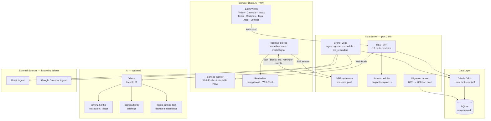
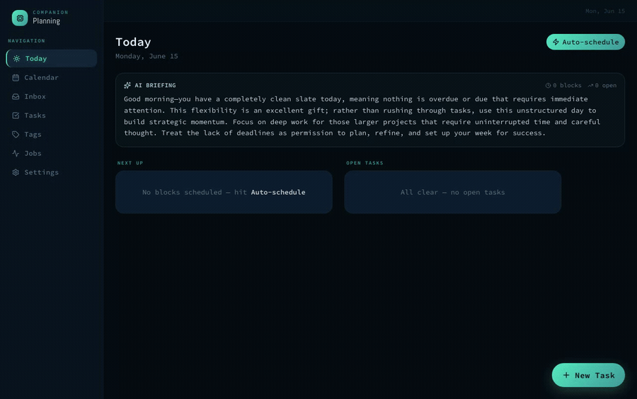
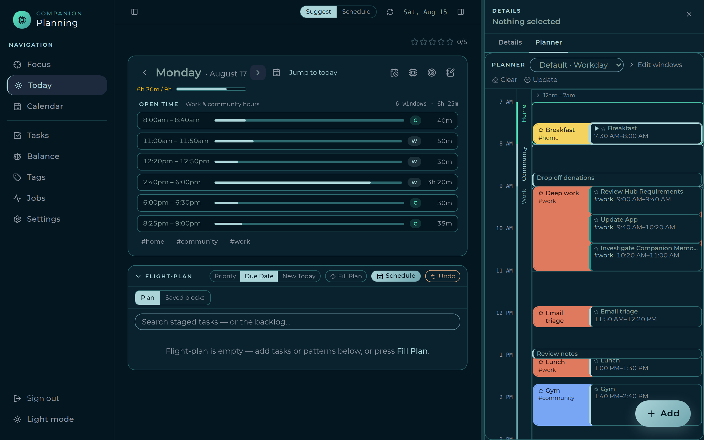
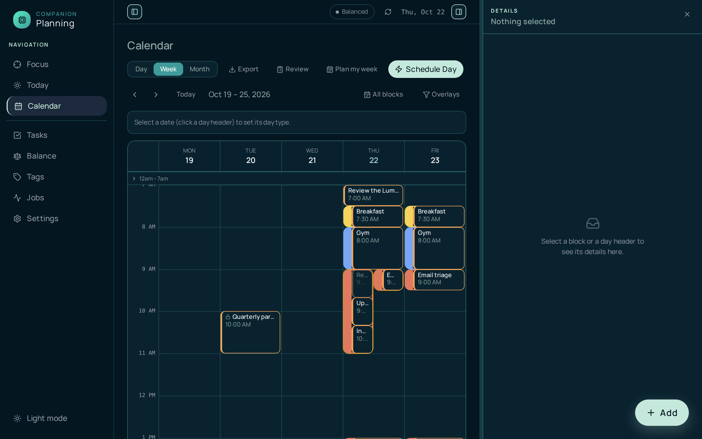
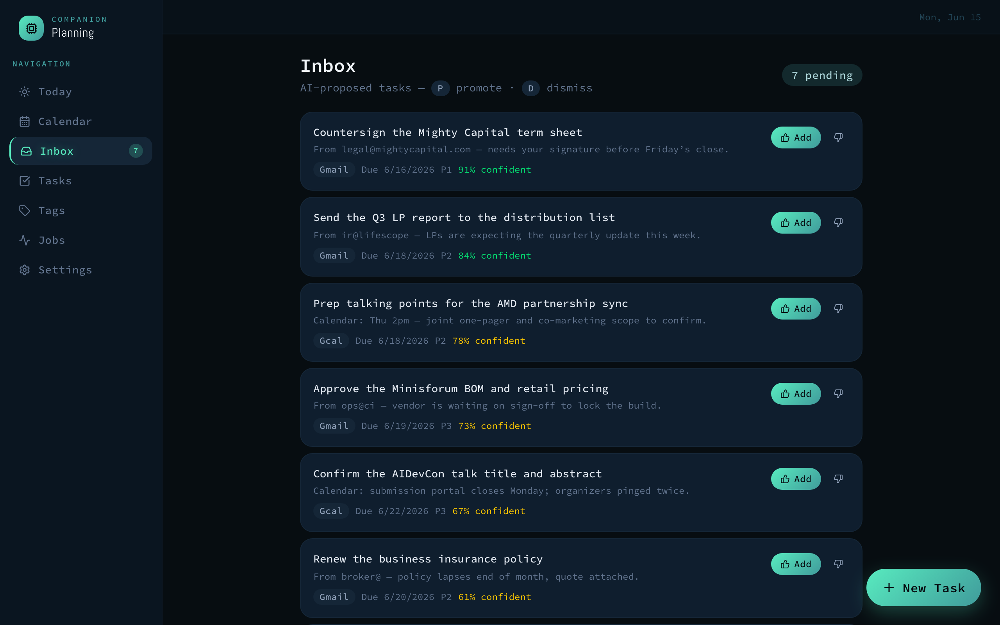
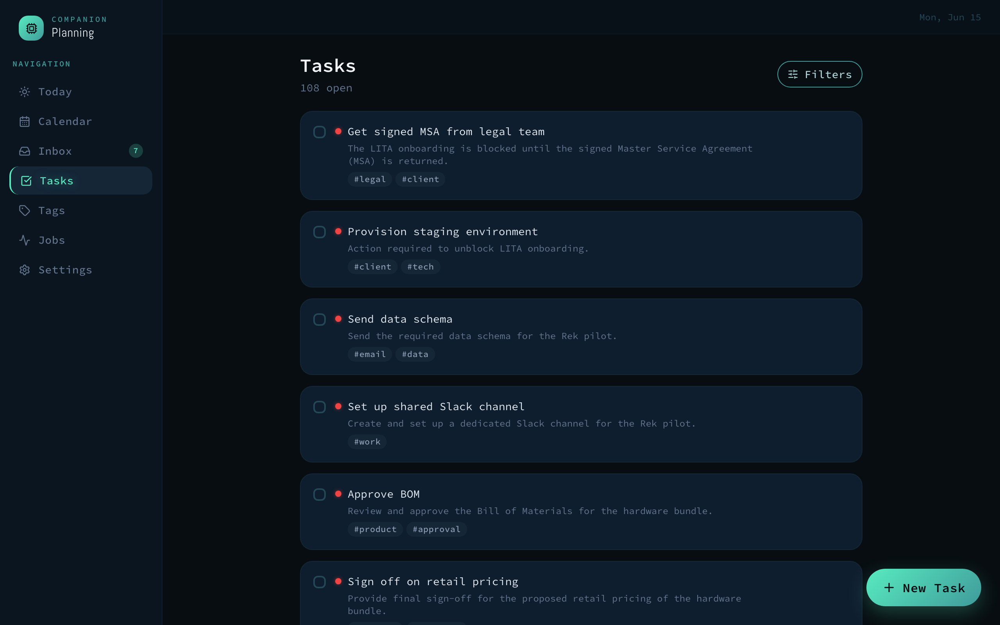
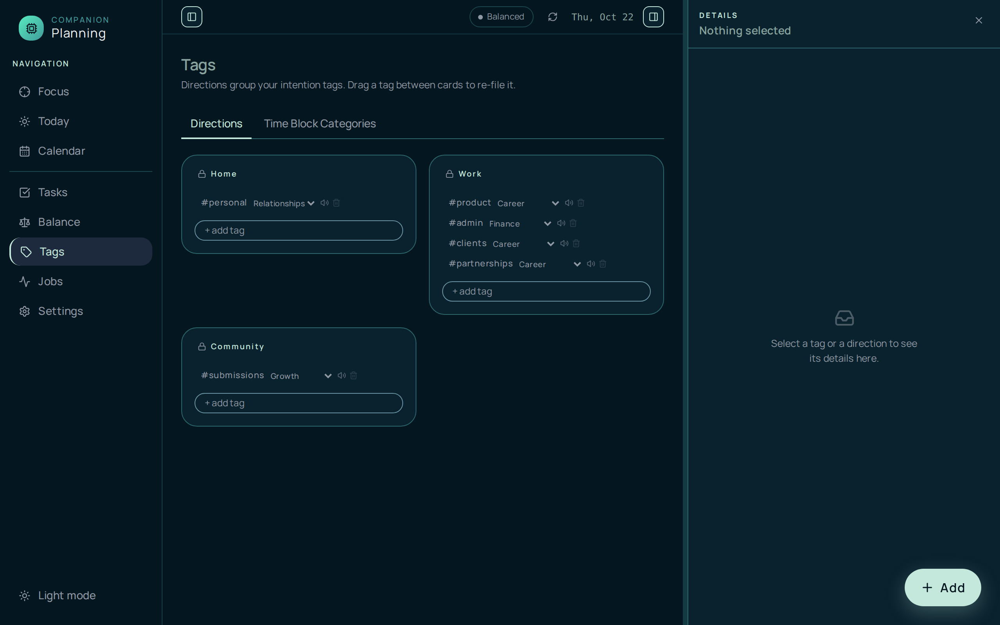
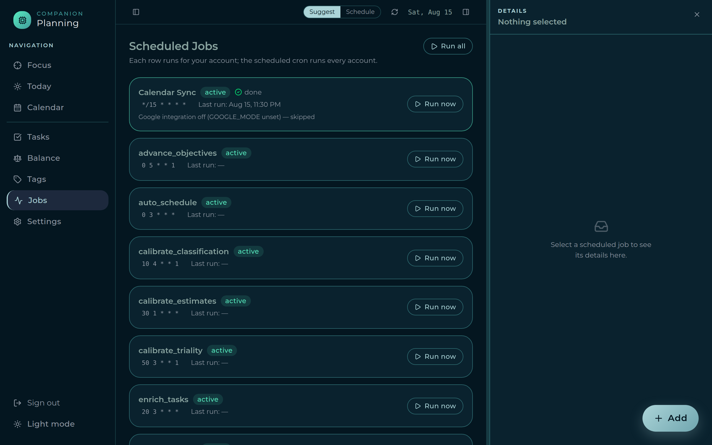
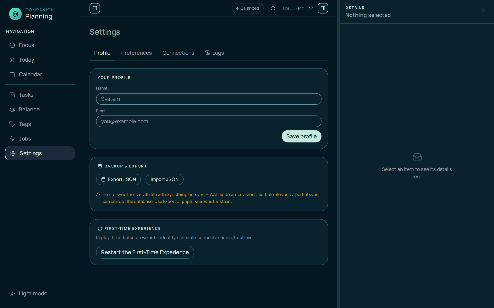

# Companion Planning

A **private, local-first** personal todo and planning app. Tasks, time blocks,
tags, and an automation pipeline live in a single SQLite file on your machine; an
optional local LLM (Ollama) adds AI briefings, task extraction, grooming, and
auto-scheduling. No cloud, no account, no telemetry — everything runs on your
hardware and stays there.

Companion Planning is currently in **v0.2 active development**. The core app is
fully local and usable today. A **standalone Google OAuth 2.1 flow** (Authorization
Code + PKCE/S256, implemented in the app — not the macOS Keychain) and **two-way
Google Calendar sync** are built in, gated behind `GOOGLE_MODE=live` plus
`CP_GOOGLE_CLIENT_ID` / `CP_GOOGLE_CLIENT_SECRET` and a 32-byte `CP_KEK_B64` key that
encrypts stored tokens. With `GOOGLE_MODE=fixture` (the default) the app runs fully
offline on committed sample data. Outbound calendar write-back stays behind a second
flag, `CP_SYNC_WRITEBACK` (off by default — inbound read-only is the safe posture).
See **[docs/google-cloud-setup.md](docs/google-cloud-setup.md)** to provision a Google
client and turn live mode on.

- **Server** — Koa + TypeScript (`server/`), SQLite via better-sqlite3 + Drizzle, cron jobs via croner
- **Client** — SolidJS + Tailwind PWA (`client/`), built by Vite into `server/public/`
- **One process, one port** — the server serves both the API and the UI on **3848**

**Source of truth for docs:** this README describes the running app;
[docs/ROADMAP.md](docs/ROADMAP.md) is the authoritative plan for future phases.
SQLite is the single source of truth for data.

## Architecture



### How the server finds and connects to the database

`server/src/lib/config.ts` resolves `DB_PATH` at startup:

1. If `DB_PATH` env var is set, use it as-is (Docker mounts `/data/companion.db`).
2. Otherwise fall back to `~/Library/Application Support/CompanionPlanning/companion.db`
   (macOS default). **On Linux or Windows, set `DB_PATH` explicitly.**
3. `mkdirSync(..., { recursive: true })` creates the containing directory before the
   file is opened — so a fresh install with no prior DB just works.

`server/src/db/index.ts` then opens and configures the connection:

```
BetterSqlite3(config.dbPath)        // synchronous open — SQLite single-writer, no pool
  .pragma('foreign_keys = ON')      // enforced at the connection level
  .function('uuid7', () => newId()) // UDF for raw-SQL inserts (CON-1 UUIDv7 identity)

runMigrations(sqlite)               // sequential, idempotent — applies any unapplied
                                    // migrations from the 0001–0061 ordered list
drizzle(sqlite, { schema })         // exports `db` used by all route handlers
```

The migration runner (`server/src/db/migrate.ts`) keeps a `_migrations` table. On
every server start it compares the ordered `MIGRATIONS` array against that table and
runs any missing ones inside a transaction. Migrations are plain TypeScript functions —
no `.sql` files, no external tool.

### Schema overview

Migrations (current head: `0061_drop_unused_sync_columns`) produce the following tables:

| Table | Purpose |
|---|---|
| `owners` | User identity (single-owner in v0.2) |
| `tasks` | Core work atom — UUIDv7 PK, status, priority, recurrence fields, subtype |
| `task_dependencies` | Blocked-by edges between tasks |
| `time_blocks` | Named time spans — `scheduled` / `someday` / `saved` states; recurrence support |
| `block_templates` | Reusable Time-Block templates with saved task lists |
| `time_entries` | Actual work logged per task; running timer = `ended_at IS NULL` |
| `possible_tasks` | Inbox queue — AI-proposed items pending promote / dismiss |
| `tags` | Cross-cutting labels; `kind`: `pattern` (Home / Work / Community) or `intention` |
| `tag_patterns` | Many-to-many: intention tags grouped under pattern tags (renamed from `tag_directions` in 0043) |
| `entity_tags` | Polymorphic tag store for tasks, blocks, and routines (CON-3) |
| `possible_task_tags` | Tags proposed alongside an inbox item |
| `patterns` | Routines — typed, reusable task collections with optional recurrence |
| `pattern_types` | Routine taxonomy: Habit ◯ · Routine ▢ · Ritual △ — **load-bearing, do not rename** |
| `pattern_tasks` | Routine membership (pattern ↔ task many-to-many) |
| `pattern_blocks` | Pattern-tag-scoped scheduling windows (`workday` / `weekend` time ranges) |
| `pattern_prefs` | Per-owner × per-pattern config: `auto_fill`, `reminder_offsets`, `icon_shape`, `color_token`, `default_minutes` |
| `flight_plan` | Staged task list for the two-step Auto (select → schedule) |
| `scheduling_prefs` | Work hours, focus/break bounds, model overrides, feature flags |
| `scheduled_jobs` | Croner job registry (name, cron expression, enabled) |
| `job_runs` | Execution log per job run (status, items created/updated, log text) |
| `reminders` | Scheduled reminders (`fire_at`, task XOR block target, `source` manual/auto) fired by the 1-min dispatcher (Phase H, 0044/0045) |
| `push_subscriptions` | Web Push endpoints per owner (VAPID), for backgrounded delivery (Phase H, 0044) |
| `audit_log` | Append-only mutation log (owner, actor, action, entity) written by every mutating route (Phase R, 0046) |
| `api_keys` | Hashed `x-api-key` credentials for `AUTH_MODE=standalone` (0049) |
| `connection_tokens` | Encrypted OAuth tokens per `(owner, provider, account)` — AES-256-GCM sealed with `CP_KEK_B64`; `status` ∈ `active`/`revoked`/`error` (Phase J 0050; `status` 0058) |
| `external_events` | Sync identity map linking provider events ↔ local `time_blocks` by `(provider, account, external_id)` + etag/direction (Phase J 0051) |
| `outbound_queue` | Local blocks pending push to a provider — one row per `(block, provider, account)`, drained by the sync agent when `CP_SYNC_WRITEBACK` is on (Phase J 0057) |
| `oauth_states` | Single-use OAuth 2.1 PKCE/state rows, consumed at the callback (0058) |
| `sync_state` | Incremental-sync cursors per `(owner, provider, account, resource)` — calendar syncToken, Gmail watermark, dead-letter (0060) |

## See it in action

From an empty day to a planned one: capture a task, pick a priority, and let the
planner place it on your calendar — no cloud round-trip, all on-device.



## Walkthrough video

> 📹 A full video walkthrough is coming soon.

<!--
  Video placeholder. To embed a walkthrough, drag an .mp4/.mov into a GitHub issue
  or release to get a hosted URL, then replace this block with the rendered link,
  e.g.:

  https://github.com/companionintelligence/Companion-Planning/assets/<id>/walkthrough.mp4
-->

## Screenshots

| Today | Calendar |
|---|---|
| [](docs/screenshots/today.png) | [](docs/screenshots/calendar.png) |
| AI briefing, next blocks, open tasks, and overdue count at a glance | Standalone day / week / month view over the same time blocks |

| Inbox | Tasks |
|---|---|
| [](docs/screenshots/inbox.png) | [](docs/screenshots/tasks.png) |
| Review queue of AI-proposed tasks with source + confidence; promote or dismiss | The full backlog with priorities, tags, and notes — filter by status, tag, or text |

| Tags | Jobs |
|---|---|
| [](docs/screenshots/tags.png) | [](docs/screenshots/jobs.png) |
| Direction + Intention taxonomy — group, mute, or delete | Background automations with their cron schedules — run any one on demand |

| Settings |
|---|
| [](docs/screenshots/settings.png) |
| Work hours, per-pattern fill + reminder offsets, pattern block shape/color, time-block labels, concept tags, model overrides, memory sync |

## What you get

- **Eight views** — Today · Calendar · Inbox · Tasks · Routines · Tags · Jobs · Settings
- **Full task CRUD** — priorities P1–P5, due date + time, estimates, notes, tags, and subtasks
- **Deterministic auto-scheduler** — packs open tasks into time blocks around your work
  hours, pattern-block windows, locked meetings, and break preferences; reflows when you change the day
- **Pattern blocks** — named availability windows (Home / Work / Community) that shade
  the Planner and constrain auto-placement; per-pattern fill toggle and reminder offsets
- **Routines** — typed task collections (Routine ▢ / Habit ◯) placed via a flight-plan
  staging area; Ritual △ is feature-flagged
- **Flight-plan staging** — two-step Auto: build a staged list, then schedule; lets you
  curate before committing
- **Inbox / review queue** — ingestion jobs propose "possible tasks" from email and
  calendar; each shows its source and a confidence score, and nothing becomes a real
  task until you promote it (one keystroke: `P` to add, `D` to dismiss)
- **Background jobs** — Gmail / Calendar ingest, possible-task promotion, nightly
  grooming (embedding-based dedupe), and auto-schedule; all visible and manually
  runnable from the Jobs view
- **AI day briefing** — Ollama-authored when available, deterministic template
  otherwise; the UI labels it honestly ("AI Briefing" vs. "Day Overview")
- **Reminders & Web Push** — per-pattern reminder offsets generate reminders that a
  1-minute dispatcher fires **exactly once**: in-app via SSE (always) and, when VAPID
  keys are set, via **Web Push** to subscribed devices (service worker + VAPID). Opt in
  from Settings; snooze reschedules; completed / cancelled tasks never fire
- **Live updates** — Server-Sent Events push task / block / job changes to every open
  client, so the UI stays in sync without polling
- **Installable PWA** — manifest + standalone display; usable from a phone over your tailnet

## How it works

Companion Planning is a small pipeline that turns raw inputs into a planned day,
with you in the loop at the one step that matters — what actually becomes a task.

1. **Ingest** — scheduled jobs read your sources (Gmail + Calendar; fixtures by
   default). Unstructured email/event text is mined by a local LLM for action items,
   with a deterministic fallback if Ollama is down. Calendar **meeting blocks** are
   mirrored by the dedicated calendar sync path (one canonical inbound reconciler keyed
   on event identity + etag), not by ingest — `ingest_gcal` now only extracts tasks.
2. **Review** — extracted items land in the **Inbox** as *possible tasks*, each
   tagged with its source and a confidence score. You promote the good ones and
   dismiss the noise. Nothing reaches your task list without your say-so.
3. **Plan** — build a **flight-plan** staging list, then run **Auto** to pack open
   tasks into the open gaps of your workday, honoring work hours, pattern-block
   windows, locked meetings, focus-block limits, and minimum breaks. Deterministic —
   same inputs, same plan — and re-runnable any time.
4. **Brief** — the **Today** view opens with an AI briefing that summarizes what's
   overdue, what's scheduled, and where to focus, generated on-device.
5. **Groom** — a nightly job dedupes near-identical tasks using text embeddings and
   tidies the backlog.

Every step runs locally. The single SQLite file is the whole system of record.
See **[Backup and restore](#backup-and-restore)** below for safe copy and recovery options.

## Backup and restore

Everything lives in the single SQLite file at `DB_PATH`. Three safe options:

### Option 1 — scheduled snapshots (built-in)

A daily `snapshot_db` cron job (02:00) writes a point-in-time copy to
`<DB_DIR>/backups/companion-<timestamp>.db` and keeps the newest `SNAPSHOT_RETAIN`
files (default 7). Run one manually any time:

```bash
pnpm --filter server snapshot
```

To restore from a snapshot (server must be stopped first):

```bash
pnpm --filter server restore -- /data/backups/companion-2026-06-22T02-00-00-000Z.db
```

The restore script validates the source file, detects a running server, copies it to
`DB_PATH`, and runs any forward migrations if the snapshot is from an older version.

### Option 2 — Litestream (streaming replication)

[Litestream](https://litestream.io) replicates the SQLite WAL to object storage
continuously. Edit `ops/litestream.yml` with your replica URL, then run it alongside
the server:

```bash
litestream replicate -config ops/litestream.yml
```

Point-in-time restore:

```bash
litestream restore -config ops/litestream.yml \
  -timestamp 2026-06-22T14:00:00Z /data/companion.db
```

### ⚠ Syncthing / rsync warning

**Do not sync the live `.db` file with a generic file-sync tool.** SQLite's WAL mode
writes across multiple files (`.db`, `.db-wal`, `.db-shm`). A file-sync tool copies
them at different moments and can produce a corrupt or inconsistent database. Use
`pnpm snapshot` or Litestream — both open a proper SQLite connection and export a
consistent snapshot.

## Project status (v0.2, 2026-06)

**Working today:**

- Koa + TypeScript backend serving both the API and the built client on port 3848
- SQLite schema (migrations 0001–0061): tasks, subtasks, time blocks, tags,
  entity_tags, tag_patterns, patterns, pattern_blocks, pattern_prefs, flight_plan,
  possible_tasks, scheduling_prefs, time_entries, block_templates, jobs, reminders,
  push_subscriptions, audit_log
- All eight SolidJS views, with full task CRUD (tags, notes, priorities, due
  date/time, subtasks)
- Deterministic auto-scheduler (`/api/schedule/run`) honoring work hours, pattern
  blocks, locked meetings, and break preferences; per-pattern auto-fill gating
- Flight-plan staging area (two-step Auto)
- Pattern blocks — direction-scoped scheduling windows with per-pattern shape, color,
  fill toggle, and reminder offsets
- Notifications: a `reminders` store + 1-minute `fire_reminders` dispatcher (exactly-once),
  delivered in-app via SSE and via Web Push (VAPID) to subscribed devices; reminders are
  auto-derived from per-pattern reminder offsets, with a Settings opt-in toggle and snooze
- Croner jobs: Gmail ingest, Calendar ingest, possible-task promotion, nightly
  grooming/dedupe, place-patterns, auto-schedule, and fire_reminders
- Ollama-backed extraction/summarization with deterministic fallbacks
- SSE events for real-time UI updates across open clients
- Tag taxonomy: pattern (direction) / intention hierarchy with many-to-many grouping

**Intentionally partial:**

- Google `live` mode (standalone OAuth + two-way calendar sync) is implemented but
  **opt-in**: it stays dormant until you set `GOOGLE_MODE=live`, `CP_GOOGLE_CLIENT_ID` /
  `CP_GOOGLE_CLIENT_SECRET`, and `CP_KEK_B64`. The default `GOOGLE_MODE=fixture` runs on
  committed sample data with no network calls. See
  [docs/google-cloud-setup.md](docs/google-cloud-setup.md).
- Calendar write-back (pushing local blocks to Google) is behind `CP_SYNC_WRITEBACK`,
  **off by default** — until you flip it on, sync is inbound read-only. `CP_SYNC_DISABLED`
  is a master kill switch for the whole sync agent.
- Web Push delivery needs VAPID keys set in the env (see below); without them push is
  dormant but in-app SSE reminders still fire
- Later phases (auth, multi-device sync) in [docs/ROADMAP.md](docs/ROADMAP.md)

## Run with Docker (CI Hub)

The published image is public and multi-arch (amd64 + arm64):

```bash
docker run -d --name ci-planning \
  -p 3848:3848 \
  -v ci-planning-data:/data \
  ghcr.io/companionintelligence/ci-planning:latest
# open http://localhost:3848
```

On a CI Hub appliance, install **Companion Planning** from the marketplace — the Hub
mounts `${APP_DATA_DIR}/data` at `/data` and wires `OLLAMA_URL` automatically.

### Environment variables

| Var | Default | Purpose |
|---|---|---|
| `PORT` | `3848` | HTTP port (API + UI) |
| `DB_PATH` | `/data/companion.db` in Docker; `~/Library/Application Support/CompanionPlanning/companion.db` on macOS; **set explicitly on Linux / Windows** | SQLite file path. The containing directory is created automatically. |
| `OLLAMA_URL` | `http://127.0.0.1:11434` | Ollama endpoint. Unreachable ⇒ AI features degrade gracefully (template briefings, dedupe off). |
| `OLLAMA_SMALL` | `qwen2.5:0.5b` | Fast model for extraction/triage |
| `OLLAMA_MEDIUM` | `gemma4:e4b` | Better model for briefings |
| `OLLAMA_EMBED` | `nomic-embed-text` | Embedding model for dedupe |
| `TZ` | UTC | Container timezone — set it so "today" and cron schedules match your day |
| `AUTH_MODE` | `test` | Auth mode: `test` (dev/CI — system owner injected, **forbidden in production**), `standalone` (hashed `x-api-key` stored in the `api_keys` table), `sso` (JWKS-signed Bearer JWT). |
| `AUTH_JWKS_URL` | (unset) | JWKS endpoint for JWT public-key verification. Required when `AUTH_MODE=sso`. |
| `AUTH_ISSUER` | (unset) | Expected JWT `iss` claim. Required when `AUTH_MODE=sso`. |
| `AUTH_AUDIENCE` | `companion-planning` | Expected JWT `aud` claim (`AUTH_MODE=sso`). |
| `AUTH_CONTRACT_VERSION` | `1` | Pinned contract version asserted in incoming JWT claims (`AUTH_MODE=sso`). |
| `AUTH_AUTO_PROVISION` | `false` | When `true`, an unknown SSO `sub` automatically provisions a new owner row instead of returning 403. |
| `AUTH_RATE_WINDOW_MS` | `60000` | Rate-limit sliding window in milliseconds. |
| `AUTH_RATE_MAX` | `60` | Max requests per window per IP across all endpoints. |
| `AUTH_RATE_ISSUE_MAX` | `5` | Max token-issue operations (login / key exchange) per window per IP. |
| `GOOGLE_MODE` | `fixture` | `fixture` (committed sample data, fully offline) or `live` (real Google OAuth + Calendar sync). `live` is hard-required to also supply `CP_GOOGLE_CLIENT_ID` and a redirect URI, or the server refuses to boot. |
| `CP_GOOGLE_CLIENT_ID` | (unset) | Google OAuth client ID. Required when `GOOGLE_MODE=live`. See [docs/google-cloud-setup.md](docs/google-cloud-setup.md). |
| `CP_GOOGLE_CLIENT_SECRET` | (unset) | Google OAuth client secret. Needed for a **Web** client (ts.net HTTPS deploy); a **Desktop/installed** client with a loopback redirect can run without one. Never commit it. |
| `PUBLIC_BASE_URL` | `http://localhost:3848` | Externally reachable base URL. Used to derive the default OAuth redirect URI. |
| `CP_OAUTH_REDIRECT_URI` | `${PUBLIC_BASE_URL}/api/oauth/google/callback` | Exact redirect URI; **must match** what you register in the Google client. |
| `CP_GOOGLE_AUTH_URI` | `https://accounts.google.com/o/oauth2/v2/auth` | Authorization endpoint (override only to point tests at a stub). |
| `CP_GOOGLE_TOKEN_URI` | `https://oauth2.googleapis.com/token` | Token endpoint (override only for tests). |
| `CP_GOOGLE_REVOKE_URI` | `https://oauth2.googleapis.com/revoke` | Token-revocation endpoint (override only for tests). |
| `CP_GOOGLE_JWKS_URI` | `https://www.googleapis.com/oauth2/v3/certs` | JWKS used to verify the Google `id_token` signature at the callback (override only for tests). |
| `CP_GOOGLE_ENABLE_GMAIL` | `false` | When `true`, `/start` also requests the Gmail scope. Gmail is a Google **restricted** scope (needs OAuth verification + a CASA assessment), so it is opt-in and gated separately from the calendar loop. |
| `CP_GOOGLE_ACCOUNT` | `primary` | Account key the live Google client binds its MCP session to (until in-app multi-account selection lands). |
| `CP_KEK_B64` | (unset) | Base64 of a **32-byte** key-encryption key (AES-256-GCM) for the encrypted `connection_tokens` store. Generate with `openssl rand -base64 32`. Required for live token storage/refresh — loaded lazily, so a live deploy without it fails on the first token operation (not at boot). Never commit it. |
| `CP_KEK_VERSION` | `1` | KEK version a fresh token seal is written under (drives rotation). |
| `CP_KEK_B64_V{n}` | (unset) | Historical KEK for version `{n}`, used while rotating (e.g. `CP_KEK_B64_V2`). The current version may live in plain `CP_KEK_B64`. |
| `CP_SYNC_WRITEBACK` | `false` | When `true`, sync pushes local block changes back to the provider. Off ⇒ inbound read-only. |
| `CP_SYNC_DISABLED` | `false` | `true` is a master kill switch — disables the sync agent entirely. |
| `CP_MCP_COMMAND` | (unset) | Command that launches the Calendar MCP server child the connector drives over stdio. **Required for `GOOGLE_MODE=live`** (unset ⇒ live sync fails with `McpUnavailable`). CP ships one: `node_modules/.bin/tsx src/scripts/mcp-google-server.ts` (run from `server/`). See [docs/google-cloud-setup.md](docs/google-cloud-setup.md) §7. |
| `CP_MCP_TIMEOUT_MS` | `30000` | Per-call timeout for MCP requests. |
| `CP_MCP_RETRIES` | `3` | Retry budget for MCP requests. |
| `CP_MCP_BREAKER_THRESHOLD` | `5` | Consecutive MCP failures before the circuit breaker opens. |
| `CP_MCP_BREAKER_COOLDOWN_MS` | `30000` | How long the MCP circuit breaker stays open before it half-opens and retries. |
| `LOG_LEVEL` | `info` | `debug` / `info` / `warn` / `error` |
| `VAPID_PUBLIC_KEY` / `VAPID_PRIVATE_KEY` | (unset) | Web Push keys — generate once with `npx web-push generate-vapid-keys`. Unset ⇒ push disabled (in-app reminders still fire). Never commit them. |
| `VAPID_SUBJECT` | `mailto:admin@companion.local` | VAPID contact (`mailto:` or URL) sent with each push |
| `SNAPSHOT_RETAIN` | `7` | Number of daily snapshots to keep in `<DB_DIR>/backups/` |

**Persistence**: everything lives in the single SQLite file at `DB_PATH`. Mount a
volume at `/data` (as above) and your tasks survive container recreation.

## Local development

Runtime requirements:

- Node.js `>=26 <27`
- pnpm `>=11 <12`

```bash
corepack enable
pnpm install
pnpm dev          # server :3848 + Vite client :5173 (proxies /api)
```

> **Note (Node 24):** `pnpm dev` uses `tsx watch` which silently crashes under
> Node 24. If you can't upgrade, run the server without watch mode:
> `cd server && PORT=3848 pnpm exec tsx src/index.ts`
> and the Vite client separately: `cd client && pnpm dev`

Production-style run (build client into `server/public`, serve everything on 3848):

```bash
pnpm build && pnpm --filter server start
```

Want a populated app to explore? Seed ~100 tasks from the bundled fixtures:

```bash
pnpm seed         # uses Ollama extraction when available, deterministic otherwise
```

## HTTP API

| Method | Path | Purpose |
|---|---|---|
| GET | `/api/tasks?status=&tag=&q=&priority=&due_before=&owner_id=` | List/filter tasks (with tags) |
| POST | `/api/tasks` | Create a task (`title` required) |
| PATCH | `/api/tasks/:id` | Update fields; `{"completed": true}` marks done |
| DELETE | `/api/tasks/:id` | Soft delete (status → `cancelled`) |
| GET | `/api/tasks/:id/subtasks` | List subtasks |
| GET/POST/PATCH/DELETE | `/api/blocks` | Time blocks for a date range |
| GET/POST/DELETE | `/api/block-templates` | Reusable Time-Block templates |
| GET/POST | `/api/tags` | Tags with usage counts |
| PATCH/DELETE | `/api/tags/:id` | Update or delete a tag |
| GET | `/api/possible-tasks` | Inbox review queue |
| POST | `/api/possible-tasks/:id/promote` \| `/dismiss` | Accept/reject a proposal |
| GET | `/api/summary?date=YYYY-MM-DD` | Day briefing (LLM or deterministic) |
| POST | `/api/schedule/run` | Run the auto-scheduler for a date |
| GET/POST/PATCH/DELETE | `/api/patterns` | Routines CRUD |
| GET/PUT/DELETE | `/api/flight-plan` | Flight-plan staging area |
| GET/POST/PATCH/DELETE | `/api/pattern-blocks` | Direction-scoped scheduling windows |
| GET | `/api/pattern-prefs` | Per-pattern preferences (fill, reminders, shape, color) |
| PUT | `/api/pattern-prefs/:patternTagId` | Update a single pattern's preferences |
| GET | `/api/push/vapid-key` | Web Push public key (empty when VAPID unconfigured) |
| POST/DELETE | `/api/push/subscribe` | Register / remove a browser push subscription |
| GET/POST/DELETE | `/api/reminders` · POST `/api/reminders/:id/snooze` | Reminders CRUD + snooze |
| GET | `/api/jobs` · POST `/api/jobs/:id/run` | List / manually run background jobs |
| GET/PATCH | `/api/prefs` | Scheduling preferences |
| GET/POST | `/api/memory` | Companion Memory sync state |
| GET | `/api/llm/status` · `/api/integrations` | Ollama & integration health |
| GET | `/api/oauth/google/start` | Begin the standalone Google OAuth flow (Auth Code + PKCE); returns `{ url }` for the SPA to navigate to. Gated; refused under `AUTH_MODE=test`. |
| GET | `/api/oauth/google/callback` | Public OAuth redirect target; verifies the `id_token`, exchanges the code, seals tokens into `connection_tokens`. |
| GET | `/api/oauth/google/accounts` | List connected Google accounts (status only, no secrets). |
| DELETE | `/api/oauth/google/accounts/:account` | Disconnect an account (revoke at Google + drop its tokens and queued pushes). |
| GET | `/api/export` | Download all owner data as a JSON file (import-compatible) |
| POST | `/api/import` | Restore owner data from an export JSON body |
| GET | `/api/events` | SSE stream (task / block / job / possible / reminder events) |

## Tests

```bash
pnpm test                      # server vitest suite (Ollama-dependent tests degrade/skip)
cd tests/container && npm i && APP_URL=http://localhost:3848 npx playwright test   # container smoke
```

## License

MIT.

## Author

Liam Broza ([@mrhegemon](https://github.com/mrhegemon))
