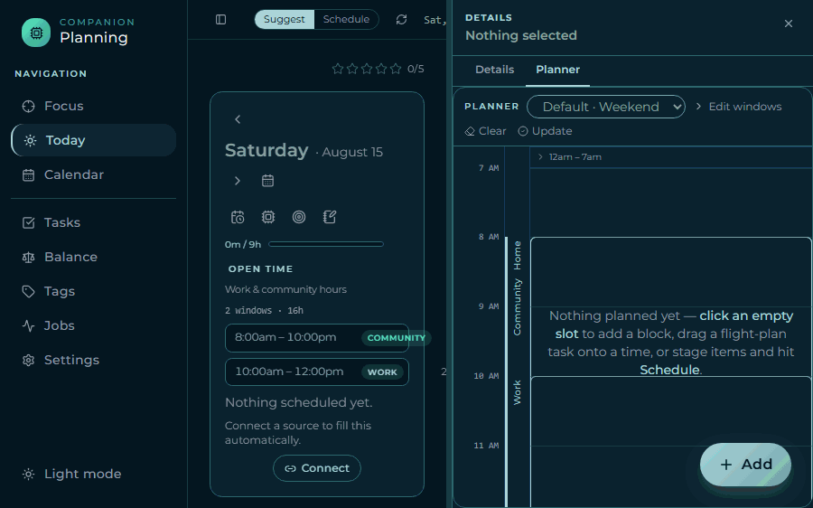
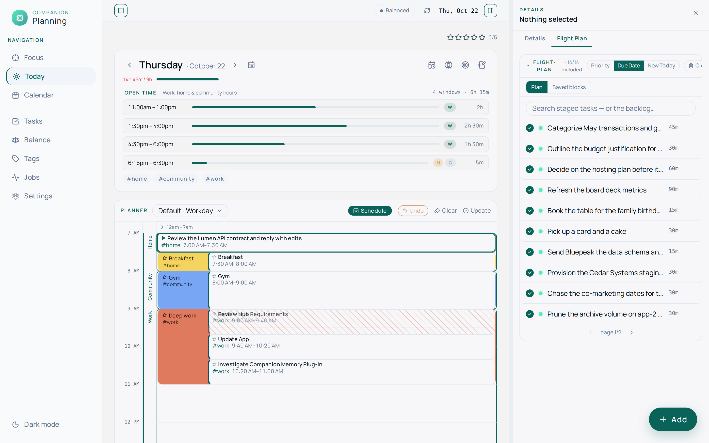
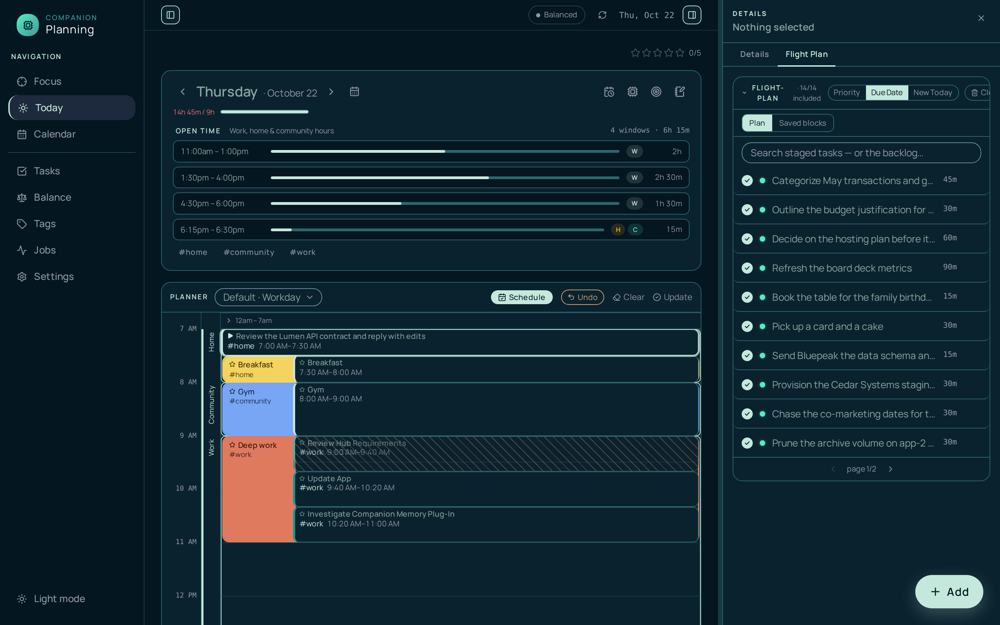
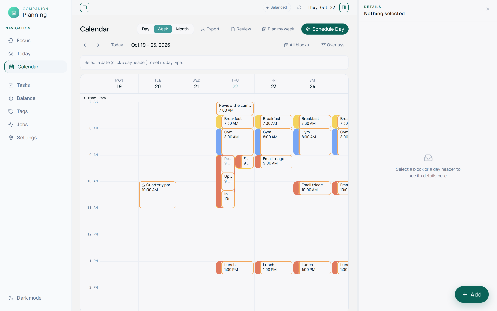
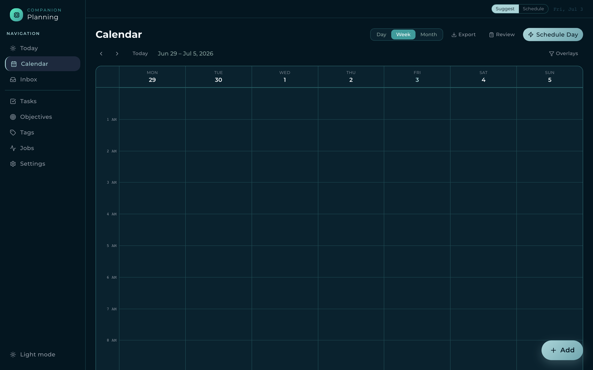
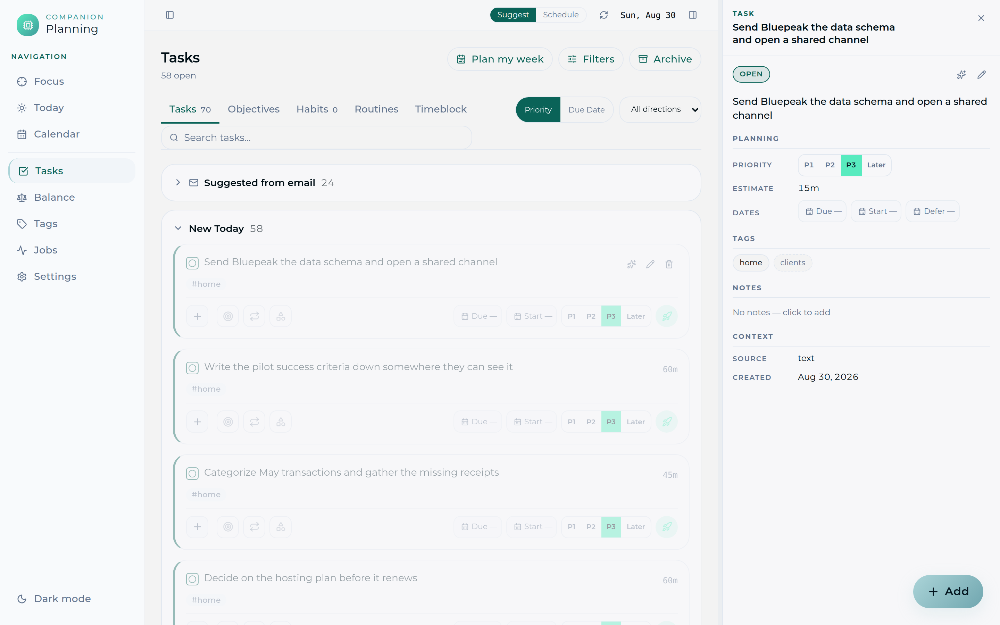
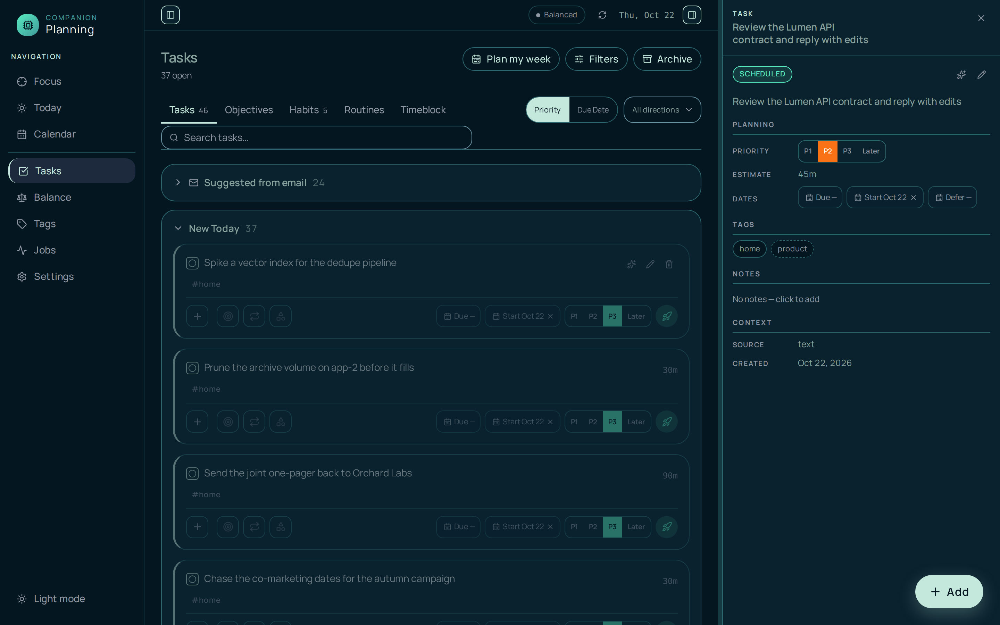
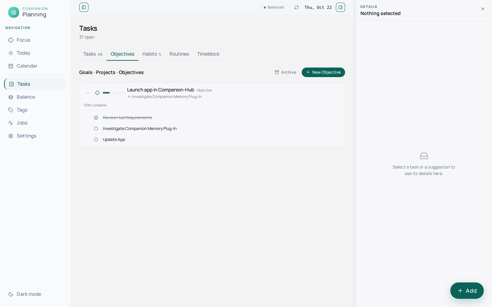
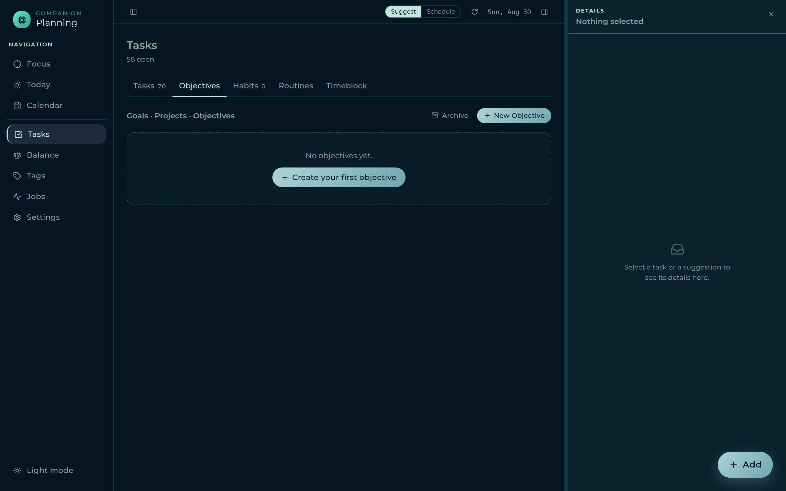
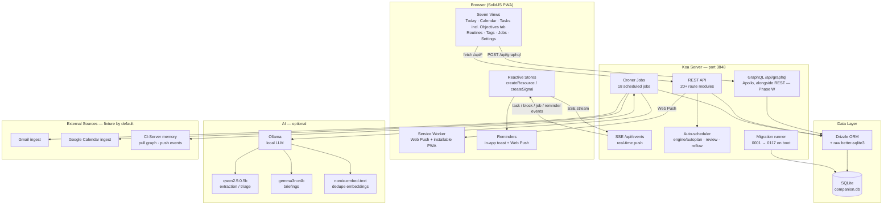

# Companion Planning

A **private, local-first** personal todo and planning app. Tasks, time blocks,
tags, and an automation pipeline live in a single SQLite file on your machine; an
optional local LLM (Ollama) adds AI briefings, task extraction, grooming, and
auto-scheduling. No cloud, no account, no telemetry — everything runs on your
hardware and stays there.

Companion Planning is currently in **v0.3 active development**. The core app is
fully local and usable today. A **standalone Google OAuth 2.1 flow** (Authorization
Code + PKCE/S256, implemented in the app — not the macOS Keychain) and **two-way
Google Calendar sync** are built in, gated behind `GOOGLE_MODE=live` plus
`CP_GOOGLE_CLIENT_ID` / `CP_GOOGLE_CLIENT_SECRET` and a 32-byte `CP_KEK_B64` key that
encrypts stored tokens. With `GOOGLE_MODE=fixture` (the default) the app runs fully
offline on committed sample data. Outbound calendar write-back stays behind a second
flag, `CP_SYNC_WRITEBACK` (off by default — inbound read-only is the safe posture).
See **[docs/google-cloud-setup.md](docs/google-cloud-setup.md)** to provision a Google
client and turn live mode on.

- **Server** — Koa + TypeScript (`server/`), SQLite via better-sqlite3 + Drizzle, cron jobs via croner
- **Client** — SolidJS + Tailwind PWA (`client/`), built by Vite into `server/public/`
- **One process, one port** — the server serves both the API and the UI on **3848**

**Source of truth for docs:** this README describes the running app;
[docs/ROADMAP.md](docs/ROADMAP.md) is the authoritative plan for future phases.
SQLite is the single source of truth for data.

## Interface

A screen-by-screen tour of the SolidJS PWA, on the
[Companion Intelligence design system](https://github.com/companionintelligence/CI-Common/tree/main/style)
— teal primary (`#0f717a` light / `#abd4d8` dark), Montserrat, light + dark. Dark is
the default; the sidebar toggle switches to light. Every pair below is a real headless
render of the built client served by the Koa server against a seeded SQLite database
(`pnpm seed`), captured at 1440×900 in both themes — not a mockup.

The one sidebar toggle flips the whole app between the two canonical CI themes:



### Today

The day overview: a QuickAdd bar, the day header with live counts (overdue · due
today · scheduled · open), day-type + day-stars, the FOCUS card, the planner
instruct bar, and the PLANNER grid for placing blocks.

| Light | Dark |
|-------|------|
|  |  |

### Calendar

Day / week / month grid with the current week in view, plus Export, Review, and
Schedule Day controls and the overlays filter.

| Light | Dark |
|-------|------|
|  |  |

### Tasks

The full backlog — priority chips (P1–P3 · Later), tags, direction filter, and the
Tasks / Habits / Routines / Time Blocks tabs. Rendered against ~74 seeded tasks.
Every task created today — manual, quick-add, or auto-promoted suggestion — sits
in a **New Today** section at the top and flows into the normal sections at the
owner-local midnight rollover (the standalone Inbox view was retired in Phase AF:
suggestions now auto-promote, so there is nothing left to triage).

| Light | Dark |
|-------|------|
|  |  |

### Objectives (a Tasks tab)

Hierarchical life goals — Goal → Project → Objective — with task linkage and
progress roll-up. Since Phase AF the tree lives as the **Objectives tab of the
Tasks view** (`/tasks?tab=objectives`); the standalone `/objectives` view is
retired. Shown at its empty state (the seed creates no objectives); the
**New Objective** / **Create your first objective** affordances open the editor.

| Light | Dark |
|-------|------|
|  |  |

> **Regenerating these:** build the client (`pnpm --filter client build`), seed a
> throwaway DB (`NODE_ENV=test DB_PATH=/tmp/shots.db pnpm --filter server seed -- --no-llm --target=70`),
> start the server against it (`DB_PATH=/tmp/shots.db PORT=8842 pnpm --filter server start`),
> then screenshot each route (`/`, `/calendar`, `/tasks`, `/tasks?tab=objectives`)
> in both themes into `docs/ui/planning-<screen>-<theme>.png`. The **Routines**,
> **Tags**, **Jobs**, and **Settings** screens live in the annotated
> [Screenshots](#screenshots) tour below.

## Architecture



### How the server finds and connects to the database

`server/src/lib/config.ts` resolves `DB_PATH` at startup:

1. If `DB_PATH` env var is set, use it as-is (Docker mounts `/data/companion.db`).
2. Otherwise fall back to `~/Library/Application Support/CompanionPlanning/companion.db`
   (macOS default). **On Linux or Windows, set `DB_PATH` explicitly.**
3. `mkdirSync(..., { recursive: true })` creates the containing directory before the
   file is opened — so a fresh install with no prior DB just works.

`server/src/db/index.ts` then opens and configures the connection:

```
BetterSqlite3(config.dbPath)        // synchronous open — SQLite single-writer, no pool
  .pragma('foreign_keys = ON')      // enforced at the connection level
  .function('uuid7', () => newId()) // UDF for raw-SQL inserts (CON-1 UUIDv7 identity)

runMigrations(sqlite)               // sequential, idempotent — applies any unapplied
                                    // migrations from the 0001–0117 ordered list
drizzle(sqlite, { schema })         // exports `db` used by all route handlers
```

The migration runner (`server/src/db/migrate.ts`) keeps a `_migrations` table. On
every server start it compares the ordered `MIGRATIONS` array against that table and
runs any missing ones inside a transaction. Migrations are plain TypeScript functions —
no `.sql` files, no external tool.

### Schema overview

Migrations (current head: `0110_entity_tags_created_at`) produce the following tables:

| Table | Purpose |
|---|---|
| `owners` | User identity (single-owner in v0.3) |
| `tasks` | Core work atom — UUIDv7 PK, status, priority, recurrence fields, subtype |
| `task_dependencies` | Blocked-by edges between tasks |
| `time_blocks` | Named time spans — `scheduled` / `someday` / `saved` states; recurrence support |
| `block_templates` | Reusable Time-Block templates with saved task lists |
| `time_entries` | Actual work logged per task; running timer = `ended_at IS NULL` |
| `possible_tasks` | Staged AI-proposed items — auto-promoted into tasks at the end of each ingestion run (kept as the audit/dedup trail, Phase AF) |
| `tags` | Cross-cutting labels; `kind`: `direction` (Home / Work / Community) or `intention` |
| `tag_directions` | Many-to-many: intention tags grouped under direction tags (0043 briefly renamed this to `tag_patterns`; reverted in 0105) |
| `entity_tags` | Polymorphic tag store for tasks, blocks, and routines (CON-3); carries `created_at` (`NOT NULL DEFAULT CURRENT_TIMESTAMP`, table rebuilt in 0110) backing GraphQL `EntityTagType.taggedAt` |
| `possible_task_tags` | Tags proposed alongside a staged suggestion |
| `patterns` | Routines — typed, reusable task collections with optional recurrence |
| `pattern_types` | Routine taxonomy: Habit ◯ · Routine ▢ · Ritual △ — **load-bearing, do not rename** |
| `pattern_tasks` | Routine membership (pattern ↔ task many-to-many) |
| `pattern_blocks` | Direction-scoped scheduling windows (`workday` / `weekend` time ranges) |
| `tag_prefs` | Per-owner × per-tag config, partitioned by `kind` (`direction` \| `category`): shared `color_token`/`default_minutes`, plus direction-only `auto_fill`/`reminder_offsets`/`icon_shape`; merged from `pattern_prefs` + `category_prefs` (0097) |
| `flight_plan` | Staged task list for the two-step Auto (select → schedule); composite PK `(owner_id, task_id)` with `owner_id` `TEXT NOT NULL` (0093) |
| `scheduling_prefs` | Work hours, focus/break bounds, model overrides, feature flags, `recurrence_horizon_days` (materialization ceiling, default 7; 0091) |
| `scheduled_jobs` | Croner job registry (name, cron expression, enabled) |
| `job_runs` | Execution log per job run (status, items created/updated, log text) |
| `reminders` | Scheduled reminders (`fire_at`, task XOR block target, `source` manual/auto) fired by the 1-min dispatcher (Phase H, 0044/0045) |
| `push_subscriptions` | Web Push endpoints per owner (VAPID), for backgrounded delivery (Phase H, 0044) |
| `audit_log` | Append-only mutation log (owner, actor, action, entity) written by every mutating route (Phase R, 0046) |
| `api_keys` | Hashed `x-api-key` credentials for `AUTH_MODE=standalone` (0049) |
| `auth_states` | Single-use pre-login CI-Portal OIDC PKCE/state rows, consumed at the callback (Phase U, 0102) |
| `password_reset_tokens` | Single-use local-login password-reset tokens (Phase V, 0104) |
| `connection_tokens` | Encrypted OAuth tokens per `(owner, provider, account)` — AES-256-GCM sealed with `CP_KEK_B64`; `status` ∈ `active`/`revoked`/`error` (Phase J 0050; `status` 0058) |
| `external_events` | Sync identity map linking provider events ↔ local `time_blocks` by `(provider, account, external_id)` + etag/direction (Phase J 0051) |
| `outbound_queue` | Local blocks pending push to a provider — one row per `(block, provider, account)`, drained by the sync agent when `CP_SYNC_WRITEBACK` is on (Phase J 0057) |
| `oauth_states` | Single-use OAuth 2.1 PKCE/state rows, consumed at the callback (0058) |
| `sync_state` | Incremental-sync cursors per `(owner, provider, account, resource)` — calendar syncToken, Gmail watermark, dead-letter (0060) |
| `daily_plan` | AI-authored task order for a day — one row per `(owner, date, task)` with a "why now" rationale and `outcome` stamp (0062, 0084) |
| `replan_suggestions` | Pending "re-plan with AI?" nudges surfaced on big-disruption reflows (0067) |
| `daily_recap` | One row per `(owner, date)` — the day-briefing cache (`prose`/`stats`/`focus`, keyed by `inputs_hash`) **and** the frozen five-star score (`star_*`/`total`/`frozen_at`); merged from `daily_summaries` + `day_stars` (0096) |
| `sync_events` | Append-only SSE event log for `Last-Event-ID` catch-up replay (Phase L, 0077) |
| `reflections` | FOCUS card slots — today focus + up to 3 weekly goals per ISO week, with optional category, done-at stamp, and an optional source link to a Task/Objective (`source_kind`/`source_ref`, 0088); also holds the one-per-day `kind='day_note'` row — no migration, reuses the same table + the PK's existing uniqueness (Phase N, 0080; linked focus 0088) |
| `objectives` | Hierarchical life goals — Goal › Project › Objective (by tree height); progress derived from task completion; `source_task_id` marks auto-promoted nodes; `version`/`field_ts` for multi-device sync (Phase N, 0081; 0085–0086; sync versioning 0087) |
| `objective_tasks` | Links objectives to Tasks; enables progress roll-up (Phase N, 0081) |
| `estimate_calibration` | Per-owner bias stats (median actual/estimated ratio + quartiles) computed weekly by `calibrate_estimates` job (Phase N, 0083; scope columns 0107) |
| `copy_history` | Time-Sense voice-loop anti-repetition log — not included in owner export (0109) |

## See it in action

From an empty day to a planned one: capture a task, pick a priority, and let the
planner place it on your calendar — no cloud round-trip, all on-device.


## Walkthrough video

> 📹 A full video walkthrough is coming soon.

<!--
  Video placeholder. To embed a walkthrough, drag an .mp4/.mov into a GitHub issue
  or release to get a hosted URL, then replace this block with the rendered link,
  e.g.:

  https://github.com/companionintelligence/Companion-Planning/assets/<id>/walkthrough.mp4
-->

## Screenshots

| Today (with FOCUS + day stars) | Calendar (with the star heatmap + Weekly Review) |
|---|---|
| [](docs/screenshots/today.png) | [](docs/screenshots/calendar.png) |
| FOCUS card (today/weekly focus + Today's Brief pop-up) · day note · single-select count buckets · day-stars tally · PLANNER · Flight-plan | Day / week / month grid · five-star heatmap + note dots · Weekly Review panel (capacity · calibration · objectives) |

| Tasks |
|---|
| [](docs/screenshots/tasks.png) |
| The full backlog with priorities, tags, and notes — filter by status, tag, or text; today's arrivals (including auto-promoted suggestions) sit in the **New Today** section on top (Phase AF) |

| Routines | Objectives (Tasks tab) |
|---|---|
| [](docs/screenshots/routines.png) | [](docs/screenshots/objectives.png) |
| Habit ◯ and Routine ▢ collections with per-pattern fill + reminder config | Hierarchical life goals — Goal → Project → Objective — with task linkage and progress; lives at `/tasks?tab=objectives` since Phase AF |

> 📸 Routines and Objectives screenshots coming soon.

| Tags | Jobs |
|---|---|
| [](docs/screenshots/tags.png) | [](docs/screenshots/jobs.png) |
| Direction + Intention taxonomy — group, mute, or delete | Background automations with their cron schedules — run any one on demand |

| Settings |
|---|
| [](docs/screenshots/settings.png) |
| Work hours, per-pattern fill + reminder offsets, pattern block shape/color, time-block labels, concept tags, model overrides, memory sync, recurrence duration, Clear Date Range |

## What you get

- **Seven views** — Today · Calendar · Tasks (with the Objectives tab and a New Today section) · Routines · Tags · Jobs · Settings
- **Full task CRUD** — priorities P1–P5, due date + time, estimates, notes, tags, and subtasks
- **Deterministic auto-scheduler** — packs open tasks into time blocks around your work
  hours, pattern-block windows, locked meetings, and break preferences. Placement is always
  deterministic and reproducible
- **Reactive reflow** — when the day shifts (a task edited, a meeting synced, a block missed),
  the schedule re-packs automatically around what's fixed: in-progress and recently-moved
  blocks are protected, churn is bounded, and a debounce collapses bursts into one pass. A
  low-noise toast reports what moved. Opt-out per owner (`auto_defense_enabled`)
- **AI planning (optional, Ollama)** — with "AI day ordering" on, a local LLM orders the day
  **once** (deadline / priority / momentum) into a durable plan; **placement stays
  deterministic**. Each AI-placed block carries a one-line "why now" rationale. A natural-language
  box turns "dentist 2–3pm" into pinned blocks the planner works around. On a big disruption the
  reflow never silently re-plans — it surfaces a single **"re-plan with AI?" nudge**, and the LLM
  re-author runs only if you accept
- **Pattern blocks** — named availability windows (Home / Work / Community) that shade
  the Planner and constrain auto-placement; per-pattern fill toggle and reminder offsets
- **Routines** — typed task collections (Routine ▢ / Habit ◯) placed via a flight-plan
  staging area; Ritual △ is feature-flagged
- **Flight-plan staging** — two-step Auto: build a staged list, then schedule; lets you
  curate before committing
- **Auto-promoted suggestions** — ingestion jobs propose "possible tasks" from email and
  calendar; each carries its source and a confidence score. Suggestions are deduplicated
  inline (embedding-based when available) and **auto-promoted into real tasks** at the
  end of each run (Phase AF); they land in the **New Today** section at the top of the
  Tasks view, and the staging rows are kept as an audit/dedup trail
- **Background jobs** — Gmail / Calendar ingest, possible-task promotion, nightly
  grooming (embedding-based dedupe), and auto-schedule; all visible and manually
  runnable from the Jobs view
- **AI day briefing** — Ollama-authored when available, deterministic template
  otherwise; the UI labels it honestly ("AI Briefing" vs. "Day Overview")
- **Reminders & Web Push** — per-pattern reminder offsets generate reminders that a
  1-minute dispatcher fires **exactly once**: in-app via SSE (always) and, when VAPID
  keys are set, via **Web Push** to subscribed devices (service worker + VAPID). Opt in
  from Settings; snooze reschedules; completed / cancelled tasks never fire
- **Live updates** — Server-Sent Events push task / block / job changes to every open
  client, so the UI stays in sync without polling
- **Installable PWA** — manifest + standalone display; usable from a phone over your tailnet
- **Objectives hierarchy** — a life-planning tree of Goals → Projects → Objectives; each leaf Objective links to Tasks whose completion rolls up into progress; height-derived level (no manual selection); a task that gains a subtask auto-promotes into its own Objective; progress is `NULL` when there's nothing to measure — a rot signal, not a zero
- **FOCUS card** (formerly "Goals") — a single today focus and up to three weekly goals in the Today cockpit, toggled by a `Today | This week` switch. Each slot can **link** to a Task (today) or an Objective (weekly) via a typeahead, or hold freeform text; completing a linked task auto-checks its focus (two-way completion). A **Today's Brief** pop-up (replacing the old standalone Morning Briefing section) shows the AI prose, capacity, and top tasks (habits + routines excluded). Each slot optionally carries a category color stripe and a done stamp.
- **Day note** — one free-text note per day (enforced structurally, not by convention — reuses the FOCUS card's `reflections` table with a dedicated `kind`); a header affordance and a calendar dot open/indicate it
- **Five-star day** — a gamified daily score derived entirely from existing signal, never a manual toggle: a star each for the day's Intention, clearing all Habits, clearing all planned Tasks, an unplanned Bonus completion, and a Reflection (a done task + a saved day note). Shown as a small live tally in the Today header and as a heatmap on the Calendar (a perfect 5/5 day gets a single glowing star). Today computes live; once a day ends, a nightly job freezes its score — permanent, never recomputed
- **Weekly Review** — summary stats (scheduled vs focus minutes, capacity, block completion %) with calibration insights and objectives progress for the week; available inside the Calendar week view
- **Estimate calibration** — a weekly job computes your personal bias ratio (median actual/estimated), surfaced as an amber label in the Weekly Review when your pattern deviates more than 10%; helps you plan more accurately over time
- **Recurrence horizon** — a Settings control (7/15/30/60/90/180 days) bounding how far ahead recurring Routines/Habits/Time-Blocks materialize; lowering it prunes future auto-placed instances (snapshotted first, reversible by raising it back) without touching the underlying recurrence rule
- **Clear Date Range** — a Settings tool to preview-then-clear any date range from the Planner (bounded → skips just that window and stays reversible; open-ended → permanently caps the recurrence rule); every apply snapshots the DB first and is fully audited
- **Multi-device sync** — IndexedDB offline write log, field-level merge (not whole-record LWW) covering Tasks, Time Blocks, and Objectives (+ objective↔task links), monotonic guards so a stale offline op can't un-complete a task or revert a `scheduled` task to `open`, `Last-Event-ID` SSE catch-up replay for reconnecting devices (Phase L)
- **GraphQL layer** — a complete GraphQL CRUD surface at `POST /api/graphql` (Apollo Server 5) **alongside** the authoritative REST API; it reuses the same owner-scoped service layer, so REST is untouched (Phase W, done)

## How it works

Companion Planning is a small pipeline that turns raw inputs into a planned day,
with a full audit trail at every step — you steer by dismissing what you don't
want and by deciding when the plan runs.

1. **Ingest** — scheduled jobs read your sources (Gmail + Calendar; fixtures by
   default). Unstructured email/event text is mined by a local LLM for action items,
   with a deterministic fallback if Ollama is down. Calendar **meeting blocks** are
   mirrored by the dedicated calendar sync path (one canonical inbound reconciler keyed
   on event identity + etag), not by ingest — `ingest_gcal` now only extracts tasks.
2. **Review** — extracted items are staged as *possible tasks*, each tagged with
   its source and a confidence score, deduplicated inline, and **auto-promoted
   into real tasks** at the end of the run (Phase AF). Everything a run creates
   surfaces in the **New Today** section at the top of the Tasks view, so you
   see exactly what arrived today; the staging rows remain as an audit trail.
3. **Plan** — build a **flight-plan** staging list, then run **Auto** to pack open
   tasks into the open gaps of your workday, honoring work hours, pattern-block
   windows, locked meetings, focus-block limits, and minimum breaks. Deterministic —
   same inputs, same plan — and re-runnable any time. With **AI day ordering** on, a
   local LLM decides the *order* once (frozen into a durable day plan); the packing
   stays deterministic. Two clocks: the LLM is slow/async and only orders or re-triages;
   the deterministic placer is fast and defends the day.
4. **Defend** — as the day shifts (edits, synced meetings, missed blocks), the schedule
   **reflows** automatically and deterministically around what's fixed. It never calls
   the LLM in this hot path; on a big disruption it raises a single **"re-plan with AI?"**
   nudge instead, and re-authors only if you accept.
5. **Brief** — the **Today** view opens with an AI briefing that summarizes what's
   overdue, what's scheduled, and where to focus, generated on-device.
6. **Groom** — a nightly job dedupes near-identical tasks using text embeddings
   (`sqlite-vec` KNN when available, an exact cosine pass otherwise) and tidies the backlog.

Every step runs locally. The single SQLite file is the whole system of record.
See **[Backup and restore](#backup-and-restore)** below for safe copy and recovery options.

## Backup and restore

Everything lives in the single SQLite file at `DB_PATH`. Three safe options:

### Option 1 — scheduled snapshots (built-in)

A daily `snapshot_db` cron job (02:00) writes a point-in-time copy to
`<DB_DIR>/backups/companion-<timestamp>.db` and keeps the newest `SNAPSHOT_RETAIN`
files (default 7). Run one manually any time:

```bash
pnpm --filter server snapshot
```

To restore from a snapshot (server must be stopped first):

```bash
pnpm --filter server restore -- /data/backups/companion-2026-06-22T02-00-00-000Z.db
```

The restore script validates the source file, detects a running server, copies it to
`DB_PATH`, and runs any forward migrations if the snapshot is from an older version.

### Option 2 — Litestream (streaming replication)

[Litestream](https://litestream.io) replicates the SQLite WAL to object storage
continuously. Edit `ops/litestream.yml` with your replica URL, then run it alongside
the server:

```bash
litestream replicate -config ops/litestream.yml
```

Point-in-time restore:

```bash
litestream restore -config ops/litestream.yml \
  -timestamp 2026-06-22T14:00:00Z /data/companion.db
```

### ⚠ Syncthing / rsync warning

**Do not sync the live `.db` file with a generic file-sync tool.** SQLite's WAL mode
writes across multiple files (`.db`, `.db-wal`, `.db-shm`). A file-sync tool copies
them at different moments and can produce a corrupt or inconsistent database. Use
`pnpm snapshot` or Litestream — both open a proper SQLite connection and export a
consistent snapshot.

## Project status (v0.3, 2026-07)

**Working today:**

- Koa + TypeScript backend serving both the API and the built client on port 3848
- SQLite schema (migrations 0001–0117): tasks, subtasks, time blocks, tags,
  entity_tags, tag_directions, patterns, pattern_blocks, tag_prefs, flight_plan,
  daily_plan, daily_recap, possible_tasks, scheduling_prefs, time_entries,
  block_templates, scheduled_jobs, reminders, push_subscriptions,
  replan_suggestions, audit_log, sync_events, reflections, objectives,
  objective_tasks, estimate_calibration, connection_tokens, external_events,
  copy_history
- All nine SolidJS views, with full task CRUD (tags, notes, priorities, due
  date/time, subtasks)
- Deterministic auto-scheduler honoring work hours, pattern blocks, locked meetings,
  and break preferences; per-pattern auto-fill gating
- Reactive reflow (`POST /api/schedule/run`) — re-packs the day deterministically
  around protected (in-progress / recently-moved) blocks; debounced reactive triggers
  on task / calendar / missed-block changes, gated by `auto_defense_enabled`
- AI planning (optional, Ollama): "AI day ordering" authors a durable `daily_plan`
  order once with per-block "why now" rationale; placement stays deterministic.
  `POST /api/plan/instruct` parses NL into pinned blocks; a big-disruption reflow
  raises a "re-plan with AI?" nudge (`/api/plan/reauthor` · `/dismiss` · `/suggestion`)
  that re-authors only on accept
- Flight-plan staging area (two-step Auto)
- Pattern blocks — direction-scoped scheduling windows with per-pattern shape, color,
  fill toggle, and reminder offsets
- Notifications: a `reminders` store + 1-minute `fire_reminders` dispatcher (exactly-once),
  delivered in-app via SSE and via Web Push (VAPID) to subscribed devices; reminders are
  auto-derived from per-pattern reminder offsets, with a Settings opt-in toggle and snooze
- Croner jobs: Gmail ingest, Calendar ingest, possible-task promotion, nightly
  grooming/dedupe, place-patterns, auto-schedule, and fire_reminders
- Ollama-backed extraction/summarization with deterministic fallbacks
- SSE events for real-time UI updates across open clients
- Tag taxonomy: pattern (direction) / intention hierarchy with many-to-many grouping
- **Objectives** — life-planning hierarchy (Goal → Project → Objective) with task linkage, progress roll-up, and the `advance_objectives` job that auto-stages tasks for active objectives into the flight plan
- **Reflections / FOCUS card** — today focus + up to 3 weekly goals per ISO week, each optionally linked (`source_kind`/`source_ref`) to a Task or Objective, with category color stripes and done/undone toggling; a **Today's Brief** pop-up carries the AI/deterministic prose + capacity + top tasks that used to be the standalone Morning Briefing section
- **Day note + five-star day** (Phase O) — one note per day (`reflections.kind='day_note'`, PK-enforced uniqueness); `computeStars()` derives 5 booleans (intention/habits/tasks/bonus/reflection) with zero manual toggles, cached in `daily_recap` and frozen permanently by the nightly `freeze_stars` job; `GET /api/stars` serves the frozen row over a live recompute
- **Weekly Review** — scheduled/focus minutes, capacity bar, completion rate, and calibration bias insight
- **Estimate calibration** — weekly `calibrate_estimates` job computes personal bias ratio (p25/p50/p75) from actual vs estimated minutes; surfaced in the Weekly Review
- **Recurrence horizon + Clear Date Range** (Phase P) — `recurrence_horizon_days` bounds materialization in both recurrence engines (patterns + blocks); lowering it auto-prunes via a shared `clearPlannerRange` engine, which also backs `POST /api/planner/clear` (dry-run preview, DB snapshot on apply) and the original `clear-planner-from.ts` CLI script
- **Multi-device sync** — field-level merge, `sync_events` append-only log, `Last-Event-ID` SSE catch-up; `POST /api/sync` applies offline op-log entries
- **GraphQL CRUD layer** (Phase W) — a complete Apollo Server 5 surface at `POST /api/graphql` alongside REST (REST authoritative/untouched); Relay-style connections, `Node`/`DateTime`/`JSON` conventions, shared owner-scoped service layer, flag-gated GraphiQL sandbox
- **Natural scheduling** (Phase AB) — `scheduled_for` + `task_time` are START intent that drives placement (a 2pm task lands at 2pm), with `due_at` a deadline only; a shared `placeStartAnchoredTask` honors stated day/time across create, quick-add, and promote
- **Calendar reliability** (Phase AD) — `task_time` honored uniformly (quick-add places on save; flight-plan pins timed tasks and packs flexible work around them); tasks inherit their container's direction tag; Alt-drag drops a block anywhere (overlap allowed)
- **Reflow correctness** (Phase AE) — the reactive reflow is snapshot-based (clear set == re-place set), so editing one placed task can never wipe the other auto-placed blocks; placement status parity (`open`↔`scheduled`), a not-before-now clamp, and locked-block guards across reschedule/review/sweep
- **Today + Tasks UI** (Phase AC) — Today's single header row (Brief · Focus · Note popovers + FAB, collapsible DUE); Tasks task-chip redesign, Routine grouping with end-of-day archive and a midnight `reset_routines` job
- **Memory integration** (Phase AA, opt-in) — a pull-first, read-only link to the CI-Server `companion-memory` graph behind `memory_pull_enabled`: the `memory_suggest` job stages upcoming events as task suggestions (auto-promoted since Phase AF), the Daily Brief folds in a memory excerpt, autoplan ordering favors memory-related tasks, and memory-drafted tasks get a history-based default estimate; a one-way `push_memory` job (behind `memory_sync_enabled`) mirrors completions/habits/reflections back

**Intentionally partial:**

- Google `live` mode (standalone OAuth + two-way calendar sync) is implemented but
  **opt-in**: it stays dormant until you set `GOOGLE_MODE=live`, `CP_GOOGLE_CLIENT_ID` /
  `CP_GOOGLE_CLIENT_SECRET`, and `CP_KEK_B64`. The default `GOOGLE_MODE=fixture` runs on
  committed sample data with no network calls. See
  [docs/google-cloud-setup.md](docs/google-cloud-setup.md).
- Calendar write-back (pushing local blocks to Google) is behind `CP_SYNC_WRITEBACK`,
  **off by default** — until you flip it on, sync is inbound read-only. `CP_SYNC_DISABLED`
  is a master kill switch for the whole sync agent.
- Web Push delivery needs VAPID keys set in the env (see below); without them push is
  dormant but in-app SSE reminders still fire
- CI-Server **memory integration** (Phase AA) is **off by default** (`memory_pull_enabled` /
  `memory_sync_enabled` both start `0`) and, in `live` mode, needs a reachable CI-Server plus
  per-owner creds; `MEMORY_MODE=fixture` (the default) runs against a committed sample graph
  with no network. Flag-off is byte-identical — the memory layer ships dark.
- **Time-Sense** (Phase Z — Focus Ritual + estimate-calibration loop) is behind the
  `time_sense_enabled` master flag (flag-off = behavior-neutral)
- Later phases (auth, multi-device sync) in [docs/ROADMAP.md](docs/ROADMAP.md)

## Run with Docker (CI Hub)

The published image is public and multi-arch (amd64 + arm64):

```bash
docker run -d --name ci-planning \
  -p 3848:3848 \
  -v ci-planning-data:/data \
  ghcr.io/companionintelligence/ci-planning:latest
# open http://localhost:3848
```

On a CI Hub appliance, install **Companion Planning** from the marketplace — the Hub
mounts `${APP_DATA_DIR}/data` at `/data` and wires `OLLAMA_URL` automatically.

### Environment variables

| Var | Default | Purpose |
|---|---|---|
| `PORT` | `3848` | HTTP port (API + UI) |
| `DB_PATH` | `/data/companion.db` in Docker; `~/Library/Application Support/CompanionPlanning/companion.db` on macOS; **set explicitly on Linux / Windows** | SQLite file path. The containing directory is created automatically. |
| `NODE_ENV` | (unset) | `production` enables fail-closed boot guards (e.g. forbids `AUTH_MODE=test`). |
| `TRUST_PROXY` | `false` | Set when behind a trusted TLS-terminating reverse proxy (e.g. CI-Hub's tunnel): honors `X-Forwarded-Proto` (⇒ Secure session cookies over HTTPS) and `X-Forwarded-For` (⇒ real client IP for login rate-limiting). |
| `OLLAMA_URL` | `http://127.0.0.1:11434` | Ollama endpoint. Unreachable ⇒ AI features degrade gracefully (template briefings, dedupe off). |
| `OLLAMA_SMALL` | `qwen2.5:0.5b` | Fast model for extraction/triage. Must be pulled (`ollama pull`) or set to an installed model. |
| `OLLAMA_MEDIUM` | `gemma3n:e4b` | Better model for briefings. Must be pulled (`ollama pull`) or set to an installed model. |
| `OLLAMA_EMBED` | `nomic-embed-text` | Embedding model for dedupe |
| `TZ` | UTC | Container timezone — set it so "today" and cron schedules match your day |
| `AUTH_MODE` | `test` | Auth mode: `test` (dev/CI — system owner injected, **forbidden in production**), `standalone` (hashed `x-api-key` stored in the `api_keys` table), `sso` (CI-Portal OIDC login or local username/password — mints a signed session cookie). |
| `AUTH_JWKS_URL` | (unset) | **Currently unused.** Predates the CI-Portal OIDC (`CIPORTAL_*`) vars from Phase U; parsed into `config.auth` but that field is consumed by no code path. SSO derives the JWKS endpoint from CI-Portal discovery (`CIPORTAL_ISSUER`). Retained pending a repoint-or-retire decision. |
| `AUTH_ISSUER` | (unset) | **Currently unused** (see `AUTH_JWKS_URL`). Parsed into `config.auth` but that field is consumed by no code path — the expected token `iss` comes from the discovered CI-Portal document. |
| `AUTH_AUDIENCE` | `companion-planning` | Legacy/unused. The effective `aud` check uses the OIDC client_id (`CIPORTAL_CLIENT_ID` for portal login, the Google client id for Google OAuth), not this value. |
| `AUTH_CONTRACT_VERSION` | `1` | Reserved — populated into config but not currently enforced (no JWT contract-version assertion is performed). |
| `AUTH_AUTO_PROVISION` | `false` | When `true`, an unknown SSO `sub` automatically provisions a new owner row instead of returning 403. |
| `AUTH_RATE_WINDOW_MS` | `60000` | Rate-limit sliding window in milliseconds. |
| `AUTH_RATE_MAX` | `60` | Max requests per window per IP across all endpoints. |
| `AUTH_RATE_ISSUE_MAX` | `5` | Max token-issue operations (login / key exchange) per window per IP. |
| `SESSION_SECRET` | (unset) | Signs the httpOnly session cookie both `AUTH_MODE=sso` login paths issue. **Required whenever `AUTH_MODE=sso`** — fail-closed if unset. Generate with `openssl rand -hex 32`. Never commit it. |
| `DISABLE_OIDC` | `false` | When `true` (meaningful only with `AUTH_MODE=sso`), disables OIDC and serves local username/password login instead. `test`/`standalone` modes ignore it. |
| `AUTH_DEFAULT_USERNAME` | `admin` | Username of the first local owner seeded on boot when `DISABLE_OIDC=true` and no local owners exist yet. |
| `AUTH_DEFAULT_PASSWORD` | (unset) | Password for that seeded owner. **Required** to seed it (`DISABLE_OIDC=true` + zero local owners) — fail-closed if unset. Never commit it. |
| `AUTH_RESET_TOKEN_TTL_MS` | `3600000` | Password-reset link lifetime for local login (default 60 min, single-use). |
| `CIPORTAL_ISSUER` | `https://hub.companionintelligence.com/api/auth` | CI-Portal SSO discovery base (OAuth 2.1 + PKCE). Endpoints and the token `iss` are read from `<issuer>/.well-known/openid-configuration`. Meaningful when `AUTH_MODE=sso` and `DISABLE_OIDC` is not `true`. |
| `CIPORTAL_CLIENT_ID` | (unset) | Our client registered with CI-Portal (public PKCE). **Required** for prod `sso`+OIDC — fails closed without it. |
| `CIPORTAL_CLIENT_SECRET` | (unset) | Only if registered as a confidential client; leave unset for public/PKCE. Never commit it. |
| `CIPORTAL_REDIRECT_URI` | `${PUBLIC_BASE_URL}/api/auth/ciportal/callback` | Must match the URI registered with CI-Portal. |
| `CIPORTAL_SCOPES` | `openid profile email` | Scopes requested at authorize. |
| `CIPORTAL_AUTHORIZE_URI` / `CIPORTAL_TOKEN_URI` / `CIPORTAL_JWKS_URI` | (unset) | Advanced: set **all three** to bypass discovery (air-gapped / no discovery doc). When overriding, `CIPORTAL_ISSUER` must equal the token's actual `iss`. |
| `GOOGLE_MODE` | `fixture` | `fixture` (committed sample data, fully offline) or `live` (real Google OAuth + Calendar sync). `live` is hard-required to also supply `CP_GOOGLE_CLIENT_ID` and a redirect URI, or the server refuses to boot. |
| `CP_GOOGLE_CLIENT_ID` | (unset) | Google OAuth client ID. Required when `GOOGLE_MODE=live`. See [docs/google-cloud-setup.md](docs/google-cloud-setup.md). |
| `CP_GOOGLE_CLIENT_SECRET` | (unset) | Google OAuth client secret. Needed for a **Web** client (ts.net HTTPS deploy); a **Desktop/installed** client with a loopback redirect can run without one. Never commit it. |
| `PUBLIC_BASE_URL` | `http://localhost:3848` | Externally reachable base URL. Used to derive the default OAuth redirect URI. |
| `CP_OAUTH_REDIRECT_URI` | `${PUBLIC_BASE_URL}/api/oauth/google/callback` | Exact redirect URI; **must match** what you register in the Google client. |
| `CP_GOOGLE_AUTH_URI` | `https://accounts.google.com/o/oauth2/v2/auth` | Authorization endpoint (override only to point tests at a stub). |
| `CP_GOOGLE_TOKEN_URI` | `https://oauth2.googleapis.com/token` | Token endpoint (override only for tests). |
| `CP_GOOGLE_REVOKE_URI` | `https://oauth2.googleapis.com/revoke` | Token-revocation endpoint (override only for tests). |
| `CP_GOOGLE_JWKS_URI` | `https://www.googleapis.com/oauth2/v3/certs` | JWKS used to verify the Google `id_token` signature at the callback (override only for tests). |
| `CP_GOOGLE_ENABLE_GMAIL` | `false` | When `true`, `/start` also requests the Gmail scope. Gmail is a Google **restricted** scope (needs OAuth verification + a CASA assessment), so it is opt-in and gated separately from the calendar loop. |
| `CP_GOOGLE_ACCOUNT` | `primary` | Account key the live Google client binds its MCP session to (until in-app multi-account selection lands). |
| `CP_KEK_B64` | (unset) | Base64 of a **32-byte** key-encryption key (AES-256-GCM) for the encrypted `connection_tokens` store. Generate with `openssl rand -base64 32`. Required for live token storage/refresh — loaded lazily, so a live deploy without it fails on the first token operation (not at boot). Never commit it. |
| `CP_KEK_VERSION` | `1` | KEK version a fresh token seal is written under (drives rotation). |
| `CP_KEK_B64_V{n}` | (unset) | Historical KEK for version `{n}`, used while rotating (e.g. `CP_KEK_B64_V2`). The current version may live in plain `CP_KEK_B64`. |
| `CP_SYNC_WRITEBACK` | `false` | When `true`, sync pushes local block changes back to the provider. Off ⇒ inbound read-only. |
| `CP_SYNC_DISABLED` | `false` | `true` is a master kill switch — disables the sync agent entirely. |
| `CP_MCP_COMMAND` | (unset) | Command that launches the Calendar MCP server child the connector drives over stdio. **Required for `GOOGLE_MODE=live`** (unset ⇒ live sync fails with `McpUnavailable`). CP ships one: `node_modules/.bin/tsx src/scripts/mcp-google-server.ts` (run from `server/`). See [docs/google-cloud-setup.md](docs/google-cloud-setup.md) §7. |
| `CP_MCP_TIMEOUT_MS` | `30000` | Per-call timeout for MCP requests. |
| `CP_MCP_RETRIES` | `3` | Retry budget for MCP requests. |
| `CP_MCP_BREAKER_THRESHOLD` | `5` | Consecutive MCP failures before the circuit breaker opens. |
| `CP_MCP_BREAKER_COOLDOWN_MS` | `30000` | How long the MCP circuit breaker stays open before it half-opens and retries. |
| `MEMORY_MODE` | `fixture` | CI-Server memory transport (Phase AA): `fixture` (committed sample graph, fully offline) or `live` (real graph API). Availability is still creds-driven in both modes. |
| `CI_SERVER_URL` | (unset) | CI-Server memory API base URL. Serves double duty: single-tenant dev/standalone fallback base, **and** required (503 if unset) by the CI-Portal memory connect flow (`/api/memory/ciportal/start`) even under multi-tenant SSO. Not ignored under SSO — see `CI_SERVER_API_KEY`. |
| `CI_SERVER_API_KEY` | (unset) | Shared API key paired with `CI_SERVER_URL` for the single-tenant fallback creds. **This is what's ignored under multi-tenant SSO** (a shared key would map every owner to one CI-Server identity); per-owner creds then come from `connection_tokens`, connected in Settings. |
| `LOG_LEVEL` | `info` | `debug` / `info` / `warn` / `error` |
| `VAPID_PUBLIC_KEY` / `VAPID_PRIVATE_KEY` | (unset) | Web Push keys — generate once with `npx web-push generate-vapid-keys`. Unset ⇒ push disabled (in-app reminders still fire). Never commit them. |
| `VAPID_SUBJECT` | `mailto:admin@companion.local` | VAPID contact (`mailto:` or URL) sent with each push |
| `SMTP_HOST` | (unset) | Outbound SMTP host for local-login password-reset email (meaningful only with `AUTH_MODE=sso` + `DISABLE_OIDC=true` — SSO owners reset in CI-Portal). **Unset ⇒ a console transport logs the message instead of sending**, so dev/CI/offline need no SMTP; a production local-login deploy without it boots with a warning (links only logged). |
| `SMTP_PORT` | `587` | `587` (STARTTLS) or `465` (implicit TLS). |
| `SMTP_SECURE` | `false` | `true` for port 465 (implicit TLS); `false` for 587/25 (STARTTLS). |
| `SMTP_USER` | (unset) | SMTP auth username (omit for an unauthenticated relay). |
| `SMTP_PASS` | (unset) | SMTP auth password. Never commit it. |
| `MAIL_FROM` | `Companion Planning <no-reply@companion.local>` | `From:` header on reset emails. |
| `APP_BASE_URL` | `${PUBLIC_BASE_URL}` | Base URL the reset link is built against (`${APP_BASE_URL}/reset-password?token=…`). Set when the externally reachable URL differs from `PUBLIC_BASE_URL`. |
| `SNAPSHOT_RETAIN` | `7` | Number of daily snapshots to keep in `<DB_DIR>/backups/` |

**Persistence**: everything lives in the single SQLite file at `DB_PATH`. Mount a
volume at `/data` (as above) and your tasks survive container recreation.

## Local development

Runtime requirements:

- Node.js `>=26 <27`
- pnpm `>=11 <12`

```bash
corepack enable
pnpm install
pnpm dev          # server :3848 + Vite client :5173 (proxies /api)
```

AI features (briefings, extraction, grooming, dedupe) are **optional** and need a
local [Ollama](https://ollama.com) — the app degrades gracefully without it. To
enable them, start the Ollama server and pull the default models once:

```bash
ollama serve                       # or launch the Ollama desktop app
ollama pull qwen2.5:0.5b           # OLLAMA_SMALL  — extraction / triage
ollama pull gemma3n:e4b            # OLLAMA_MEDIUM — briefings / planning
ollama pull nomic-embed-text       # OLLAMA_EMBED  — dedupe embeddings
```

Already have other models? Skip the pulls and set `OLLAMA_SMALL` / `OLLAMA_MEDIUM` /
`OLLAMA_EMBED` in `server/.env` to any name from `ollama list`. Check health anytime
at `GET /api/llm/status` (`available` + installed `models`). A model that's configured
but not pulled fails with an actionable `ollama pull …` error.

Production-style run (build client into `server/public`, serve everything on 3848):

```bash
pnpm build && pnpm --filter server start
```

Want a populated app to explore? Seed ~100 tasks from the bundled fixtures:

```bash
pnpm seed         # uses Ollama extraction when available, deterministic otherwise
```

## HTTP API

| Method | Path | Purpose |
|---|---|---|
| GET | `/api/tasks?status=&tag=&q=&priority=&due_before=&owner_id=` | List/filter tasks (with tags) |
| POST | `/api/tasks` | Create a task (`title` required) |
| PATCH | `/api/tasks/:id` | Update fields; `{"completed": true}` marks done |
| DELETE | `/api/tasks/:id` | Soft delete (status → `cancelled`) |
| GET | `/api/tasks/:id/subtasks` | List subtasks |
| GET/POST/PATCH/DELETE | `/api/blocks` | Time blocks for a date range |
| GET/POST/DELETE | `/api/block-templates` | Reusable Time-Block templates |
| GET/POST | `/api/tags` | Tags with usage counts |
| PATCH/DELETE | `/api/tags/:id` | Update or delete a tag |
| GET | `/api/possible-tasks` | Staged suggestions (audit trail; auto-promoted since Phase AF) |
| POST | `/api/possible-tasks/:id/promote` \| `/dismiss` | Accept/reject a proposal |
| GET | `/api/summary?date=YYYY-MM-DD` | Day briefing (LLM or deterministic) |
| GET | `/api/summary/top-tasks?date=YYYY-MM-DD` | Today's Brief top tasks (excludes habits + routines; 422 on a malformed date) |
| POST | `/api/schedule/run` | Run the auto-scheduler for a date |
| GET/POST/PATCH/DELETE | `/api/patterns` | Routines CRUD |
| GET/PUT/DELETE | `/api/flight-plan` | Flight-plan staging area |
| GET/POST/PATCH/DELETE | `/api/pattern-blocks` | Direction-scoped scheduling windows |
| GET | `/api/pattern-prefs` | Per-pattern preferences (fill, reminders, shape, color) |
| PUT | `/api/pattern-prefs/:patternTagId` | Update a single pattern's preferences |
| GET | `/api/push/vapid-key` | Web Push public key (empty when VAPID unconfigured) |
| POST/DELETE | `/api/push/subscribe` | Register / remove a browser push subscription |
| GET/POST/DELETE | `/api/reminders` · POST `/api/reminders/:id/snooze` | Reminders CRUD + snooze |
| GET | `/api/jobs` · POST `/api/jobs/:id/run` | List / manually run background jobs |
| GET/PATCH | `/api/prefs` | Scheduling preferences (incl. `recurrence_horizon_days`; a shorten auto-prunes and returns `pruned` count) |
| POST | `/api/planner/clear` | Preview (`dry_run`) or apply a Clear Date Range — bounded suppresses just that window, open-ended permanently caps the rule; snapshots + audits on apply (Phase P) |
| GET/POST | `/api/memory` | Companion Memory sync state |
| GET | `/api/llm/status` · `/api/integrations` | Ollama & integration health |
| GET | `/api/oauth/google/start` | Begin the standalone Google OAuth flow (Auth Code + PKCE); returns `{ url }` for the SPA to navigate to. Gated; refused under `AUTH_MODE=test`. |
| GET | `/api/oauth/google/callback` | Public OAuth redirect target; verifies the `id_token`, exchanges the code, seals tokens into `connection_tokens`. |
| GET | `/api/oauth/google/accounts` | List connected Google accounts (status only, no secrets). |
| DELETE | `/api/oauth/google/accounts/:account` | Disconnect an account (revoke at Google + drop its tokens and queued pushes). |
| GET/PUT/DELETE | `/api/reflections` · `/api/reflections/today` · `/api/reflections/weekly/:pos` | Today goal + weekly goals (Phase N) |
| POST | `/api/reflections/:kind/:pos/done` | Mark a goal done / undone (`today_goal`/`weekly_goal` only — `day_note` is 422'd here) |
| PUT | `/api/reflections/note` | Upsert the day's note; empty body deletes (Phase O) |
| GET | `/api/reflections/notes?from&to` | Dates in range with a non-empty day note — backs the calendar's note dots (Phase O) |
| GET | `/api/stars?from&to` | Five-star day score per date in range; frozen row if present, else computed live (Phase O) |
| GET/POST/PATCH/DELETE | `/api/objectives` | Objectives CRUD (Phase N) |
| GET | `/api/review/week?period=YYYY-MM-DD` | Weekly review stats — scheduled/focus minutes, capacity, completion %, calibration (Phase N) |
| GET | `/api/calibration` | Personal estimate bias stats (bias ratio, quartiles, sample count) (Phase N) |
| POST | `/api/sync` | Apply offline op-log entries from a device (Phase L) |
| GET | `/api/export` | Download all owner data as a JSON file (import-compatible) |
| POST | `/api/import` | Restore owner data from an export JSON body |
| GET | `/api/events` | SSE stream (task / block / job / possible / reminder events) |
| POST | `/api/graphql` | GraphQL endpoint (Apollo, alongside REST; introspection on); gated by the same `requireAuth` as REST (session cookie in `sso` mode, `x-api-key` in `standalone`) (Phase W, done) |

## Tests

```bash
pnpm test                      # server vitest suite (Ollama-dependent tests degrade/skip)
pnpm --filter client test      # client vitest — two projects: `unit` (pure logic, node) +
                                # `dom` (SolidJS component rendering, jsdom + vite-plugin-solid)
cd tests/container && npm i && APP_URL=http://localhost:3848 npx playwright test   # container smoke
```

## License

MIT.

## Author

Liam Broza ([@mrhegemon](https://github.com/mrhegemon))
