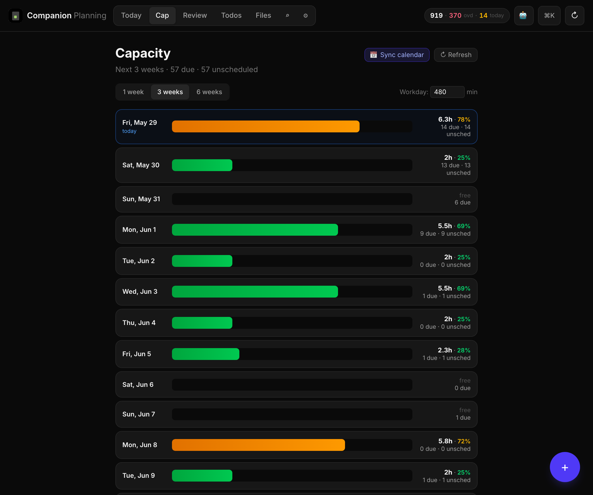
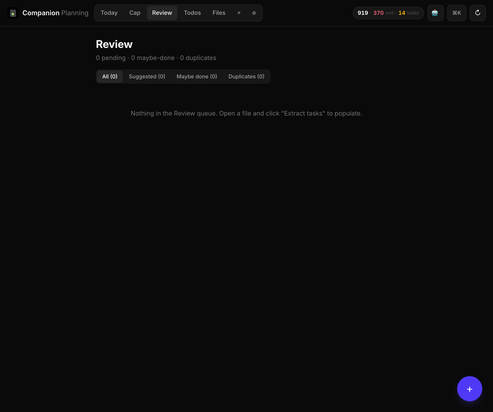
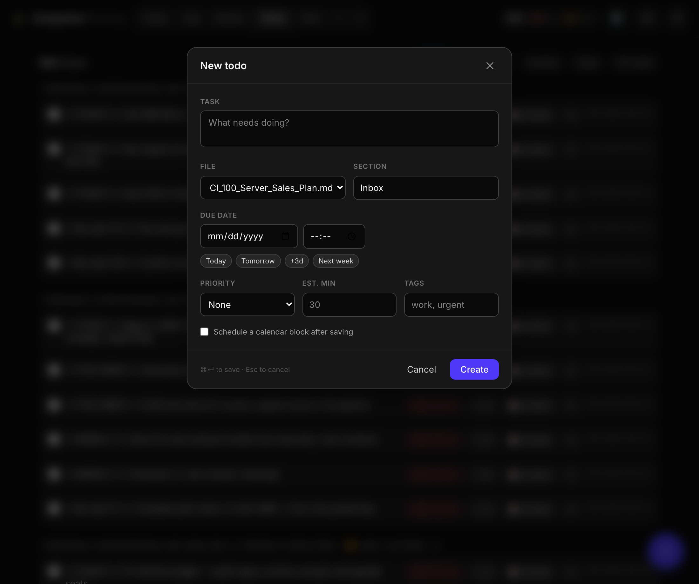

# Companion Planning

A **private, local-first, MCP-native** personal todo and planning app. Reads your
markdown files on disk, indexes them in SQLite, exposes everything to Claude and
agents via Model Context Protocol, and lets you triage with a local LLM. Runs as a
single Node process; accessible from your phone over Tailscale as an installable PWA.

> Markdown stays the source of truth. SQLite is a rebuildable derived index.
> Local LLMs only — no cloud calls for your notes.

## Screenshots

| Today | Capacity |
|---|---|
|  |  |
| Tasks grouped by urgency, each with estimate / schedule / edit actions | 3-week load bars from your real Google Calendar — green/amber/red |

| Review queue | Todo editor |
|---|---|
|  |  |
| LLM-extracted tasks awaiting accept/dismiss — nothing auto-writes | Create/edit with date+time pickers, presets, priority, estimate, tags |

Regenerate with `node ops/scripts/screenshots.mjs` (server must be running).

## Why

If you keep planning docs as markdown (Obsidian-style, Foam-style, or just folders
of `.md`), you have two problems:

1. There's no good way to **slice across files** — Today, Overdue, by-tag, by-project — because nothing reads the structure.
2. There's no good way to **let agents act on your todos** — Claude can read the files, but every edit is a brittle string replace with no atomicity, no concurrency guard, no stable IDs.

Companion Planning fixes both. It maintains a SQLite index of every checkbox in
every watched directory, gives todos stable content-hash IDs, and exposes both
HTTP and MCP APIs so the web UI and an agent share one data layer.

## What you get

- **Seven views**: Today / Capacity / Review / Todos / Files / Search / Settings
- **Full todo editor** — create & edit with native date/time pickers, due-date presets, priority, time estimates, tags, and one-click "schedule a calendar block"
- **Capacity planning** — a 3-week lookahead with green/amber/red daily load bars; see over-committed days before you say yes to one more meeting
- **Calendar bridge** — sync events in, schedule tasks to time blocks, find open slots, open events in Google Calendar (provider-agnostic; manual provider works out of the box)
- **Review queue** — local LLM extracts tasks from *prose* (emails, meeting notes), not just checkboxes; nothing is written to disk until you accept it
- **Scheduled summary routines** — daily/weekly/monthly reviews written to `Summaries/`, driven by launchd or hermes cron, with calendar reconciliation
- **MCP server with ~38 tools** over **stdio _and_ HTTP** — attach Claude Code locally or any agent on your tailnet
- **Local LLM** via Ollama (auto-detected; graceful template fallback when offline)
- **PWA** — installable on iPhone & Android via Tailscale
- **Atomic, hash-guarded writes**; estimates & metadata round-trip through markdown so a reindex never loses them
- **Live reload** + hourly git auto-commit of your markdown root via launchd

## Quick start

```bash
git clone https://github.com/mrhegemon/companion-planning.git
cd companion-planning
npm install

# Point it at your planning markdown root(s)
cp config.example.json config.json
$EDITOR config.json

# Build the TypeScript server + Svelte UI, then start
npm run build
npm run build --prefix ui
HOST=0.0.0.0 npm run start:ts
# Open http://localhost:3847 or http://<your-tailnet-ip>:3847
```

Or run the full installer — builds everything, registers the launchd services
(server, hourly autocommit, daily/weekly/monthly summaries), and installs the
pre-commit hook:

```bash
bash ops/scripts/install.sh
```

Optional but recommended:

```bash
# Local LLM for triage, extraction, and LLM-authored summaries
brew install ollama && ollama serve &
ollama pull qwen2.5:7b-instruct   # ~4.7 GB, good baseline

# Register as MCP server for Claude Code (stdio)
claude mcp add companion-planning -- node "$(pwd)/server/dist/mcp-stdio.js"

# LLM-authored scheduled summaries via hermes (alternative to launchd)
bash ops/scripts/install-hermes-routines.sh
```

## Configuration

```json
{
  "directories": ["~/Documents/Liam_Plan"],
  "excludeDirs": ["archive", "_archive", "planning_archive", "node_modules", ".git"],
  "port": 3847,
  "title": "Companion Planning"
}
```

## Markdown conventions

These are optional — files without them still work, they just won't surface in filters.

| Convention | Example |
|---|---|
| Todo | `- [ ] file taxes` |
| Done | `- [x] file taxes (done: 2026-04-15)` |
| Due date | `- [ ] file taxes (due: 2026-04-15)` |
| Tag | `- [ ] file taxes #tax #urgent` |
| Priority | `- [ ] file taxes !!!` or `p1` |
| Time estimate | `- [ ] file taxes (est: 45m)` |
| Frontmatter | `due:`, `tags: [tax, urgent]`, `project: name` |

The canonical line order (what the editor writes) is:
`- [ ] !!! body #tags (est: Nm) (due: YYYY-MM-DD)`. Estimates live in the markdown,
so a reindex never loses them.

Todos are addressable by a **stable content hash** (sha256 of `path + heading + text`)
— so an edit doesn't break agent references the way line numbers do.

## HTTP API

| Method | Path | Purpose |
|---|---|---|
| GET | `/api/health` | Version, uptime, counts |
| GET | `/api/files` | List indexed files with todo counts |
| GET | `/api/file?path=` | Read a file (content, sha256, parsed todos & headings) |
| PATCH | `/api/file` | Toggle a checkbox by `hash` |
| PUT | `/api/file` | Replace file content with optimistic `expected_sha256` |
| POST | `/api/todo` | Create a todo (text, due, tags, priority, estimate) |
| PATCH | `/api/todo` | Edit a todo by `hash` (merges omitted fields) |
| GET | `/api/todos?open=true&due=today&tag=…` | Filtered query |
| GET | `/api/search?q=` | BM25-ranked FTS5 search |
| GET | `/api/stats` | Aggregate counts |
| GET | `/api/lookahead?weeks=3` | Day-by-day capacity + tasks + events |
| GET | `/api/capacity?start_date=&end_date=` | Capacity for a date range |
| POST | `/api/task/estimate` | Set a durable `(est: Nm)` estimate |
| POST | `/api/calendar/events` | Batch-ingest events fetched by an agent (the "connect my calendar" path) |
| POST | `/api/calendar/sync` | Pull calendar events via the bound provider |
| POST | `/api/calendar/schedule` | Create a time block linked to a task |
| GET | `/api/calendar/slots?duration_minutes=` | Find open slots |
| GET / POST | `/api/suggestions`, `/api/suggestion/:id/accept\|dismiss` | Review queue |
| POST | `/api/extract` | LLM-extract tasks from a file → Review queue |
| POST | `/api/summary/{daily\|weekly\|monthly}` | Generate a period review |
| POST | `/api/reconcile` | Close past calendar blocks whose task is done |
| GET / PUT | `/api/memory[/:key]` | Persistent agent memory |
| POST / GET / DELETE | `/mcp` | MCP-over-HTTP (Streamable transport) |
| GET | `/api/events` | SSE stream of file-change events |

## MCP tool surface

~38 tools over **stdio and HTTP**. Highlights: `list_todos`, `add_todo`,
`complete_todo`, `search`, `triage_inbox`, `summarize_day`, `extract_from_source`,
`accept_suggestion`, `lookahead`, `capacity_report`, `schedule_task`, `find_slot`,
`sync_calendar`, `generate_summary`, `reconcile_past`, `task_history`, `set_estimate`,
`memory_get` / `memory_set`.

Attach Claude Code over stdio:

```bash
claude mcp add companion-planning -- node /path/to/server/dist/mcp-stdio.js
```

Attach any agent on your tailnet over HTTP (no SSH needed):

```json
{ "mcpServers": { "companion-planning": { "url": "http://100.x.x.x:3847/mcp" } } }
```

## Security model

- **Trust boundary: Tailscale.** No per-request auth; the server (and MCP-over-HTTP at
  `/mcp`) is reachable only via your tailnet (or `127.0.0.1` without `--host 0.0.0.0`).
- **Path sandbox**: every read and write is checked against the configured roots
  (`isPathInRoots` in `server/src/util.ts`).
- **No LLM auto-writes**: extraction, triage, and summaries return plans; only an
  explicit accept/apply touches a file.
- **Atomic writes**: write to `<file>.tmp.<pid>.<ts>` then `rename()`.
- **Concurrency guard**: `PUT /api/file` requires `expected_sha256`; toggles use
  content-hash todo IDs that survive reflows.
- **LLM input stays local**: prompts include note content; Ollama runs on-device.

## Scheduled routines

Daily / weekly / monthly reviews are generated by an **external scheduler** hitting
idempotent endpoints — so the trigger and the logic are decoupled. Each review is
LLM-authored when Ollama is up, and falls back to a deterministic template otherwise,
so a 9pm cron never fails. Output lands in `Summaries/{Daily,Weekly,Monthly}/` and is
re-indexed automatically; `reconcile` closes past calendar blocks whose task is done.

Two interchangeable drivers (pick one — `install.sh` wires the launchd one):

- **launchd** (default, robust, local): `ops/launchd/com.companion-planning.summary.*`
  run `ops/scripts/summary.sh` on a `StartCalendarInterval` (daily 21:00, weekly
  Sun 19:00, monthly 1st 08:00).
- **hermes cron** (LLM-authored, agentic): `ops/scripts/install-hermes-routines.sh`
  registers the companion MCP with the hermes agent daemon and creates cron jobs that
  call `generate_summary` + `reconcile_past` as a full agent turn.

Trigger any review by hand from **Settings → Summaries & routines**, or:

```bash
curl -X POST http://127.0.0.1:3847/api/summary/weekly -d '{}' -H 'Content-Type: application/json'
```

## Connecting Google Calendar

The server stores **no Google credentials** — an agent that already has calendar
access (Claude with the Calendar MCP, Claude Cowork, or hermes) pulls events and
pushes a minimal batch into `POST /api/calendar/events`. Once ingested, the Capacity
view and `lookahead` reflect your real committed hours, and `find_slot` schedules
around real meetings. Full recipe in
[`ops/scripts/sync-google-calendar.md`](ops/scripts/sync-google-calendar.md).

```bash
# An agent fetches events, then:
curl -X POST http://127.0.0.1:3847/api/calendar/events -H 'Content-Type: application/json' -d '{
  "events": [{ "calendar_id": "work", "event_id": "abc",
               "title": "Standup", "start": "2026-05-29T09:00:00-07:00",
               "end": "2026-05-29T09:30:00-07:00" }]
}'
```

Ingest **timed** events only — all-day items (deadlines, holidays) would distort
capacity and are better tracked as todos.

## Architecture

See [ARCHITECTURE.md](ARCHITECTURE.md) for the full V4.1 design (data model, calendar
bridge, ingestion, scheduled-routine layer, agent attachment, security).

Stack:
- Node 22 + Express + chokidar, **strict TypeScript** (ESM, NodeNext)
- better-sqlite3 (WAL mode, FTS5)
- @modelcontextprotocol/sdk (stdio **and** Streamable HTTP transports)
- gray-matter for frontmatter parsing
- Ollama HTTP client (zero-dep, graceful-degradation)
- Svelte 5 + Vite + Tailwind v4 PWA (single UI at `/`)
- Provider-agnostic calendar bridge (manual provider default; Google adapter pluggable)

## Tests

99 unit + integration tests (Vitest) and Playwright E2E. Ollama and Google Calendar
are stubbed, so CI needs neither.

```bash
npm test          # unit + integration
npm run test:e2e  # Playwright
```

## License

MIT.

## Author

Liam Broza ([@mrhegemon](https://github.com/mrhegemon))
