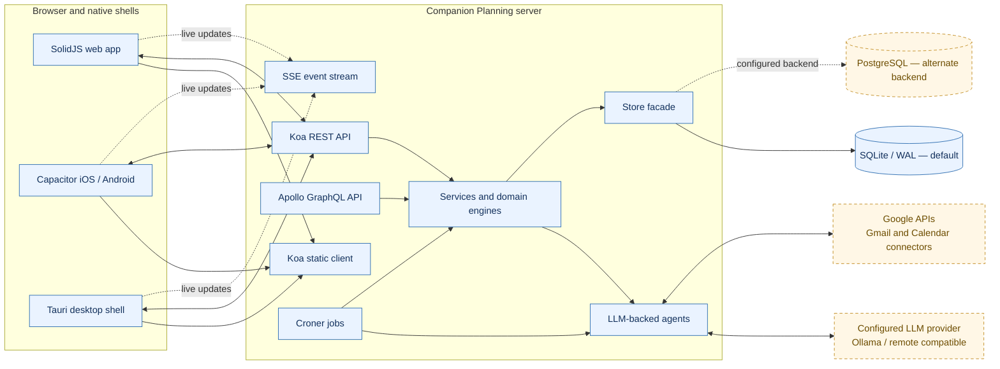
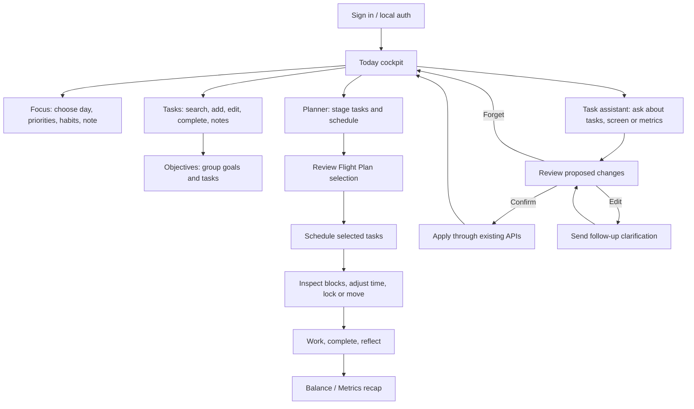
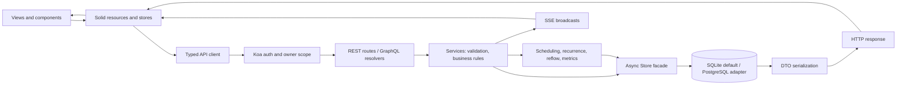
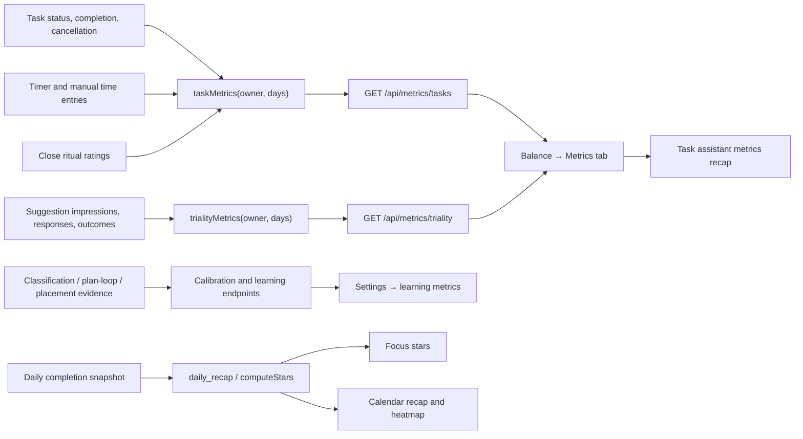

# Companion Planning — Current System Flows

Updated 2026-11-23 from `client/src`, `server/src`, `server/src/db/schema.ts`, and the migration registry. Solid paths are implemented. Dashed paths are optional, conditional, or proposed follow-up work.

## System flow



## User flow



## Data flow



## Agent flow

```mermaid
sequenceDiagram
  actor User
  participant Chat as Task assistant UI
  participant Route as /api/task-agent/plan
  participant Scope as Owner-scoped context services
  participant Model as Configured LLM
  participant APIs as Existing task/objective APIs
  participant DB as Store
  User->>Chat: Type or dictate; review transcript
  Chat->>Route: Message, bounded history, screen summary
  Route->>Scope: Search task candidates / read objectives / screen context
  Scope->>DB: Owner-scoped reads
  DB-->>Scope: Candidate records and state
  Route->>Model: Request + bounded context
  Model-->>Route: Structured reply and proposed actions
  Route->>Route: Validate action kinds, IDs and fields
  Route-->>Chat: Reply + proposals (no writes)
  Chat-->>User: Confirm / edit / forget
  User->>Chat: Confirm
  Chat->>APIs: Apply accepted action(s)
  APIs->>DB: Validated writes, notes, placement
  DB-->>APIs: Updated records
  APIs-->>Chat: Success or partial failure
  Chat-->>User: Outcome
```

## Metric flow


