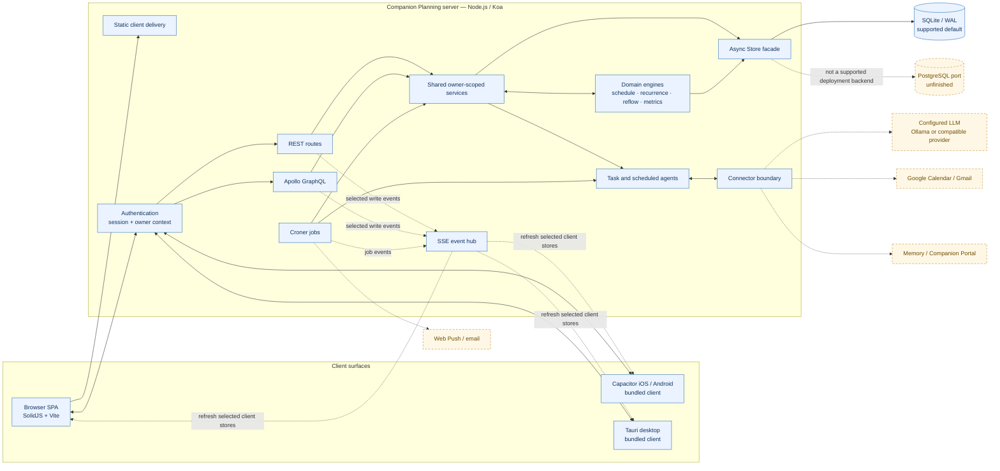
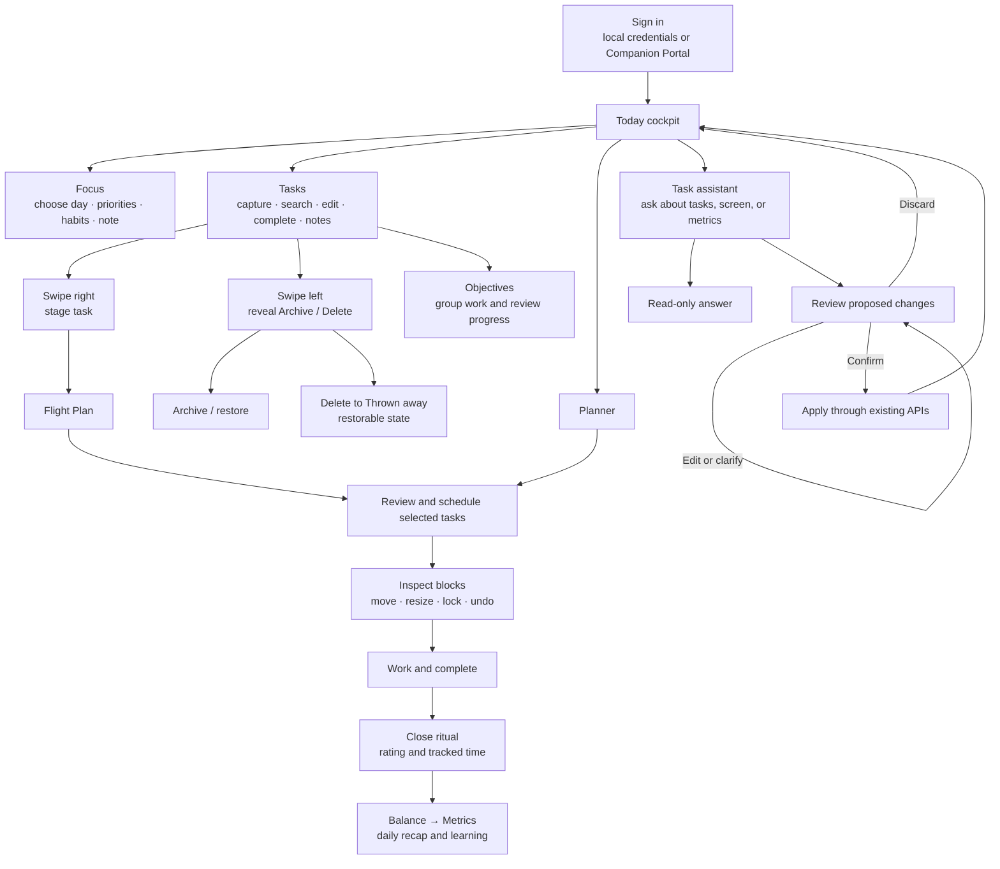
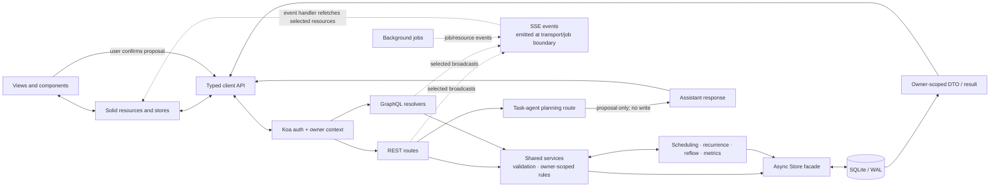
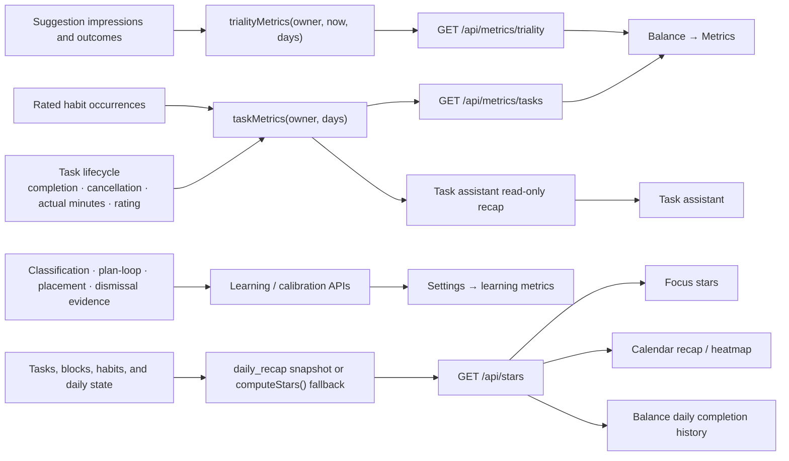

# Companion Planning — Current System Flows

Updated 2026-11-24 from the current client, server routes/services, Store facade, job registry, and metrics code. Solid edges are implemented request/data paths. Dashed edges are optional integrations or the unfinished PostgreSQL port. These five diagrams describe the live system; historical and feature-specific diagrams elsewhere in the repository remain scoped to their original documents.

## System flow



## User flow



## Data flow



## Agent flow

```mermaid
sequenceDiagram
  actor User
  participant UI as Task assistant UI
  participant Route as POST /api/task-agent/plan
  participant Scope as Owner-scoped context/services
  participant Store as Store / SQLite
  participant Model as Configured LLM
  participant API as Existing task / block APIs
  User->>UI: Ask, dictate, or answer a clarification
  UI->>Route: Message + bounded history + screen summary
  Route->>Scope: Find candidate tasks, objectives, and relevant tagged blocks
  Scope->>Store: Owner-scoped reads only
  Store-->>Scope: Current records and state
  Route->>Model: Request + bounded context
  alt Provider unavailable
    Model-->>Route: No usable response
    Route-->>UI: 503; no write
  else Provider returns a proposal
    Model-->>Route: JSON reply and proposed actions
    Route->>Route: Validate action kinds, known IDs, fields, and scope
    Route-->>UI: Reply + editable proposal; no task write
    UI-->>User: Review, edit, clarify, confirm, or discard
    User->>UI: Confirm proposal
    UI->>API: Apply accepted action(s) through existing endpoints
    API->>Scope: Validate and perform owner-scoped writes
    Scope->>Store: Persist task / objective / block changes
    Store-->>API: Updated records
    API-->>UI: Success or per-item failure
    API-->>UI: Selected SSE events trigger store refreshes
    UI-->>User: Show outcome
  end
```

## Metric flow


