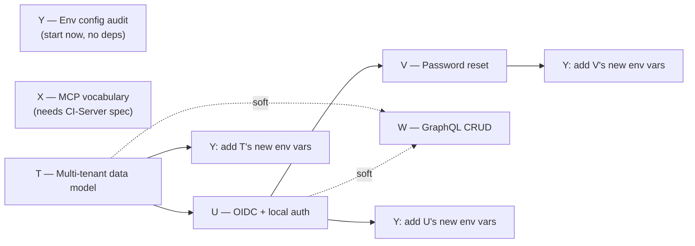

# Release readiness — master plan (Phases T-Y)

**Status:** Planning only — no code, schema, or config touched to produce this or any linked doc. Companion to [ROADMAP.md](ROADMAP.md). Continues the lettered-phase convention (`B0`...`S` exist; this starts at `T`).

> **Reviewed 2026-07-01** — see [RELEASE-READINESS-REVIEW.md](RELEASE-READINESS-REVIEW.md) for an audit of this plan against the live codebase, the fixes applied to S/T/U/V/W/Y and ROADMAP, and one code change (`schema.ts` reconciled to the migrations — Drizzle is the approved source of truth). **Headline:** the app is *not* release-ready after Phase S; S is table cleanup, and the real gate is T+U+V, which are unbuilt and partly blocked on external inputs. Note also that Q has not landed (live migration head is `0091`), which the whole T–Y chain assumes.

This plan covers six phases needed to take the app from single-owner/local to a releasable, multi-tenant, OIDC-authenticated product with a GraphQL surface and an aligned MCP vocabulary. Each phase has its own doc with full detail; this doc is the map: what depends on what, what can run at the same time, and — important — **which inputs I don't have and need from you before certain phases can be fully specced** (not blocked on planning, just on a few facts only you or the CI-Server/Hub team have).

## Phases at a glance

| Phase | Doc | One-line goal | Depends on |
|---|---|---|---|
| **T** | [T-multi-tenant-users.md](T-multi-tenant-users.md) | Turn the owner-scoped-but-single-owner data model into a real multi-tenant one; decide what "user" means | none |
| **U** | [U-oidc-local-auth.md](U-oidc-local-auth.md) | OIDC login via hub.companionintelligence.com (over Tailscale) + a local username/password fallback mode with an env toggle | T (schema) |
| **V** | [V-password-reset.md](V-password-reset.md) | Password reset modal for local sign-in, emailing the portal account by default | U (needs local auth to exist) |
| **W** | [W-graphql-crud.md](W-graphql-crud.md) | A GraphQL CRUD layer alongside the existing REST API | soft: T (final resource shape), U (auth context) |
| **X** | [X-mcp-intent-vocabulary.md](X-mcp-intent-vocabulary.md) | Align the existing 36-tool MCP vocabulary with CI-Server's naming/intent conventions | external input (CI-Server's vocabulary spec) |
| **Y** | [Y-env-configuration.md](Y-env-configuration.md) | Audit and document every environment variable the app reads (existing + new from T-V) | none to start; finalized after T-V |

## Dependency / parallelization map

**Three tracks, only one is truly sequential:**

- **Track A (sequential — data & identity):** T → U → V. Each genuinely needs the one before it: U needs T's owners/users schema decided before it can define what a login credential attaches to; V needs U's local-auth tables to exist before a "reset" means anything.
- **Track B (parallel to Track A):** W (GraphQL) and X (MCP vocabulary) can be **designed** in full parallel with T starting on day one — neither touches the owner-scoping schema work. Final *implementation* wiring for W should wait until T's schema and U's auth-context shape are locked, so the GraphQL resolvers aren't built against a moving target. X has no hard dependency on anything internal — it's gated only on getting CI-Server's vocabulary spec from your side.
- **Track C (parallel, no dependencies):** Y can start immediately — auditing today's env vars doesn't wait on anything. It gets revisited at the end of T, U, and V to add each phase's new variables.

**Practical staffing suggestion:** if you have more than one person/session available, T and Y can both start today; X can start today if you can hand over CI-Server's MCP vocabulary doc; W's design can start today too. U and V are genuinely blocked on T finishing its schema decisions first.

## Inputs I need from you (not blocking planning, but blocking full specificity)

I don't have access to CI-Hub, CI-Server, or hub.companionintelligence.com's source or docs — everything below is drafted from standard OIDC/industry practice and this repo's own existing patterns, not from your actual Hub implementation. Before these phases move from "draft plan" to "ready to build," I'd need:

1. **hub.companionintelligence.com's OIDC discovery document** (or the issuer URL so I/an implementer can fetch `.well-known/openid-configuration`), plus how existing consumers (CI-Import Tools, CI-Hub) register as OAuth clients — is there a self-service registration, or does someone provision a `client_id`/`client_secret` by hand? (Phase U)
2. **CI-Hub's actual password-reset flow** — I couldn't find CI-Hub's source in either of your connected folders. If you share the repo, a doc, or even just screenshots of the flow, I'll mirror its shape instead of guessing. (Phase V)
3. **CI-Server's MCP intent vocabulary spec** — the naming/verb convention you want Companion Planning's 36 MCP tools aligned to. Without it, X can only audit what exists today, not tell you where it diverges. (Phase X)
4. **A decision on the tenant model** — see T's "open decision" section. This is the single highest-leverage thing to lock down first since it changes the shape of al