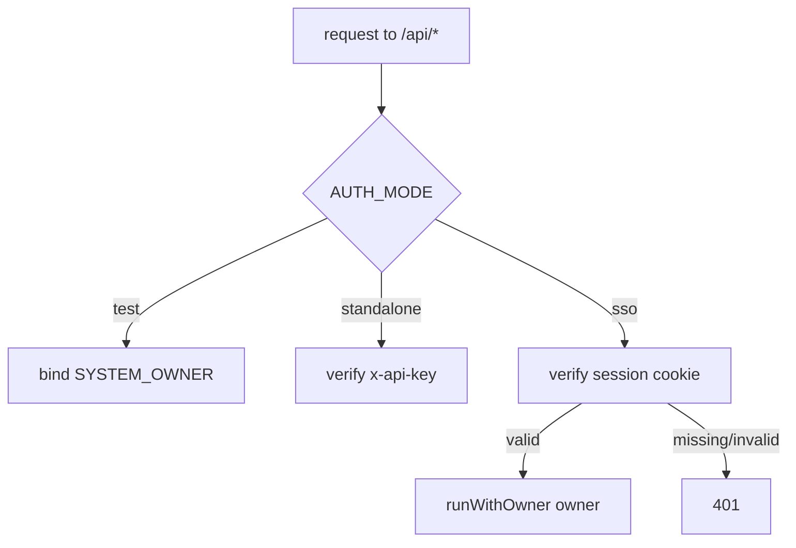

# Phase U — Authentication (OIDC SSO + local login)

**Status:** shipped as U0 → U3. This is the reference for how Companion Planning authenticates users.

Phase U turns the app from "single implicit owner" into a real multi-tenant, authenticated
service, in four slices:

| Slice | What it adds | PR |
|---|---|---|
| **U0** | `owners` gains auth-identity columns (`external_subject`, `username`, `password_hash`) + `owner ≡ user` becomes canon | #225 |
| **U1** | **Companion Portal SSO** — OAuth 2.1 + PKCE Relying-Party login against `hub.ci.computer` (CI-Portal) | #228 |
| **U2** | **Local username/password** login (`DISABLE_OIDC`) + session cookie | #226 |
| **U3** | **SolidJS `/login` screen** + auth-gated route guard | #228 |

> **Owner ≡ User.** There is no separate `users` table. The internal `owners` table *is* the
> user/account table (Phase T decision #1, 1:1 tenant = user). Auth columns live directly on it.

---

## The three auth modes

`AUTH_MODE` selects the authentication strategy. It is read once at boot.

| `AUTH_MODE` | Credential | Who it's for | Login UI |
|---|---|---|---|
| `test` (default) | none — a fixed `SYSTEM_OWNER` is injected | dev + the test suite (forbidden in production) | none |
| `standalone` | hashed `x-api-key` header | the headless / public Docker image | none |
| `sso` | signed httpOnly **session cookie** | multi-user deployments | **yes** (`/login`) |

`sso` mode has two sub-modes, chosen by `DISABLE_OIDC`:

```
AUTH_MODE=sso
├── DISABLE_OIDC=false (default) → Companion Portal SSO (U1) "Continue with Companion Portal"
│                                  + local username/password (U2) behind "Sign in with username instead" (A4)
└── DISABLE_OIDC=true            → local login only (U2)  username + password form
```

Both sub-modes **end a login by minting the same signed httpOnly session cookie**, so from
`requireAuth`'s perspective every authenticated `sso` request is identical — it just verifies the
session. `test` and `standalone` ignore `DISABLE_OIDC` entirely, so dev/CI and the Docker image are
unaffected by any of Phase U.



---

## U0 — the owner identity columns

`owners` gained three **nullable** columns (migration `0101`):

| Column | Set by | Meaning |
|---|---|---|
| `external_subject` | U1 | the CI-Portal id_token `sub` — maps a portal identity to a local owner |
| `username` | U2 | local-login handle |
| `password_hash` | U2 | argon2id hash |

An owner's auth mode is *inferred* from which columns are non-null — there is no `auth_kind`
column. Uniqueness on `external_subject`/`username` is enforced by **partial unique indexes**
(`WHERE col IS NOT NULL`) because SQLite's `ALTER TABLE ADD COLUMN` can't add a `UNIQUE` column, and
the partial predicate lets many NULL rows (the sentinel + not-yet-authed owners) coexist.

**N-SENTINEL.** The single `SYSTEM_OWNER` row (`00000000-…-0001`) keeps all three columns NULL — it
is *auth-inert*. Every owner lookup in U1/U2 explicitly excludes it (`... AND id <> SYSTEM_OWNER_ID`)
so an external login can never take over the dev/test identity.

---

## U1 — CI-Portal SSO (OAuth 2.1 + PKCE Relying-Party)

Companion Planning is an **OAuth consumer** of Companion Portal (CI-Portal; production `hub.ci.computer`,
staging `hub.companionintel.com`, dev `hub.companionintelligence.com` — a public Cloudflare Worker, so the
code exchange needs no Tailscale) — the same role CI-Import Tools and CI-Hub play. It runs a full **Authorization-Code +
PKCE(S256)** Relying-Party flow: redirect the user to the portal, receive a code, exchange it, verify
the returned id_token, then resolve or provision the local owner and start a session.

This mirrors the app's existing, proven Google OAuth client (`server/src/routes/oauth.ts`) rather than
introducing a new dependency. The security-sensitive id_token verification is now **one shared module**
(`server/src/lib/auth/verifyOidcIdToken.ts`) used by both Google and CI-Portal.

```mermaid
sequenceDiagram
  autonumber
  participant B as Browser
  participant A as Companion Planning
  participant P as CI-Portal
  B->>A: GET /api/auth/ciportal/start
  A->>A: mint state + PKCE verifier + nonce → auth_states row
  A-->>B: 302 → portal /authorize?code_challenge=S256(...)&state&nonce
  B->>P: authorize (user signs in / consents)
  P-->>B: 302 → /api/auth/ciportal/callback?code&state
  B->>A: GET callback?code&state
  A->>A: consume auth_states row (single-use); reject unknown/expired
  A->>P: POST /token (code + code_verifier + redirect_uri)
  P-->>A: { id_token, access_token }
  A->>P: GET jwks_uri
  A->>A: verify id_token (EdDSA or RS256, iss, aud, exp, nonce)
  A->>A: sub → owner (excl. sentinel); auto-provision if new
  A-->>B: Set-Cookie cp_session (signed, httpOnly) · 302 → /
```

**Two structural differences from the Google connector** (both deliberate):

1. **This is a login, not account-linking.** Google's `/start` needs an already-resolved owner;
   U1's `/start` runs *before* any owner exists. So its state lives in a **new `auth_states` table**
   (migration `0102`) — `oauth_states` minus `owner_id` — rather than loosening `oauth_states`'s
   `NOT NULL owner_id` (which other code correctly relies on).
2. **The callback resolves/provisions an owner and starts a session** instead of storing a
   connection token. `sub` → `owners.external_subject`; a new `sub` with `AUTH_AUTO_PROVISION=true`
   provisions a fresh owner (see below), otherwise 403.

   **Who becomes the operator (A3, 2026-10-21 — Companion Memory parity).** A provisioned portal
   user is a `member` (Phase AG), with one exception: when the instance has **no operator yet**
   (a portal-only install where no `AUTH_DEFAULT_*` admin was seeded), the **first** portal login
   claims the `operator` role so someone can manage accounts. The decision is made inside the
   insert statement itself (`provisionOwner({ claimOperatorIfNone: true })`), so two first logins
   racing each other can only ever mint one operator. The sentinel never counts. The claim never
   bypasses `AUTH_AUTO_PROVISION`.

**Discovery-driven** (matches CI-Import-Tools, the sibling consumer). The only required
config is `CIPORTAL_ISSUER` + `CIPORTAL_CLIENT_ID`; the authorize/token/JWKS endpoints — and the
canonical token `iss` — are read at runtime from `<issuer>/.well-known/openid-configuration`
(`lib/auth/oidcDiscovery.ts`, 1h cache). The explicit `CIPORTAL_*_URI` vars remain as optional
overrides to bypass discovery (air-gapped / a provider without a discovery doc).

**Security properties** (enforced in `verifyOidcIdToken.ts` + the callback):

- Only two signatures are accepted, each pinned to one key shape: **RS256** against an RSA JWK
  (what Google issues) and **EdDSA/Ed25519** against an `OKP` JWK (what CI-Portal issues —
  better-auth's `jwt()` default; its live JWKS at `https://hub.ci.computer/api/auth/jwks` holds
  exactly one such key). `alg:none`, `HS*`, `ES*`, `PS*` and Ed448 are rejected, a JWK whose own
  `alg`/`use` disagrees with the token is skipped, and the header `alg` can never route a key of
  the other shape through the wrong algorithm. **History:** until 2026-10-21 the verifier was
  RS256-only, so every real CI-Portal login failed with `invalid_id_token` while the fixture
  portal (then RS256) kept the end-to-end tests green.
- Signature is checked against the portal's JWKS (matched by `kid`, then by key shape); a token signed
  by any other key is rejected.
- `iss` must equal the **discovery document's `issuer`** (not the configured discovery URL). This
  distinction is load-bearing: CI-Portal runs **better-auth**, which serves discovery at `…/api/auth`
  but stamps the **bare origin** (`https://hub.ci.computer`) as the token `iss` —
  validating against `doc.issuer` is what makes real tokens verify.
- `aud` must **contain** `CIPORTAL_CLIENT_ID` — it may be a single string or an array (§3.1.3.7).
  When it names more than one audience, `azp` must additionally identify **us**; without that check a
  token minted for a different client at the same provider, merely listing us among its audiences,
  would verify. A present-but-mismatched `azp` is rejected even for a single-valued `aud`.
- `exp` must be future, and `nbf`/`iat` (when present) must not be. Each bound allows **60s of clock
  skew** in the forgiving direction — provider and server clocks drift, and a token rejected purely
  for a one-second disagreement is a support ticket, not a security win.
- Every endpoint taken from the discovery document (`authorization_endpoint`, `token_endpoint`,
  `jwks_uri`, and `issuer` itself) must sit on the **same origin as `CIPORTAL_ISSUER`**. The document
  is fetched from a configured host but its contents are provider-supplied, so without this it is an
  open redirect into the flow: `token_endpoint` receives the code + PKCE verifier and `jwks_uri`
  decides which key may sign an identity. Validation runs **before** the 1h cache write. Stricter
  than the spec (which permits a cross-host `jwks_uri`, as Google uses) — safe because discovery is
  CI-Portal-only; a provider that needs cross-origin endpoints sets the three `CIPORTAL_*_URI`
  overrides, which bypass discovery.
- The JWKS fetch is bounded (5s, matching discovery) and fails **closed** — no keys means no
  candidate key, so the token is rejected rather than the signature check being skipped.
- The **nonce is always enforced** (`auth_states.nonce` is `NOT NULL`), so a token minted for a
  different flow can't be spliced in.
- `state` is single-use (`DELETE … RETURNING`) and expires (10 min). It is also **bound to the
  browser that started the login**: `/start` drops a short-lived signed httpOnly `cp_login_state`
  cookie, and `/callback` rejects any `state` that doesn't match it — so an authorization response
  replayed into a victim's browser (login-CSRF / session-fixation) is refused (`state_not_bound`).
- The PKCE `code_verifier` is stored server-side and never placed in a URL; `redirect_uri` is the
  configured value, never steered by an arbitrary request `Host` — with one deliberate exception (A5):
  a browser on a **loopback** host (`localhost`, `127.0.0.1`, `::1`, any port — CI-Hub's "local open",
  ADR 001) gets the loopback callback on its own port, so the session lands where the user opened the
  app instead of on the public tunnel host. A loopback redirect can only deliver the code to the user's
  own machine, and the Portal accepts on-device hosts for this client without consent. The choice is
  stored with the state and echoed at the token exchange.
- Identity is taken **only** from the verified `sub` — never a decoded-but-unverified claim.

### G-BASETAG — provisioning a functional owner

A brand-new owner must be a functional tenant, not an empty shell. `provisionOwner()`
(`server/src/lib/owners.ts`) creates, in **one transaction**, everything the migrations gave owner #1
at seed time (those seeds ran once, globally, so they never reach later owners):

- `scheduling_prefs` — cloned from the sentinel's baseline row
- base **tags** — `home`/`work`/`community` (pattern) + `family`/`social`/`me` (category), `is_base`
- category `tag_prefs` with the standard color tokens
- `day_types` (`workday`/`weekend`) + `day_of_week_map`
- builtin `pattern_types` (Routine/Habit/Ritual) + the Community catch-all

Without these, Auto placement would silently do nothing for the new owner.

---

## U2 — local username/password

For deployments without CI-Portal, `AUTH_MODE=sso` + `DISABLE_OIDC=true` serves a local login.

- **Hashing:** argon2id via `@node-rs/argon2` (prebuilt binaries — no node-gyp).
- **Login** (`POST /api/auth/login`): looks up the owner by username (**excluding the sentinel**),
  verifies the password, sets the session cookie. It performs **constant work** — one argon2id verify
  against a decoy hash even for an unknown or OIDC-only username — so response *timing* can't be used
  to enumerate accounts. The 401 is byte-identical regardless.
- **Rate limiting:** `config.auth.rateLimit.issueMax` attempts per window per IP (429 beyond).
- **Boot bootstrap** (`ensureLocalAuthBootstrap`): on first boot with no local owners, seeds one from
  `AUTH_DEFAULT_USERNAME`/`AUTH_DEFAULT_PASSWORD` as the operator. Under `DISABLE_OIDC=true`, no
  default password + no owners **fails closed** — refuses to boot. **Under OIDC (A3)** the same pair
  seeds a **break-glass local operator** that can still sign in at `POST /api/auth/login` (served in
  both `sso` sub-modes) if the portal is unreachable; without the pair OIDC mode boots anyway and the
  first portal login claims the operator role instead.

---

## U3 — the login screen + route guard (SolidJS)

The client learns what is on from the public `GET /api/auth/config` and adapts. Since **A4
(2026-10-21)** the payload carries capability flags rather than a mode the client has to decode:

```jsonc
{ "mode": "sso", "disableOidc": false, "portal": true, "local": true, "signup": "portal" }
```

| Field | Meaning |
|---|---|
| `portal` | "Continue with Companion Portal" is available — `mode === 'sso'` and `DISABLE_OIDC` not `true` |
| `local` | the username/password form is available — `mode === 'sso'` (**both** sub-modes since A3; the break-glass operator and invited local accounts sign in here even on a portal install) |
| `signup` | the sign-up affordance the login screen offers: `portal` whenever the portal is on (B1 — the Portal owns sign-up), else the local policy `invite` / `open` (B2 — `/signup`), else `off` |
| `disableOidc` | **deprecated** — kept one release for older clients; read `portal`/`local` instead |

`test`/`standalone` report `portal: false, local: false, signup: 'off'` and stay **ungated**.

- **Ungated (`test`/`standalone`):** the app is byte-for-byte unchanged — the original Shell-root
  router, no `/login` route, no session probe.
- **Gated (`sso`):** `/login` (and `/signup`, `/reset-password`) render bare (no nav/chrome). A
  `SessionGate` probes `GET /api/auth/me` and redirects unauthenticated users to `/login`. A **Sign
  out** action (→ `POST /api/auth/logout`) appears in the nav.

> The client guard is **UX only** — the server enforces auth on every `/api/*` call regardless. A
> user who bypasses the client guard still gets 401s from the API.

Visual parity with CI-Portal/CI-Hub's own login components is a later reconciliation pass (their
components aren't available in this repo); U3 uses this app's own design tokens.

### The login screen (A4 — both methods on one screen)

`client/src/views/Login.tsx` is driven purely by the flags above (Companion Memory's layout):

- **`portal && local`** (a Hub install): primary **Continue with Companion Portal** (a top-level
  navigation to `/start`, not a fetch), then a secondary **Sign in with username instead** that expands
  the username/password form *in place*; **Forgot password?** sits under that form.
- **`local` only** (`DISABLE_OIDC=true`): the username/password form shows directly, with
  **Forgot password?** under it.
- **`portal` only** / neither: the portal button alone / "Sign-in is not enabled on this deployment."
- **Under the card** — the sign-up line, by `signup`: **"Don't have an account? Create one with
  Companion Portal"** (B1, same `/start` URL, plus the note that on a Hub the account must also be a
  member of the Hub's organization), or **"Don't have an account? Sign up"** → `/signup` (B2, "with an
  invite code" under `invite`), or nothing under `off`.
- **`?sso_error=`** from the callback: `invalid_redirect_uri`, `access_denied` and `unauthorized_client`
  — the shapes the Portal's org-membership refusal arrives in (§"Portal contract" in the
  [2026-10-21 readiness review](PRODUCTION-READINESS-2026-10-21.md)) — render as *"Companion Portal
  couldn't sign you in (…). Ask your Hub's owner to invite you to the organization, then try again."*;
  every other code keeps the generic *"cancelled or failed"* copy. `confirmation_expired` is the B3
  page's own bounce (below).

`client/src/views/Login.test.tsx` renders every flag combination and both error renderings.

---

## B1 / B2 / B3 — getting an account (2026-10-21)

Three paths to a first account, all ending in the same `provisionOwner({ claimOperatorIfNone: true })`
call, so whichever one runs first on an operator-less instance mints the operator (A3) and every later
account is a member.

### B1 — Companion Portal is the sign-up path

The Portal has no `screen_hint`/`prompt=create`: its `/login` and `/signup` are one card with a
client-side toggle, and an unauthenticated `/oauth2/authorize` round-trips through that card and
`/api/oidc-resume` (10-minute window) back to our callback. So the login screen's **Create one with
Companion Portal** link is simply `/api/auth/ciportal/start` again. On return the callback sees an
unknown `sub` and — rather than provisioning silently — runs the B3 confirmation, which creates the
owner. **Hub constraint:** a brand-new Portal account has no organization, and on a tunnel or tailnet
host the Portal refuses the redirect until the Hub's owner invites the person into the org; the login
screen says so, and renders the refusal as the actionable message above.

### B3 — first-time portal sign-in confirmation

A verified id_token whose `sub` has no owner yet must not become a tenant by accident (the wrong Portal
persona on a shared device; or, on an operator-less instance, an accidental operator claim). The
callback therefore:

1. checks `AUTH_AUTO_PROVISION` (403 `unknown_subject_auto_provision_disabled` when off) and the
   N-SENTINEL reservation (403 `subject_unavailable`) **before** asking;
2. parks the verified `sub`/`name`/`email` in **`cp_portal_intent`** — a Koa-signed (`SESSION_SECRET`),
   httpOnly, `SameSite=Lax`, `Secure`-over-HTTPS cookie that also carries a random CSRF token and an
   absolute `exp` the server enforces itself (10 minutes; the browser `maxAge` is a courtesy) —
   `server/src/lib/auth/portalIntent.ts`;
3. redirects to **`GET /api/auth/ciportal/confirm-account`**: a self-contained, no-script HTML page
   (inline styles, every value escaped) — *"Create a Companion Planning account for <name> (<email>)?"*
   with **Create account** / **Cancel**, a form `POST` to the same path with the CSRF token in a hidden
   field. Reloading the page does not consume the intent.
4. **`POST`**: the CSRF token must match the cookie's (constant-time; a mismatch is 403 and leaves the
   intent intact so the real tab can still confirm). `decision=create` re-checks `AUTH_AUTO_PROVISION`,
   provisions through the shared `provisionPortalOwner` (the A3 claim, the UNIQUE-race re-read, the
   sentinel fail-closed), sets the session and redirects to `/`; anything else clears the intent and
   returns to `/login`. An absent, expired or tampered intent (the signature no longer verifies)
   bounces to `/login?sso_error=confirmation_expired` from either method, provisioning nothing.

Known subjects never see the page — they sign in directly, as before.

### B2 — invite-code local sign-up

Companion Memory's `signup_code` model, keeping the 2026-07-12 ruling: an operator never sees or sets
anyone's password. **`AUTH_SIGNUP`** = `invite` (default; the CI-Hub manifest's value) · `open` ·
`off`; an unknown value refuses to boot. Meaningful only under `AUTH_MODE=sso`, in **both** sub-modes
— on a portal install `/signup` is the operator's escape hatch for someone without a Portal account,
reached by direct link (the login screen's affordance is the portal).

- **Codes** (`signup_codes`, migration **0172**; `server/src/lib/auth/signupCodes.ts`): minted by an
  operator in **Settings → Accounts → Invite codes** (`POST /api/accounts/signup-codes`, optional note;
  `GET` lists with a derived `active | used | revoked | expired` status; `DELETE …/:id` revokes).
  Human-typeable `XXXX-XXXX-XXXX` (no 0/O/1/I/L; normalised on input), **sha256 at rest** — the raw
  code is returned exactly once — **7-day TTL**, single-use. Minting is refused (409) unless the policy
  is `invite`. Both owner FKs are `ON DELETE SET NULL`, so deleting the minting operator or the
  signed-up account never blocks and the row keeps its history.
- **`GET /api/auth/signup/requirements`** (public): `{ enabled, codeRequired }`, config-derived only.
- **`POST /api/auth/signup`** (public, per-IP rate-limited with the login limiter): `{ name,
  username, email, password, code? }`. Username rules mirror `PATCH /api/owner/profile` (≤64 chars, no
  whitespace, not case-folded); password ≥ 8; email shape-checked. Under `invite` the code is
  **claimed first by one guarded `UPDATE`** (`WHERE used_at IS NULL AND revoked_at IS NULL AND
  expires_at > now`) — the SQLite store cannot nest `provisionOwner`'s transaction, so the claim is what
  makes "consumed once" hold against a race — then the owner is provisioned (argon2id hash, A3 claim)
  and the code bound to it; if provisioning fails (`409 that username is not available`, the same text
  for every taken handle) the claim is released. Unknown, spent, revoked and expired codes all get the
  one 400, so codes cannot be probed. Success (`201`) sets the session cookie.
- **`/signup`** (`client/src/views/Signup.tsx`): name, username, email, password + confirm, and the
  code field only when `codeRequired`; **Sign up with Companion Portal** beside it when `portal` is on;
  "by invitation" notice (plus the Portal button) when `enabled` is false.

---

## Configuration reference

All auth env vars (see [`server/.env.example`](../server/.env.example) for the authoritative copy):

| Var | When required | Purpose |
|---|---|---|
| `AUTH_MODE` | — | `test` \| `standalone` \| `sso` (default `test`) |
| `SESSION_SECRET` | **always when `sso`** | signs the httpOnly session cookie (boot fails closed without it) |
| `DISABLE_OIDC` | — | `sso` only: `true` ⇒ local login instead of CI-Portal |
| `AUTH_AUTO_PROVISION` | — | `true` ⇒ an unknown Companion Portal `sub` provisions a new owner (the first one on an operator-less instance as `operator`, A3); else 403 |
| `AUTH_DEFAULT_USERNAME` / `AUTH_DEFAULT_PASSWORD` | `sso`, first boot | seed the first local owner as operator. Required under `DISABLE_OIDC=true` (fails closed otherwise); optional under OIDC, where it seeds the break-glass operator (A3) |
| `AUTH_SIGNUP` | — | `sso` only: local self-serve sign-up at `/signup` (B2) — `invite` (default; needs an operator-minted single-use code) \| `open` \| `off`. Independent of the portal, which owns sign-up whenever it is on (B1). Unknown values fail boot |
| `CIPORTAL_ISSUER` | — | discovery base; **default `https://hub.ci.computer/api/auth`** (production; staging `hub.companionintel.com`, dev `hub.companionintelligence.com`, each `+ /api/auth`). Endpoints + canonical `iss` come from `<issuer>/.well-known/openid-configuration`. On a CI-Hub appliance the Hub injects the paired value. |
| `CIPORTAL_CLIENT_ID` | — | our client at CI-Portal (public PKCE). **Default `ci-planning`** — a fixed first-party registration, so a deployment no longer has to set it |
| `CIPORTAL_CLIENT_SECRET` | confidential clients only | omit for public/PKCE-only |
| `CIPORTAL_REDIRECT_URI` | — | default `${PUBLIC_BASE_URL}/api/auth/ciportal/callback` — must match the URI registered at CI-Portal |
| `CIPORTAL_AUTHORIZE_URI` / `CIPORTAL_TOKEN_URI` / `CIPORTAL_JWKS_URI` | — | **optional** overrides — set all three to bypass discovery (then `CIPORTAL_ISSUER` must equal the token's actual `iss`) |

**Boot guards** (`config.ts`, fail-closed): `AUTH_MODE=test` forbidden in production;
`AUTH_MODE=sso` requires `SESSION_SECRET`; production `sso`+OIDC requires `CIPORTAL_ISSUER` +
`CIPORTAL_CLIENT_ID` (endpoints are discovered, so they're no longer required up front). Both now
have real defaults, so that last guard is satisfied out of the box — it stays as a guard against a
deployment that deliberately blanks either one.

> **Confirmed against CI-Import-Tools** (the sibling consumer, `backend/src/auth/`): CI-Portal runs
> **better-auth**; the production discovery issuer is `https://hub.ci.computer/api/auth` (the default
> since 2026-10-21 — before that the default was the DEV origin `hub.companionintelligence.com`); consumers are **public PKCE clients** (CI-Import-Tools registers `ci-import-tools`).
> **Client registration: DONE.** CI-Portal registered this app as the first-party public (PKCE)
> client `ci-planning` — CI-Portal PR #444, `PUBLIC_CLIENTS` in `apps/hono-app/.../createAuth.ts` —
> so `CIPORTAL_CLIENT_ID` now defaults to it and production SSO no longer needs an operator to
> discover a value. Both of this app's redirect paths are registered against the provisioned
> `ci-planning` host: `/api/auth/ciportal/callback` (sign-in, #444) and
> `/api/memory/ciportal/callback` (the AA0b memory connector, CI-Portal PR #447). Self-hosted
> tailnet installs are NOT matched on host alone any more: since CI-Portal removed its blanket
> `.ts.net` allowance, a `*.ts.net` redirect is accepted only when the host equals a paired
> device's self-reported `tailscale_dns` (device check-in) and the signing-in user belongs to
> that device's organization. On-device hosts (`localhost`, `127.0.0.1`, RFC1918, `*.local`)
> are always accepted; the Hub's public tunnel host must equal `ci-planning-<device>-<org>.<root>`.
> The older generic `AUTH_JWKS_URL`/`AUTH_ISSUER`/`AUTH_AUDIENCE`/`AUTH_CONTRACT_VERSION` vars have
> been **retired** — they were parsed into config but read by no code path.

---

## Developing against a fixture CI-Portal

Real CI-Portal credentials aren't required to build or exercise U1. `server/src/scripts/fixture-portal.ts`
is a minimal, standards-shaped OIDC provider (discovery, consent page, **real S256 PKCE validation**,
**EdDSA/Ed25519-signed id_tokens — the real portal's algorithm**; `FIXTURE_PORTAL_ALG=RS256` for the
Google shape) for dev and manual end-to-end testing.

```bash
# terminal 1 — the fixture portal
pnpm --filter server exec tsx src/scripts/fixture-portal.ts   # → http://localhost:9899

# terminal 2 — the app, pointed at it
AUTH_MODE=sso SESSION_SECRET=dev AUTH_AUTO_PROVISION=true \
CIPORTAL_CLIENT_ID=companion-planning-dev \
CIPORTAL_ISSUER=http://localhost:9899 \
CIPORTAL_AUTHORIZE_URI=http://localhost:9899/authorize \
CIPORTAL_TOKEN_URI=http://localhost:9899/token \
CIPORTAL_JWKS_URI=http://localhost:9899/jwks \
pnpm --filter server dev
```

Then open `/login` and click **Continue with Companion Portal**.

---

## Testing & verification

- **`server/test/ciportal-auth.test.ts`** (U1): the full negative matrix — no code, wrong/replayed/
  expired state, `alg:none`, HS256-forged, ES256, tampered signature (RSA and Ed25519), EdDSA↔RS256
  key-shape confusion both ways, Ed448, contradicting JWK `alg`/`use`, wrong `iss`/`aud`, expired token,
  nonce mismatch, missing `sub` — the EdDSA happy path (with and without JWK `alg`/`use`) — plus provisioning (functional-tenant seeds, no dupes, 403 when
  auto-provision off, sentinel fail-closed), session round-trip, logout. Every provisioning case runs
  through the **B3** confirmation step (`completeLogin`); the B3 block adds: callback parks without
  provisioning, the page's content and escaping, create / cancel / unknown decision, CSRF wrong /
  missing / cross-flow, expired intent, tampered intent, no cookie, auto-provision flipped off between
  callback and click, two tabs confirming the same sub, 404 under `DISABLE_OIDC`.
- **`server/test/local-auth.test.ts`** (U2/A4): login/session/logout, generic-401 (no enumeration),
  constant-work verify, N-SENTINEL exclusion, rate-limit 429, boot seed + fail-closed guard, and the
  `GET /api/auth/config` payload per mode / `AUTH_SIGNUP` value.
- **`server/test/signup.test.ts`** (B2): the requirements probe per policy; `off` → 404; `invite` —
  code required, consumed once, expired, revoked, unknown ≡ spent, normalised input, released when the
  username is taken; `open` needs no code; works under portal login; roles (first = operator, second =
  member, existing operator ⇒ member, sentinel excluded, racing sign-ups mint one operator);
  validation 400s that never spend the code; per-IP 429; absent in `test` mode.
- **`server/test/accounts.test.ts`** (AG + B2): the operator-gated `/api/accounts/signup-codes`
  mint/list/revoke, raw code shown once and never listed, 7-day TTL, 403 for members, 409 unless
  `AUTH_SIGNUP=invite`, note validation, rows surviving owner deletion.
- **`client/src/views/Login.test.tsx`** (A4/B1): every `{ portal, local, signup }` combination, the
  in-place expansion, submit + reload, and both `?sso_error=` renderings.
- **`client/src/views/Signup.test.tsx`** (B2): code field only when required, submit gating, 409 /
  400 / 429 copy, open mode, the "by invitation" state, the Portal alternative.
- **`server/test/oauth.test.ts`** (unchanged) proves the shared-verifier extraction didn't regress the
  Google flow.

Full server suite: **1170 passed / 3 skipped**. The entire CI-Portal flow was also driven end-to-end
against the fixture portal over real HTTP: `401 → start → consent → code → verified token →
auto-provision → session → gated access → replay rejected → logout`.

---

## Verified on a Hub (A6)

**Status 2026-10-21: local stand-in complete; the on-Hub run is still to do.** Everything below
"Local stand-in" was driven against the EdDSA fixture portal on this branch; the "On a paired Hub"
checklist needs a dev Hub paired to an organization and two Companion Portal accounts (one a member
of that organization, one not). Record the Hub and Portal versions and the date next to each line
when it is run.

### Local stand-in (fixture portal, EdDSA, `AUTH_AUTO_PROVISION=true`)

| Step | Result |
|---|---|
| Boot in Portal mode with **no** `AUTH_DEFAULT_PASSWORD` | boots; logs "the first portal login becomes the operator" |
| `GET /api/auth/config` | `{ mode: sso, portal: true, local: true, signup: portal }` |
| Login screen renders | "Continue with Companion Portal", "Sign in with username instead", "Don't have an account? Create one with Companion Portal", the org-invitation hint |
| First portal login (new `sub`) | B3 confirm-account page → Create → 302 `/`, `cp_session` set, `/api/auth/me` → `role: operator`, `/api/jobs` 200 |
| Second portal login (another `sub`) | `role: member`, `/api/jobs` 403 |
| Replayed callback | 400 (state single-use) |
| Boot with `AUTH_DEFAULT_PASSWORD` set | logs "Seeded break-glass local operator"; `POST /api/auth/login` 200 for it, wrong password 401; a later portal login is a member |
| Local-open browser (`Host: 127.0.0.1:<port>`) | `/start` sends the loopback `redirect_uri`; the token exchange echoes it (A5) |
| **Real browser, built client** (desktop app's browser pane) | `/login` → **Continue with Companion Portal** → fixture consent → B3 "Create a Companion Planning account?" → **Create account** → `/` renders; `/api/auth/me` → `role: operator`; `/api/jobs` 200 |
| Signed out, `/login` again | **Sign in with username instead** expands username/password + "Forgot password?"; "Don't have an account? Create one with Companion Portal" links to `/start` |
| `/signup` | invite-code form (code, name, username, email, password ×2) + "Sign up with Companion Portal" + "Already have an account? Sign in" |

### On a paired Hub — checklist

1. Install Companion Planning from the store on a paired dev Hub (after A2: the Hub injects
   `CIPORTAL_ISSUER`, `AUTH_AUTO_PROVISION=true`, no `DISABLE_OIDC`). Confirm `GET /api/auth/config`
   reports `portal: true` on the app's tunnel host.
2. **Tunnel host:** open `https://ci-planning-<device>-<org>.<root>/login`, click **Continue with
   Companion Portal**, sign in with the org-member account, accept the Portal consent screen (forced
   for tunnel hosts), confirm the B3 "Create account?" page → land on `/` as **operator**
   (`/api/auth/me` → `isOperator: true`; Settings → Accounts is visible).
3. **Second account:** sign out; sign in with a second org-member Portal account → **member**
   (`/api/jobs` 403, no Accounts card).
4. **Non-member:** sign in with the Portal account that is NOT in the org → the Portal refuses the
   redirect after its login; the app's `/login?sso_error=…` shows "Ask your Hub's owner to invite you
   to the organization, then try again".
5. **Tailnet host:** repeat step 2 from the device's `tailscale_dns` host (the device must have
   checked in) — consent is forced; the session lands on the tailnet host.
6. **Local open:** from the Hub's local launcher (`http://127.0.0.1:<host-port>`), click the Portal
   button → Portal → back to `http://127.0.0.1:<host-port>/`, **not** the tunnel host (A5); no
   consent screen (on-device rule).
7. **Break-glass:** with the install-time admin password, "Sign in with username instead" → 200;
   that account is an operator.
8. **Memory connector (AA0b):** Settings → Companion Memory → "Sign in with Companion Portal"
   completes on the tunnel host (its callback is registered for that host only).
9. Record Hub version, Portal commit, date, and any deviation here.

## Follow-ups (not in Phase U)

- **V — password reset:** the login screen's "Forgot password?" hook is a placeholder for V's reset
  modal.
- ~~**Cookie `Secure` flag:** omitted deliberately for the http-over-Tailscale deployment~~ — superseded:
  the flag is set per request whenever the request is HTTPS, and the Hub sets `TRUST_PROXY=true` so
  `X-Forwarded-Proto` counts; revisit
  behind HTTPS.
- **CI-Portal visual parity:** reconcile the login screen with CI-Portal/CI-Hub's own components once
  available.
- **Real CI-Portal wiring:** obtain the discovery values + client registration (see Configuration).
