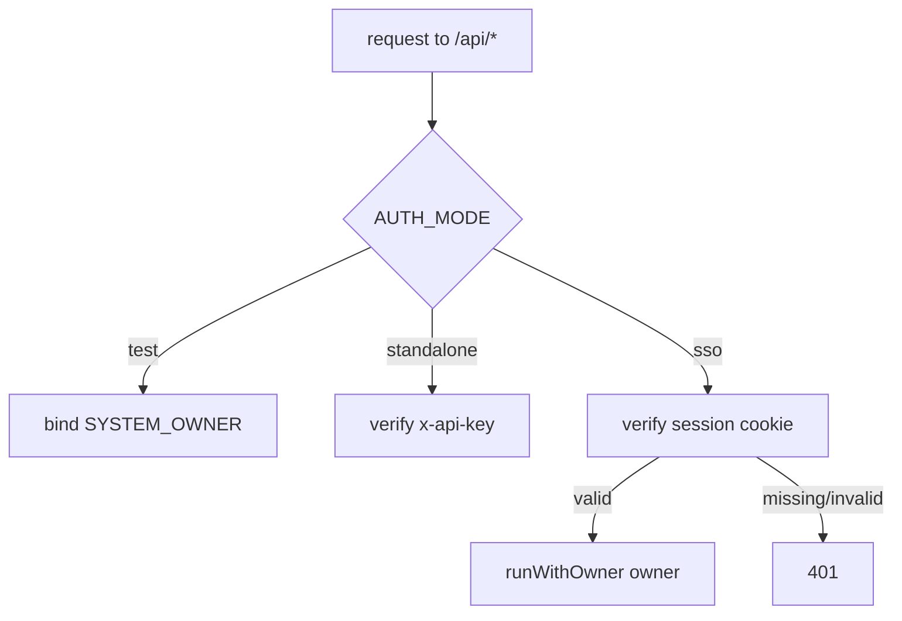

# Phase U — Authentication (OIDC SSO + local login)

**Status:** shipped as U0 → U3. This is the reference for how Companion Planning authenticates users.

Phase U turns the app from "single implicit owner" into a real multi-tenant, authenticated
service, in four slices:

| Slice | What it adds | PR |
|---|---|---|
| **U0** | `owners` gains auth-identity columns (`external_subject`, `username`, `password_hash`) + `owner ≡ user` becomes canon | #225 |
| **U1** | **CI-Portal SSO** — OAuth 2.1 + PKCE Relying-Party login against `hub.companionintelligence.com` | #228 |
| **U2** | **Local username/password** login (`DISABLE_OIDC`) + session cookie | #226 |
| **U3** | **SolidJS `/login` screen** + auth-gated route guard | #228 |

> **Owner ≡ User.** There is no separate `users` table. The internal `owners` table *is* the
> user/account table (Phase T decision #1, 1:1 tenant = user). Auth columns live directly on it.

---

## The three auth modes

`AUTH_MODE` selects the authentication strategy. It is read once at boot.

| `AUTH_MODE` | Credential | Who it's for | Login UI |
|---|---|---|---|
| `test` (default) | none — a fixed `SYSTEM_OWNER` is injected | dev + the test suite (forbidden in production) | none |
| `standalone` | hashed `x-api-key` header | the headless / public Docker image | none |
| `sso` | signed httpOnly **session cookie** | multi-user deployments | **yes** (`/login`) |

`sso` mode has two sub-modes, chosen by `DISABLE_OIDC`:

```
AUTH_MODE=sso
├── DISABLE_OIDC=false (default) → CI-Portal SSO   (U1)  "Continue with CI-Portal"
└── DISABLE_OIDC=true            → local login     (U2)  username + password form
```

Both sub-modes **end a login by minting the same signed httpOnly session cookie**, so from
`requireAuth`'s perspective every authenticated `sso` request is identical — it just verifies the
session. `test` and `standalone` ignore `DISABLE_OIDC` entirely, so dev/CI and the Docker image are
unaffected by any of Phase U.



---

## U0 — the owner identity columns

`owners` gained three **nullable** columns (migration `0101`):

| Column | Set by | Meaning |
|---|---|---|
| `external_subject` | U1 | the CI-Portal id_token `sub` — maps a portal identity to a local owner |
| `username` | U2 | local-login handle |
| `password_hash` | U2 | argon2id hash |

An owner's auth mode is *inferred* from which columns are non-null — there is no `auth_kind`
column. Uniqueness on `external_subject`/`username` is enforced by **partial unique indexes**
(`WHERE col IS NOT NULL`) because SQLite's `ALTER TABLE ADD COLUMN` can't add a `UNIQUE` column, and
the partial predicate lets many NULL rows (the sentinel + not-yet-authed owners) coexist.

**N-SENTINEL.** The single `SYSTEM_OWNER` row (`00000000-…-0001`) keeps all three columns NULL — it
is *auth-inert*. Every owner lookup in U1/U2 explicitly excludes it (`... AND id <> SYSTEM_OWNER_ID`)
so an external login can never take over the dev/test identity.

---

## U1 — CI-Portal SSO (OAuth 2.1 + PKCE Relying-Party)

Companion Planning is an **OAuth consumer** of CI-Portal (`hub.companionintelligence.com`, reachable
over Tailscale) — the same role CI-Import Tools and CI-Hub play. It runs a full **Authorization-Code +
PKCE(S256)** Relying-Party flow: redirect the user to the portal, receive a code, exchange it, verify
the returned id_token, then resolve or provision the local owner and start a session.

This mirrors the app's existing, proven Google OAuth client (`server/src/routes/oauth.ts`) rather than
introducing a new dependency. The security-sensitive id_token verification is now **one shared module**
(`server/src/lib/auth/verifyOidcIdToken.ts`) used by both Google and CI-Portal.

```mermaid
sequenceDiagram
  autonumber
  participant B as Browser
  participant A as Companion Planning
  participant P as CI-Portal
  B->>A: GET /api/auth/ciportal/start
  A->>A: mint state + PKCE verifier + nonce → auth_states row
  A-->>B: 302 → portal /authorize?code_challenge=S256(...)&state&nonce
  B->>P: authorize (user signs in / consents)
  P-->>B: 302 → /api/auth/ciportal/callback?code&state
  B->>A: GET callback?code&state
  A->>A: consume auth_states row (single-use); reject unknown/expired
  A->>P: POST /token (code + code_verifier + redirect_uri)
  P-->>A: { id_token, access_token }
  A->>P: GET jwks_uri
  A->>A: verify id_token (RS256, iss, aud, exp, nonce)
  A->>A: sub → owner (excl. sentinel); auto-provision if new
  A-->>B: Set-Cookie cp_session (signed, httpOnly) · 302 → /
```

**Two structural differences from the Google connector** (both deliberate):

1. **This is a login, not account-linking.** Google's `/start` needs an already-resolved owner;
   U1's `/start` runs *before* any owner exists. So its state lives in a **new `auth_states` table**
   (migration `0102`) — `oauth_states` minus `owner_id` — rather than loosening `oauth_states`'s
   `NOT NULL owner_id` (which other code correctly relies on).
2. **The callback resolves/provisions an owner and starts a session** instead of storing a
   connection token. `sub` → `owners.external_subject`; a new `sub` with `AUTH_AUTO_PROVISION=true`
   provisions a fresh owner (see below), otherwise 403.

**Discovery-driven** (matches CI-Import-Tools, the sibling consumer). The only required
config is `CIPORTAL_ISSUER` + `CIPORTAL_CLIENT_ID`; the authorize/token/JWKS endpoints — and the
canonical token `iss` — are read at runtime from `<issuer>/.well-known/openid-configuration`
(`lib/auth/oidcDiscovery.ts`, 1h cache). The explicit `CIPORTAL_*_URI` vars remain as optional
overrides to bypass discovery (air-gapped / a provider without a discovery doc).

**Security properties** (enforced in `verifyOidcIdToken.ts` + the callback):

- Only an **RS256** signature is accepted — `alg:none`, `HS256`, `ES256`, `EdDSA` are all rejected.
- Signature is checked against the portal's JWKS (matched by `kid`); a token signed by any other key
  is rejected.
- `iss` must equal the **discovery document's `issuer`** (not the configured discovery URL). This
  distinction is load-bearing: CI-Portal runs **better-auth**, which serves discovery at `…/api/auth`
  but stamps the **bare origin** (`https://hub.companionintelligence.com`) as the token `iss` —
  validating against `doc.issuer` is what makes real tokens verify.
- `aud` must **contain** `CIPORTAL_CLIENT_ID` — it may be a single string or an array (§3.1.3.7).
  When it names more than one audience, `azp` must additionally identify **us**; without that check a
  token minted for a different client at the same provider, merely listing us among its audiences,
  would verify. A present-but-mismatched `azp` is rejected even for a single-valued `aud`.
- `exp` must be future, and `nbf`/`iat` (when present) must not be. Each bound allows **60s of clock
  skew** in the forgiving direction — provider and server clocks drift, and a token rejected purely
  for a one-second disagreement is a support ticket, not a security win.
- Every endpoint taken from the discovery document (`authorization_endpoint`, `token_endpoint`,
  `jwks_uri`, and `issuer` itself) must sit on the **same origin as `CIPORTAL_ISSUER`**. The document
  is fetched from a configured host but its contents are provider-supplied, so without this it is an
  open redirect into the flow: `token_endpoint` receives the code + PKCE verifier and `jwks_uri`
  decides which key may sign an identity. Validation runs **before** the 1h cache write. Stricter
  than the spec (which permits a cross-host `jwks_uri`, as Google uses) — safe because discovery is
  CI-Portal-only; a provider that needs cross-origin endpoints sets the three `CIPORTAL_*_URI`
  overrides, which bypass discovery.
- The JWKS fetch is bounded (5s, matching discovery) and fails **closed** — no keys means no
  candidate key, so the token is rejected rather than the signature check being skipped.
- The **nonce is always enforced** (`auth_states.nonce` is `NOT NULL`), so a token minted for a
  different flow can't be spliced in.
- `state` is single-use (`DELETE … RETURNING`) and expires (10 min). It is also **bound to the
  browser that started the login**: `/start` drops a short-lived signed httpOnly `cp_login_state`
  cookie, and `/callback` rejects any `state` that doesn't match it — so an authorization response
  replayed into a victim's browser (login-CSRF / session-fixation) is refused (`state_not_bound`).
- The PKCE `code_verifier` is stored server-side and never placed in a URL; `redirect_uri` is taken
  verbatim from config, never recomputed from the request `Host`.
- Identity is taken **only** from the verified `sub` — never a decoded-but-unverified claim.

### G-BASETAG — provisioning a functional owner

A brand-new owner must be a functional tenant, not an empty shell. `provisionOwner()`
(`server/src/lib/owners.ts`) creates, in **one transaction**, everything the migrations gave owner #1
at seed time (those seeds ran once, globally, so they never reach later owners):

- `scheduling_prefs` — cloned from the sentinel's baseline row
- base **tags** — `home`/`work`/`community` (pattern) + `family`/`social`/`me` (category), `is_base`
- category `tag_prefs` with the standard color tokens
- `day_types` (`workday`/`weekend`) + `day_of_week_map`
- builtin `pattern_types` (Routine/Habit/Ritual) + the Community catch-all

Without these, Auto placement would silently do nothing for the new owner.

---

## U2 — local username/password

For deployments without CI-Portal, `AUTH_MODE=sso` + `DISABLE_OIDC=true` serves a local login.

- **Hashing:** argon2id via `@node-rs/argon2` (prebuilt binaries — no node-gyp).
- **Login** (`POST /api/auth/login`): looks up the owner by username (**excluding the sentinel**),
  verifies the password, sets the session cookie. It performs **constant work** — one argon2id verify
  against a decoy hash even for an unknown or OIDC-only username — so response *timing* can't be used
  to enumerate accounts. The 401 is byte-identical regardless.
- **Rate limiting:** `config.auth.rateLimit.issueMax` attempts per window per IP (429 beyond).
- **Boot bootstrap** (`ensureLocalAuthBootstrap`): on first boot with no local owners, seeds one from
  `AUTH_DEFAULT_USERNAME`/`AUTH_DEFAULT_PASSWORD`; if there's no way to log in (no default password,
  no owners) it **fails closed** — refuses to boot.

---

## U3 — the login screen + route guard (SolidJS)

The client learns which mode is active from the public `GET /api/auth/config` (`{ mode, disableOidc }`)
and adapts:

- **Ungated (`test`/`standalone`):** the app is byte-for-byte unchanged — the original Shell-root
  router, no `/login` route, no session probe.
- **Gated (`sso`):** `/login` renders bare (no nav/chrome). A `SessionGate` probes
  `GET /api/auth/me` and redirects unauthenticated users to `/login`. The login screen shows either
  a **"Continue with CI-Portal"** button (a top-level navigation to `/start`, not a fetch) or the
  **username/password form**, chosen by `disableOidc`. A **Sign out** action (→ `POST /api/auth/logout`)
  appears in the nav.

> The client guard is **UX only** — the server enforces auth on every `/api/*` call regardless. A
> user who bypasses the client guard still gets 401s from the API.

Visual parity with CI-Portal/CI-Hub's own login components is a later reconciliation pass (their
components aren't available in this repo); U3 uses this app's own design tokens.

### Login screens

Rendered from the actual components (see [`docs/screenshots/login-screens.html`](screenshots/login-screens.html)
for an inline reproduction):

- **SSO:** brand mark, "Sign in" heading, "Use your CI-Portal account to continue.", one primary
  **Continue with CI-Portal** button.
- **Local:** brand mark, "Sign in", Username + Password fields, primary **Sign in** button.

---

## Configuration reference

All auth env vars (see [`server/.env.example`](../server/.env.example) for the authoritative copy):

| Var | When required | Purpose |
|---|---|---|
| `AUTH_MODE` | — | `test` \| `standalone` \| `sso` (default `test`) |
| `SESSION_SECRET` | **always when `sso`** | signs the httpOnly session cookie (boot fails closed without it) |
| `DISABLE_OIDC` | — | `sso` only: `true` ⇒ local login instead of CI-Portal |
| `AUTH_AUTO_PROVISION` | — | `true` ⇒ an unknown CI-Portal `sub` provisions a new owner; else 403 |
| `AUTH_DEFAULT_USERNAME` / `AUTH_DEFAULT_PASSWORD` | local, first boot | seed the first local owner (fails closed if no login path) |
| `CIPORTAL_ISSUER` | — | discovery base; **default `https://hub.companionintelligence.com/api/auth`**. Endpoints + canonical `iss` come from `<issuer>/.well-known/openid-configuration` |
| `CIPORTAL_CLIENT_ID` | prod `sso`+OIDC | our client registered at CI-Portal (public PKCE); no default |
| `CIPORTAL_CLIENT_SECRET` | confidential clients only | omit for public/PKCE-only |
| `CIPORTAL_REDIRECT_URI` | — | default `${PUBLIC_BASE_URL}/api/auth/ciportal/callback` — must match the URI registered at CI-Portal |
| `CIPORTAL_AUTHORIZE_URI` / `CIPORTAL_TOKEN_URI` / `CIPORTAL_JWKS_URI` | — | **optional** overrides — set all three to bypass discovery (then `CIPORTAL_ISSUER` must equal the token's actual `iss`) |

**Boot guards** (`config.ts`, fail-closed): `AUTH_MODE=test` forbidden in production;
`AUTH_MODE=sso` requires `SESSION_SECRET`; production `sso`+OIDC requires `CIPORTAL_ISSUER` +
`CIPORTAL_CLIENT_ID` (endpoints are discovered, so they're no longer required up front).

> **Confirmed against CI-Import-Tools** (the sibling consumer, `backend/src/auth/`): CI-Portal runs
> **better-auth**; the discovery issuer is `https://hub.companionintelligence.com/api/auth` (now the
> default); consumers are **public PKCE clients** (CI-Import-Tools registers `ci-import-tools`).
> **The one thing still needed from the CI-Portal team**: register a client for this app (public PKCE)
> and set `CIPORTAL_CLIENT_ID`. This is an EXTERNAL dependency — it cannot be resolved from this
> repo, and until it lands production SSO is not live (there is no default client id, and the boot
> guard fails closed on `sso` + OIDC without one). Use the fixture portal below in the meantime.
> The older generic `AUTH_JWKS_URL`/`AUTH_ISSUER`/`AUTH_AUDIENCE`/`AUTH_CONTRACT_VERSION` vars have
> been **retired** — they were parsed into config but read by no code path.

---

## Developing against a fixture CI-Portal

Real CI-Portal credentials aren't required to build or exercise U1. `server/src/scripts/fixture-portal.ts`
is a minimal, standards-shaped OIDC provider (discovery, consent page, **real S256 PKCE validation**,
RS256-signed id_tokens) for dev and manual end-to-end testing.

```bash
# terminal 1 — the fixture portal
pnpm --filter server exec tsx src/scripts/fixture-portal.ts   # → http://localhost:9899

# terminal 2 — the app, pointed at it
AUTH_MODE=sso SESSION_SECRET=dev AUTH_AUTO_PROVISION=true \
CIPORTAL_CLIENT_ID=companion-planning-dev \
CIPORTAL_ISSUER=http://localhost:9899 \
CIPORTAL_AUTHORIZE_URI=http://localhost:9899/authorize \
CIPORTAL_TOKEN_URI=http://localhost:9899/token \
CIPORTAL_JWKS_URI=http://localhost:9899/jwks \
pnpm --filter server dev
```

Then open `/login` and click **Continue with CI-Portal**.

---

## Testing & verification

- **`server/test/ciportal-auth.test.ts`** (U1): the full negative matrix — no code, wrong/replayed/
  expired state, `alg:none`, HS256-forged, tampered signature, wrong `iss`/`aud`, expired token, nonce
  mismatch, missing `sub` — plus provisioning (functional-tenant seeds, no dupes, 403 when
  auto-provision off, sentinel fail-closed), session round-trip, logout.
- **`server/test/local-auth.test.ts`** (U2): login/session/logout, generic-401 (no enumeration),
  constant-work verify, N-SENTINEL exclusion, rate-limit 429, boot seed + fail-closed guard.
- **`server/test/oauth.test.ts`** (unchanged) proves the shared-verifier extraction didn't regress the
  Google flow.

Full server suite: **1170 passed / 3 skipped**. The entire CI-Portal flow was also driven end-to-end
against the fixture portal over real HTTP: `401 → start → consent → code → verified token →
auto-provision → session → gated access → replay rejected → logout`.

---

## Follow-ups (not in Phase U)

- **V — password reset:** the login screen's "Forgot password?" hook is a placeholder for V's reset
  modal.
- **Cookie `Secure` flag:** omitted deliberately for the http-over-Tailscale deployment; revisit
  behind HTTPS.
- **CI-Portal visual parity:** reconcile the login screen with CI-Portal/CI-Hub's own components once
  available.
- **Real CI-Portal wiring:** obtain the discovery values + client registration (see Configuration).
