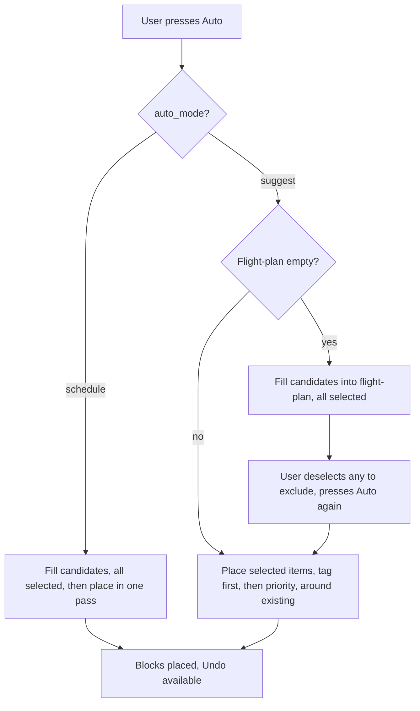

# Auto-scheduling feature plan, schedule-or-suggest, tags, undo

> Status: design, authored 2026-06-22. Captures Liam's feature request: a
> schedule-or-suggest toggle, an instant undo, tag-driven placement into pattern
> windows, suggested tags on every ingested item, a P1 fallback, an inverted
> flight-plan selection, and a check that Auto never creates overlap. Each
> requirement below is mapped to the actual files that change.

---

## Two findings up front

Before the plan, two things from reading the engine that shape everything else.

Overlap avoidance is already correct, you asked me to check this. `dayObstacles()`
in `server/src/engine/scheduler.ts` collects every existing entity in the target
window: locked blocks, meeting blocks, and active task blocks (and Plan
containers when `includePlans` is set). `buildGaps()` and `pickGap()` only ever
place into the gaps between those obstacles, and `clearPriorAuto()` removes only
Auto's own prior placements, so manual blocks and meetings always survive and are
respected. Auto does not create overlap today. The only nuance is that Phase G
allows manual overlap by design, that is a separate, user-driven path and does not
affect the Auto engine. No change needed here beyond a regression test to lock it.

There is a real break in the tag pipeline. Ingested items do receive suggested
tags on `possible_tasks` (via `possible_task_tags`), but the promote handler in
`server/src/routes/possibles.ts` does not copy those tags onto the new task's
`entity_tags`. The Auto engine matches tasks to Plans and pattern windows by task
tag name (`taskTagNames`). So today, the suggested tags are silently dropped the
moment an item becomes a real task, which means tag-driven placement never fires
for anything that came from ingestion. Fixing this is the linchpin of the whole
request; without it, requirements 3, 4, 5, and 9 do nothing for ingested work.

---

## Requirements, mapped to code

### 1. Trust option becomes a toggle: schedule or suggest

Replace the three-state dial sketched in the FTUE plan with a two-state toggle.

- Data: add `auto_mode` to `scheduling_prefs` (text, `'suggest'` default, or
  `'schedule'`). Reuse the existing `GET/PATCH /api/prefs` plumbing, no new route.
- Behavior:
  - suggest: the Auto button stages into the flight-plan and stops (see 7 and 8).
  - schedule: the Auto button fills pattern windows immediately by tag (see 3),
    in one press, skipping the manual review gate.
- UI: a small segmented toggle in the Today cockpit beside the Auto button, in
  `client/src/components/FlightPlan.tsx`, mirrored in Settings. Label it plainly,
  "Schedule" vs "Suggest", with one line of helper text on what each does.

### 2. Undo button, no confirmation

A one-click revert of the last Auto placement, no confirm dialog.

- The engine already has `clearPriorAuto()` which deletes Auto's own day
  placements. Undo builds on that but must be precise to "the last run", not "all
  Auto blocks", so two placements in a row can be undone one at a time.
- Approach: stamp each placement run with a `run_id` (a UUID) written onto the
  `time_blocks` rows it creates (a nullable `auto_run_id` column, migration 0048),
  and remember the latest run id per owner (in memory, or a tiny `last_auto_run`
  row). Undo deletes blocks with that run id and re-stages those tasks back onto
  the flight-plan so the user is not left empty-handed.
- API: `POST /api/auto/undo`. UI: an Undo button that appears after a place and
  fires immediately on click, with a toast ("Undone") rather than a modal.
- Tests: place then undo restores the prior state exactly; undo twice is a no-op,
  not a crash; undo does not touch manual or meeting blocks.

### 3. When Auto is on, pattern windows fill with the best-fit task by tag

Most of this exists and needs wiring to the new schedule mode plus a refinement.

- Today `placeFlightPlan()` already does Plans-first, tag-matched placement
  (pass 1) and direction-window placement (pass 2a) using `orderForPlan()`, which
  ranks by priority, then diluted tag-match weight, then tag-overlap clustering,
  then due date. That is the "best-fit by tag" ordering.
- Change: in schedule mode, a single Auto press must both fill candidates and
  place them. Right now `runAuto()` only places when items are already selected.
  Add a mode-aware path: schedule mode calls fill then place in one call; suggest
  mode keeps the two-press flow.
- Refinement: pass 2a currently matches a task to a direction window by direction
  tag only. Confirm intention-tagged work also routes to the right window, and
  that within a window `orderForPlan()` is applied so the best-fit task wins, not
  just the first by position.

### 4. Every external item gets suggested tags on ingest, by source and content

Two kinds of guess, one of which is missing today.

- Content tags: the LLM extractor (`server/src/agents/extract.ts`) already emits
  one to three free-form tags. Two gaps: they are unconstrained (not aligned to
  the user's pattern or intention taxonomy, so they may never match a Plan), and
  there is no deterministic fallback when Ollama is down (extract throws).
- Source tags: missing entirely. Add a source-to-tag mapping so an item's origin
  contributes a best-guess tag, for example a work account's mail maps to the Work
  direction tag, a personal account to Home. This lives in
  `server/src/agents/ingest.ts` where `upsertPossible()` already attaches tags.
- Make tagging always-on: even with Ollama unavailable, every ingested item gets
  at least its source-based tag, so nothing arrives untagged.
- Linchpin fix (see findings): carry `possible_task_tags` onto the promoted task's
  `entity_tags` in the promote handler, so the suggested tags survive into the
  task the Auto engine actually reads.

### 5. If no tags match, place P1 tasks first

A priority fallback for windows that no staged task matches by tag.

- Today, a Plan or pattern window with no tag-matching candidates is skipped
  (`continue`), and leftovers only land later in the generic workday fallback.
- Change: when a window has remaining capacity and no tag match, fill it with the
  highest-priority unplaced tasks, P1 first. `orderForPlan()` already sorts by
  priority first, so feeding it the unplaced set with no weights gives exactly
  this. The order within Auto becomes: tag-matched best-fit first, then
  priority-first fill of leftover capacity, then the workday fallback.

### 6. Auto finds existing entities before scheduling, no overlap

Verified done (see findings). Action is to lock it with a regression test that
asserts a placement run never overlaps a pre-existing locked block, meeting, or
active task block, and that a re-run is idempotent.

### 7. If Auto is off, the Auto button loads entities to the flight-plan

This is the suggest-mode first press, and it already exists as step 1
(`fillFlightPlanCandidates`). The only change is that it must run regardless of
selection state (see 8) and must tag-and-select its candidates as valid.

### 8. Flight-plan items default to selected, deselect to exclude

Invert the current model, where items arrive unselected and must be picked.

- Data and engine: `fillFlightPlanCandidates()` inserts with `selected = 0` today.
  Change to `selected = 1`. Manual staging via `POST /api/flight-plan` already
  inserts `selected = 1`, so the two paths become consistent.
- Decouple the Auto step decision from the selection count. Today `runAuto()`
  treats "zero selected" as "fill" and "some selected" as "place". With everything
  selected by default that logic breaks. Switch the rule to: empty flight-plan
  means fill, non-empty flight-plan means place. Selection then purely controls
  which staged items are included, not which step runs.
- UI: checkboxes render checked by default; copy changes to "deselect to exclude".
  In `FlightPlan.tsx`, `selectedCount()` and the select-all affordance flip to a
  deselect-all.

### 9. Second Auto press places: by tag, around existing, then priority

This is the composition of 3, 5, and 6. In suggest mode, the second press calls
`placeFlightPlan()`, which places selected items tag-first into Plans and pattern
windows, around existing entities, with the P1 fallback for unmatched windows.

---

## The new Auto state machine

---

## Data model changes (one migration, 0048)

1. `scheduling_prefs.auto_mode` text, default `'suggest'`.
2. `time_blocks.auto_run_id` text nullable, stamped on Auto-created blocks for
   precise undo.
3. Optional `last_auto_run` tracking (a column on `owners` or a tiny table) so the
   undo endpoint knows the most recent run per owner.
4. No change to `flight_plan`; only the default value written by the fill path
   changes from 0 to 1.

---

## Files that change

- `server/src/db/migrations/0048_*.ts`, the schema additions above.
- `server/src/engine/autoplan.ts`, mode-aware `runAuto`, the empty-vs-nonempty step
  rule, `selected = 1` on fill, the P1 fallback per window, run-id stamping, and an
  `undoLastAuto()`.
- `server/src/routes/flight-plan.ts`, pass `auto_mode` through, add
  `POST /api/auto/undo`.
- `server/src/routes/possibles.ts`, copy `possible_task_tags` to `entity_tags` on
  promote (the linchpin fix).
- `server/src/agents/ingest.ts`, source-based tag mapping and always-on tagging.
- `server/src/agents/extract.ts`, optionally constrain or normalize content tags
  toward the user's taxonomy.
- `client/src/components/FlightPlan.tsx`, the schedule/suggest toggle, the Undo
  button, default-checked selection, and the deselect-all affordance.
- `client/src/lib/api.ts`, `api.auto.undo` and the prefs field.
- `client/src/views/Settings.tsx`, mirror the toggle.

---

## Test plan

- Mode toggle: schedule mode places in one press; suggest mode needs two.
- Inverted selection: filled candidates arrive selected; deselecting one excludes
  it from placement; deselecting all then pressing Auto does not silently re-fill.
- Tag carry-over: a promoted possible-task keeps its suggested tags and is placed
  into a matching Plan or pattern window.
- Source tagging: with Ollama down, every ingested item still gets its source tag.
- P1 fallback: a window with no tag match fills with the highest-priority unplaced
  tasks, P1 first.
- Overlap: a placement run never overlaps an existing locked block, meeting, or
  active task block; re-run is idempotent.
- Undo: place then undo restores prior state and re-stages the tasks; undo is a
  no-op when there is nothing to undo; undo never touches manual or meeting blocks.

---

## Suggested build order

1. Linchpin first, carry tags through promote (req 4 tail). Small, unblocks the
   rest, valuable on its own.
2. Inverted selection plus the empty-vs-nonempty step rule (req 8, 7). Small.
3. Schedule/suggest toggle and mode-aware Auto (req 1, 3). Medium.
4. P1 fallback per window (req 5). Small.
5. Source-based and always-on ingest tagging (req 4 head). Medium.
6. Undo with run-id stamping (req 2). Medium.
7. Regression test locking overlap behavior (req 6). Small.

---

## Open decisions for Liam

1. In schedule mode, should Auto place silently in the background on each ingest,
   or only when you press the button. Background placement is the true zero-click
   path but removes the review beat.
2. Undo scope, just the last run (recommended), or a longer stack of undos.
3. Source-to-tag mapping, do you want to define which account maps to which
   direction tag (Work, Home, Community), or should the system infer it.
4. Should content tags be constrained to your existing taxonomy (cleaner matches,
   fewer tags) or stay free-form with a normalization step.
5. P1 fallback, fill a non-matching window fully by priority, or only top it up
   after tag matches are exhausted across all windows.
