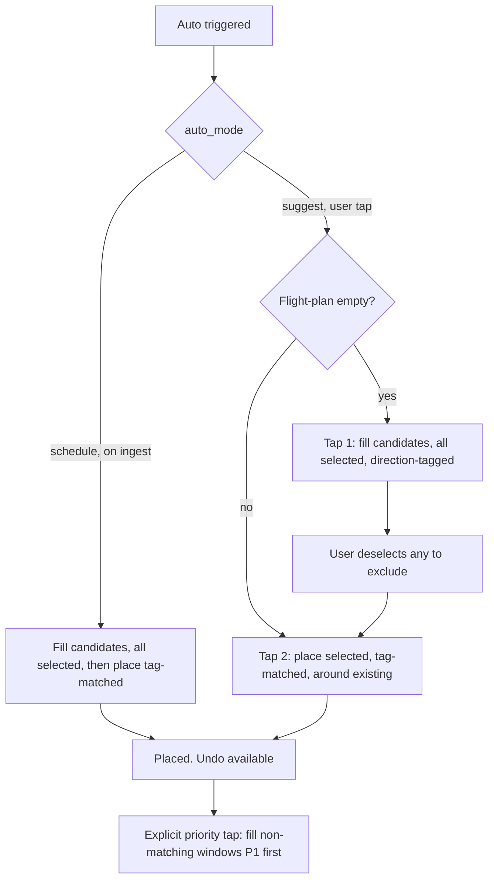

# Auto-scheduling, agent-ready prompt

> A self-contained build prompt for one coding agent. Decisions are resolved, so
> the agent should not need to ask. Read the findings and decisions first, then
> the numbered requirements. Add a test with every change.

## How to use

Give the agent everything from "Global constraints" through "Build order". Work in
the build order at the bottom. One migration covers all schema changes.

---

## Global constraints

- Stack: Koa + TypeScript server (`server/`), SolidJS + Tailwind client
  (`client/`), SQLite via Drizzle and raw better-sqlite3, croner for jobs.
- The deterministic core stays deterministic. AI assists ordering and tagging
  only, and every AI path needs a deterministic fallback for when Ollama is down.
- Schema changes go through one new forward-only migration, 0048 (current head).
- Do not regress the no-overlap guarantee or the existing Vitest suites.
- Respect owner scoping (`currentOwnerId()`) and broadcast SSE events for any
  state the client mirrors.

---

## Findings (read before coding)

1. Overlap avoidance already works. `dayObstacles()` in
   `server/src/engine/scheduler.ts` collects every existing entity in the target
   window (locked blocks, meetings, active task blocks, and Plan containers when
   `includePlans` is set). `buildGaps()` and `pickGap()` place only into the gaps
   between them, and `clearPriorAuto()` removes only Auto's own prior placements,
   so manual blocks and meetings survive. Auto does not create overlap. Manual
   overlap is a separate, user-driven path and is out of scope. Action: lock this
   with a regression test (requirement 6), no behavior change.

2. The tag pipeline is broken at promote, and this is the linchpin. Ingested items
   get suggested tags on `possible_tasks` (via `possible_task_tags`), but the
   promote handler in `server/src/routes/possibles.ts` does not copy them onto the
   new task's `entity_tags`. The Auto engine matches by task tag name
   (`taskTagNames`), so the tags vanish exactly when an item becomes schedulable.
   Until this is fixed, tag-driven placement (requirements 3, 4, 5, 9) does nothing
   for ingested work. Build this first.

---

## Decisions (resolved, do not re-litigate)

- D1, modes and triggers. The schedule/suggest choice is a user setting. In
  schedule mode, Auto runs automatically after each ingest and places tag-matched
  work in the background (the zero-click path). The priority top-up (D5) is never
  silent: it always requires an explicit tap, in both modes.
- D2, undo scope. Undo reverts only the last placement run. No multi-step undo
  stack.
- D3, source-to-tag mapping. Inferred by the system for now, not user-configured.
- D4, tag vocabulary for auto-tagging. Auto-tagging resolves every item to exactly
  one direction tag: HOME, WORK, or COMMUNITY. These are the pattern (direction)
  tags the Auto engine matches pattern windows against, which keeps placement
  clean. Content tags from the LLM may still be stored as secondary intention
  tags, but the placement-relevant tag is always one of the three.
- D5, priority fallback is a distinct third step. Tag matches are placed across all
  windows first. Leftover window capacity is not auto-filled by priority. A
  separate, explicit tap then fills non-matching windows by priority, P1 first.

---

## Requirements

### 1. Trust toggle: schedule or suggest

Two-state toggle replacing the old three-state dial.

- Data: add `auto_mode` to `scheduling_prefs`, text, default `'suggest'`, value
  `'suggest'` or `'schedule'`. Reuse `GET/PATCH /api/prefs`, no new route.
- Behavior: suggest stages into the flight-plan and stops (see 7, 8). Schedule
  fills pattern windows by tag automatically on ingest (see 3, D1).
- UI: a segmented toggle in the Today cockpit beside the Auto button
  (`client/src/components/FlightPlan.tsx`), mirrored in Settings
  (`client/src/views/Settings.tsx`). Labels "Schedule" and "Suggest", one line of
  helper text each.

### 2. Undo button, no confirmation (D2)

One click reverts the last placement run, no dialog.

- `clearPriorAuto()` deletes Auto's whole-day placements, which is too broad. Undo
  must target the last run only, so two placements in a row undo one at a time.
- Approach: stamp each run with a `run_id` written to the `time_blocks` it creates
  (new nullable `auto_run_id`, migration 0048), and track the latest run id per
  owner. Undo deletes that run's blocks and re-stages those tasks onto the
  flight-plan.
- API: `POST /api/auto/undo`. UI: an Undo button shown after a placement, fires on
  click with a toast.
- Tests: place then undo restores prior state exactly; undo twice is a no-op;
  undo never touches manual or meeting blocks.

### 3. Schedule mode fills pattern windows by best-fit tag

Mostly exists, needs wiring plus a check.

- `placeFlightPlan()` already does Plans-first tag-matched placement (pass 1) and
  direction-window placement (pass 2a) via `orderForPlan()` (ranks by priority,
  then diluted tag-match weight, then tag-overlap, then due date).
- Change: make Auto mode-aware. Schedule mode fills candidates and places
  tag-matched work in one pass, triggered on ingest (D1). Suggest mode keeps the
  stepped flow (7, 8, 9).
- Check: confirm pass 2a routes work to the right window by its direction tag and
  applies `orderForPlan()` inside the window, so the best-fit task wins rather
  than the first by position.

### 4. Every ingested item gets one direction tag, by source and content (D4)

- Resolve each item to exactly one of HOME, WORK, COMMUNITY. Inference (D3) uses
  source first (for example a work account maps to WORK, a personal account to
  HOME) and content as a tiebreaker.
- Content tags: the LLM extractor (`server/src/agents/extract.ts`) emits free-form
  tags today. Map them down to a direction for placement; optionally keep the
  originals as secondary intention tags.
- Always-on: even with Ollama down, every item gets its source-inferred direction
  tag. Nothing arrives untagged. Tagging lives where `upsertPossible()` attaches
  tags in `server/src/agents/ingest.ts`.
- Linchpin fix (finding 2): in `server/src/routes/possibles.ts`, copy
  `possible_task_tags` onto the promoted task's `entity_tags` so the direction tag
  survives into the task the Auto engine reads.

### 5. Priority fallback is a separate, explicit step (D5)

- Today a window with no tag match is skipped (`continue`) and leftovers land in
  the automatic workday fallback. Change: do not auto-fill leftover capacity by
  priority.
- Step order: place tag matches across all windows first. Only on an explicit
  priority tap does Auto fill non-matching windows with the highest-priority
  unplaced tasks, P1 first (`orderForPlan()` with no weights already sorts
  priority-first). The existing `auto_fill_workday` pass becomes this gated
  priority step rather than running automatically.

### 6. No overlap (finding 1)

Verified. Add a regression test asserting a placement run never overlaps a
pre-existing locked block, meeting, or active task block, and that a re-run is
idempotent. No behavior change.

### 7. Suggest mode, first tap loads the flight-plan

This is step 1, `fillFlightPlanCandidates`. Changes: it must run regardless of
selection state (see 8) and must tag its candidates (4) and mark them selected.

### 8. Flight-plan items default to selected, deselect to exclude

Invert today's pick-to-include model.

- `fillFlightPlanCandidates()` inserts `selected = 0` today; change to
  `selected = 1`. Manual staging already inserts `selected = 1`, so the paths
  align.
- Decouple the step decision from selection count. Today `runAuto()` reads "zero
  selected" as fill and "some selected" as place, which breaks when everything is
  selected. New rule: empty flight-plan means fill, non-empty means place.
  Selection now only controls which staged items are included.
- UI (`FlightPlan.tsx`): checkboxes render checked; `selectedCount()` and the
  select-all affordance flip to deselect-all; copy reads "deselect to exclude".

### 9. The placement taps, composed

Suggest mode is a three-tap progression, schedule mode collapses the first two:

- Tap 1 (empty flight-plan): fill candidates, all selected, all direction-tagged.
- Tap 2 (non-empty): place selected items tag-matched into Plans and pattern
  windows, around existing entities. Leftover capacity is left open.
- Tap 3 (explicit priority tap): fill non-matching windows by priority, P1 first.
- Schedule mode: tap 1 and tap 2 run automatically on ingest (D1). Tap 3 stays
  explicit in both modes.

---

## Auto behavior model

---

## Migration 0048

1. `scheduling_prefs.auto_mode`, text, default `'suggest'`.
2. `time_blocks.auto_run_id`, text, nullable, stamped on Auto-created blocks.
3. Last-run tracking per owner (a column on `owners` or a small table) for undo.
4. No `flight_plan` schema change; only the fill path's default flips 0 to 1.

---

## Files to change

- `server/src/db/migrations/0048_*.ts`: schema above.
- `server/src/engine/autoplan.ts`: mode-aware `runAuto`, empty-vs-nonempty step
  rule, `selected = 1` on fill, gated priority step, run-id stamping,
  `undoLastAuto()`.
- `server/src/routes/flight-plan.ts`: pass `auto_mode` through, add the explicit
  priority tap path, add `POST /api/auto/undo`.
- `server/src/routes/possibles.ts`: copy `possible_task_tags` to `entity_tags` on
  promote (linchpin).
- `server/src/agents/ingest.ts`: source-inferred direction tag, always-on.
- `server/src/agents/extract.ts`: map content tags down to a direction; keep
  originals as secondary if useful.
- `client/src/components/FlightPlan.tsx`: toggle, Undo button, default-checked
  selection, deselect-all, the explicit priority tap affordance.
- `client/src/lib/api.ts`: `api.auto.undo`, the `auto_mode` pref field.
- `client/src/views/Settings.tsx`: mirror the toggle.

---

## Test plan

- Mode toggle: schedule places tag-matched on ingest; suggest needs explicit taps.
- Inverted selection: filled candidates arrive selected; deselecting one excludes
  it; deselecting all then tapping does not silently re-fill.
- Direction tagging: every ingested item resolves to one of HOME, WORK, COMMUNITY,
  including with Ollama down (source-inferred).
- Tag carry-over: a promoted possible-task keeps its direction tag and lands in a
  matching pattern window.
- Priority step: tag matches place first; leftover capacity stays open until the
  explicit priority tap, which then fills P1 first.
- Overlap: a run never overlaps a locked block, meeting, or active task block;
  re-run is idempotent.
- Undo: place then undo restores prior state and re-stages tasks; undo is a no-op
  when nothing to undo; never touches manual or meeting blocks.

---

## Build order

1. Linchpin: carry tags through promote (req 4 tail). Small, unblocks the rest.
2. Direction tagging on ingest, always-on (req 4 head, D4). Medium.
3. Inverted selection plus the empty-vs-nonempty step rule (req 7, 8). Small.
4. Schedule/suggest toggle and mode-aware Auto (req 1, 3, D1). Medium.
5. Gated priority step as a separate tap (req 5, 9, D5). Small to medium.
6. Undo with run-id stamping (req 2, D2). Medium.
7. Overlap regression test (req 6). Small.
