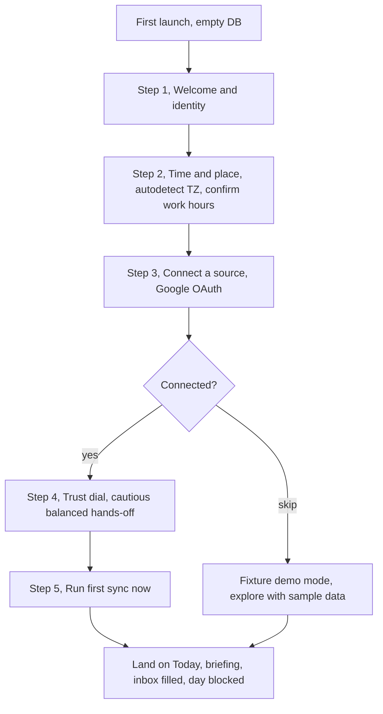

# FTUE plan, from API in to auto-scheduled, fewest clicks

> Status: design, authored 2026-06-22. Goal framing from Liam: pull info in from
> an API and auto-schedule it, with the fewest possible clicks. This doc covers
> (1) where the current build falls short of that goal, (2) what must be set for
> the planner to work end to end, and (3) a concrete first-time user experience
> that gets a new user from zero to a planned day with as little input as
> possible.

---

## 1. The honest current state

The pipeline is real and tested, but it runs on a closed loop. Ingest, extract,
review, groom, and schedule all work, yet the data source is stubbed and the path
from a raw item to a calendar block is fully manual.

What works today:

- Croner jobs run on schedule (ingest_gmail, ingest_gcal, promote_possibles,
  nightly_grooming, auto_schedule, generate_recurrences, review_day,
  fire_reminders, snapshot_db).
- Extraction via Ollama with a deterministic fallback.
- Inbox review queue, flight-plan staging, the two-step Auto, reminders, SSE,
  PWA, backups.
- A default owner and scheduling prefs are seeded on first boot by migration
  0003 (hardcoded to "Liam" / liam.broza@gmail.com, timezone from the server).

What does not work yet, and blocks the stated goal:

- `createLiveGoogleClient()` in `server/src/mcp/google.ts` is a placeholder. Even
  with `GOOGLE_MODE=live` it logs a warning and falls back to fixture JSON. So no
  real data enters the system from any API.
- There is no way inside the app to connect an account. `/api/integrations` only
  reports status (fixture vs live), there is no connect action, no OAuth flow, no
  token store.
- There is no FTUE. The identity is baked into a migration, not chosen. The
  `ftue.gif` in the README is a marketing clip of manual task creation, not an
  in-app flow.

---

## 2. Gaps, ranked against the goal

| # | Gap | Why it blocks "API in, auto-scheduled, fewest clicks" | Where |
|---|---|---|---|
| 1 | Live Google client is a stub | No external data arrives at all. This is the single biggest unlock. | `server/src/mcp/google.ts` |
| 2 | No connect / OAuth UI or token store | A user cannot link an account, so ingestion has nothing live to read. | new route + Settings view |
| 3 | No FTUE or empty-state guidance | A new user lands on empty views with no path to "connect, then plan". | `client/src/App.tsx`, views |
| 4 | Auto-schedule is manual and multi-click | Phase G retired auto-pack. Today the path is ingest, then promote (click), then stage to flight-plan (click), then run Auto (click). At least three gated clicks per item. | `jobs/index.ts` (auto_schedule), `engine/autoplan.ts`, Inbox |
| 5 | No auto-promote / trust dial | Every item must be promoted by hand. There is no confidence threshold to let high-confidence items skip the queue. | `promote_possibles`, prefs |
| 6 | No "auto-block accepted tasks" policy | Even a promoted task with an estimate does not get a calendar block on its own. This is open question 5 in the ingestion plan. | `engine/autoplan.ts`, prefs |
| 7 | Timezone defaults to UTC in Docker | If unset, "today" and cron windows are wrong, which silently breaks scheduling. | `lib/config.ts`, prefs |
| 8 | No multi-account support | Ingestion plan lists five Google identities. The live client is single-identity and unbuilt. | ingest jobs, google client |

Items 1 to 3 are prerequisites: nothing is auto-scheduled until data flows and a
user can connect. Items 4 to 6 are the actual "fewest clicks" levers. Items 7 and
8 are correctness and scale.

---

## 3. What must be set for the planner to work end to end

These are the settings the FTUE should capture or auto-detect. Most can be
prefilled so the happy path is near zero input.

1. Identity. Owner name and primary email. Currently hardcoded in migration 0003,
   should be chosen or confirmed once.
2. Timezone. Critical. Auto-detect from the browser (`Intl.DateTimeFormat().resolvedOptions().timeZone`)
   and write to `scheduling_prefs.timezone`. Without this, "today" can be wrong.
3. Work hours. `workday_start` / `workday_end` (default 09:00 to 18:00). One
   confirm step, prefilled.
4. At least one connected data source. The Google OAuth connection. This is the
   missing build, and the one true click that matters.
5. Source scope. Which accounts and which sources (mail, calendar, files) are
   actionable, so the queue is signal not noise.
6. Trust dial. How aggressive promotion should be: review everything, or
   auto-promote high-confidence items above a threshold.
7. Auto-schedule policy. Whether accepted tasks that carry an estimate get a
   calendar block automatically, or stay manual (ingestion-plan open question 5).
8. Optional, can defer to later: notification permission and VAPID keys for Web
   Push, Ollama availability for AI briefings vs the deterministic fallback.

---

## 4. The tension to resolve first

The product has a standing rule: nothing becomes a task without an explicit
promote. That human-in-the-loop step is a feature, and it is also the main source
of clicks. "Fewest clicks" and "review everything" pull in opposite directions.

The resolution is a trust dial, not removing the gate. The user picks once how
much they trust the pipeline, and that choice sets the steady-state click count:

- Cautious: everything lands in the Inbox, user promotes by hand. Most clicks.
- Balanced (recommended default): items at or above a confidence threshold
  auto-promote to tasks, the ambiguous middle waits in the Inbox. The user only
  touches the uncertain items.
- Hands-off: high-confidence items auto-promote and, if they carry an estimate,
  auto-get a calendar block via the Auto engine. Morning is effectively zero
  click; the user reviews only flags and conflicts.

This single choice is what turns the morning from a chore into a glance, and it is
the cleanest way to honor "the less clicks the better" without throwing away the
review safety net.

---

## 5. The FTUE flow

Design target: a new user reaches a planned, populated day in under two minutes,
with one real decision (connect a source) and one preference (the trust dial).
Everything else is auto-detected and prefilled, with a Skip on every step.

Step by step:

Step 1, Welcome and identity. One screen. Prefill name and email if known,
otherwise a single field. Writes the owner row instead of relying on the
hardcoded migration value. Skippable to a default single owner.

Step 2, Time and place. Auto-detect timezone from the browser and show it for
confirmation. Show work hours prefilled at 09:00 to 18:00 with a quick edit.
Zero clicks if the user accepts. This closes gap 7 before it can bite.

Step 3, Connect a source. The heart of the FTUE and the one click that matters.
A single "Connect Google" button starts the OAuth flow, scoped read-only (Gmail
read, Calendar read, Drive readonly). On return, store the token securely and flip
that account to live. If the user is not ready, a "Try with sample data" path
drops them into fixture mode so the app is never empty.

Step 4, Trust dial. Three options as described in section 4, Balanced
preselected. This sets the auto-promote threshold and the auto-block policy in one
choice, so the steady-state click count is decided here, not rediscovered daily.

Step 5, Run first sync now. A button that triggers the ingest jobs immediately
rather than waiting for the 06:30 cron, so the user sees the payoff in the same
session: the Inbox fills, calendar events mirror as meeting blocks, Auto places
the day, and the Today briefing renders. This is the moment that proves the value.

Empty-state fallback. If the user skips connection, every view shows a one-line
prompt ("Connect a source to fill this automatically") with a button back to Step
3, plus the sample-data option, so the app is useful and explorable from minute
one.

---

## 6. Steady state, what "fewest clicks" looks like after setup

Once connected with the Balanced or Hands-off dial, the daily loop runs without
the user:

1. 06:30 cron pulls mail, calendar, and files from connected accounts.
2. Extraction proposes items; high-confidence ones auto-promote, the rest wait in
   the Inbox.
3. Promoted tasks with estimates auto-get a calendar block via the Auto engine;
   calendar events are mirrored as locked meetings the planner respects.
4. Grooming dedupes across sources so one real action shows up once.
5. The Today briefing summarizes due, overdue, new, and where to focus.

The user opens the app to a planned day, glances at the briefing, and only touches
the handful of ambiguous items in the Inbox. That is the fewest-clicks end state,
and it depends on building gaps 1, 2, 4, 5, and 6.

---

## 7. Suggested build sequence

Each step is useful on its own, ordered so value lands early.

1. Live Google client for the two already-authed accounts (calendar plus Gmail),
   read-only, behind `GOOGLE_MODE=live`. Closes gap 1, the biggest unlock.
2. Connect UI plus token store, the OAuth flow and a Settings panel showing
   connection status with a connect and disconnect action. Closes gap 2.
3. FTUE wizard, steps 1, 2, 3, 5 wired to the above. Closes gap 3 and gives a
   real first-run path. Auto-detect timezone here closes gap 7.
4. Trust dial plus auto-promote threshold in prefs, with the confidence gate in
   `promote_possibles`. Closes gap 5.
5. Auto-block policy, accepted tasks with estimates flow into the Auto engine
   automatically when the dial is Hands-off. Closes gap 6 and answers ingestion
   open question 5.
6. Multi-account loop and per-account provenance. Closes gap 8, scales to the five
   accounts in the ingestion plan.

Steps 1 to 3 deliver "API in" with a real first run. Steps 4 to 6 deliver
"auto-scheduled, fewest clicks".

---

## 8. Open decisions for Liam

1. Connect all five Google identities, or start with the two work accounts.
2. Default trust dial out of the box: Balanced (recommended), or Cautious.
3. Auto-block accepted tasks with estimates, or always keep placement manual.
4. Should the FTUE offer fixture demo mode, or require a real connection before
   entering the app.
5. Delivery of the morning briefing: in-app only, or also pushed to a device.
